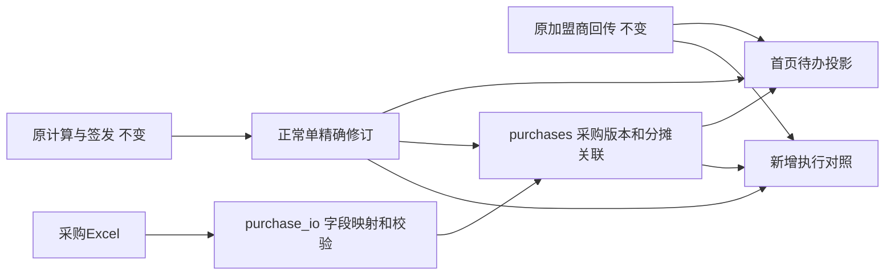

# 0.14.0 首页待办与实际下单关联

本版在0.13.0（cae49389c1b6666c183a060ff3192f40a08cb303）上新增首页跟进和独立采购资料。不升级安全依赖、不接收货，不改预测、预算、仓路由、签发或现有导出。模型仍0.3.3-rules，仓归属仍0.5.0。

## 专人日常使用

1. 首页默认最近7个业务日；点“全部未完成（不限日期）”可找到更早的遗漏。按门店、仓、单号及状态筛选。列表按每店每仓分开，50单一页；日期不等于下单日期。
2. 每行“查看签发”沿用原签发依据；“查看执行对照”并列展示签发建议、加盟商确认、已关联实际下单、收货未接入。缺回传/采购资料显示未提供或未关联，不能理解成0。
3. 点“导入实际下单资料”，可拖入多个.xlsx，或下载空白最低标准模板。每个文件明确选择工作表和字段列；固定来源/仓/单位可在映射中填写。映射方案可命名保存，表头和列序不同会拒绝自动套用。第一行须是表头；不同采购系统的状态应明确映射为“有效/已取消”。
4. 检查预览中的编码、数量、单位、来源文件/页/行。模板明确填“库存单位”的数量直接按库存单位保存；其它单位须有明确换算系数和依据，否则暂存待核，不能关联。这里不使用模型箱规猜测采购单位。
5. 文件同时给出精确的仓子单号、签发修订、门店、仓和商品编码，才自动建议关联。缺少信息时选中商品，使用“分摊选中一行”或“关联所选行至同一签发单”。后者仅支持同店同仓且都在签发表中的商品；额外采购必须逐行确认。关联量不能超过实际下单量。
6. 一个采购行可以分摊给多张同店同仓签发单；一张签发单也可以有多个采购单。界面显示确切V修订；旧修订不会自动转到新修订。未分配余量继续待核。
7. 保存前查看完整差异。每个外部采购单的新文件必须是**完整本版总量**，不能是增量；确认后替换当前采购版本，历史版本保留。预览默认取消，提交期间不可关闭或取消；准备可取消，失败整体回滚。
8. “采购资料与版本”可查看历史明细、下载原Excel字节、修改当前版本的关联。原件不会被重新生成。没有采购明细号的更新必须逐行确认旧行身份或明确新增，不能按行号/相似度猜测。
9. 首页勾选可跨页保留，改变查询条件会清空。独立“执行对照”导出支持每店每仓每修订一个文件，或合并成多订单表；只认勾选，不认高亮。此新增导出不替代原来的计算表、商品资料原表、签发表或加盟商确认单。
10. 暂缓、恢复、已核实差异是三个固定按钮，只作用于高亮一单，必须填写原因。暂缓可设恢复日期；核实意见绑定当时回传和采购数量，资料变化后再次提示。核实不抹掉缺回传或未关联的待办。

## 数量与版本边界

| 对象 | 身份和口径 | 是否可被本功能覆盖 |
|---|---|---|
| 原签发 | 原门店正常单 + 签发修订 + 仓子单 | 否 |
| 加盟商确认 | 原回传版本，数量按库存单位 | 否 |
| 实际下单 | 来源系统 + 外部采购单号 + 门店编码 + 仓；完整本版数量 | 仅显式确认后增加采购版本 |
| 采购明细 | 外部明细号；无明细号则源文件哈希/页/行的本地身份 | 更新需人工确认身份 |
| 关联 | 采购版本/明细 → 精确签发修订/仓/商品/分摊量 | 显式确认后增加采购版本 |
| 收货 | 未接入 | 不填0，不推断 |

同商品多行保留；同采购明细号内容相同去重、来源保留，内容冲突拒绝整批提交。重复同一原件保留已经人工核对的换算和关联，不累加数量。不同原件即使数量相同也可形成可追溯的新版本。实际金额、实际单价、币种原样独立留存，不用模型V价补造实际采购金额。本版执行对照不生成混合币种或缺价的总金额结论。

“已关联”仅表示签发应处理商品在所关联资料中出现，不证明采购系统资料完整；额外采购和差异仍须核实。取消的采购版本撤掉其当前有效关联，旧版本可追溯；不将缺行或取消推成自动补货。负数退货暂不支持，需提供明确非负的完整当前数量/取消状态。

无仓字段的旧回传若挂在旧修订，提示旧修订待核，不猜具体归属。回收站里的仓单不能新建关联或新增执行对照导出，原有快照仍保留。

## 数据安全与兼容

新增表仅为 `purchase_documents`、`purchase_versions`、`purchase_files`、`purchase_events`、`purchase_mappings`、`purchase_link_index`、`followup_notes`。采购payload为schema1；原JSON、每日作业、正常单、回传、商品原件和分块存储格式不迁移。所有采购事实在现有SQLite文件中的独立表保存；不是覆盖原签发字段。旧0.13.0忽略新表，因此看不到采购信息，但原工作/签发数据仍可读。

首次新增写入前沿用安全备份。取消可留下备份文件或存储元信息，不能据此声称数据库文件字节完全未变。读取首页只写可丢弃的 `followup_index.sqlite3` 投影缓存，不写业务数据库。多单提交在一个事务内；预览后采购版本、签发当前修订、回传版本或回收站状态改变，提交拒绝并要求重核。最终提交边界内不强杀进程。

查询走独立后台spawn读进程，界面可继续操作；导入/核对走后台任务和阶段进度。关闭窗口停止所属查询进程。当前采购目录/可关联修订按所涉店仓读取，历史很大时首次查询/读取版本仍有成本，不宣称无上限常数耗时。执行对照批量导出冻结同一数据库读事务的外部事实，取消时保留并列明已完成文件。

## 代码索引



| 文件 | 查找内容 |
|---|---|
| src/followup.py | 默认范围之外仍可查的待办投影、暂缓/核实及资料变更失效 |
| src/followup_ui.py | 首页分页、明确勾选范围、每单入口 |
| src/purchase_io.py | 原件哈希、字段位置映射、空值/编码/单位、模板 |
| src/purchases.py | 独立版本、事务、精确关联、来源原件、执行对照 |
| src/purchase_ui.py | 拖拽/映射/预览/人工分摊/历史版本业务表单 |
| tests/test_purchases.py | 无真实业务文件和Qt依赖的新增规则测试 |
| tools/verify_followup_exe.py / src/followup_smoke.py | 实际源码/EXE两次启动及新界面流程 |

## 验证与限制

全部验收使用隔离QA库，不读取日常用户配置来计算。可复跑：

```powershell
.\dev.ps1 Test
.\dev.ps1 Test -Optimized
.\.venv\Scripts\python.exe tools/verify_followup_exe.py --output qa/followup_014/新源码验收目录
.\.venv\Scripts\python.exe tools/verify_followup_exe.py --exe '交付_0.14.0_rc2/补货助手/补货助手.exe' --output qa/followup_014/新EXE验收目录
```

38项真实/合成计算及12组原有导出使用固定0.13.0源码独立重跑；最终数值及证据以 `releases/0.14.0/rc2` 的报告为准。测试原始目录不覆盖，复跑换新目录。

用户尚未提供真实实际采购单样本，本版已验标准模板、可保存映射和合成异常场景；不能据此声称所有ERP格式均已验收。只读表格首行表头、明确状态、明确单位；不按名称相似度或群消息时间自动关联。本轮暂缓安全依赖升级、收货关联和效果分析。
