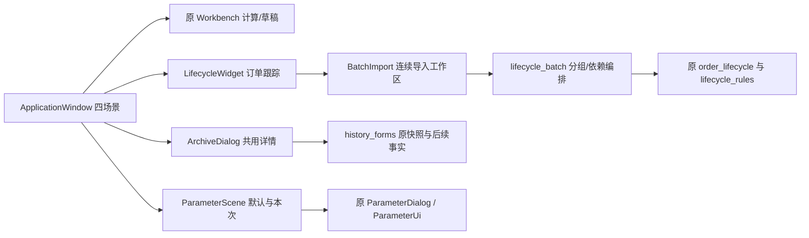

# 0.17.0 四个业务入口与混合批量导入

基线为 0.16.1 / 3e167f5c86f64d1d8a98adffda8287b35ab76361。模型规则仍为 0.3.3-rules；数据格式、原签发和原有导出格式不变。实际验收与构建提交见 releases/0.17.0/rc3。

## 日常怎么用

**补货出单**：已有仓资料时，拖入补货文件后自动检查，完成后进入门店核对。沿用已保存的主从仓、预算和参数及原门店勾选规则。点击开始计算，完成后确认签发并导出；范围表显示店仓和默认目录，最终确认显示整店签发保存范围与文件范围。同日变化继续核对；失败/取消不猜测未完成状态，已签发部分按原签发从订单详情导出。新品仍需明确选择。

**订单跟踪**：列表显示最早缺少的环节，无手工暂缓/恢复状态。可以直接拖入多份回传、付款、实际收货文件，也可用三个独立导入按钮限定环节。勾选订单时导入严格限制在勾选范围。使用补货单号自动关联，不填写修订、上环节数量或重复填写店仓。

批量工作区展示每份完整来源单、环节、行数、工作表和目标补货单。付款原表没有补货单号时，在同一工作区给每个完整来源订单选一次目标；不根据相近门店名/日期猜测。未识别字段才打开映射，未知或失败文件必须处理或明确排除，不能静默跳过。每单同环节有多份文件只选择一份，不相加。完全相同文件哈希只读取一次。

预览按订单首次出现顺序，订单内按回传→付款→收货核对。顶部订单×环节概览标明本批拟新增、拟更新、内容相同或未提供，点击单号或环节定位下方明细；每行都有环节列，详细读取统计可展开。付款使用本批回传、收货使用本批付款；本批未提供的读已保存有效上游。缺上游仅留存待核，不能编造缺行0。0、空白、缺行按已确认规则统一有效数量0并保留来源区别；缺整单不当0。预览列全体数量差异、范围外商品、未纳入项与待核项，确认后整批事务保存；签发/上游被其他窗口修改则整批拒绝。准备和写锁等待可取消，最终提交不强杀；可取消产生既有备份/存储元数据，但不提交生命周期业务事实。

**决策复查**：搜索单号、门店或商品；打开决策依据，先看当时签发、销量库存、实际周期/预测、已有数量中间值和后续事实。签发明细、订单跟踪、决策依据在同一详情切换。可筛签发大于0、签发为0和候选大于执行；筛选不改变整单保存/导出范围。原表下载、完整计算表、签发明细（内部）仍为独立入口。历史缺失字段如实显示，不用当前资料补历史。

**参数设置**：可在没有载入当天数据时编辑已保存的门店默认和方案。保存为门店默认只供下次作业；编辑本次作业参数必须选择已载入门店并明确应用。应用后原有相关门店失效规则保留。默认主从仓/预算独立勾选修改；保存使用比较并提交检查，防止覆盖另一窗口的新默认。各仓周期、分类重绑及原配置优先顺序不变。完整参数帮助与试算复用原组件。

Ctrl+1 首页，Ctrl+2 补货出单，Ctrl+3 订单跟踪，Ctrl+4 决策复查，Ctrl+5 参数设置；F1 使用指南。跨场景切换保留作业和已加载查询上下文。导出设置仍在主导航右侧。

## 实现和查找



新增批量层不复制数量口径。order_lifecycle.upstream / make_plan / prepare 增加可选的本批上游视图，默认旧调用不变；commit 校验已预览的本批依赖后统一提交。存储 schema 不变。work_repository.save_stores 只增加可选的期望旧值校验。history_forms 增加新的决策总览，原核对表单与导出未重排。

## 可复跑验证

在项目根目录，以 .venv/Scripts/python.exe 执行：

```powershell
.\.venv\Scripts\python.exe -m unittest discover -s tests
.\.venv\Scripts\python.exe -O -m unittest discover -s tests
.\.venv\Scripts\python.exe tools\verify_interaction_exports.py --baseline qa/business_flows_0170/baseline --output qa/business_flows_0170/exports-recheck
.\.venv\Scripts\python.exe tools\verify_business_flows.py --baseline qa/business_flows_0170/baseline --output qa/business_flows_0170/lifecycle-recheck
.\.venv\Scripts\python.exe tools\verify_flow_parallel.py --qa qa/business_flows_0170 --baseline qa/business_flows_0170/baseline --output qa/business_flows_0170/parallel-recheck
.\.venv\Scripts\python.exe tools\verify_scenes_exe.py --exe 交付_0.17.0_rc3/补货助手/补货助手.exe --output qa/business_flows_0170/exe-recheck
```

输出目录必须不存在。验收全部使用独立 SQLite、原件副本与设置目录；正常业务库不参与测试。性能脚本旧/新交替串行各3次，20毫秒采样进程树 RSS；小合成样本、系统文件缓存未清空，不外推真实大批量提速。

完整模型对照使用本次冻结源与输入分别运行 `tools/structure_oracle.py capture --qa qa/business_flows_0170 --source <源目录> --out <独立目录>`，两端设置相同 `PYTHONHASHSEED=0`。`tools/verify_flow_models.py --qa qa/business_flows_0170 --old <旧目录名> --new <新目录名>` 严格比较30项。原始并行完成顺序可能不同，该脚本仍报告差异并非绿；另用上面的 parallel 验证在两个真实进程中分别控制正/逆结果交付顺序，比较全部数据和导出。报告须同时保留原始差异及补充证据，不能只引用通过项。

## 边界和遗留

原工作流的签发范围选择与差异确认仍有两个明确步骤；常规有配置路径实测操作数在交付报告中列出，不能声称已压到3次。默认导出目录已提前展示，最终确认后不再要求目录选择。

没有真实付款ERP工作簿，付款适配用截图同表头合成样本验收。任意表头、任意标题行不保证自动识别；可明确映射，公式无缓存和非法数仍阻止保存。完全相同文件去重；同内容但不同哈希文件不会相加，需明确选择一份。

未限定订单的批量导入目前仍读取可关联订单集合；长期大量历史资料下的目标选择耗时未做大规模基准。本次不顺带迁移历史索引。

没有引入历史算法多版本重放器；试算仍使用现版本、固定数据，不能当成旧算法复现。未留存原附件/归因的旧订单保持缺失。未增加云同步、部分单、责任判定或收付款执行。

用户真实操作观察尚未完成；自动化程序验收不能替代使用体感。保留0.16.1及更早交付，本轮不合并、不推送。
