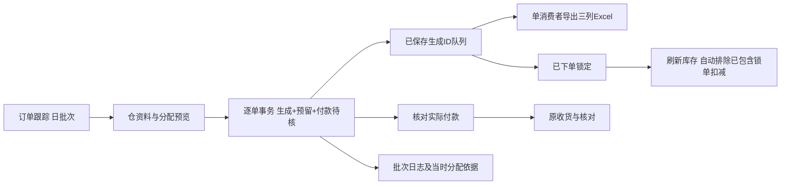

# 0.21.0 日批次、聚水潭订单与付款待核

## 从哪里开始

原“补货出单”保持不变。签发后进入“订单跟踪”，默认看今天，一天作为一个业务批次；每店每仓的订单独立推进，不等全批结束。需要处理昨天的单，修改日期，或点“全部未完成（不限日期）”。

主链路：**待回传 → 待生成聚水潭订单 → 待核对付款单 → 待收货 → 已结束**。无要货仍按原规则无需后续。锁单是执行保护，不代表已付款。

1. 导入门店回传单，沿用原签发单修改数量的方式，支持拖拽和批量导入。
2. 勾选店仓订单，点“流程处理 → 生成勾选订单”。也可点击每行“下一步”。
3. 选河北仓或山东仓，更新本次商品资料；可拖入 Excel，也可采用默认资料。更新仅影响本次执行分配，不回写签发计算依据；“保存为该仓默认资料”是另一个明确动作。
4. 预览每单每商品的回传量、生成量、单价、金额、箱规及分配前后余额。默认回传确认较早的优先；需要人工顺序时拖动列表并勾选“使用上方人工顺序”。
5. 确认生成。每单保存后即可导出，后面的继续生成。下方完成列表可多选，提前导出或确认已在聚水潭下单并锁定。导出是一条串行通道，没有多份 Excel 同时写出。
6. 生成单自动保留一份“待核对付款草稿”。核对其与实际已付款订单一致后，才确认保存为付款单；不一致请导入真实付款单。系统不会自动宣称付款完成。
7. 继续使用原实际收货单导入与差异核对。

四组按钮：“流程处理”推进订单；“业务文件”导出；“依据复查”看当时分配及批次日志；“维护”处理错误生成、锁单更正。批次日志可按日期、门店/单号/仓/动作查询，列表分页，点击看业务表单，支持导出查询结果。

## 库存和箱规口径

- 以**本次采用的同仓资料的基本售价**计价，全部数量为库存单位。
- 精确商品编码匹配，只用订单所属仓。不临时换仓、不拆单、不借用另一仓库存、不重新调用模型。
- 对有效需求，`分配量 = floor(min(回传量, 分配前可用余额) / 出库步长) × 出库步长`。
- 箱规24、可用23：0；可用30、回传48：24；剩余6仍保留。箱规1按整数单位。缺箱规沿用默认1；明确非法箱规、未知/负库存、缺价、禁用、无商品条目均待核。
- 回传量本身不是箱规倍数时，提示待核，不自动改量。待核商品生成0须明确勾选确认；不把未知库存解释为0库存。
- 没有正分配的订单仅留未生成原因和运行记录，不制造空的付款草稿。剩余缺口不自动建立第二张欠单。

同仓顺序分配、两仓独立。预览不占用，确认后每单的生成明细、库存预留、付款草稿引用和成功事件在同一事务保存。重新分配须选齐该仓全部未锁生成单，一次整体提交，避免后续订单仍沿用被更改的余额。

## 锁单与刷新仓资料

锁单用于“已在聚水潭下单”。锁定时不再扣一次库存，也不加回库存；之后普通批量生成跳过它。

**新导入可用库存已经扣掉此前锁单，所以刷新后不会重复扣这些单。** 尚未锁定的本地预留仍扣除。例：可用100，A生成40后锁定，未更新时余额60；更新资料可用60，仍是60；另有未锁B预留10，则可分50；随后锁B仍为50，下次更新可用50仍为50。

导入读取期间有新锁、分配或其他库存更新，会拒绝旧准备结果并要求刷新；不弹“哪些已包含”逐单确认。系统无法自动判断外部库存是否真的扣减，业务必须在实际下单后锁定，并导入对应的新库存。

更正已锁订单需先核实外部撤销，写明原因；本地解除保护不会撤销远端订单或把已反映在新资料中的数量加回来。已有实际付款/收货的单拒绝此类更正。未下单的错误生成单可明确撤销，历史保留，释放尚未反映到库存基准的预留。

已有有效生成记录时，阻止直接覆盖同日签发；已锁单阻止直接改回传，避免绕过占用。未锁回传更正后提示生成依据过期，须重新分配。旧单无新生成记录时，原读写行为保持。

## 文件与保存边界

聚水潭文件每店每仓一份，仅“商品编码、单价、数量”三列，正数量才输出，编码按文本保存。文件名包含业务日、门店、仓、补货单号和队列位置；同名先完成临时文件再安全替换。重复导出读取原生成记录，不重新计算或重复占用。

所有新记录放在现有独立资料目录的 workbench.sqlite3 新增 `jst_*` 表，不改变每日作业格式。沿用安全备份；当时仓资料原件按内容哈希只留一份，旧资料缺原件会明确提示，不拿当前资料冒充。

取消发生在可安全阶段会回滚当前单，已提交单保留；提交边界期间按钮禁用，关闭请求等该边界结束后停止后续。导出失败不撤销生成，使用“业务文件 → 导出勾选聚水潭订单”重试。失败/停止记录进入批次日志；若数据库正被其他任务持锁、日志短时写入失败，会在结果及应用日志明确提示。取消可能留下备份、存储元数据和停止审计，不宣称数据库字节完全未变。

旧0.20.0交付包保留。回退应使用升级前备份与旧包；不要用不了解新锁/预留表的旧程序继续写新版资料库。测试和验收只用独立QA库。

## 代码查找索引

|模块|职责|
|---|---|
|`jst_allocation.py`|无Qt的Decimal分配、箱规和待核原因|
|`jst_orders.py`|基准、占用、冻结预览、逐单/整批事务、锁、付款草稿、原件|
|`jst_exports.py`|只读指定生成ID的三列文件；安全覆盖与导出事件|
|`daily_batch.py`|现有生命周期投影叠加新阶段；按日队列及分页日志|
|`jst_ui.py`|生成预览、后台任务、提前导出/锁单、付款核对、业务日志|
|`lifecycle_home_ui.py`|订单跟踪入口、日期/仓/锁筛选、四组动作|
|`order_lifecycle.py`、`normal_orders.py`|仅增加新生成/锁/付款绑定保护，原计算和导出不改|
|`history_read.py`、`ui_tasks.py`|spawn历史查询入口、线程进度/提交边界/已保存单通知|
|`tests/test_jst*.py`、`tools/jst_qa.py`、`jst_smoke.py`|便携验证、隔离集成、交替性能测量、实际程序验收|

日批次由原业务日期推导，不增加一套可相互矛盾的批次状态。生成共享一份每仓编码索引和余额，紧凑预览保存一次；单个订单不复制整仓资料。导出排队只保存所选范围内的生成ID，不搬运明细；一个生成任务、一个导出消费者。历史列表沿用每页50条，日志在SQL中分页，新增明细使用QAbstractTableModel。旧首页首次索引的成本仍存在。

## 人工试用清单

1. 签发两店两仓，回传后进入待生成；先锁一单，重新批量生成应跳过它。
2. 同仓同商品让两店竞争库存，核对先后顺序和合计不超库存；手工换序后重新预览。
3. 箱规24分别试库存23/24/30；分配应为0/24/24，未满足原因看得见。
4. 锁A后更新扣过A的库存，再生成后单，确认没有重复扣；未锁预留仍保留。
5. 一单先导出下单锁定，后单继续；关闭/停止后已完成不丢失，再打开能继续。
6. 核对付款草稿前应仍待核；确认实际付款后才待收货，原回传/签发数不被覆盖。
7. 重开程序查看日期队列、原分配和仓原件；重复导出不增加库存占用。

## 验收与现实限制

模型规则仍 **0.3.3-rules**，归属 **0.5.1**。固定基线 `a70c00f8b8adaeb3ed425b4181440e2cdf153f08`，实施分支 `feat/jst-daily-batch-0.21.0`。实际构建提交、完整校验值、普通/-O结果、严格业务及Excel差异、实际EXE和性能原始值，以 `releases/0.21.0/rc1/交付报告.md` 为准。

本地文件验证不等于真实聚水潭导入成功；尚未获得接收端模板/账号和真实已回传订单做外部核对。本版不登录聚水潭、不自动下单、不同步库存、不提供多机共享库存占用。聚水潭生成量和价来自这次执行资料，可与原模型签发不同，这是新增执行层事实，原单不变。

本次性能场景含6/20/100张合成店仓订单，不能冒充真实业务吞吐量；单机文件缓存未清空，首次索引仍有耗时。详细测量范围、未覆盖规模和UI心跳延迟均随报告披露。
