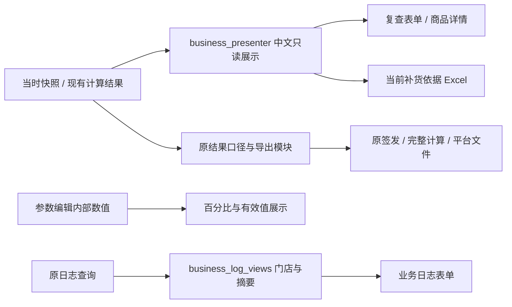

# 0.28.0 业务可读性整理

基线 `0f34aa226b1341e73001489b80981593308404fa`（0.27.1）。分支 `feat/business-readability-0.28.0`。按照全局核查的 R01—R32 分四阶段实施；模型、存储、既有完整计算/签发/平台Excel合同不变。原文件和旧包保留，不推送或合并。

## 阶段记录

1. 中文展示投影与历史复查：新增 `business_presenter.py`，复用原模型字段与参数说明，分开业务显示和旧Excel标签。数量阶段从已保存快照读取，不重跑算法；人工覆盖时读取保留的自动候选和安排量。历史旧格式入口继续保留。新增9项展示契约测试、6项签发前调整归档回归通过；当前源码实际Qt隔离窗口打开通过，同一样例总览47→12行、实际参数251→23行，完整依据119行和原计算表370列保留。临时源码检查发现一次缩进问题，修复后编译检查通过。
2. 参数与确认窗口：参数名称去掉英文键，百分比编辑器的内部值/范围仍为小数；实际值页与完整覆盖关系分开，仓周期拆成备货/到货。新品、草稿、签发的确认保留原默认取消按钮和后台修订校验，明细使用可搜索表格；超过200条仍明确截断并保留完整差异导出。生命周期增加逐单0/空白/缺行统计表，可点击进入相应筛选。7项分类参数、8项参数导入事务、53项生命周期和3项新Qt显示契约通过。新Qt测试初次使用了元组仓周期，与旧编辑器固有的列表返回不同；夹具改为实际JSON配置的列表形式后通过，没有修改业务预期。
3. 工作表、导入、日志与错误：默认主要结果列组，全部旧列仍可展开，导出字段不变；持续显示组合筛选与快捷条件，逐项清除；商品侧栏先结果再数量步骤。冲突按字段/来源并排核对，门店商品名称优先。文件名主显、路径留在详情；归档日志按确切修订读取名称，批次日志使用当前关联归档名称（不冒充历史名称），技术字段单独展开。导出结果与翱象异常分层，保留未核实受理状态、不重发。548项全套回归通过，新增3项只读日志契约及5项翱象界面复查通过。测试中的5个异常弹窗替身由旧 warning 改为新统一 failure 入口，原业务断言不变；日志新测试最初遗漏关闭自身SQLite夹具，修复夹具后通过。
4. 兼容与交付：552项普通回归、13项优化模式展示回归通过；33组固定业务场景及5份计算Excel严格0差异，另12组归档/原表/门店文件对照0差异。源码真实Qt18项检查通过。已补实际EXE专用入口及独立验证脚本；最终构建提交、EXE实测与哈希以 releases/0.28.0/rc1/交付报告.md 为准。展示验收发现列隐藏早于模型初始化、快速筛选残留旧按钮两处问题，已修复并重新打开窗口核验；中文相邻字母说明翻译也补了回归。

## 实现边界

- `history_forms.form` 和既有导出标签保留，新的 `business_view` 请求只给业务窗口和该窗口的核对表使用。不能把UI翻译回写快照或模型。
- `result_semantics` 继续决定最终数量金额；显示阶段不能取代其预算、排除与人工调整口径。
- 无当时参数或阶段记录显示“历史未留存”，不使用当前默认值补填。
- 完整计算/内部明细Excel的宽表仍保留技术取证格式。R28/R29通过业务复查及业务核对导出提供替代阅读入口，不宣称旧宽表格式已经重设计。
- 所有本轮运行证据保存在独立 `qa/readability_0280`；实际验收和发行记录最终另行补充。


## 使用顺序

1. 决策复查打开某店某仓单，选商品，先看“决策总览”。金额数量来自当时签发；回传、付款和收货仍在独立“订单跟踪”页。
2. 切“数量形成过程”看各个已留存阶段数量及增减。这里不反算模型，不把恢复参考量当成实际增量。需要全部中间值时用“商品完整计算依据”，原字段作为对照保留。
3. “当时参数”只看该商品、仓与分类实际值；“完整参数与技术资料”看全部快照。无留存值明确标注，不套用今天默认。
4. “导出当前补货依据”导出当前范围的完整表单，不跟随字段搜索删行；“下载商品资料原表”另行下载原文件，两者不会互换。
5. 工作商品表默认“主要结果”。列组只改变显示，不影响筛选或文件；条件条显示快捷条件、组合条件、仓、分类和搜索，可逐项移除或全部清除。
6. 维护参数时，95%仍存为0.95；先核对有效值与适用范围，再应用。覆盖关系可展开；未保存到历史的操作来源不推测。
7. 归档操作日志可按门店名称和原字段检索；批次日志仍按原来的门店编码/单号/仓等查询与导出同一范围，名称只是显示投影。事件汇总可能覆盖同店两仓，逐仓数量在关联单据查看。

## 覆盖清单

| 核查项 | 实现位置与边界 |
|---|---|
| R01—R08 | `business_presenter`、`history_read`、`history_ui`：中文字段、数量步骤、实际参数、单位、统一入口、导出范围。未留存不补算。 |
| R09—R13 | `parameter_ui`：中文名称、百分比编辑、有效值与覆盖层分开、仓周期拆开、业务帮助。JSON及参数导入格式不变。 |
| R14—R16 | `ui_results`：列组、分层商品详情、全部条件条；过滤算法及旧导出列顺序不变。 |
| R17—R19 | `readable_ui`、`application_window`、`workbench`：预算/草稿/签发差异表；保留默认取消、修订绑定、截断提示和完整导出。 |
| R20 | `batch_app`、`conflict_ui`：名称与精确编码同显，逐字段来源对照；仍由用户明确选保留源。 |
| R21—R23 | `import_ui`、`aoxiang_setup_ui`、`warehouse_ui`、`history_ui`：文件名与资料用途主显，路径、校验值可展开。 |
| R24—R25 | `business_log_views`：后台只读名称关联；业务摘要+选中事件表单+完整技术字段。归档日志名称绑定确切修订；批次日志名称取当前关联签发，未声称是该事件发生时的名称。旧日志导出未改。 |
| R26—R27 | `lifecycle_ui`、`jst_review_ui`：逐单零/空/缺行摘要与点击定位；商品款数用词，原计数不变。 |
| R28—R29 | 通过业务复查及业务核对表提供易读入口。旧完整计算/内部明细宽表继续原样，不删除或重排其技术字段。 |
| R30—R31 | `readable_ui`、相关导出窗口：文件结果列表；常见错误主信息+完整详情；翱象受理不明保持不重发。只处理核查确认的高频入口，不声称74个原始异常候选全是缺陷或全部重写。 |
| R32 | `business_presenter`按字段区分0、空串、缺失、不限预算、历史未留存；没有改变通用GridModel对其他业务场景的默认语义。 |

## 代码查找与边界



运行时新增三处职责：`business_presenter.py`纯展示与历史投影；`business_log_views.py`后台只读日志投影；`readable_ui.py`通用表格确认、文件结果、异常详情。没有复制预算/模型/归档实现。`history_read`用显式`business_view`选择新表单，旧调用保留旧结构。

## 验证复跑

独立目录 `qa/readability_0280`。源代码快照固定到0f34aa2；真实输入沿用已冻结文件，保留原SHA256。新测试本身生成临时数据，不依赖现场业务库。

```powershell
$env:PYTHONUTF8='1'
$env:QT_QPA_PLATFORM='offscreen'
$env:PYTHONHASHSEED='0'
.venv\Scripts\python.exe -m unittest discover -s tests -v
.venv\Scripts\python.exe tools/parallel_qa.py capture --qa qa/aoxiang_integration_20261101 --source . --output <新的捕获目录>
.venv\Scripts\python.exe tools/verify_maintenance.py compare --qa qa/readability_0280
.venv\Scripts\python.exe tools/verify_interaction_exports.py --baseline qa/readability_0280/before_source --output <新的归档对照目录>
.venv\Scripts\python.exe tools/verify_readability.py --exe <新包/补货助手.exe> --fixture qa/aoxiang_integration_20261101/inputs --output <新的窗口验收目录>
.venv\Scripts\python.exe tools/benchmark_readability.py --baseline qa/readability_0280/before_source --db <隔离样例数据库> --output <新的性能目录>
```

固定比对的正式运行目录名为`before`/`after`，compare会核对捕获源码哈希，后续改源码后应重新捕获。实际EXE证据单独记录；源码Qt通过不能代替包内spawn验证。
