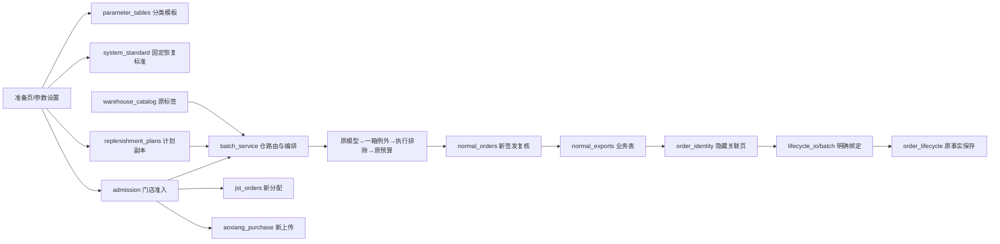

# 0.32.0 参数、门店准入、补货计划与单据关联

这是独立本地候选；保留0.31.0。模型仍为0.3.4-rules，仓归属0.5.1，存储格式2。没有修改预测、箱规、原最低持有、一箱例外或预算算法。新增资质与门店拒收会排除不合格执行候选，释放的预算仍按原算法分配，所以命中新规则的订单执行量可以改变。

## 日常怎么用

1. **准备数据**：已有线路时点“选择补货计划”，采用名单和预设参数。仍可普通导入文件或使用原平台取数入口，计划不会自行启动外部操作。缺文件或供货设置在当前页提示。
2. **门店与参数**：看实际生效值；临时修改默认只应用本次。预算、主从仓分别维护，不藏在超参模板里。正常作业不需要进入长期维护页。
3. **计算**：资质/拒收/禁用/停采优先过筛。受限商品保留原模型建议，执行为0；人工改量、新品、清单补足不能绕过。
4. **核对与签发**：原确认和同日覆盖保护保留；分仓签发文件的单号放在隐藏页，门店只改数量。回传仍从订单跟踪或该订单详情进入。

参数设置中的“其他设置导入 / 模板”提供完整补货参数、补货策略、供货关系、门店预算和旧版混合参数；“门店资质 / 拒收”提供准入表单、批量导入与模板。支持拖拽。

## 参数分类与恢复

| 模板 | 必填身份 | 维护内容 |
|---|---|---|
| 分仓周期 | 门店编码、属仓 | 本仓备货天数、到货天数 |
| 完整补货参数 | 门店编码；分类页另填分类组/商品分类 | 分仓周期、门店通用超参、分类权重与超参、分类映射四页 |
| 补货策略 | 门店编码 | 一箱例外、极端缺货自动恢复、新品铺设 |
| 供货关系 | 门店编码 | 主仓、从仓 |
| 门店预算 | 门店编码 | 整店预算方式、金额 |

新版参数模板有明确格式标记：**已有参数列的空白恢复系统默认**，分类专用超参空白沿用门店通用值；完全没有的列/行不修改；0就是0。供货关系、预算和策略模板空白保留。旧版混合模板保持原有空白语义。预览显示格式、变更及空白处理，确认后才应用。

系统标准版本为`2026-11-03.1`，来自固定验收默认配置并校验内容摘要；不能通过业务保存入口改写。已有90%/95%等参数不会被自动重置。恢复单项/当前组只改编辑器，仍要明确应用；“撤销本次表单修改”恢复打开时的值。恢复分类超参明确填入系统值，避免再次继承已改坏的通用值。

有效顺序：系统标准作为缺项基底 → 保存的门店默认 → 明确采用的计划完整预设 → 本次门店修改；SKU层分类专用值覆盖通用值，各仓周期按归属仓生效。主从仓、预算独立。草稿恢复保留当时完整配置，不自动套最新默认。计划保存完整参数副本，不跟随方案库的后续编辑。

## 资质、标签与拒收

- 原样保存商品资料“商品标签”的全部内容；逗号、中英文分号、换行拆词用于展示/判定，原文仍保留。只有包含“二类医疗”的标签触发本次资质要求；其他标签不会自行变成必卖或新品。
- 同SKU两仓标签冲突，只要任一仓明确命中医疗标签，按需资质处理，并保留来源。仓归属、价格和箱规仍走原逻辑。
- 状态为已核验且未过期才能通过；核验人和日期必填。未维护即待核验。软件实施的是用户确认的业务规则，不替代线下资质真实性核验。
- 标签列存在但单元格为空与整列缺失不同。缺列显示资料待核，不能据此作新的正数执行安排；旧归档仍可原样查看/重导。
- 门店拒收按门店编码+商品编码，两仓共用；到期当天有效，未填到期日一直保留到解除。导入缺行不会解除。表单可添加/解除，重新填写同编码可更新原因及到期日，保存前显示差异。
- 新签发复核准入依据；预览后记录变化或跨日拒绝旧预览。旧草稿没有准入依据的旧计算结果先重算；已经签发的原修订重导不改量。
- 聚水潭新的分配、翱象新的采购上传复核当前准入；受限项不消耗库存。已锁单、已存在平台单及回传/付款/收货事实保留，不自动撤销或归零。

## 补货计划

维护页新建、编辑、复制、删除计划。保存有序门店名单与完整预设，**不保存预算、主从仓、资质、拒收、库存或登录状态**。多店参数不同时必须明确选预设来源；新建默认以系统标准起步。

采用时已存在当前作业会显示替换范围；采用后可单店微调。重新检查文件保留计划和本次修改。草稿和签发保存当时副本，删除/修改计划不改历史。缺计划门店的文件保持待补，不虚构成功结果；首屏仅展示简要名单，完整名单可查看提示。

## 签发与回传关联

门店表保持原A:T字段，原V列“决策理由”移到U列；明细中的补货单号列移除。新增很隐藏的“系统关联信息”页，结构保护用于减少误删，不是防篡改认证。文件名、三张业务表及数量分组不变；内部归档/生命周期对照/聚水潭单的单号列仍保留。

从原签发改数量后回传，可自动识别门店、仓和原签发；排序、删商品行不会改变身份。无关联页/单号时在同一导入页选择签发单，不必回Excel补系统列。多个订单不能唯一划分时，用“划分选中来源组并绑定签发单”明确选行；系统不猜商品相似度和相邻日期。合并回传保留全部订单关联信息。

隐藏页与行内信息/旧属性相冲突或原签发已更新时拒绝关联；不得删掉冲突再冒充“系统已识别”。旧无隐藏页的仅按单号入口沿用原兼容行为，它没有新隐藏页的摘要防错能力。已保存生命周期事实及原件不回写。

回传按签发核对，付款按正数回传核对，收货按正数付款核对；0、空白、缺行分别提示，确认完整单据后均为0。整单未导入不等于0。最低回传/收货模板不再包含系统单号和上环节数量，付款保留既有业务样式。

## 代码定位

| 查什么 | 文件 |
|---|---|
| 系统值、恢复和模板空白 | `src/system_standard.py`、`parameter_tables.py`、`store_parameter_import.py` |
| 有效参数、应用范围 | `parameter_ui.py`、`parameter_scene.py`、`store_parameter_ui.py` |
| 资质/拒收规则、原子保存 | `admission.py`、`admission_ui.py` |
| 标签原文及跨仓证据 | `warehouse_catalog.py`、`batch_service.py`、`input_adapter.py` |
| 计划保存与采用 | `replenishment_plans.py`、`replenishment_plan_ui.py`、`workbench.py` |
| 关联页、绑定、完整单核对 | `order_identity.py`、`lifecycle_io.py`、`lifecycle_batch.py`、`lifecycle_batch_ui.py` |
| 验证 | `tests/test_parameter_tables.py`、`test_admission.py`、`test_replenishment_plans.py`、`test_order_identity.py`、`tools/verify_governance.py`、`tools/governance_delivery_qa.py`、`src/governance_smoke.py` |

存储仅增加准入/计划表及事件表，沿用原SQLite备份与并发校验，不迁移或覆盖历史数据格式。保存动作可能产生备份/元数据，不等于数据库文件字节完全不变。

## 试用重点

先用独立测试资料操作，避免把合成资质、拒收写入正式业务。

1. 两仓周期各一行导入；只改周期，不改变预算、主从仓和分类超参。试空白恢复、0、非法值及取消。
2. 改一个参数，分别点恢复系统默认、撤销、只应用本次；退出重新进入看长期默认是否保持。
3. 新建一个两店计划，采用后重查文件；单店再改参数，确认另一店和计划原件不变。
4. 一件“二类医疗+其他标签”商品，在未核验/已核验门店对比；拒收后原建议保留但执行为0，手工增量被挡住。
5. 改资质/拒收后，原预览不能签发，只有受影响店待重算。已签发历史数量不变。
6. 山东、河北分别签发；打开Excel看不到单号列。直接改数量、排序、删一行回传，对照空白/缺行按0。
7. 无号文件在导入页选单；错仓/旧签发文件必须报错。多店回传一次导入，检查金额/商品归属并试取消。

自动化Qt走查和实际EXE测试只能证明已覆盖路径可执行；业务人员不看提示能否独立找到入口，仍需人工试用评价。尚未做新电脑重建或新的真实平台采购联调。
