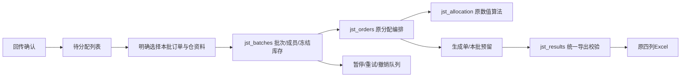

# 0.33.0 批次库存与处理范围

按2026-11-04收敛口径：库存仅服务于明确选择的本批订单；每个新批从所选资料开始，不扣其他批的本地预留。业务判断资料是否适合本批，软件不按文件时间、哈希或名称推断新旧。模型版本保持0.3.4-rules。

## 业务使用

1. 确认门店回传后，进入“聚水潭导入单”。回传保存后是待分配，不会自行逐店建立库存池。
2. 筛选门店/仓，或勾选订单，点击“准备新分配批次”。为相关仓选用已有资料、手动导入或主动在线获取。核对回传确认时间顺序，必要时明确拖动排序。
3. 预览后确认生成。每仓冻结一份库存，按确定的门店顺序分配；价格、箱规和分配算法沿用既有规则。默认资料的当前准入标签仍单独复核。
4. 在结果页“导出当前筛选（N份）”或“导出勾选（N份）”。可重复导出，同名安全覆盖；导出不分配、不扣库存，也不确认付款。
5. 在聚水潭实际下单后，按原入口确认已下单并锁定；本批占用保持，付款事实仍需独立确认。

已停止/失败：选择原分配批次，点击“继续原批未完成任务”，预览后确认。使用原库存、原顺序、原进度，已完成单不再扣一次。同仓前序失败不能由后店抢先分配；另一仓仍独立。

需要修改已生成结果：选择原批并勾选未锁订单，点击“重新分配本批勾选单”。只替换这些订单的预留，其他单保留；不要求选齐全仓历史单。已有付款/收货、锁定和准入保护继续生效。

不再使用：在“其他订单操作”分别撤销未下单生成单、撤销本批未完成任务，填写原因。撤销与停止旧任务一起落库，后台不会复活；已生成/已锁单不会因取消未完成任务消失。新建另一批会暂停旧批剩余任务，需要明确继续才恢复。

## 页面范围

- 订单跟踪按日期展示进度；“日批次”不是一个库存池。一天可有多个分配批次。
- 勾选订单进入环节时绑定这些单；未勾选则继承日期范围、仓、锁状态和搜索。聚水潭页不再默默切换到今日全部。
- “选择分配批次”对话框明确说明会改为该批全部订单；本地搜索继续用于缩小显示及导出。日期控件在选择批次后禁用，可“返回日期范围”。
- 新建批次、导出当前筛选均只用可见订单。筛选变化清空勾选并提示；导出份数始终展示。
- “刷新列表”只查询；新建批次选择库存；“继续原批”和“重新分配”均沿用冻结依据，不把刷新按钮兼做重算。
- 列表读完收起进度条，业务进度用各单状态表达。零份导出有原因和下一步；永久删除收进订单维护区。
- 自动获取建议入口前移到准备页上方；签发页突出“确认签发并导出”，改量和内部明细为辅助动作。首页待办重组、固定列及全局布局压缩留作后续，不冒称本次完成全篇UX审查建议。

## 结构与数据

新增SQLite表为批次、批次库存引用、顺序成员、生成单与批次关联。锁单永久删除时只保留本批已耗用数量，避免该批其他店重复获得已下单库存；不带入下一批。永久删除会清理对应成员及生成关联，空批删除。历史生成单、签发、回传、付款、收货快照不改写。

`jst_batches.preview_new/preview_existing`只预览；`register`保存成员及库存；`execute`复用原提交服务；`record`与生成、占用同事务；`drain`只处理明确启动的批次。暂停使用控制序号，分仓库存使用乐观并发序号；提交前复核，已提交操作幂等重放。不能强杀提交进程。

`jst_orders.prepare_checked(..., batch=None)`保留旧兼容入口：旧记录和旧验证可按原语义读取。新界面全部走明确批次接口，不凭日期或同一文件自动迁移旧记录。旧待执行任务停止自动消耗库存，业务在准备页明确建立新批。旧生成单仍可查询和导出；没有重写为新批，保留原有效性检查。0.33.0新生成单的有效性绑定本批，不因下一批库存更新而自动失效。

## 回归边界

不改 model.py、allocation.py、one_box_exception.py、jst_allocation.py、默认配置、生命周期数量金额口径。允许变化只有跨批占用不再继承、显式批次队列、批次审计字段、导出范围及相应提示。新批与旧批共用同一库存文件是业务明确选用，不作为错误。

旧测试两项合同有意更新并保留原因：回传逐单自动生成改为明确批次；聚水潭入口忽略筛选改为继承范围。旧 `jst_basis_smoke`、`jst_results_smoke` 中全局库存更新拒绝新单导出、搜索不影响全部导出等交互预期保留为历史脚本，本版实际程序使用 `--jst-batch-smoke`；其中共用Excel比较工具继续复用。

复跑与构建命令见 `releases/0.33.0/rc1/交付报告.md`。该版本只在本地独立分支及目录交付，未合并、未推送。
