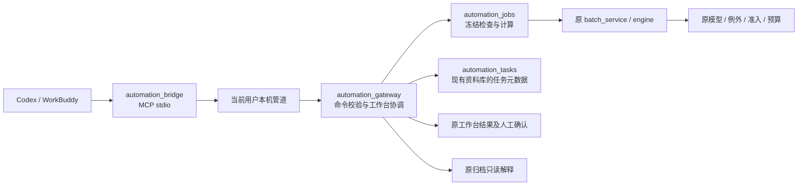

# 0.35.0 AI 协助：Codex / WorkBuddy

这是外接操作接口，AI 客户端使用正在打开的补货助手工作台。补货模型仍为 0.3.4-rules。正式保存、签发、默认参数维护、删除及平台采购继续使用原页面；接口没有这些提交命令。

## 开始使用

1. 完整解压交付目录，打开补货助手。不要只复制 EXE，`AI接口` 子目录也需要保留。
2. 点击顶部“AI 协助”，启用本机连接。一次资料环境只允许一个窗口启用。
3. 点击“生成 Codex 与 WorkBuddy 连接配置”，选择空目录。生成的是配置片段，不含浏览器登录态，也不需要填写 API Key。
4. Codex：把 TOML 片段合并到该客户端的 MCP 配置，或按片段中的 command/args 添加 stdio MCP。WorkBuddy：专家·技能·连接器 → 连接器 → 自定义连接器 → 添加 MCP，把 JSON 中的 `replenishment` 项加入已有 `mcpServers`，保留其他项目。首次连接的信任提示由使用者核对后处理。
5. 关闭补货助手的配置弹窗，在客户端检查工具连接。能发现工具不代表工作台已开启；查询提示“未连接”时先检查上述窗口。

连接配置绑定本机目录。移动交付包或换电脑后重新生成，不搬运浏览器登录态。启用时生成的连接凭据仅用于当前 Windows 用户的本机管道，不放入配置片段或模型回答。外部 AI 会收到所查询的必要业务摘要，请使用业务允许的客户端。

可直接使用的说法：

- “先看看补货助手当前有哪些门店和可用预案，不计算。”
- “使用当前已检查的数据，按这些门店编码试算，先保留当前正式结果。”
- “仅把 A 店山东仓备货天数改为 7 天试算，其他参数保持原值，告诉我金额变化。”
- “停止这个任务后续门店，已完成结果保留。”
- “查询上一个任务，重试其中失败的这两家，继续使用原任务输入和必卖清单。”
- “这个订单的这个商品为什么补这些量？给我当时销量库存、实际参数和数量形成过程。”

门店名称有歧义时必须使用编码；不会猜主从仓、未知分类、冲突候选或缺失参数。参数路径可先通过 `effective_parameters` 查询；分类覆盖项会返回实际值和“沿用门店”来源。

## 工作规则

先检查形成预览，再执行。`trial` 是独立试算，不修改当前结果；`current` 表示明确采用到本次工作台，仍未保存或签发。选定预案仅覆盖该预案勾选的参数；未显式选新预案时，不重新应用旧预案覆盖当前人工调整。

工作台已有数据时，AI 可以用另一组文件试算，但替换当前输入需要先在原“准备数据”页采用文件。涉及已有新品选择或人工改量的重新计算，返回具体影响并交给原界面核对；不由 AI 自动清空。

每次请求使用操作键；相同内容重复提交返回原任务，内容变更却复用操作键会报错。客户端断开不会取消已受理任务；重连后查询原任务。取消是停止后续，正在计算的门店安全结束。点击“接手处理”后不自动采用当前 AI 结果。人工改了输入、参数、必卖清单或结果，旧试算不能覆盖；浏览、筛选不使结果过期。

顶部“查看进度”能查看门店状态；“查看此任务结果”以中文业务字段分页核对，可明确采用到本次作业。正式保存与签发仍从工作页进行。

未保存的结果只在当前会话有效。内存保留最近 3 个计算根批次及其重试、最近 5 个检查预览，旧任务保留操作记录并说明结果已释放；释放不删除已采用的工作台结果、草稿或签发数据。退出重启后必须重新检查计算，不能把任务日志当作可恢复草稿。历史解释读取原签发快照，不使用当前资料补写历史。

## 模块与调用关系



| 查找对象 | 代码位置 |
|---|---|
| 12 个工具、字段与错误码 | `src/automation_protocol.py` |
| 客户端 stdio、JSON-RPC、命名管道请求 | `src/automation_bridge.py` |
| 任务状态、幂等、上下文保护、采用与重试 | `src/automation_gateway.py` |
| 文件检查、参数快照、历史解释 | `src/automation_jobs.py` |
| UI 与接口共用预算解析、重算影响和预案覆盖 | `src/workbench_actions.py` |
| 任务与增量事件，不复制订单明细 | `src/automation_tasks.py` |
| 连接设置、任务表、分页结果与接手 | `src/automation_ui.py` |
| 实际 Qt / stdio / Windows spawn 验收 | `src/automation_smoke.py`、`tools/run_automation_ui.py` |
| 已安装 Codex MCP 客户端验证（无模型调用） | `tools/verify_codex_client.py` |
| 固定基线对照、性能 | `tools/verify_automation.py`、`tools/benchmark_automation.py` |

原 `model.py`、`one_box_exception.py`、`allocation.py`、默认配置、签发、生命周期和导出实现不改。没有新增数据库格式迁移，仅启用连接时向原资料库增加 `automation_tasks` 和 `automation_events` 两张元数据表；首次建表保留既有安全备份。

## 首期边界

不提供远程 HTTP 服务，不接管账号登录、翱象/聚水潭采集、采购上传或删除。接口接受现有本地 `.xlsx` 文件；跨文件冲突仍回原界面处理。不能把聊天里的 `confirmed=true` 当作正式签发确认。

当前工具采用任务编号加增量游标查询进度，未实现 MCP 主动推送。查询默认门店汇总，商品每页最多 100 行；单条消息最大 2 MiB。启用、受理和轻量状态仍需要 Qt 主线程协调；实际性能和客户端验收范围以本次交付记录为准，不能把配置生成称为真人客户端全流程通过。

## 可复跑验证

```powershell
qa/v0350/locked-venv/Scripts/python.exe -m unittest discover -s tests -v
qa/v0350/locked-venv/Scripts/python.exe tools/verify_automation.py freeze --qa qa/automation-new-comparison
qa/v0350/locked-venv/Scripts/python.exe tools/verify_automation.py before --qa qa/automation-new-comparison
qa/v0350/locked-venv/Scripts/python.exe tools/verify_automation.py after --qa qa/automation-new-comparison
qa/v0350/locked-venv/Scripts/python.exe tools/verify_automation.py compare --qa qa/automation-new-comparison
qa/v0350/locked-venv/Scripts/python.exe tools/run_automation_ui.py --out qa/automation-new-source --codex-client
qa/v0350/locked-venv/Scripts/python.exe tools/run_automation_ui.py --exe '交付_0.35.0_rc1/补货助手/补货助手.exe' --out qa/automation-new-exe --codex-client
qa/v0350/locked-venv/Scripts/python.exe tools/benchmark_automation.py --out qa/automation-new-performance
```

输出目录必须是新目录。真实样本对照依赖本机已有 `qa/governance_032/inputs`，冻结后各自保存 `before/after`；便携合成单测不依赖原业务 Excel。性能脚本读取已冻结的 `qa/v0350/inputs`。AI 任务测试使用独立资料库。客户端配置不会覆盖已有配置；安装和首次信任状态须单独核验。

本次原 `.venv` 有两项依赖版本偏离锁文件，未覆盖它；使用独立 `qa/v0350/locked-venv`，按 `requirements-win-amd64.lock` 全量校验哈希安装后测试、构建。其他电脑需按锁文件新建自己的 Python 3.12 环境，不复制这个虚拟环境。完整事实、性能与客户端限制见 `releases/0.35.0/rc1/交付报告.md`。

## 业务人员试用重点

1. 打开原工作台检查文件并选好两家店，在客户端说“按当前参数试算这两家，不采用”。金额应与原计算一致，原工作台结果不被替换。
2. 说“只调整第一家的备货天数试算”，对照生效参数；第二家参数不变。确认后再明确要求采用，仍需从原页面保存和签发。
3. 试算后先在工作台人工改参数，再让 AI 采用旧结果：应提示已过期，不覆盖人工操作。
4. 多店计算时点“停止后续”或“接手处理”，看已完成结果和未完成门店；失败重试仍在原任务内，沿用原必卖及参数。
5. 关闭客户端再连接，查询原任务；退出补货助手后未保存的试算不能冒充草稿恢复。
6. 按门店、仓、商品编码问历史补货原因，应显示当时销量库存和中文参数；不能用新资料替换历史。
