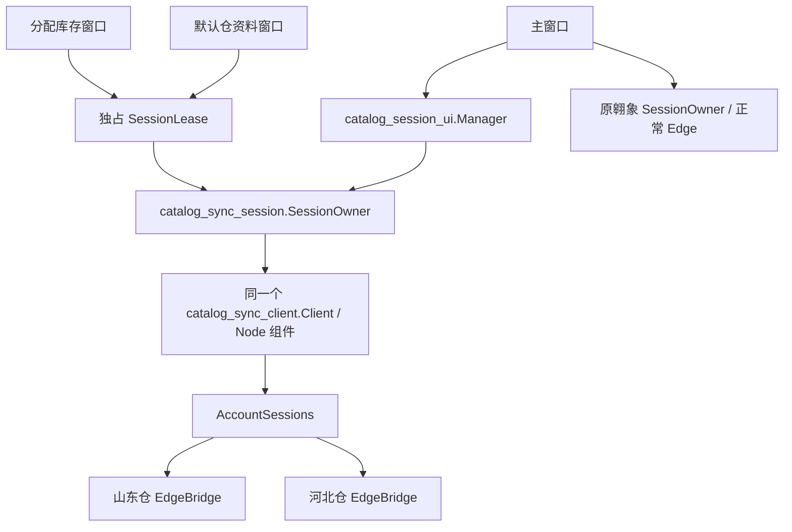

# 0.36.1 浏览器连接保留

## 使用方法

保持补货助手主窗口和对应浏览器开启。聚水潭首次核验或刷新时，按浏览器提示允许连接；之后关闭商品资料窗口、重新打开，或进入“更新本次分配库存”，继续使用同一后台组件和该仓的健康连接。

商品资料窗口增加本仓连接状态和“重新连接本仓”。正常情况下直接执行业务操作，不需要点重连。浏览器连接或作业标签被关闭时，显示连接中断；主动重连只断开、核验当前仓，不重发导出、不重置已采用资料。已有导出按“继续原记录未完成项”恢复。

两仓各自独立账号和专用浏览器；翱象保持正常 Edge 的原共享连接。不能把三套配置合并、复制登录状态或切换账号来减少提示。

| 动作 | 连接与任务行为 |
| --- | --- |
| 关闭商品资料窗口 | 安全结束当前动作，释放窗口操作权，保留健康连接 |
| 重新打开默认资料或分配库存窗口 | 复用原组件；两种用途的任务仍分别处理 |
| 停止同步 | 保留已受理平台任务及已下载文件；不自动重提 |
| 重连本仓 | 只释放本仓连接并核验账号；可能再次要求允许 |
| 退出整个补货助手 | 等待安全步骤结束、停止组件；不关闭用户浏览器 |
| 浏览器退出、更新或连接中断 | 下次连接可能重新要求允许；不保证永久授权 |

“保持连接”只减少由本软件主动断连引起的重复许可，不绕过 Edge 的授权。网站登录过期仍需正常登录；本轮没有改变网站自动登录、导出、采购或收货规则。

## 结构与安全边界



- `SessionOwner` 属于主窗口，窗口只借用 `SessionLease`；启动结果未知或旧进程未退出时拒绝另起组件。下载目录与原 Client 保持同一绝对路径。
- 窗口关闭调用串行控制命令 `session.release`，停止尚在运行的操作；只有组件确认空闲才释放独占权。响应未知时安全结束原组件，未退出前不接新窗口，不强杀提交。
- `session.reset` 在空闲状态下只断开指定仓。账号资料改绑时释放旧绑定；不改任务存储结构及业务快照。
- `AccountSessions` 同时检查作业标签是否关闭、CDP 浏览器是否仍连接。两仓分别缓存；连接状态只作为运行态输出，不写入商品资料或业务指纹。
- 主窗口关闭由后台线程分步结束组件，Qt 继续响应；正在同步时先停止，待安全交接后再关闭。已有正常浏览器和用户标签保留。
- 没有增加保活网页操作或轮询导出；没有在网络异常时盲目重新提交任务。重连核验通过也不会自动采集。

## 验证与复跑

所有验证使用独立 QA 目录；原商品资料、签发、草稿、用户数据库和旧包不写入。模型、分配、箱规、价格、库存口径及导出实现不变。源码对照固定为 `2487601d9a3d5830704f4dbab8e6dc56961a1fd4`。

```powershell
$py = '.\qa\v0350\locked-venv\Scripts\python.exe'
$env:PYTHONUTF8 = '1'
$env:QT_QPA_PLATFORM = 'offscreen'
& $py -m unittest discover -s tests -v
& .\components\aoxiang\runtime\node.exe --test components/jst_catalog/test/*.test.mjs
& .\components\aoxiang\runtime\node.exe --test components/aoxiang/test/*.test.mjs
& $py tools/verify_connection_retention.py freeze --qa qa/replay0361
& $py tools/verify_connection_retention.py before --qa qa/replay0361
& $py tools/verify_connection_retention.py after --qa qa/replay0361
& $py tools/verify_connection_retention.py compare --qa qa/replay0361
$env:QT_QPA_PLATFORM = 'windows'
& $py tools/verify_catalog_sync_ui.py --output qa/replay0361-ui --exe '交付_0.36.1_rc1/补货助手/补货助手.exe'
& .\components\aoxiang\runtime\node.exe tools/verify_browser_connection_retention.mjs 'C:/Program Files (x86)/Microsoft/Edge/Application/msedge.exe' qa/replay0361-browser '交付_0.36.1_rc1/补货助手/_internal/components'
```

最后一项在新建的隔离 Edge 配置与本机页面上验证真正 CDP 连接，过程中会启动最小化的测试浏览器；不连接用户账号，不执行平台导出或采购。它证明连接复用、单仓断开恢复和标签保留，不代替生产浏览器许可弹窗、跨日或休眠稳定性测试。实际候选包检查、完整证据和已知限制见 [交付报告](../releases/0.36.1/rc1/交付报告.md)。
