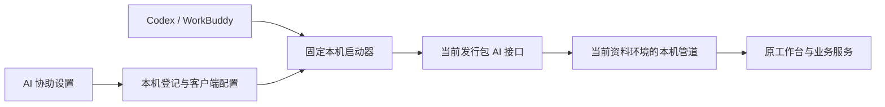

# 0.40.0：AI 分析依据与本机连接

开发基线：`86464a64584c17aa69d0269f77f14d212e75ea59`（0.39.0 实际客户端验收）。独立分支 `feat/ai-contract-portability-0.40.0`。模型保持 0.3.4-rules，仓归属 0.5.1；没有修改计算、预算、箱规、原签发、生命周期或存储格式。新候选独立打包，旧 0.39.0 保留。本轮没有推送或合并。

## 业务人员如何连接

1. 打开目标资料环境的补货助手，点击 **AI 协助**。
2. 选择 Codex 或 WorkBuddy。默认定位该用户的客户端配置，可明确选择其他位置。
3. 点击 **配置/修复本机连接**，核对目标后确认。只更新 `replenishment`，保留其他连接和设置；原配置备份在其旁边。
4. 在客户端重新加载连接，首次使用按客户端要求信任。点击软件里的 **检查本机连接**，核对接口、版本和当前资料环境。
5. 关闭设置弹窗，从 AI 常用业务重新复制当前作业提示词。客户端先查询工作台上下文，再执行授权范围内的操作。

选择取消不修改客户端配置。配置失败会说明原因，不覆盖无法安全解析的配置。配置预览后文件发生变化则拒绝写入，需重新核对。备份可能含其他连接的私密设置，留在本机，不随发行证据或业务迁移上传。

界面区分：配置写入、工作台启用、链路验证、客户端最近核对。工具列表可读取不等于已经连到工作台；最近核对也不代表客户端持续在线。只读检查后台执行，15 秒超时停止检查进程，不取消业务任务。

## 换机、升级、目录移动

客户端配置里仍有绝对路径，这是本机程序定位。业务人员无需手工编辑。

- 固定入口放在本用户 `%LOCALAPPDATA%/YoutuanTools/补货助手/AI接入/<资料环境标识>/`，独立一份小启动器，通过 `binding.json` 定位当前接口程序。
- 用户明确配置后，该环境才登记。之后新版在同一资料环境启用连接，会更新该环境登记的接口位置；其他环境不跟随切换。
- 已运行的旧 MCP 进程不会在请求中途替换。升级后客户端重新加载连接；新版接口携带应用版本，工作台拒绝版本不一致的业务调用，`doctor` 保留诊断能力。
- 资料目录改变会改变环境标识，需要从目标工作台再次配置/修复；不靠扫描最新修改时间自动猜正式库、测试库。
- 新电脑安装应用并迁移业务资料后，在新电脑重新配置。不要复制 `automation/connection.json`、`owner.lock` 或本机 `AI接入` 目录作为可用会话；连接密钥、运行实例、浏览器登录态不迁移。
- `REPLENISHMENT_DATA_DIR` 测试环境的登记默认放到其自身 `ai-clients`；可用 `REPLENISHMENT_AI_HOME` 指定隔离验收位置。测试不会更新日常登记。
- 源码运行保留 Python 依赖；交付 EXE 的启动器与接口均无需另装 Python。

原 `--connection` CLI/MCP 入口兼容；手动导出的配置片段仍绑定当前安装位置，换机应重新生成。推荐业务人员使用配置/修复按钮。首次信任和客户端加载由客户端控制，软件不会代替授权。

## AI 数据口径

| 新增内容 | 解释 |
|---|---|
| `history.items[].evidence_details` | 每条历史差异带证据业务日期、补货单号、仓、商品、单位及环节前后数量；不能把上轮减量归到当前观察日期 |
| `observation_basis` | 本轮签发时快照的单号、日期、五段数量及有效性；无效值仍按有效性标识解释 |
| `parameter_basis` | 当时备货天数、到货天数、保护期及来源；当前默认不同不表示历史错误 |
| `stock_diagnosis_results.risk_summary` | 原有/候选保护期缺口商品数、未知数、到货前风险、增加或减少缺口数，按门店与商品统计，不累计不同单位的件数 |
| `stock_diagnosis_parameters` | 按诊断 task_id、候选编号及精确门店，返回基线和候选完整参数、中文定义、来源及变更项；复用现有参数解释实现 |

旧 `risk_count` 保留，含义是“新增或加剧风险”；旧 `recommended` 仅表示未发现新增风险或硬问题，不等于所有缺口已解决，也不代表授权采用。候选完整参数使用新增工具，不把诊断任务编号误当作普通 `preview_id`。

仅在接口输出层把 Decimal 零（如 `0E+20`）显示为文本 `0`，其他 Decimal 用精确十进制文本；未知仍是 null，空文本、数值 0 分开。不修改模型数值，不扩大业务指纹忽略字段。统一使用“门店回传”，不是“退货”。

原历史复盘表仍使用既有展示字段、列顺序和内容；新增结构化依据供接口读取，不回写历史。候选计算、采用门槛与明确确认要求保持不变。自然语言解释仍可能出错，不能把一次模型测试当成所有提问均正确。

## 结构与定位



- `automation_connection.py`：环境登记、客户端配置合并/备份、连接文件校验。
- `automation_launcher.py`：独立轻量 EXE，传递标准输入输出到指定接口；不读取业务数据库，不管理浏览器。
- `automation_connection_ui.py`：配置、修复、后台检查与状态展示。
- `automation_bridge.py` / `automation_gateway.py`：原 stdio 和管道协议，增加环境/版本核对。
- `automation_diagnosis.py` / `history_diagnostics.py`：新增业务解释依据；计算仍由原服务负责。

## 可复跑验收

在项目根目录使用已有锁定环境，所有 QA 输出必须是新目录：

```powershell
.venv\Scripts\python.exe -X utf8 -m unittest discover -s tests -v
.venv\Scripts\python.exe -X utf8 tools/verify_ai_portability_0400.py --out qa/0400_新对照
.venv\Scripts\python.exe tools/build_from_commit.py --commit <构建提交> --build-id <未使用编号>
```

实际 EXE 用 `--automation-portability-smoke <QA目录>`，同时设置 `REPLENISHMENT_DATA_DIR=<QA目录>/settings`。验证实际启动器/接口、两种客户端配置操作、启停重连、环境拒绝、Windows spawn 和候选参数。另复用 `--analytics-smoke` 验证原报表。

真实 AI 客户端复跑沿用 `tools/serve_analytics_ai_acceptance.py`、`tools/verify_codex_natural.py` 和 `tools/verify_ai_analytics_artifacts.py`，用本次新接口包；自然语言需人工/独立核对，脚本完成不等于解释全部正确。换机目录模拟不等于第二台物理电脑验收。最终通过项与限制以本轮发行报告为准。
