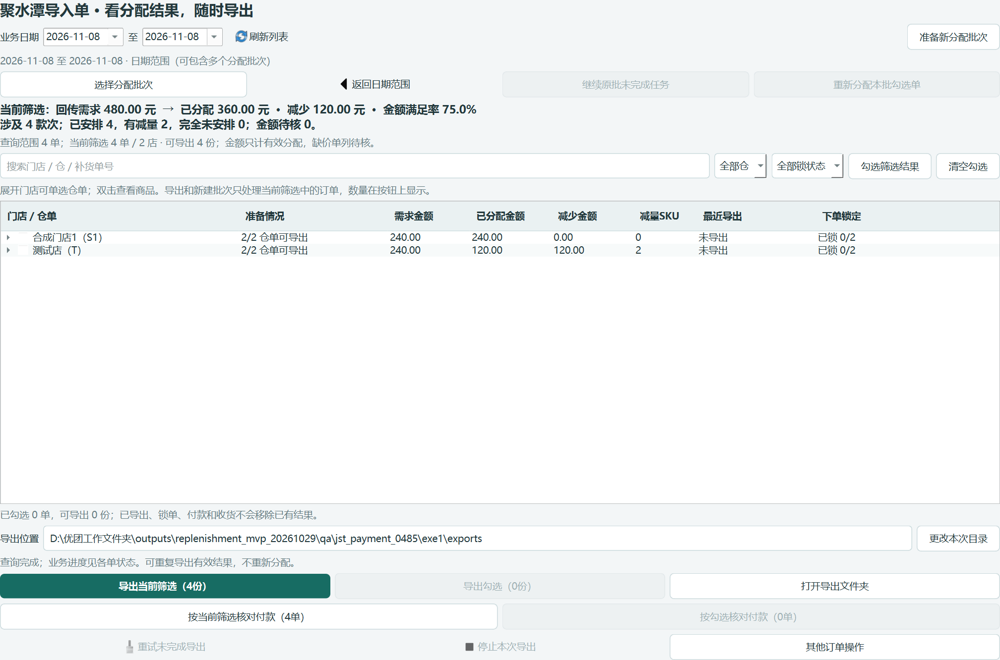
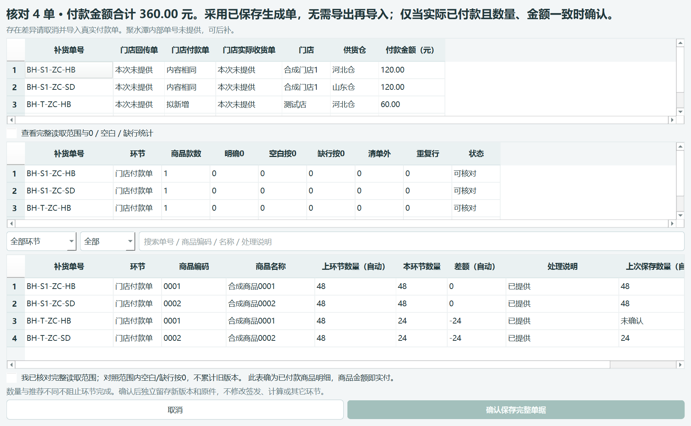

# 0.48.5：生成单直达付款核对

## 业务用法

在「订单跟踪 → 聚水潭导入单」查看已保存的分配结果后，可以直接使用这些明细核对付款，无需退回付款跟踪、导出 Excel 再导入。

1. 使用搜索、仓库、锁单状态确定本次范围。
2. 全部当前结果使用「按当前筛选核对付款（N单）」；部分结果先展开门店勾选仓单，使用「按勾选核对付款（N单）」。高亮一行不等于勾选。
3. 查看补货单号、门店、供货仓、各单付款金额和批量合计；商品表保留上环节数量、本次数量、差额和源单商品金额，可横向滚动查看金额。
4. 只有这些数量、金额与实际已付款事实一致时，勾选核对声明并点击「确认保存完整单据」。未付款或外部实付有差异时取消，使用真实付款单导入。
5. 保存后留在原结果页。已保存生成单、导出记录、仓占用、锁单状态均保留；重复确认同一份明细不会追加相同付款版本。

本入口只保存本机「门店付款单」业务记录，不调用平台支付、创建采购单或自动确认已下单。聚水潭内部单号可以后补，不编造平台单号。生成、导出和锁单均不自动代表付款。

## 异常处理

当前范围包含未生成、零分配或失效生成单时，列出具体门店、仓、订单和原因，整批不进入付款保存；可处理原因后刷新，或只勾选有效订单。不会静默跳过订单，也不会把未勾选解释为全选。

页面显示的生成身份在点击时固定；准备时复核当前生成、签发、回传、仓资料与锁状态。核对期间若生成单被替换、上游变化或付款版本被其他作业更新，现有写锁内校验会阻止整批保存；刷新后重新核对，不自动采用新生成单。正数量商品单价/金额缺失时保留待核，不按0猜测。

取消核对或准备失败不会保存付款；确认后使用现有一次事务整体提交，不分批落库。不改变模型、参数、仓归属、库存分配或原文件导入入口。

## 验证入口与限制

- `tests/test_jst_payment.py`：隔离两店四仓单，验证精确范围、旧来源等价、重复确认、金额缺失、取消及并发冲突整批回滚。
- `tools/verify_jst_payment.py --output <新的独立目录> [--exe <候选EXE>]`：创建合成数据库，再实际点击结果页及付款核对窗口。目录已存在即拒绝。
- 本版证据位于 `releases/0.48.5/rc1`，原始过程位于 `qa/jst_payment_0485`。首次测试夹具误读目标结构、重分配范围及错误提示预期的失败日志保留，最终用修正夹具重新验证；未放宽业务校验。
- 不读取或修改真实业务数据，不执行实际付款、不连接真实平台；真实付款与生成明细一致仍由操作人核对。

此前「批量导入布局」「拖动即采用人工分配顺序」「生成窗口锁单无选择提示」的方案不在本版实施范围。
