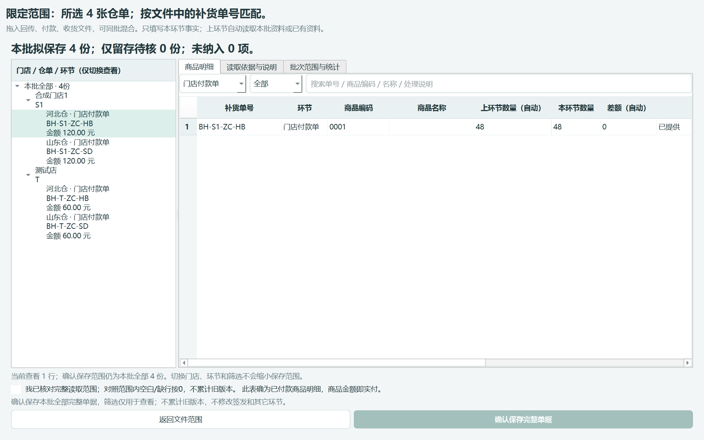
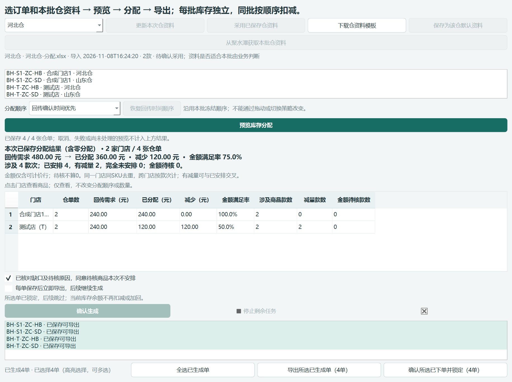

# 0.48.6：采购恢复与作业交互

## 已创建采购单，助手仍待核

新版本保留原采购身份和受理任务号。若唯一上传回执已可靠保存，但上传保护随后阻断额外请求，继续沿原任务查询导入结果、唯一采购标记、主单和全部商品数量金额；核验通过才关联采购单号。被拦请求仍被阻断，诊断警告不会丢弃，不将“已受理”直接等同“已关联”。

没有唯一回执、存在多个受理任务、商家变化、候选采购单不唯一或任一商品明细不符时，继续待核，禁止重传。身份超时恢复补齐了原导入任务和已知导出任务的只读查询；同一账号核验后仅重试一次原查询，不重放上传、提交、付款或其他写入。

采购门店筛选先尝试编码，再尝试门店简称及完整名称；仅允许名称在空格、全半角括号等格式归一化后精确且唯一匹配，实际查询请求及返回结果继续严格验证门店编码。不会因为金额相同就关联，也不进行模糊店名匹配。

**已有待核单怎么操作：**启动新版本，进入原「采购上传与核对」批次，对原单点击「继续核对采购结果」。不要新建采购任务、不要重传。若网络或页面仍异常，新提示会区分“身份查询失败”“门店未定位”“导入部分失败”等；原记录保留，可在「查看原因与下一步 → 查看技术详情」查看被拦请求类型、方法、主机和路径。不记录请求体、令牌或查询参数。

本版没有对安次现场原采购单执行回查、重传或手工关联。原现场错误没有完整请求路径，因此不能证明首次额外请求一定是误拦；新版本修复可确认的恢复缺口并补足后续诊断，不宣称已复现或消除了所有网络故障。

## 批量单据核对：商品表优先

左侧按门店名称、编码、仓单和环节切换查看；右侧商品表使用主要空间，可搜索商品。读取依据、空白/缺行按0统计、本批保存范围和校准差异放入独立页签，窗口分隔条可拖动。

左侧只查看一单、搜索或筛选商品都不改变本批提交范围。底部明确显示当前查看行数及“确认保存本批全部N份”。确认完整读取范围及清单外商品的原有要求保留，仍采用一次事务保存。未确认前不能保存；取消不写入。批次保存范围不列出冗长单号挤占顶部，完整单号可在范围页签及提示中核对。

## 分配顺序与锁单

默认仍按回传确认时间优先，预览完成后上方列表显示实际执行顺序。拖动列表自动采用人工顺序并使旧预览失效，不再额外勾选。点击「恢复回传时间顺序」重新预览即可恢复默认；这些动作都不生成订单。已保存批次继续冻结原顺序，不能通过拖动改变。

生成完成后，下方显示已生成及已选择数量。先高亮选择完成列表中的仓单，或点击「全选已生成单」，再导出或「确认所选已下单并锁定」。没有选择时按钮禁用，直接调用也会提示操作方法；锁定只作用于明确选择的订单。导出不代表已经下单，锁单不代表付款。

## 生成单直接核对付款

保留0.48.5入口：聚水潭导入单结果页直接「按当前筛选核对付款」或「按勾选核对付款」，无需退出、导出再导入。只有实际已付款且数量金额一致时才确认；不同请使用真实付款单。新核对布局同样适用于此入口。

## 验证与边界

模型、预算、箱规、归属、原分配算法和完整性校验不变。新增可选诊断字段，不改数据库表结构，不清理或改写既有现场记录。旧版本全部保留，本版不推送、不合并。

隔离验证入口：`tools/verify_jst_payment.py --workflow --output <新目录> [--exe <EXE>]` 验证分配、选中锁单和批量文件核对；不带 `--workflow` 验证直达付款。`tools/verify_packaged_purchase_recovery.mjs <打包组件目录> <新输出目录>` 验证打包组件的原任务恢复和拒绝不完整证据，使用模拟适配器而非真实平台。完整测试和截图见本版交付报告。
