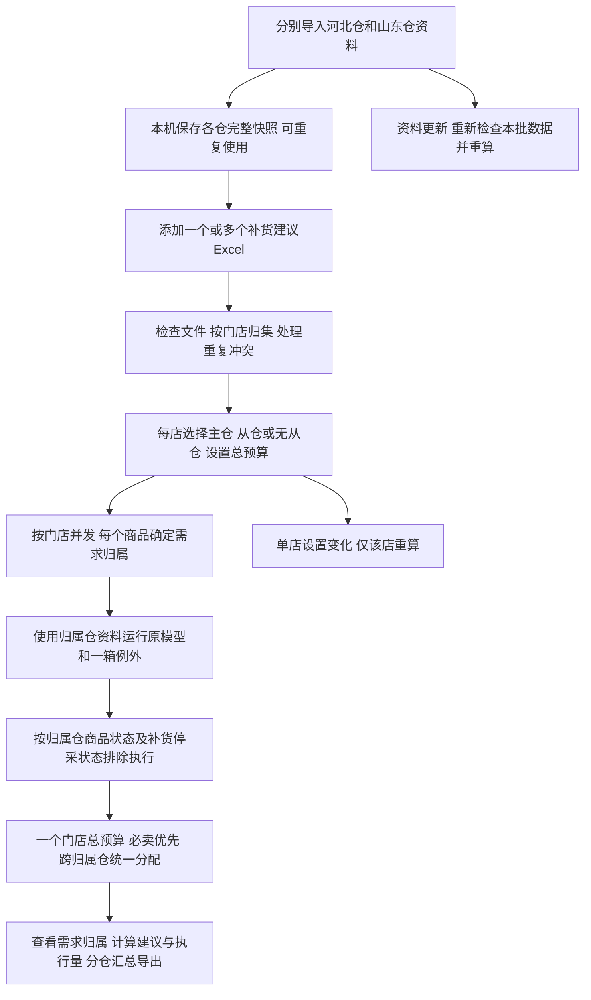

# 0.5.0 分仓资料与需求归属

本次增加外部仓标签、分仓资料快照、门店主从仓与归属追踪。原模型、最低持有、一箱例外、禁用/停采和必卖预算算法保持0.3规则；原0.3、0.4交付包保留。需求归属规则独立记录为0.5.0，不把历史试验保护期或日均改法并入。

## 使用流程

## 确定需求归属

| 条件 | 归属与计算 |
|---|---|
| 主仓有该商品、非禁用、可用数>0 | 主仓；即使库存只有1且需求超过1也不拆单、不限量 |
| 主仓禁用、可用数≤0或无该商品，已配置从仓 | 从仓；不再因从仓无货清零需求 |
| 仅配置主仓，主仓无货 | 仍归属主仓并计算需求 |
| 从仓禁用 | 归属从仓，保留计算参考，沿用禁用规则排除执行 |
| 主仓可用数缺失或非数字 | 保留主仓，记录可用数待核，不把未知当0 |
| 归属仓没有SKU，但其他已导入仓有 | 归属仍保留，资料待核，不能借其他仓价格/箱规 |
| 已导入仓均无该SKU | 地采商品，保留销量库存，不编造价格或补货量 |

不新增“仓库暂不可供”商品类别。无货判断只用于转仓，不构成需求计算/预算执行的新拦截。库存快照不会因计算或并发扣减，后续实际发货配货不在本版范围。

## 字段与来源

补货建议按“门店编码+商品编码”唯一确定门店销量库存记录。分仓商品资料按“仓库外部标签+商品编码”唯一确定资料；两个仓同SKU合法，一个仓内重复SKU拒绝整份导入，原快照保留。

| 字段 | 作用 |
|---|---|
| 商品编码 | 精确匹配，不按名称猜测 |
| 商品状态、可用数 | 主仓转从仓依据；商品状态还参与既有禁用执行规则 |
| 基本售价 | 归属仓V单价，用于金额与预算；不用采购价替代 |
| 出库箱规 | 归属仓最小出库单位；缺失仍按既有确认补1 |
| 分类、可选补货模型分类 | 归属仓分类权重；未知分类沿用无分类快销 |
| 门店主从仓设置 | 外部选择；与资料文件内部列无关 |
| 门店日销/周销/月销/可用/在途 | 沿用补货建议输入，不拿中心仓可用数替代门店库存 |
| 来源、源行、SHA256、导入时间、快照版本 | 追溯本次归属与计算依据 |

本机快照在应用数据目录的`warehouse_catalogs/河北仓.json`、`山东仓.json`，门店设置在`store_supply.json`。默认不填任何仓资料，避免把示例文件猜成某一个真实仓。成功导入整份替换选中的仓快照，失败保留旧资料。原Excel只读。

## 验证与版本对应

新增`verify_warehouse.py`覆盖单/双仓、库存缺失/不足/零、禁用与停采、地采与资料待核、主从仓价格/箱规/权重/到货参数、并发与单店总预算、快照复用和导出金额勾稽。
新增`verify_warehouse_exe.py`验证打包程序的资料维护、门店配置、无货仍有需求、单店失效、导出与复用。原`verify_budget.py`、`verify_batch.py`和`verify_exe.py`继续验证兼容模式。
发行归档必须同时使用本次源码提交的五份报告；开发试跑报告不得用于封包。源码版本0.5.0，模型版本0.3.0-rules，打包目录自动为`交付_0.5.0_<构建编号>`。
实际验收结果以`releases/0.5.0/<构建编号>`为准。给定资料模板是9142行单份数据，未声称已取得两个仓的真实同期库存；双仓业务边界用明确标注的合成样本验证。
