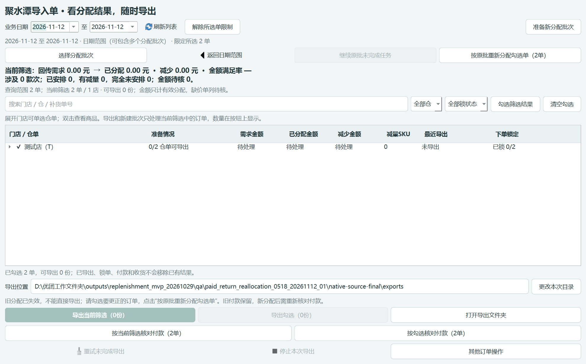
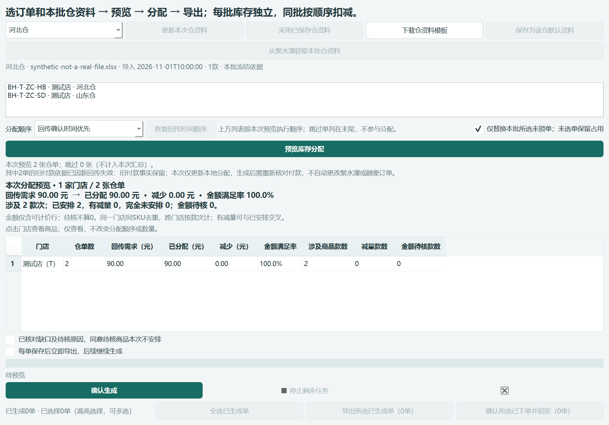

# 0.51.8 付款后回传更正与原批重分配

## 现场问题与原因

业务先完成分配和付款核对，处于待收货；加盟商改量并提交新回传后，原分配的回传依据失效，不能直接导出。0.51.7 同时存在三个问题：新批入口排除所有已分配订单；日期总览必须先另选原批才能重分配；原批校验又将任何付款记录一律拦截，没有区分旧付款是否已因新回传失效。因此出现“0/2可导出”，却提示“已生成单可直接导出”的死路。

用实际计算与保存入口、隔离合成订单已复现这条状态链。本次没有读取业务电脑数据库，尚不能证明现场两张订单的具体版本、锁单和收货事实与演练完全一致。

## 业务如何继续

1. 先保存加盟商重新确认的完整回传单，核对原签发单号、门店和供货仓。
2. 在“聚水潭导入单”日期总览勾选要更正的仓单，点击“按原批重新分配勾选单”。无需退出本页再寻找批次。
3. 若所选单来自多个批次，每次明确选择一个原批；其他勾选保留，不能混用各批库存。未生成订单另走“准备新分配批次”。
4. “预览库存分配”沿用原批冻结库存及顺序，只替换所选订单；未选订单的分配和占用不变。查看新数量、金额与缺口后确认生成。
5. 新生成单可导出。旧付款事实和旧生成单完整保留；新的分配不表示已按新金额付款，应回到付款核对，按真实付款依据明确确认后再进入待收货。
6. 若已在聚水潭或翱象执行下单，仍由业务核实是否需要更正外部订单。本地重分配不会自动作废、修改或重发平台单。



图源：0.51.8 源码 Qt 隔离演练，测试店两张仓单；不是业务现场数据。



图源：同一隔离演练，河北需求由40改为30，山东由20改为15；原批河北还有未选门店占用60，保持不变。

## 保留的边界

- 允许更正的是已确认新回传、旧付款依据确因回传变化而失效的订单。当前回传对应的有效付款、待核付款和旧格式不明依据仍不能任意重分配。
- 已锁单继续受保护；任何收货记录均须先核对实收事实，不能借重分配改写或抹去。不会将实际付款、已下单或收货事实伪装成未发生。
- 更正预览冻结旧付款版本和摘要；提交时复核付款、回传、签发、活动生成单、库存占用和批次控制版本。期间有修改则拒绝提交并要求重新预览。
- 支持所选订单改为零需求，仅释放该订单的原批占用，旧付款保留；之后重新产生需求仍可回到原批。零需求后如需确认零付款，须据真实业务在付款环节处理。
- 分配模型、库存扣减和箱规、价格、预算、主从仓归属均不修改；不采用新批库存绕过原批约束。
- 取消、失败回滚和已提交操作重试保持原契约；本次更正组在一个事务内完成，不部分替换同组订单。

## 验证与复跑

源码专项在 `tests/test_paid_return_reallocation.py` 和 `tests/test_paid_return_reallocation_ui.py`。原故障、各轮测试和原生界面证据保存在 `qa/paid_return_reallocation_0518_20261112_01`，保留测试夹具首次导入错误及修正后结果，不覆盖旧验收。

原生界面入口（必须指定新的独立QA输出目录）：

```powershell
.venv\Scripts\python.exe tools/verify_paid_return_reallocation.py --out qa/新的独立目录 --exe 交付_0.51.8_rc1/补货助手/补货助手.exe
```

脚本只生成隔离订单和原表，不连接真实平台。它检查同店两仓原批更正、未选门店库存、旧事实保留、自动导出及重新核对付款后的状态；真正平台订单的撤销或更正不在本次验收范围内。

最终源码、EXE哈希、回归和打包结果以 `releases/0.51.8/rc1/交付报告.md` 为准。0.51.7和此前交付均保留，本轮未要求推送或合并。
