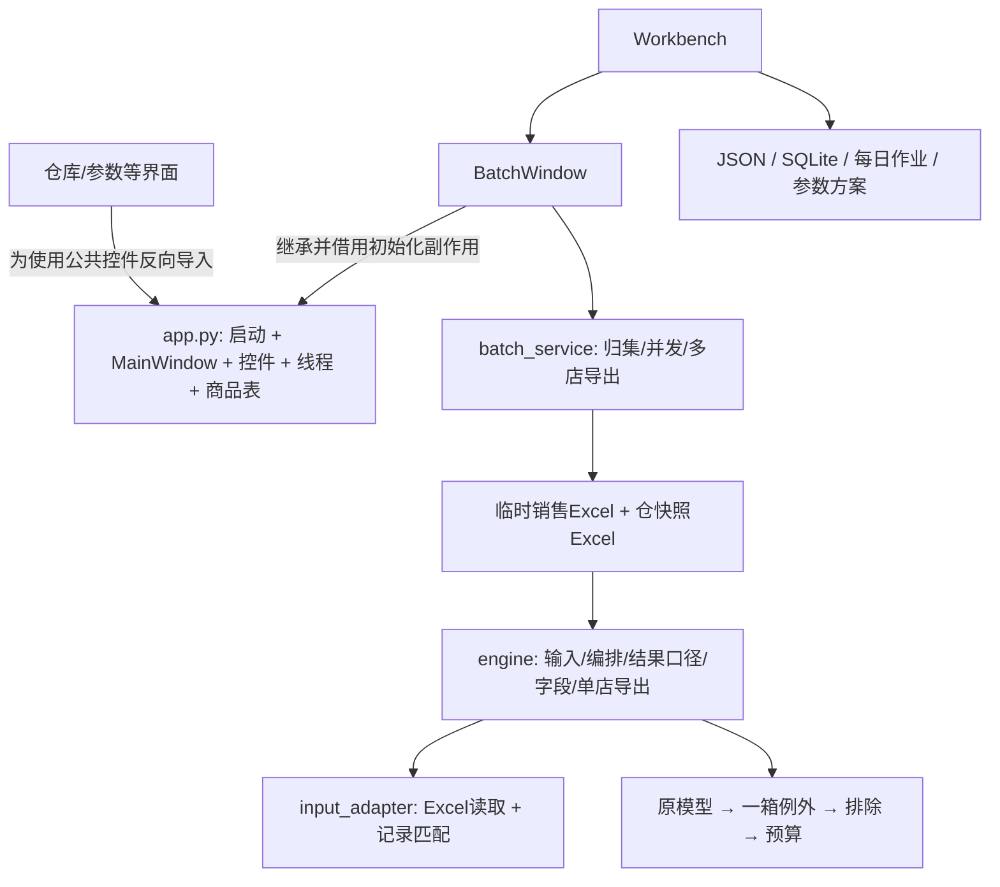
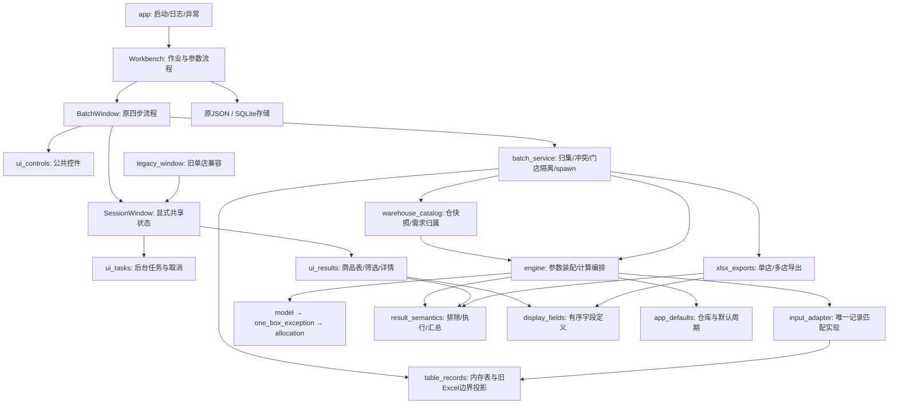

# 0.6.1 代码结构与查找索引

本次是对固定提交 `e50072cc00c6997aed9fe1113012192210ad7eb3`（0.6.0）的结构整理。模型规则 `0.3.0-rules`、需求归属 `0.5.0`、参数/作业格式 `1` 均不变。阶段证据见[结构整理阶段记录](结构整理阶段记录.md)，发行证据以 `releases/0.6.1/<构建编号>` 为准；构建前本文件不表示已验收发行。

## 整理前

## 整理后

## 从操作找到代码

| 要查的问题 | 入口与调用链 |
|---|---|
| 启动、日志、未捕获界面异常 | `app.main` → `Workbench`；打包子进程先 `multiprocessing.freeze_support` |
| 原四步页面、勾选门店、失效、部分完成 | `batch_app.BatchWindow`；工作台覆写部分状态联动在 `workbench.Workbench` |
| 公共状态何时建立 | `ui_session.SessionWindow.__init__`；不创建页面，不在构造期间调用子类页面方法 |
| 后台任务、取消、退出等待 | `ui_tasks.Worker / BatchWorker / BackgroundJobs`；计算检查点在 `runtime_support` |
| 商品列、筛选、排序、详情 | `ui_results.GoodsModel / FilterModel / ResultsView`；共用列在 `display_fields.COLUMNS` |
| 多文件、相同重复、冲突选择与源行 | `batch_service.intake` → `prepare`；原源文件哈希仍在读前读后核对 |
| Excel工作表识别与读取 | `engine.sheet_name` → `input_adapter.read_table` → `table_records.table_records` |
| 内存记录变模型字典 | `engine.load_records` → `input_adapter.prepare_records`；文件入口 `prepare` 也委托同一实现 |
| 原临时Excel影响了什么 | `table_records.bridge_table / bridge_cell`；仅内部归集/快照调用，保留16位数字序列化、空文本、日期毫秒和XML回车规则 |
| 仓资料维护与主从仓归属 | `warehouse_catalog.import_catalog / Repository / prepare_records / route_store`；库存只用于归属 |
| 完整方案、分类覆盖、门店有效参数 | `parameter_schema.standard / apply`、`workbench.selected_settings`；具体优先级见字段契约文档 |
| 单店计算 | `batch_service.calculate_store` → 归属 → `parameter_schema.apply` → `engine.run_calculation` → 原模型/一箱例外 → `engine.apply_budget` |
| 串行/并发及隔离 | `batch_service.run` 创建 Windows spawn 进程；每店独立输入/配置副本，最多4个并发 |
| 计算量、候选量、执行量不是同一口径 | `result_semantics`；字母AS/BV和预算审计字段保留，不改写为执行量 |
| 排除、待核、状态、金额与持有天数 | `result_semantics.exclusion_reason / issue_text / order_status / summarize / coverage` |
| 单店/多店Excel | `xlsx_exports.export_xlsx / export_batch` → `write_table`；两种原有样式策略显式保留 |
| 作业按天、覆盖确认、历史只读 | `workbench`的确认流程 → `work_repository.Repository.save_job` 的修订检查与SQLite事务 |
| 参数试算不修改正式结果 | `parameter_trial.compare`；复制配置并重新计算，不覆盖作业 |
| 参数方案、门店默认与仓快照持久化 | `work_repository`、`priority_list`、`warehouse_catalog.Repository`；无格式迁移 |
| 原模型公式与字母含义 | `model.py` + [字段与数据契约](字段与数据契约.md)；原模型字典未改写成新对象 |

## 兼容入口

- `app.MainWindow`：通过模块惰性属性访问旧单店窗口；活动工作台不依赖它。
- `engine` 原结果辅助函数、`COLUMNS`、`IMPORT_HEADERS`、`import_audit_rows`、`export_xlsx`：导入别名，和新模块是同一对象。
- `batch_service.export_batch / write_sheet`：导入别名；没有另一套导出实现。
- `engine.load_inputs`、`input_adapter.prepare / read_table`：保留Excel入口与文件哈希检查。
- `warehouse_catalog.write_catalog / prepare_warehouses`：保留原显式Excel兼容入口；归属、元数据和预览合并共用 `_prepare_catalogs`。
- `runtime_support.Cancelled` 与 `engine.Cancelled` 是同一异常类，原取消捕获仍有效。

内部加载对象的原临时路径现在用 `memory:batch.xlsx`、`memory:master.xlsx`、`memory:河北仓.xlsx`、`memory:山东仓.xlsx` 表示。它们仅表示不再存在的中转对象；原始输入文件、SHA256、工作表、源行、仓修订和导入审计继续保存，不把真实来源替换成内存标识。

## 本次没有改变什么

三份算法文件及默认JSON逐字节不变；没有调整导入路径。只有 `input_adapter` 的读表/记录匹配边界改变，其原匹配主体和其他算法函数通过AST完全一致检查。采用库存单位、基本售价、缺箱规补1、无分类用快销；库存归属不截断需求、不拆单、不预占；没有应用3.5+5天、统一日均或试验安全余量。

每日作业、原仓快照、JSON方案与SQLite继续使用格式1。类型契约只作静态说明，不强制数值转换。内存桥接中的数值投影是显式复现原临时Excel往返，不是新的业务转换规则。

## 独立验证与复跑

`tools/structure_oracle.py` 从固定Git归档运行基线、从当前源码另起解释器运行候选。输入、方案、必卖与仓快照先冻结；测试设置目录在QA内部。按门店编码+商品编码检查唯一性与完整记录，严格比较全部嵌套字段的类型和值，不设浮点容差。另比较工作表顺序、全部单元格值/类型、列顺序、完整样式表、筛选与冻结窗格等结构。

执行顺序：`freeze`（只对不存在的目录）→ `capture --source <固定基线目录>` → `capture --source .` → `compare`。`qa/structure_061/frozen.json`与`oracle-full`为本次固定依据；不得复写它们制造新的预期。新候选输出必须使用新目录。最终验收记录会列出实际目录、差异数及精确动态白名单。

`verify_memory_adapter.py` 用实际写出/读回的旧Excel路径，对照内存路径的边界值与错误；分别在源码lxml和EXE使用的etree环境执行。`tools/adapter_structure_check.py`替代原适配器整文件哈希断言，检查完整匹配主体和未拆分算法函数的AST；不替代全量结果对照。`tools/verify_structure.py`检查依赖方向、继承、兼容别名身份和核心文件哈希。

最终仍须执行预算、多店、分仓、工作台回归和三套实际EXE交互验收。旧报告与源码启动成功均不能代替本次打包验收。

## 已知限制与遗留

- 原历史命令行 `input_adapter.run` 仍引用未随桌面源码分发的 `schema.json`；桌面入口不使用它。本次记录而不夹带修复。
- 工作台保留既有继承层次，公共结果视图对页面、状态栏和任务入口的要求已在类文档写明；没有引入依赖注入框架或重做UI。
- 内存桥接依赖已锁定的openpyxl 3.1.5单元格序列化语义，升级依赖必须重跑两种XML环境的边界验证。
- 旧临时Excel兼容接口可由外部调用者继续使用；活动批量归集不再调用它们。
- 未验证其他Windows电脑，也不声称逐字节可复现构建。业务双仓场景使用明确标记的合成样本，不能代替两仓实际经营资料的联合验收。
