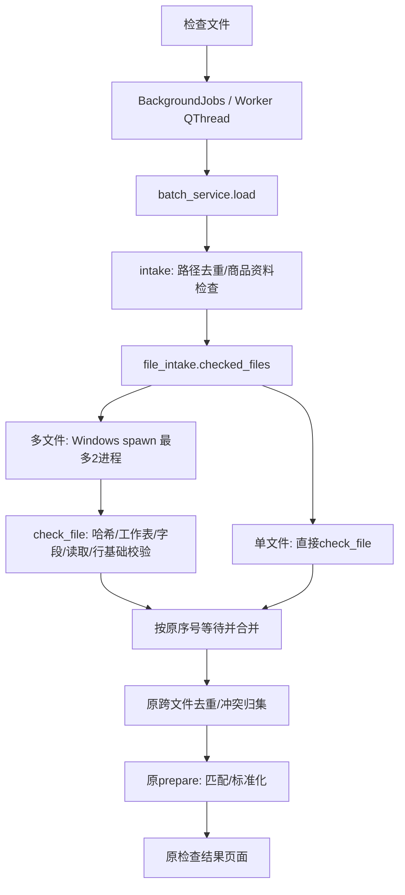

# 0.6.2 多文件检查

固定基线为实际开始时HEAD `ebaf8d059667968d11ee994c20837b4313f32337`，原分支refactor/structure-0.6.1且工作区干净。本次独立分支perf/parallel-intake-0.6.2。模型0.3.0-rules、归属0.5.0、存储格式1不变；候选是否通过验收以releases/0.6.2中的报告为准。

## 调用链和边界



新模块的顶层函数check_file(index,path)只接收序号和绝对文件路径，不传输商品资料、Qt对象、用户配置或整批数据。每个文件返回报告、记录、名称、已按旧规则排序的表头和哈希。普通文件异常返回原错误文本，该文件不发布部分有效行；进程崩溃、任务传递/解包失败向协调线程抛出，不能伪装成成功。

商品资料检查仍在父线程；匹配、仓路由、模型、一箱例外、排除、必卖、预算、解释和导出不在读取子进程内执行。单文件不构造进程池。“同时计算门店数”仍只控制后续门店计算，不增加新界面参数。

## 顺序和内存上限

路径仍先resolve并按原dict.fromkeys规则去重。序号是去重后的原列表位置。总共最多两个尚未按序合并的任务（运行中或已完成等待），而非无限提交文件队列。

结果可乱序到达ready，但只从merge序号连续取出，父线程再执行原合并。报告、文件内行、门店首次名称、表头并集、重复来源、冲突组/编号/候选项、后续匹配输入都保留原顺序。没有增加业务排序。早文件很慢时，较快文件可能等待；这是限制内存和取消队列长度的明确取舍。

读取前后哈希与后续prepare前后源文件校验仍保留；旧仓快照/每日作业frozen语义不变。

## 取消和关闭

协调线程每50毫秒等待检查取消标志；取消后不再提交新任务，取消尚未启动的future，丢弃已完成/在读任务结果，shutdown(wait=True)回收全部子进程。不强制杀死正在解压/读取文件的进程；最多等待两个在读文件安全结束，慢盘/网络文件系统的等待取决于读取何时返回。

窗口在worker结束前不启动新检查，也不退出。仅对batch_service.load增加成功前取消检查和Qt排队信号的活动worker身份检查，避免取消/关闭后的旧信号写入新批次；其他任务的信号行为保留。读完后仍走原未保存作业确认。

Windows/PyInstaller仍由app.py的freeze_support在创建QApplication前分派spawn子进程。check_file是模块顶层函数，不在子进程创建窗口。intake_probe/intake_smoke只由显式测试参数使用，不进入正常检查流程。

## 可复跑验证

独立QA目录qa/parallel_062。baseline来自Git归档；frozen.json固定源码、输入、参数、必卖、仓快照、旧包和用户资料哈希。原始文件不写入；文件变化测试只改QA临时副本。

- `tools/parallel_qa.py capture`：新旧独立解释器，逐层完整对象与Excel导出；compare同时比较列表顺序及字典键顺序，绝不按SKU重排。普通时间/进程/构建叶子使用明确白名单，类型和浮点严格相等。
- `--forced`：测试任务使前文件延迟，证明后文件先完成时整个业务结果与顺序不变。
- `controls`：子进程崩溃、取消、回收、重试，以及实际字节在读取后变化的独立新旧对照。
- `verify_intake_exe.py`：运行真实包，验证乱序、错误、取消、关闭、再次检查；记录EXE哈希与所有观察到的子进程，退出后确认无残留。
- 继续运行预算、多店、仓、工作台及已有EXE回归。

旧engine._master_config从set追加未知分类，字典键顺序原本受Python哈希随机种子影响。首轮不固定种子的报告保留；正式新旧独立进程都使用PYTHONHASHSEED=0，不改旧代码、不排序或忽略这些字段。文件顺序/去重/冲突顺序仍完全比较。

示例（输出目录须不存在）：

```powershell
$env:PYTHONHASHSEED='0'
.venv\Scripts\python.exe tools/parallel_qa.py capture --qa qa/parallel_062 --source qa/parallel_062/baseline --output qa/parallel_062/新基线对照
.venv\Scripts\python.exe tools/parallel_qa.py capture --qa qa/parallel_062 --source . --output qa/parallel_062/新候选对照 --forced
.venv\Scripts\python.exe tools/parallel_qa.py compare --qa qa/parallel_062 --baseline qa/parallel_062/新基线对照 --output qa/parallel_062/新候选对照
.venv\Scripts\python.exe tools/benchmark_intake.py run --qa qa/parallel_062 --output qa/parallel_062/新性能测试 --rounds 3
```

## 性能口径

同机同Python/依赖，新旧版本按AB/BA/AB交替，每次单独运行。每组至少3次；报告中位数、最小和最大。单文件、2分片、6分片、大文件加3个小片段；分片和摘录明确标记为合成文件布局，不冒充新增真实门店。

intake时间包含商品资料快照读取、各销售文件哈希/识别/读取/校验、跨文件有序合并与去重；prepare是后续匹配/标准化。完整检查计时覆盖load调用，包含进程启动、传参、回传、合并及池回收，不只取子进程读取时间。解释器/界面已经导入模块的启动时间不算一次“检查”。另报同数据预算3000的代表性计算时间和结果。

外部控制器每50毫秒通过Win32 API采样检查主进程及所有子孙进程，报告同期WorkingSetSize之和的峰值，并附PrivateUsage之和。RSS相加重复计算共享页，PrivateUsage是私有提交量而非私有物理RSS；采样可能漏掉短峰。控制器不计入。原始采样逐轮保存，可审计。

不清理操作系统文件缓存，结果属于重复运行的混合/热缓存测试；不声称冷盘效果，也不能排除系统后台负载。单文件不应承担池启动成本，多文件收益和内存代价以实测为准，不能承诺固定倍数。

候选构建用新目录，不替换旧包或用户设置。assemble.py针对0.6.2额外要求正常/强制乱序的等价报告、性能报告、检查文件EXE及控制测试报告；不允许借用0.6.1验收代替。本次不自动合并或推送。


性能混合样本补充：原始大文件与重写摘录会在部分非模型数值字段产生62组冲突，旧版与新版都正确阻断；首次性能汇总断言失败，原始逐轮记录保留。正式混合场景改为同一写入方式生成完整真实记录副本与三个100行摘录，保证重复记录原值一致；仍保留14244行、3000预算88款/2999.87元的既定预期，并在计算前强制检查无未解决冲突。不是放宽预期或跳过业务差异。

性能采样补充：Windows venv 的启动器与实际解释器可能为两个 PID。初版无子进程断言错误地把解释器也计为读取进程；保留失败测量，正式脚本记录实际解释器 PID，单文件要求没有额外读取进程，所有测试要求无残留 multiprocessing 子进程。内存仍计算启动器、实际解释器及全部子孙，不删减采样。

## 本次验收结果

0.6.2 rc1已完成独立正常/乱序等价对照、24次性能测量和实际EXE验收。正常和强制乱序各33对象/5Excel均0差异。两文件/六文件约缩短18%/21%，大小混合慢约11%；单文件无读取子进程。完整分阶段时间、内存、限制、哈希和交付路径见[交付报告](../releases/0.6.2/rc1/交付报告.md)。源码性能与EXE功能验收分别记录，不混作EXE性能结论。
