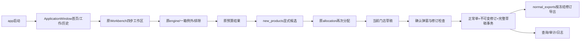

# 0.7.0 首页、正常单和新品

本轮范围对应统一方案 A/B/C。历史外部确认、下单、收货资料的导入关联仍属于后续 D 阶段。发行验收以 `releases/0.7.0/<构建编号>` 为准，开发中的检查不当作发行通过。

## 操作

1. 首页进入工作页，沿用准备数据、门店与参数、计算、查看四步。首页和历史页切换不销毁工作区。首页的“继续已保存的今日草稿”恢复当时快照。
2. 有效计算后，在本店结果或门店汇总点“选择本店新品 / 预览预算”。四项有效零值才进入候选，默认不选。可按必卖、已选、未获预算、仓、分类及商品搜索；隐藏不清空选择。批量操作针对当前筛选，清空全店单独确认。
3. 首铺数量必须为最小出库单位倍数。预览列出候选及执行数量、金额和最低持有缺口变化，点击“应用到本店草稿”才生效。取消维持原选择和分配。
4. “保存草稿”只保存作业。“确认所选门店并自动归档”只处理门店页勾选且有效完成的门店，同时保存完整当前草稿，弹窗展示两者覆盖影响，默认取消。
5. 第一次每店生成 `BH-日期-门店编码-ZC / V001`。同日重算不改归档；再次确认业务变化才成为同号 V002。完全相同结果不增加修订。其他店未被选中或从草稿消失，不删除其正常单。历史旧修订只用于审计，首页金额按当前修订统计。
6. “导出加盟商确认单（带号）”从已确认快照导出当前门店；若未选择本店，先选门店。本版正式导出逐店操作，每文件只含一家门店。每行带补货单号、修订、明细ID；工作表为概览、动销补货、新品推荐、缺货恢复、填写说明。只导出签发量大于0的商品；预算未补足数量在内部工作表/归档审计中保留。加盟商确认数留空，空白不等于0。表内基本售价金额是估算，不是实际采购结算。
7. 正式导出不受商品筛选影响。原全量/当前筛选/批次导出仍在，明确标为内部明细。目标文件已存在一律拒绝覆盖；可另选文件名重导同修订。导出失败不撤销成功归档。
8. 历史归档按日期、门店、单号、商品查询；双击查看当前/旧修订、逐商品明细和完整审计。操作日志可查询并导出JSON，当前记录内部签发、同日修订和带号导出，不等同后续采购/收货流水。

## 边界

- 新品依据本店原输入 J/月销、K/可用、L/在途、N/原缺货天数，全为有效数字0。不用模型Q新品或修正BA替代；不把空值当0。日/周销量矛盾、禁用、停采、地采、缺价或其他待核不可选。缺箱规沿用1，并提示来源。
- AS/BV 和全部模型中间值保留。新品独立 `_new_requested`、组合 `_candidate_*`；有预算使用原 allocation，无预算由显式 `_execution_*` 取候选。必卖新品优先于普通动销，同组仍使用原排序。未选新品逐字段兼容旧版本。
- 重新计算已有新品选择的门店，先明确提示并默认取消；确认重算后需重新选新品。刷新输入同样重新建立工作结果。新品选择只属于本次作业，保存恢复可复用，不传播到其他门店、下一天或门店长期默认。
- 过期、计算中、失败、只读历史不允许签发。跨天不能签发旧业务日期，必须新建今日作业。0金额有效结果可以归档，缺价/待核不伪装零成本可购商品。
- 当前应用仍用既有本机 settings 文件夹。首次增加归档表前，用SQLite backup生成 `workbench.before-normal-orders.<UUID>.sqlite3`。现有JSON及schema1作业不迁移，增加可选新品基础结果快照及独立表。0.7可读取旧草稿；含新品的0.7草稿应在0.7继续，旧程序不能解释新增新品执行字段，不应交替编辑同一天草稿。
- 不处理加盟商回传、不生成实际下单、不预占仓库存、不回写Excel、不自动发送。原0.6.2交付包保留；不自动推送或合并Git。

## 代码索引及数据链



| 文件 | 职责 |
|---|---|
| `application_window.py` | 保持Workbench实例的顶层导航、归档确认、只读历史及新选择编排 |
| `new_product_ui.py` | 商品资格、数量、筛选及当前筛选批量选择 |
| `new_products.py` | 四零识别、候选资格、组合预算、数量差异；不修改原算法 |
| `normal_orders.py` | 每日每店唯一正常单、CAS、SQLite事务、修订、完整来源工作快照与事件 |
| `normal_exports.py` | 冻结签发建议、逐店分组Excel、安全文本、拒绝覆盖 |
| `result_semantics.py` | 新增无预算新品执行口径；未选新品原字段不变 |
| `verify_normal.py`、`normal_smoke.py` | 独立合成业务验收与实际Qt窗口/EXE验收 |
| `tools/normal_equivalence.py` | 固定a417622源对照，使用独立进程捕获，严格业务值/类型/顺序/Excel比较 |

归档主键 `(day,store,normal_model)`；单号和内部ID固定；修订以整数递增。明细ID为订单UUID与精确商品编码确定的UUID5，排序不改变身份。旧修订保留原结果、配置、来源和对应完整作业修订；单独保存草稿不会删除该签发依据。

签发幂等比较只从结果根节点排除 `created`、`task`、`version`（时间/进程/构建诊断）；原快照仍完整保存。等价验证使用另一套更严格的叶级白名单，不能用签发指纹代替逐字段验收。

## 可重跑验证

先固定基线源与输入哈希到独立qa目录；基线源码为a417622，运行代码等同已交付0.6.2，含后来批准的设计文档。

```powershell
$env:PYTHONHASHSEED='0'
.venv\Scripts\python.exe tools\parallel_qa.py capture --qa qa\parallel_062 --source qa\normal_070\baseline --output qa\normal_070\baseline-capture
.venv\Scripts\python.exe tools\parallel_qa.py capture --qa qa\parallel_062 --source . --output qa\normal_070\candidate
.venv\Scripts\python.exe tools\normal_equivalence.py --qa qa\normal_070 --candidate qa\normal_070\candidate
.venv\Scripts\python.exe verify_normal.py --output qa\normal_070\normal
.venv\Scripts\python.exe verify_normal_exe.py --exe 交付_0.7.0_rc1\补货助手\补货助手.exe --fixtures qa\normal_070\normal --output qa\normal_070\normal-ui
```

输出目录须新建；重跑请改目录名。发行还必须通过既有budget/batch/warehouse/workbench及对应EXE验收、intake EXE回归，`assemble.py`对0.7增加normal、normal_ui、normal_equivalence报告门槛。数据样本在本机qa，未随Git上传。不得把合成门店、新品或旧报告说成本轮真实运营效果。
