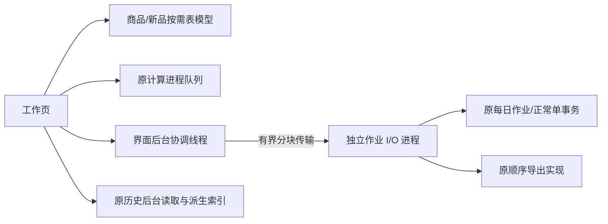

# 0.7.3 工作链路性能与过滤

目标是让原五店大作业中的商品、新品、作业保存恢复、签发与导出保持响应，并以额外真实文件验证规模边界。计算数量、价格口径、预算顺序、仓归属规则及存储格式保持原实现。**本轮明确的商品范围变化：工作链路及商品 Excel 排除商品资料禁用和补货建议停采。**

## 操作与数据边界

- 工作商品列表、新品选择、当前筛选导出、内部全量商品表、加盟商三表共用现有排除原因判定。只排除最终归属商品的禁用状态和补货建议的停采状态；不因主仓禁用而误排正常转从仓商品。
- 原始输入、原模型行、中间值、原建议、预算前后结果与归档快照仍完整保存。历史审计可回溯排除依据；历史 JSON 审计导出仍为完整资料，不伪装成门店商品单。
- 加盟商单仍只有中心仓，保留三张表、A–T 原字段、U 单号、V 简短决策理由；全部符合条件且未被禁用/停采排除的新品候选保留，未安排数量为 0。
- 内部 Excel 原有工作表、列序、字段类型与样式保留；已排除工作表保留表头。必卖匹配明细、已知排除商品的冲突明细同步过滤；原文件行数、原去重数量仍表示真实导入情况。
- 每日作业仍每天一份，同日覆盖仍必须确认。正常单仍每日每店一条链路，同号修订、保留旧版。没有迁移 SQLite、JSON 或压缩格式。
- 选择 4 家并发时，第 5 家及以后持续补位，计算完成不依赖签发或导出。未引入并行导出或缩减内部报表。

## 实现和查找索引

| 位置 | 责任 |
|---|---|
| `ui_goods_fast.py` / `ui_results.py` | 原生 Qt 排序、筛选标记；业务单元格按需格式化；已计算全行汇总复用 |
| `new_product_ui.py` | 新品表虚拟显示、数量编辑、原行索引、搜索防抖、隐藏勾选保持 |
| `result_semantics.py` | `work_eligible`、`working_rows`、`export_projection`；原执行数量和排除原因函数未改 |
| `normal_exports.py` / `xlsx_exports.py` | 按上述投影导出，基础写表与样式复用实现沿用 |
| `ui_work_io.py` | Qt 后台线程协调 spawn 进程、真实进度、取消、关闭边界 |
| `work_transfer.py` | 本机自建 Pipe 分块传输；通常 64 条记录一组、大组拆分；保留值/类型/顺序 |
| `work_io_process.py` | 完整快照读取、保存前核对、签发差异、事务提交和顺序导出 |
| `normal_delivery.py` | 兼容入口保留复制隔离；已独占快照入口避免重复复制 |
| `workbench.py` / `application_window.py` | 原操作入口；专用读取拥有的数据树直接恢复，其他调用仍复制隔离 |
| `work_repository.py` | 未改：原日期唯一、修订冲突检查、事务、JSON/zlib 存储 |

商品表缓存限于当前发布结果，切换数据时清空；筛选汇总携带代次，不把旧计算回填到新筛选。缓存不参与签发、预算或业务指纹。商品价格、数量、日期、空白、编码等不做新的隐式转换。

## 取消、失败与一致性

读取与准备阶段可取消；窗口关闭时取消本次读取并回收本应用创建的进程。正在保存/签发的事务不能强杀，界面提示等待本次提交结束；导出在已有安全检查点停止，已归档修订和已完成文件保留，并列明未完成部分。失败后重试创建独立会话，不沿用旧取消状态。

确认框中的超长差异只显示前 120,000 字符，并明确提示；“导出完整差异”保存全部 JSON，拒绝覆盖已有文件。此限制只作用于对话框文本，归档、明细与审计字段不截断。

原 `get_job` 校验、正常单指纹、修订比较和事务继续使用；后台进程没有跳过完整性检查。分块传输只服务本机创建的进程通道，不新增任意 pickle 文件导入入口。

## 验证入口

所有输出指定 `qa/full_workflow_073` 下新目录；源文件与旧包不覆盖。真实五店 84,693 行，扩展 25 个原始文件 390,433 行。额外实体使用明确标注的 QA 参数，不假称它们已配置正式门店方案。

- `tools/parallel_qa.py capture` + `tools/verify_workflow_backend.py`：固定 0.7.2 的 33 组全业务字段、类型、字典/列表顺序；新旧双方设置相同 `PYTHONHASHSEED=0`，不忽略原未知分类映射的插入顺序。
- `tools/verify_workflow_goods.py`、`verify_workflow_views.py`：商品排序筛选、所有业务单元格、新品选择与编辑；仅按独立的旧排除规则去掉授权排除行。
- `tools/verify_workflow_exports.py`：单店、批次、加盟商工作簿的工作表、单元格值、类型、顺序、样式及批注。
- `tools/verify_work_transfer.py`、`verify_work_io_controls.py`：完整类型传输、覆盖、修订冲突、失败回滚、取消、重试。
- `tools/verify_workflow_pressure.py`：实际工作页检查、4 槽自动补位、逐店商品/新品访问、与固定基线的完整结果对照。
- `tools/benchmark_workflow_final.py`：旧/新、新/旧、旧/新交替的三轮测量，区分总耗时、界面响应和进程树 RSS；操作系统文件缓存不清空。
- `tools/verify_work_io_exe.py` 与既有 normal/work/delivery/history EXE 验证：隔离用户目录，真实运行冻结程序。

正式通过项、精确耗时/内存、构建提交和 EXE 哈希以 `releases/0.7.3/<构建编号>` 为准。首轮压力发现的短暂停顿、存储不改带来的等待和内存代价必须在发行报告披露；本说明不承诺任意规模、任意电脑均无等待。
