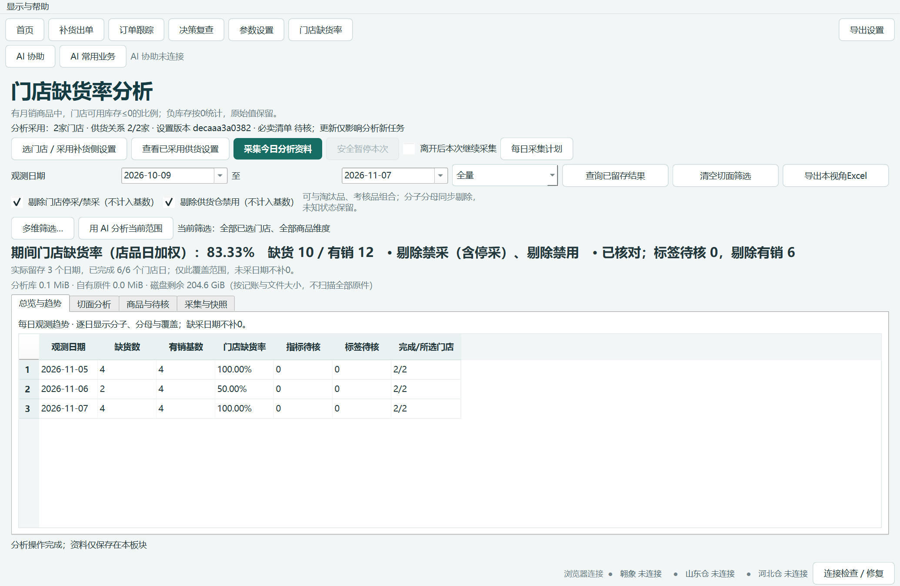

# 补货助手 · 新人使用手册

适用版本：0.48.0。模型：0.3.4-rules。本手册以本机 Windows 应用为准；截图来自同版本实际 EXE 的隔离演示数据，不能当作真实经营数据或新增平台实测证据。

先找到要做的事，再按步骤操作。HTML 可离线搜索；PDF 可搜索文字。应用里的“显示与帮助 → 图文使用手册”打开本手册。页面名称可能因窗口宽度折行，含义不变。

## 01 初次使用：从哪里开始

目标：打开正确版本，知道资料保存在哪一边。

1. 完整解压交付包，打开“补货助手.exe”；保留旁边的 `_internal`、AI 接口和使用手册目录。不要只复制 EXE。
2. 在“版本信息”核对应用版本和构建。升级前关闭旧版，保留旧程序包；不要同时用两个版本编辑同一份资料。
3. 进入首页。补货作业使用补货侧资料；“门店缺货率”使用独立分析资料。只有明确采用设置时，分析侧才复制一份设置，不会反向改补货侧。
4. 点击“导出设置”，选择本人有写入权限、空间足够的本地目录。先用测试门店走一次完整流程。

完成标志：能进入首页，版本正确，知道导出位置。软件启动成功不代表平台登录、商品资料和门店参数都已就绪。

图 1：实际 EXE 首页，隔离演示资料。① 顶部切换业务；② 首页恢复草稿或查询历史；③ 顶部菜单进入显示、手册和导出恢复。

## 02 开机连接：自动尝试，失败再修复

目标：让翱象、山东仓、河北仓连接可用。

1. 正常启动后等待底部连接状态更新，应用会尝试接通和登录核验。
2. 若显示未连接或登录待核，点“连接检查 / 修复”，查看是哪一个平台或仓失败；按界面打开专用浏览器并完成本人登录。
3. 登录失效、验证码、权限不足必须本人处理。修复后重新核验；浏览器能打开不等于账号已通过核验。
4. 手动接通用于自动尝试失败后的排查。不要把另一公司的浏览器、账号或仓会话混用。

异常处理：连接失败时先保留当前作业，修复连接；不要反复新建已提交的采集或采购任务。本章是入口说明，本轮手册没有新增真实平台登录验收。

## 03 设置门店：主仓、从仓、预算、资料来源

目标：按实际供货关系配置门店。

1. 打开“参数设置”，按门店编码和名称定位对象；批量修改前核对所选门店数量。
2. 单仓门店只配置实际供货仓。双仓门店按真实业务设置主仓、从仓，主从顺序影响供货与资料选择。
3. 核对预算、各仓备货天数和到货天数、完整参数预案及必卖清单。单仓归属只依据本店实际供货范围；其他仓有资料，不会因此把商品强行归到其他仓。
4. “仅用于本次”只影响当前作业；明确点击保存默认的入口才改变以后采用的门店配置。保存草稿、计算、签发不会自动保存永久默认。
5. 修改输入、参数或供货关系后重新检查、计算。不要在旧结果上继续签发。

完成标志：门店编码、单/双仓、主从顺序、预算和实际采用参数一致。分析侧要采用新设置时，另到缺货率板块明确采用；旧分析快照保持原设置。

## 04 准备数据：取得补货建议和仓商品资料

目标：取得本次所选门店的销量库存和实际供货仓资料。

1. 在“补货出单 → 准备数据”选择需要的门店，获取翱象补货建议；核对日期、门店编码与名称。
2. 按实际供货仓准备聚水潭商品资料。销售库存来源与商品资料分开使用；不能把缺资料的字段猜成 0。
3. 等待本机采集记录显示各店结果，核对已验收、进行中、待处理与失败的门店。
4. 点击“采用已验收文件并检查”。采用前不会替换当前计算结果；检查后处理明确的表头、门店或资料冲突。

异常处理：“原件存在重复表头”需区分分析会使用的字段与不使用的原表字段；使用字段重复不能按第一列猜取。保留原文件和完整报错用于排查。

## 05 采集异常中断：继续原任务

目标：恢复已受理的采集，避免重复导出。

1. 在本机采集记录选择原来那次任务，点“刷新原任务状态”。先看平台是否已受理和已生成文件。
2. 已受理但尚未定位结果时，使用“继续原采集任务”；不要重新提交同一导出请求。
3. 需要停下时使用安全停止或结束本次采集，等待当前安全步骤完成。停止本地后续动作不会撤回平台已经受理的任务。
4. `TASK_NOT_FOUND` 的意思是当前查询依据尚未找到原任务，不等于导出一定失败。保留原受理编号、时间和原任务记录，按界面核对。

完成标志：各门店状态和验收文件一致。关闭窗口不一定取消已排队任务，应以界面说明和原任务状态为准。

## 06 检查并计算：先处理输入，再看结果

1. 检查文件后确认有效门店、商品资料、必卖清单及待核项。按需要选择门店和预算。
2. 开始计算，查看各店进度；界面显示已受理或进度条运行不代表门店已完成。
3. 已完成门店进入“核对与签发”。未完成、输入过期或失败的门店先按原因处理。
4. 需要停止时停止后续任务；当前安全步骤结束后查看已完成与未执行门店。重试应复用原任务允许重试的范围。

异常处理：模型提示字段缺失、趋势矛盾或箱规不合法时回查原表。不要把待核值改成 0 来消除报错。

## 07 保存草稿、跨日与历史只读

1. “保存草稿”保存当前完整作业，不是只保存屏幕筛选出的门店。
2. 同日覆盖前看差异和减少/失效的门店，默认取消；确认后旧修订仍按现有规则留存。
3. 今日草稿可继续；过去日期的作业按历史只读处理。新一天作业应新建今日草稿或复制配置，并重新准备当天输入。
4. 已签发且未变化的历史修订可以从订单跟踪重导。历史只读时不要把“确认签发并导出”当作新签发入口。

异常处理：“历史只读，请从历史页导出已签发修订”说明当前对象是历史作业；先到订单跟踪选择原单及修订，不是再点击签发。

## 08 人工核对：让表格完整可读

1. 打开最终清单，先选门店、仓及商品范围。收起上方筛选与批量操作区可给表格更多空间；收起不会清除筛选或勾选。
2. 使用“全部字段 / 改量与金额 / 库存与覆盖 / 原因与风险”选择当前要看的列。
3. 拖动列宽，或在“显示与帮助”选择 10、11、12 磅正文和紧凑、标准、宽松行距。偏好只保存本机显示，不改业务参数。
4. 选中商品后，表格上方常驻显示当前商品身份；横向滚动时仍可核对门店、仓、编码与名称。
5. 右键“查看当前行完整内容”，或按 Ctrl+Shift+D；可搜索、选中文本和复制完整字段。长原因不能仅凭省略号判断。
6. 多张风险表可拖动分隔条分配高度；取消窗口不会应用改量。

图 2：实际最终清单，10 磅演示。① 收起筛选区；② 选择列组；③ 查看当前行完整内容。金额汇总与商品筛选的口径以界面说明为准。

图 3：实际同一窗口，12 磅、宽松行距；横向滚动后当前商品身份仍显示。截图仅为隔离演示，不代表人工改量已应用。

## 09 改量、新品与清单补足

1. 在最终清单按库存单位填写数量；箱规输入必须符合允许的整倍数。
2. 填写业务原因，查看自动安排、拟签发量、差额、金额和风险。人工改量与新品金额可能交叉，不能简单相加。
3. 若使用清单补足，先核对所选清单、门店、策略及商品范围，再预览变化。未选门店与商品不应被带入。
4. 对出现的风险逐项核对。应用到本次草稿后还需签发；应用改量不等于已经签发或采购。

异常处理：箱规不合法、关键资料待核、超预算或覆盖风险不能通过缩小显示范围绕过。筛选只改变看到的内容，确认范围要看确认页。

## 10 确认签发并导出

目标：从“核对与签发 → 确认签发并导出”生成门店签发文件。

1. 选择需要导出的门店和仓，核对目标目录。单店双仓可能有多份文件。
2. 在可调整大小的核对窗查看本次变化、旧修订与新签发范围；需要全量时导出完整差异 Excel。搜索只筛选显示，不改变实际确认范围。
3. 确认无误后点击“确认签发并导出”。默认按钮是取消；取消不新增签发。
4. 等待签发归档和逐文件导出结束，查看结果页。签发已提交和 Excel 已生成是两件事；中途失败时可能原签发已保留。
5. 按结果页路径打开实际文件，再发送给门店。发送文件本身需由人员明确操作。

图 4：实际签发核对窗。① 本次签发范围；② 可搜索的差异表；③ 完整差异导出与最终确认。演示中取消与确认分别做了检查。

图 5：实际结果页。请以逐文件路径和状态判断完成，不能仅凭关闭进度窗口判断成功。

## 11 导出失败：按原修订恢复

1. 先读错误第一行：是否已归档、已生成几份。不要因为 Excel 失败就重新签发。
2. 如果文件被 Excel/WPS 占用，关闭该文件；若目录无权限或空间不足，改选可写目录或释放空间。
3. 打开“显示与帮助 → 导出任务与恢复”，也可在订单跟踪的归档导出区域进入。
4. 选择原任务，点“核对所选任务”。系统核对原签发身份、文件是否存在和摘要；缺失或变化的文件可勾选恢复。
5. 点“按勾选项恢复”，选择目录；软件新建恢复目录，保留用户原文件，读取原修订，不新增签发。
6. 文件已生成但导出日志未写完时，可核验后补记日志。原修订无法确认、已删除或已失效时保持待核，不自动改用最新单。

图 6：实际 EXE 中用 Windows 文件占用模拟故障；不是用户原故障的复现证明。旧文件与签发修订在测试中保留。

图 7：核对原任务后按勾选项恢复；已完成文件与需要处理的文件分别展示。

注意：旧版本没有导出回执的任务，从订单跟踪选择原单、原仓和原修订重导。任务状态未知且没有充分回执时，先核对订单和目录，不推断“没有签发”。本地回执只记录任务和身份，不自动清理已导出的外部文件。

## 12 签发 Excel 中的隐藏关联是什么

签发文件已有隐藏工作表“系统关联信息”，记录补货单号、门店编码、仓、业务日期、原签发修订和摘要。它用于回传定位；不是防伪签名，也不能代替原数据库中的签发依据。

1. 使用原签发文件填写需要回传的数量，尽量保留工作簿结构。
2. 文件重命名与工作表重命名不是一回事。复制业务工作表到新文件、删隐藏页、改表名、转 CSV 可能丢失或破坏关联。
3. 不确定时在导入窗口选中文件，点“查看文件关联信息”，只读核对门店、仓、日期与修订。
4. 当前代码路径已验证读写校验；本轮没有替所有 Excel/WPS 版本验证各类另存操作，转换后应重新核对。

图 8：从实际签发工作簿读取的关联信息。它不会修改回传原件，也不会创建新的订单绑定。

## 13 门店回传导入：识别、核对、保存

1. 在订单跟踪进入生命周期单据导入，选择回传环节，选择文件或拖入文件。
2. 检查每个来源组的文件、表、商品行数、环节和目标补货单。新版“识别状态与下一步”会说明为什么匹配或无法匹配。
3. 选中来源组，点“查看识别依据与候选”：候选保留和排除的原因都可查看。
4. 明确缺标记的来源允许人员按完整订单绑定；同名门店、相同 SKU 或相近数量不能证明是同一张单。
5. 有多店/多单混合来源时先划分完整来源组，再明确选原单。来源内部冲突时先修正正确来源，不删标记强行绕过。
6. 点“核对并准备保存”，查看差异和本次纳入范围，再保存。

图 9：实际签发文件回传识别。① 来源组；② 精确签发单；③ 识别状态；④ 原因和隐藏关联查看入口。

图 10：保存前核对上下游与差异。仅预览不保存；正式保存后以回执确认完成。

## 14 回传绑定失败：先看是哪种问题

- “缺少关联”：没有足够的签发身份。核对原文件是否由本程序导出；明确来源后整单人工绑定。
- “旧修订 / 签发依据不一致”：回传对应的不是当前有效签发。回查原签发版本，不自动绑定到新修订。
- “标记损坏 / 字段冲突”：隐藏关联、行字段或文件属性互相矛盾。保留原件，取正确文件或交由维护人员查冲突；不能忽略冲突后自动识别。
- “原单不存在”：核对当前资料目录、门店、日期和原单是否已删除。不能新建同名订单来伪装原单。
- “同单同环节多份文件”：明确选择一份完整事实来源，不按文件到达时间覆盖，不把多份整单数量相加。

整张订单尚未回传不等于回传量为 0。完整订单内明确的空白/缺行处理沿用保存前核对规则，以预览为准。

## 15 付款、收货与五段漏斗

1. 在订单跟踪定位精确门店、仓、补货单，依次导入回传、付款、实际收货文件；不同环节独立留存。
2. 导入付款时核对来源订单、数量单位、支付事实与原补货单；不以采购预览代替付款事实。
3. 实际收货记录用于对照已付款和签发范围。没有收货资料时保持未取得，不能算成已收 0 或已收齐。
4. 在决策复查看五段漏斗与货盘结构。库存货值、签发价货值、实际付款和现货库存不是同一指标。
5. 漏斗供应商/类目扩展另有方案，不能把缺货率已有切面当作所有旧报表都已支持。

## 16 翱象采购：预览与结果核对

1. 从订单跟踪选择本次需要的准确订单，进入翱象批次作业；先看采购预览，再明确确认上传。
2. 在批次内核对勾选范围，只执行需要的订单。历史批次的待处理项不代表本次都要重跑。
3. 显示“采购结果需核对”时，使用“继续核对采购结果”，查询原任务和原采购单；不重新上传。
4. 平台单已创建但本机未关联时，原结果应继续核对。平台已作废、门店/仓/供应关系不符或状态变化时，不能当作待提交成功单直接关联。
5. 停止、结束本地任务不会撤销平台已创建的单。是否提交或作废平台单，由人员在明确业务范围内处理。

异常处理：`SUBMISSION_UNKNOWN` 表示提交结果未知；`TASK_NOT_FOUND` 表示当前查询未定位原任务。都不是“可以再下单”的证明。保留原编号和受理时间。

本章依据现有功能路径和已有验收记录；本轮不连接真实采购平台，也不创建、提交或作废真实采购单。

## 17 门店缺货率：第一次采集

1. 进入“门店缺货率”，点“选门店 / 采用补货侧设置”，选择门店并核对采用的设置版本、必卖清单、单/双仓及主从顺序。
2. 点击“查看已采用供货设置”，确认分析使用的供货关系。补货侧后来改参数，不会自动覆盖这里的已采用快照。
3. 点击“采集今日分析资料”，观察采集与快照中的原任务状态。翱象采集复用并行能力；按平台实际受理状态等待。
4. 需要离开时先选择是否“离开后本次继续采集”。未进入板块时不加载分析页和查询能力；每日采集计划是明确启用后的独立安排。
5. 选择观测日期，点击“查询已留存结果”。未采日期不补 0；只对已完成的门店日覆盖作结论。

图 11：实际 EXE 查询隔离演示日报。标题同时显示缺货数、有销基数、比例和覆盖，便于判断是否可比较。

## 18 缺货率怎么算，为什么有时显示横线

门店缺货率 = 纳入范围内“月销大于 0 且可用库存小于等于 0”的店品数 ÷ 纳入范围内“月销大于 0”的店品数。

- 负库存按 0 参与统计，原负数保留在证据中；在途不是门店可用库存。
- 默认剔除门店停采/禁采及实际供货仓禁用，同时从分子和分母剔除。
- 淘汰品按虚拟分类“标杆淘汰”系列识别，考核品按“淘便考核”识别；四种视角可选择。
- 标签未知与指标未知不同。标签待核需要查看资料依据；指标待核或基数为 0 时不输出可靠百分比。
- 多店、多日用缺货数合计除以有销基数合计，不平均门店百分比。跨日同店同商品计为不同店品日观测。
- 缺货率是门店观测指标，不是仓库缺货率，也不是全天缺货时长；不能单凭它认定参数设小、没采购或仓库迟发。

显示“—”时到“商品与待核”查指标待核；若是旧日报尚未采用负库存规则，按第 20 节用留存原件重算，不必重新采集。

## 19 多维切面、筛选与 Excel 导出

1. 先固定日期、剔除视角及停采/禁用开关，再设多维筛选。按编码或名称定位，门店和商品都要核对编码。
2. 选择或自定义维度组合：门店、供货仓、中心仓/地采、必采属性、上游供应商、类目等，最多 12 个维度。
3. 同一维度多选是“或”，不同维度之间是“且”。地采的供货仓显示“地采”；上游供应商是仓商品对应的供货商。
4. 查看切面后可选分组筛选或下钻，逐页读取。分组数很多时不要只看第一页就称为全量。
5. 点击“导出本视角 Excel”，选择要导出的多套组合和是否包含明细。每套组合一张工作表，每行一组完整维度与指标，表头可筛选。
6. 导出后核对日期、过滤条件、覆盖、分子分母和工作表名称。未知仍为空或待核，不自动编造。

图 12：隔离演示中的门店、仓、上游供应商和类目组合。界面是分页预览；导出范围由导出确认确定。

## 20 分析数据维护：重跑、重算与删除

1. 到“采集与快照”选择原作业，先看该作业日期、门店范围、设置版本及原件状态。
2. 重跑采集使用原任务允许的范围；先查询已受理任务，不重复创建未知结果的导出。
3. “用留存原件重算”在本地复用原件；明确选择原作业当时设置或当前已采用设置。两者不是同一业务口径。
4. 重算发布新日报修订，旧分析会话不自动换到新数据。重新查询后才看到最新日报。
5. 删除分析结果或作业日志前看确认范围；有原件被引用或任务未安全结束时按界面处理，不强制删文件。
6. 分析维护只影响本模块，不能用它清理补货侧订单、参数或真实平台数据。

## 21 AI 连接与门店缺货率分析

1. 点击顶部“AI 协助”，启用本机连接；在配置/修复本机连接中为使用的客户端生成配置。使用随包 AI 接口和稳定入口，不需要把业务资料直接交给任意脚本读取。
2. 客户端完成 MCP 配置后先查询工作台上下文。未连接时按配置说明处理，不以终端、SQL 或浏览器绕过接口。
3. 在门店缺货率设好日期、筛选与维度，点击“用 AI 分析当前范围”。选择概览、两日比较、重复缺货、资料剔除复核或后续调参证据，复制后发给 AI。
4. 复制要求不会自动执行。AI 查询后台完成后按页读取；同一分析会话固定日报修订，约 1 小时过期，关闭连接或重启后需重新查询。
5. 明确要求导出时，AI 使用同一快照导出本地报表。默认只查询，不采集、不签发、不采购、不删除。

图 13：实际 AI 分析要求窗口。范围来自当前缺货率页，复制不会启动业务操作；此图不证明外部 AI 客户端已经完成调用。

## 22 AI 调参：本期能做什么

本期新增缺货率事实、切面、重复观测和原表证据查询，以及为后续调参准备证据的操作说明。已有的参数字典、独立试算和明确采用到本次作业继续使用。

1. 先核对资料质量和缺货覆盖，再看准确原单的签发、回传、付款、收货事实。
2. 履约没有精确原单关联时，原因保持未知；需要人员明确原单后，通过已有漏斗与历史复盘工具查询。
3. 拟调整参数时，先读完整参数含义、合法范围和本店供货配置，按同一输入独立试算。
4. 人员核对完整候选、金额与风险后，明确采用到本次作业；保存永久默认是另一个决定。

尚未实现：AI 自动为所有门店批量配置参数并保存默认、自动采购闭环、根据缺货率自动判定原因。本期不能把提示模板当成已交付的自动配参引擎。

## 23 删除订单、任务与全部初始化

1. 删除前选准日期、门店、仓及订单，阅读完整预览；同店同日两仓共享父单的现有规则仍适用。
2. 若提示关联任务未处理，进入原批次核对平台结果。已有采购身份或平台任务不能仅靠结束本地准备来消除。
3. 停止后等待安全边界；正在提交时不能强杀进程。取消后查看原任务结果，再决定是否重试。
4. “全部初始化”用于明确清空本机资料的场景，按确认页核对数据目录、备份和清空范围。它不能撤销平台采购单，也不能用来绕过未知提交结果。
5. 外部已导出的 Excel、其他位置备份与平台单据，不会因为本机订单删除就自动消失。

本手册的演练只用隔离数据。对业务电脑执行初始化或删除前，必须由操作者核对准确对象和备份，不要照抄演示目录。

## 24 常见报错：先做哪一步

- 登录待核 / 未连接：打开连接检查，核对具体平台和仓，完成本人登录，再复核。
- 已受理、结果未知：查询原任务；不要重新提交。保留受理编号与时间。
- 当前作业、参数或结果已变化 / STALE_CONTEXT：重新核对当前范围，重新查询或试算；旧候选不能直接采用。
- 基线重算与当前结果不一致：停止调参，核对输入、参数、人工改量及结果来源。不是“可忽略误差”；保存原提示用于排查。
- 历史只读 / 跨日作业：新业务使用今日草稿；旧已签发单从订单跟踪按原修订重导。
- 导出未全部完成：先看签发和逐文件状态，再进入导出任务与恢复；不重复签发。
- 文件被占用 / PermissionError：关闭 Excel/WPS 文件，核对写入目录；恢复到新目录可保留原文件。
- 数据被占用 / database is locked：等当前操作结束，查看原任务状态，再重试原操作；不要同时开多个版本编辑。
- 旧修订 / 隐藏关联冲突：查原文件与原签发修订；不自动匹配到最近订单，不删标记绕过。
- 缺货率为横线：查看指标待核或基数是否为 0；缺采不补 0，负库存旧日报按提示重算。
- 磁盘不足：停止启动新的大采集/导出，保留已完成数据，核对可清理范围；不要直接删除数据库附件目录。

## 25 向维护人员描述问题

请一次提供：应用版本与构建、入口及按钮、日期/门店编码/仓/订单或任务编号、操作前状态、完整报错与发生时间、目标导出目录、是否已有部分结果。截图要包含状态和提示。

导出问题优先附本地导出回执和日志；回传问题保留原 Excel，不要先删隐藏页或改名改表。不要在普通聊天中发送密码、Cookie、令牌或无关敏感资料。

本次已知限制：用户所说的签发导出失败入口已确认，但未取得那次原始错误与原件，因此不能断言某一个故障注入就是原故障根因。测试、截图和真实业务验收的范围以交付报告为准。

## 26 新人内部练习单

使用隔离演示环境依次完成：连接状态辨认 → 两店输入检查与计算 → 打开审计表并查看全文 → 取消一次签发 → 确认签发与打开文件 → 查看隐藏关联并导入回传 → 演练导出占用及原修订恢复 → 缺货率多维筛选/导出/本地重算 → 复制 AI 只读分析要求。

每一步记录：想做什么、点击哪里、看到什么代表完成、遇到什么提示、怎么恢复。没有真实新人独立参与时，只能称为内部走查，不能称为“新人验收通过”。

手册来源：应用对应源码、自动化验收及实际 EXE 截图。截图索引记录来源和演示条件；旧版记录保留在项目历史文档中。本手册为当前操作入口，不承诺未标明的真实平台或低配置电脑验证。
