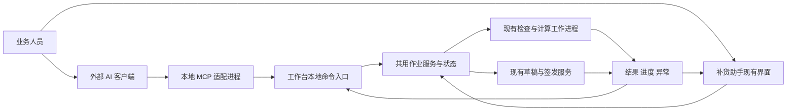
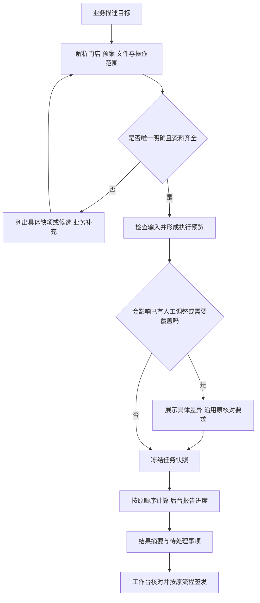

# 补货助手 AI 外接操作接口与人机协同设计

日期：2026-11-04。设计基线：0.34.0 rc2，源码提交 `f0e3765d5f317cf45d708f3774bee90652bc5dc2`，模型 `0.3.4-rules`。

本方案新增一个供外部 AI 使用的操作入口。补货助手继续负责参数解析、计算、校验、任务执行、归档和导出；业务人员继续在现有工作台核对与接手。首期打通已有文件与预案的检查、计算和复查，不改变补货规则。

本文为设计稿，接口、模块名和交互均为拟建能力，不能据此认为已经实现。本次只新增设计文档，不修改程序、用户配置或业务数据库。工作区另有 README 等文档修改，未纳入本方案的编辑范围；当前版本以源码和发行记录为准。

## 1. 面向业务的目标与首期范围

业务人员可以在支持本地工具连接的 AI 客户端中提出目标，例如：

> 用现有文件和青岛线预案准备今天的补货，保持原门店顺序，计算后放到工作台。列出缺资料、预算缺口和需要人工核对的商品，先别签发。

预期只需要说明一次范围。AI 自动读取预案、识别门店和文件、核对生效参数，执行已有检查与计算服务，再返回摘要和工作台入口。有同名门店、未解决冲突或会影响已有人工调整时，停在需要业务判断的具体步骤。

| 首期交付 | 操作边界 |
| --- | --- |
| 查询当前作业、已保存预案、参数、任务和历史订单 | 使用业务服务查询；商品明细按需返回 |
| 使用已经导入的资料或业务指定的本地文件 | 复用原 Excel 检查、顺序、去重、冲突与来源追踪 |
| 采用已有预案、核对每店有效配置 | 作用于本次任务；不修改已保存默认、预案或全局分类映射 |
| 选定门店计算、参数试算、失败门店重试 | 调用原计算与预算实现；试算结果不覆盖当前作业 |
| 将明确要求采用的结果展示到工作台 | 校验上下文未变化；保持现有失效和人工调整复核行为 |
| 查询补货理由、异常和参数差异 | 从已计算结果及原快照提供证据，AI 负责解释 |
| 查看进度、停止后续任务、人工接手 | 保留已完成结果，运行中的门店按现有安全策略结束 |

首期正式签发、同日草稿覆盖、生命周期导入确认、默认参数维护、人工改量、平台采购和彻底删除仍由现有界面操作。AI 可以定位对应页面和说明待处理事项，不代替这些动作。新品自动识别等已有计算规则照常执行；首期不通过 AI 新增人工选品或铺货策略。

首期不包含平台自动取数。翱象补货建议和聚水潭仓资料仍可由原功能获取，取得后供 AI 使用；后续再把已有平台任务接入同一操作入口。聚水潭实际下单仍按现有业务边界处理。

## 2. 已核实的现状与需要整理的位置

| 现有代码 | 已有基础 | 本次设计如何使用 |
| --- | --- | --- |
| `src/batch_service.py` | `intake/prepare/load/calculate_store/run` 已分离文件检查、匹配、计算编排 | 原样复用；门店和文件顺序不变 |
| `src/batch_app.py` | 计算快照、重试、结果失效和工作线程启动仍由窗口管理 | 抽出任务快照组装和执行前检查，供 UI 与接口共用 |
| `src/workbench.py` | `selected_settings/snapshot/restore_job` 管理有效参数、草稿和恢复 | 保持同一份当前作业；不能让 AI 另建默认值解析规则 |
| `src/application_window.py` | 重算前处理新品选择和人工调整；签发前核对 | 抽出判断与差异数据，原弹窗和 AI 入口读取同一结论 |
| `src/parameter_maintenance.py` | 所选参数更新、全局映射、预案参数合成已有纯逻辑 | 共用这些函数；首期只读取或应用本次，不写默认 |
| `src/replenishment_plans.py` | 校验与参数合成可复用，`apply/install` 仍依赖窗口对象 | 将预案的计算部分与界面更新分开，不复制实现 |
| `src/normal_delivery.py`、`src/work_io_process.py` | 已有后台准备、版本复核、归档与导出编排 | 后期接口调用原事务和取消边界，不重写归档 |
| `src/business_presenter.py`、`src/order_review.py` | 业务名称、参数行、计算链和差异明细 | 为 AI 和业务页面提供同一份可读解释依据 |
| `src/aoxiang_client.py`、`src/aoxiang_session.py` | 结构化组件通信、连接复用和任务会话 | 后续复用连接，不另开 AI 浏览器操作链 |
| `components/jst_catalog/src/machine-entry.mjs` | 仓资料组件已有结构化命令 | 后续由主应用协调，两仓账号与资料隔离保持不变 |

这不是给窗口按钮加一个远程点击开关。当前窗口中仍有影响业务正确性的状态与分支，必须先让两种入口共用这些判断。也不做全仓库重构，只整理首期链路涉及的位置。

## 3. 架构和进程边界

### 3.1 外部 AI 与本地适配器

AI 放在外部客户端，补货助手不内置模型账号、聊天记录或推理 SDK。首期选择支持本地 MCP 的宿主；MCP 适配器把工具调用转换为固定的业务命令。

传输建议使用 MCP 的标准输入输出模式。该模式由客户端启动适配进程，通过标准输入输出交换消息；工具可以声明输入、输出结构。它适合包装现有本地业务服务，但不会自动提供业务幂等、任务恢复或授权保证，这些由本应用实现。[MCP 传输规范](https://modelcontextprotocol.io/specification/2025-11-25/basic/transports)、[MCP 工具规范](https://modelcontextprotocol.io/specification/2025-11-25/server/tools)。

外部 AI 宿主尚未选定，开发启动时核实其本地工具接入能力，并锁定兼容的协议和依赖版本。首期不承诺兼容所有 AI 客户端，也不依赖宿主特有的任务或弹窗扩展。

### 3.2 本地适配器与工作台

建议通过 Windows 本地命名管道连接主应用，使用有大小限制的结构化 JSON 消息。可以复用 Qt 的本地通信能力，构建时单独核对相关模块收集。适配器不直接打开业务数据库写入，不接收 Python 表达式、SQL 或任意函数名。

工作台持有当前作业和计算调度权。适配器只转发命令、返回任务编号和读取结果。所有需要访问控件的代码仍在 Qt 主线程运行，文件检查、计算和导出继续在原后台执行。

入口需要绑定准确的应用实例与资料目录；有多个窗口时显示门店批次、业务日期和资料环境，不自动连接第一个实例。首次连接由工作台启用该会话，限制为本机当前用户。连接凭据不交给模型，不写入普通日志或导出文件。

工作台未打开时返回“请先打开补货助手”。首期不自动后台启动一个隐形工作台，不在 AI 客户端退出时关闭业务程序。MCP 服务进程退出与业务任务取消是两回事。

### 3.3 对原架构的影响

| 对象 | 处理方式 |
| --- | --- |
| 原模型、预算、一箱例外和准入逻辑 | 保持实现，接口只调用 |
| 工作台四个业务场景 | 保留原入口和人工使用路径 |
| 正常单、生命周期、仓快照及已有导出格式 | 首期不改结构与语义 |
| 当前作业状态 | 窗口和接口共用，增加可校验的上下文标识 |
| 启动入口 | 增加本地适配器启动模式，在 GUI 初始化前分流 |
| 参数组装与重算检查 | 小范围下沉为共用服务，保持优先级 |
| AI 任务元数据 | 增加轻量追踪记录，不成为新的业务单据或生命周期 |

## 4. 使用方式与交互

### 4.1 首次接入

在“设置 → AI 协助”提供“启用本机连接”和客户端连接说明。默认开放“查询与计算”，首期没有“任意修改全部数据”选项。连接一次后，已授权范围内的查询、文件检查和计算不逐项弹确认。

不新增第五个业务主页面。主窗口顶部增加一个紧凑状态区，平时收起；有任务时显示“AI 正在检查 3 份文件”或“计算 3/5 家门店”。只有任务需要业务处理时突出显示。

状态区提供语义固定的操作：`查看进度`、`停止后续`、`接手处理`。停止与继续使用不同按钮；取消是取消任务，关闭详情只是关闭视图。已完成后提供“查看结果”和“查看异常”。

### 4.2 正常操作链

预览由软件生成，不由 AI 凭印象拼接。包含业务日期、门店数量与顺序、供货仓、预案、生效参数来源、资料版本、预算及运行方式。显示摘要即可，不将每一个参数都塞进聊天；需要时可以展开全参数。

明确指令且无覆盖、清空等分支时，AI 展示简短执行说明后继续，不要求用户重复确认。发现同名门店、冲突记录或会清空新品选择等情况，只询问受影响项；不能默认选择第一家店或第一份文件。

### 4.3 “试算”与“应用当前作业”分开

| 用户意图 | 行为 |
| --- | --- |
| “看看”“比较一下”“先试算” | 基于快照计算并返回对比，不修改工作台正式结果和默认配置 |
| “按这个预案准备今天的补货，算完放到工作台” | 在明确范围内更新本次作业并计算；原有覆盖和重算确认仍有效 |
| “把试算结果采用到当前作业” | 校验原上下文未变化，再采用已经验证的结果；不重新悄悄改参数 |
| “保存成以后默认” | 首期打开相应参数页面供业务操作，不伪装成已保存 |
| “签发出去” | 首期定位原核对与签发页面，保留原签发流程 |

应用本次、保存默认、保存草稿、确认签发是不同动作。任务完成不能显示为“已签发”；AI 的“已经算完”也不能被界面记为正式归档。

### 4.4 人工接手

业务人员可以查看其他订单、查看进度或结果。对正在运行的当前作业需要改量、改参数或换文件时，点击“接手处理”：停止提交后续步骤，正在计算的门店按原策略结束后解除该作业占用。

同一作业的冲突性修改不与 AI 并发执行。互不影响的历史查询不被全局锁住。界面明确显示“正在等待本店计算完成，随后可编辑”，不能显示“已停止”但后台还持续启动新门店。

## 5. 首期工具清单与调用契约

工具按业务动作设计，不把数十个内部函数直接暴露给模型。以下名称为拟定名。

| 工具 | 主要输入 | 主要结果 |
| --- | --- | --- |
| `workbench_context` | 实例标识 | 当前作业、版本、运行任务、可执行动作 |
| `find_resources` | 资源类型、业务条件 | 门店、预案、已登记文件、仓资料或订单候选；分页 |
| `effective_parameters` | 门店、上下文或历史订单 | 参数名称、值、单位、来源层级及快照依据 |
| `prepare_calculation` | 文件引用、门店有序列表、预案引用、运行方式 | 检查任务；完成后给出预览标识、依赖快照、冲突与影响 |
| `run_calculation` | 预览标识、操作键 | 任务编号；执行前再次核对依赖和许可 |
| `task_status` | 任务编号、事件游标 | 阶段、分项进度、等待原因、已完成/失败门店 |
| `stop_remaining` | 任务编号 | 停止后续请求是否受理；哪些工作仍在安全结束 |
| `retry_failed` | 原任务、失败门店有序列表 | 同快照重试或明确提示需要重新检查 |
| `calculation_results` | 任务、门店、仓、筛选和分页 | 汇总、异常明细及结果引用 |
| `explain_decision` | 任务或历史单、仓、商品编码 | 当时输入、参数、过程值、执行调整和来源 |
| `adopt_trial` | 试算结果、目标上下文 | 校验后采用，或指出已经变化的条件 |
| `open_workbench_view` | 受限页面名、订单/门店/任务标识 | 打开对应原页面，不执行该页面的提交动作 |

`find_resources` 只查询应用登记的业务资源；新文件由用户明确提供路径或在工作台选择。不开放任意磁盘遍历。目录中有多份文件时，不能仅按名称相似度或修改时间擅自挑选。

所有写入或采用动作检查连接许可和请求范围。工具名、输入结构和输出结构固定；范围外字段直接报错，不隐式忽略。内部 IPC 可以继续使用原机制，外部入口不得接受 pickle。

内部请求至少携带：`protocol_version`、`request_id`、`operation_key`、`instance_id`、`workspace_id`、`context_token`、`action`、`arguments`。鉴权凭据由适配器单独维护，不放入 AI 可见参数。

响应至少包括：`task_id`、`state`、`stage`、`progress`、`message`、`warnings`、`result_ref`、`next_actions`。普通业务错误使用稳定的错误码、中文说明、受影响对象和可执行下一步；技术堆栈留在本地诊断中。

例如“参数已变化”应返回具体门店和变化项，不能只给 `STALE_CONTEXT`。但 AI 客户端仍可根据错误码决定停止、查询或重新准备。

## 6. 任务快照、参数和状态一致性

### 6.1 任务身份不能只用日期

正式作业和正常单继续按原规则组织。AI 的 `task_id` 只是一次操作身份，同一天可以有多次检查、试算或重试；不能把日期当成重试键，也不能将 AI 任务变成新的订单生命周期阶段。

同一任务固定以下依赖：

- 原始文件引用、读取校验值、工作表、行号与文件顺序。
- 门店编码及顺序；主从仓和对应仓资料版本、原表快照引用。
- 每店实际有效参数、分类映射、预案中明确采用的字段。
- 本次必卖清单、预算、准入、已选新品和人工调整状态。
- 应用版本、模型版本、参数结构版本及上下文代次。

文件哈希用于读取完整性与快照身份，不能据此判断业务库存是否够新。是否刷新和采用哪份仓资料继续由业务决定。

### 6.2 不另写参数优先级

所有参数由原参数服务组装。分类映射全局共用，分类参数可按门店设置并在两仓共用；备货和到货天数按店按仓保留。预算、主从仓和准入属于独立设置，不由采用补货预案隐式覆盖。

预案只应用它明确维护的字段。使用已保存默认、继续当前调整、恢复历史快照必须区别显示；AI 不因“看起来默认更新了”而擅自改变已冻结任务。历史单按当时快照解释。

界面默认值变化不应自动使已有快照重算。只有任务所依赖的有效输入发生变化，或业务明确采用新默认，才产生新的准备结果。正式签发时的当前准入复核继续按原规则执行。

### 6.3 状态版本与过期结果

拟增加轻量的会话代次、输入代次和门店状态代次。切换/恢复任务后会话代次变化；输入改变后相关结果失效；门店参数或人工调整改变后该店结果失效。仅浏览页面、切换筛选不改变业务代次。

准备时生成不透明 `context_token`，绑定实际依赖；执行前和结果应用前分别校验。另一个窗口或人工操作已经改变目标状态时，旧结果可以查看，但不能覆盖当前作业。

恢复 B 任务必须整体更换输入、必卖清单、参数和结果上下文，不能残留 A 的 `_calculation_profile`。失败重试使用原任务完整快照；业务要求采用新文件或新参数时走重新准备，不能沿用“重试”混搭快照。

## 7. 并发、取消、断线与重复调用

### 7.1 同一业务事实只有一条执行路径

主应用按作业或目标对象协调修改操作，AI 和人工通过同一检查入口。首期最多一个改变当前工作台状态的 AI 任务；计算门店并发数仍使用现有设置，文件读取仍使用现有并发上限。

不能因增加 AI 入口再启动另一套门店进程池，或绕过原平台连接占用锁。多实例竞争写入仍使用现有数据库事务和版本条件；新增本地连接互斥不能替代数据库校验。

### 7.2 状态与动作

| 状态 | 业务显示与动作 |
| --- | --- |
| 排队/准备中 | 显示范围和阶段；可停止后续 |
| 等待业务处理 | 显示具体缺项、冲突或确认内容；提供原页面入口 |
| 计算中 | 显示完成/总门店数、当前门店、最近进展时间 |
| 正在停止后续 | 不再启动新任务；明确仍在执行的门店 |
| 部分完成 | 完成结果保留，失败项可独立重试，不能冒充整批完成 |
| 已完成/已停止/失败 | 清楚列出结果和下一步，不自动开始另一轮 |
| 应用已退出/状态待核对 | 重新核对已有记录，不自动重放写入 |

无法测量总工作量时显示当前阶段、已完成项和等待时间；不编造百分比。能计数的阶段使用真实计数，阶段进度不冒充全流程百分比。

### 7.3 两种断线分别处理

AI 聊天或 MCP 适配器断线，工作台仍运行：已经受理的计算按原任务继续；重连后按任务编号查询，不新开一份。明确取消才停止后续动作。

工作台退出或崩溃：首期不做计算进程的跨重启自动续跑。重新打开后标记原执行中任务为中断并核对；已保存草稿、已签发单按原恢复入口使用，未保存结果不能宣称已落库。再次计算要重新确认输入是否可用，不能读丢失的内存快照。

### 7.4 重复调用

业务操作键与传输请求编号分开。相同操作键和相同规范化参数返回原任务/原结果；相同键但参数不同拒绝。对于同一预览的同一执行步骤，即使 AI 换了请求编号，也不重复启动。明确要求重新计算时生成新的执行尝试并记录与原任务的关系。

后续接入签发和平台采购时，不能承诺跨系统“绝对只执行一次”。请求超时但受理状态不明时先查原单或原任务；确认没有提交后才能重新提交。原有 `SUBMISSION_UNKNOWN` 等保护继续生效。

### 7.5 正式写入的后续边界

后续签发采用“准备差异 → 绑定确切快照的确认 → 原事务提交”。许可绑定门店、仓、数量金额、目标修订和覆盖范围。已有明确授权且内容未变时复用，不重复问同一件事；预览后数据改变则原确认失效。

确认不能由模型自行填一个 `confirmed=true` 完成。首期使用原工作台确认；未来若支持聊天确认，必须有宿主可验证的人类确认事件，缺少该能力则仍回到工作台。

事务进入不可中断提交段后，不强杀进程。提交成功后停止导出，只停止剩余文件，并准确返回已签发、已导出和未导出列表，按原修订重试。

## 8. 数据、日志与解释

AI 默认收到门店级汇总、异常计数、必要参数和少量明细，不自动发送整仓原表、完整 14,244 行输入或浏览器凭据。业务要求具体商品时再按门店、仓、编码查询。原始业务文件和快照留在原位置；必要摘要可能进入所选外部 AI 服务，由连接说明明确展示。

新增任务追踪元数据写入现有本机资料环境，可用两张附加表记录任务和事件，不复制订单或计算明细，不增加用户需要管理的“AI 数据库目录”。表只在启用功能后建立，记录原业务对象引用、操作者、动作、依赖标识、状态、重试关系和错误，不迁移旧业务表。

未保存的试算结果首期保存在当前应用会话；任务日志记录其可用范围，不能将一个结果引用误报为可跨重启恢复。已保存结果引用原草稿/签发快照。业务对象删除后，相应查询应明确“原数据已删除”，不能用缓存重新生成业务记录。

日志显示“使用青岛线预案计算 5 家店，成功 4 家，1 家缺商品资料”，技术标识放在详情中。任务追踪可在现有进度/任务详情入口查看，不新建回收站或平行订单日志。

补货原因由 `business_presenter` 和原中间值提供证据：预测需求、库存和在途、箱规、安全库存、恢复规则、预算和人工改量分开。AI 解释必须能定位订单/任务、门店、仓、商品及快照。历史缺少的字段显示“当时未记录”，不倒推成确定事实；AI 不重新算一遍替换模型结论。

## 9. 拟新增模块与修改面

不引入重型工作流平台或通用插件系统。建议集中为少量模块：

| 模块 | 责任 |
| --- | --- |
| `src/automation_protocol.py` | 固定命令、请求/结果结构、错误码和兼容版本 |
| `src/automation_bridge.py` | MCP stdio 适配及本地连接；没有业务计算实现 |
| `src/automation_gateway.py` | 工作台端连接许可、命令白名单、Qt 线程投递 |
| `src/workbench_actions.py` | 首期共用的准备、快照、重算影响、采用结果；UI 与 AI 都调用 |
| `src/automation_tasks.py` | 操作键、状态、事件和结果引用；复用原工作执行器 |
| `src/automation_ui.py` | 连接配置和紧凑任务状态区 |

对 `batch_app/workbench/application_window/replenishment_plans` 只抽取首期相关逻辑，原方法保留薄入口。先证明抽取前后人工路径等价，再接适配器。`app.py` 增加早期入口分流和正确的 `freeze_support` 顺序，避免适配进程或 spawn 子进程重复打开窗口。

仓资料、模型、预算及签发等模块原则上不改业务实现。为呈现状态或结构化错误必须改动时，单独列差异与回归范围。

## 10. 性能策略

工具启动检查/计算后立即返回任务编号，进度通过事件游标增量读取；不让一次工具调用阻塞到整批完成。支持通知的宿主可读取通知，不支持时按阶段节制轮询。

共享数据使用任务内引用和已冻结快照，不让每条查询重新读取全仓 Excel。查询分页，默认先给汇总，商品明细按需返回；大型原表不通过聊天传输。保持现有跨进程数据裁剪、计算并发和顺序合并策略。

接口只做控制和解释，不期望它直接让模型计算加速。新增目标是减少业务操作数。性能验收在同一环境下交替运行人工服务路径和接口路径，每个代表场景至少三次，保留原始耗时、峰值内存和中位数。

首期工程目标：同一应用会话内，轻量任务状态查询 95% 在 500ms 内响应；长操作受理不等待计算结束；完整检查与计算中位耗时增幅目标不超过 10%。这些是验收目标，尚非实测结果。冷启动、首次索引另列，不从数据中删去；超标先定位原因，不修改业务规则换速度。

## 11. 验证与发布门槛

开发前固定实际 HEAD、输入、仓快照、必卖清单、参数和预案。测试使用独立资料目录，不读写日常用户配置和旧交付。基线不是这份设计文档的日期，而是开始修改时确认的源码与数据。

| 验证组 | 必须证明 |
| --- | --- |
| 人工入口与接口入口同输入 | 全部业务字段、类型、顺序、金额和状态一致；不能只比总额 |
| 真实样本与合成边界 | 复用已有真实样本，覆盖预算、双仓、准入、缺资料、冲突、新品和人工调整 |
| 参数与默认 | 当前调整、预案选定字段、系统默认、全局映射、历史快照语义不变 |
| A → 恢复 B → 重试 | 输入、参数、必卖和预算优先级均来自 B，不串缓存 |
| 人机并发 | 人工变更后旧预览/旧结果不能覆盖；浏览页面不误判过期 |
| 新品及人工调整后重算 | 两个入口给出同一影响预览并执行相同保留/清空规则 |
| 重复请求与断线 | 返回同一任务；连接超时不启动第二次；关闭适配器不关闭工作台 |
| 失败与停止 | 失败门店可重试；不再启动后续门店；已完成结果保留 |
| 多实例与错误对象 | 不写入另一资料环境，不猜门店，不跨仓或串批 |
| 正式数据保护 | 查询和试算不签发、不改默认、不写生命周期数量 |
| 原功能回归 | 相关 Python 全量回归、已有导出值/类型/样式/顺序对照通过 |
| 实际 EXE | 主程序、MCP 适配模式、Windows spawn、本地通信模块收集与中文路径实测 |
| 真实 AI 客户端 | 能发现工具、发起任务、读取进度、处理错误并打开结果；不是只用脚本模拟 |

业务比较只允许排除明确的运行时间、进程号和新增任务标识等非业务动态字段，逐项列出。保持原记录顺序，数量和金额不放宽容差。后续增加正式写入时，另补多店原子性、提交边界取消、精确修订导出和跨系统未知状态回查测试。

发布使用独立分支、独立候选目录，保留 0.34.0 rc2。构建提交、EXE 哈希、客户端配置示例、可复跑脚本和人工验收清单随交付提供。不改变模型版本；应用版本待开发启动时按实际主线确定。推送、合并和平台真实操作按当次明确范围执行。

## 12. 开发顺序与工程量

| 顺序 | 成果 | 依赖 | 粗估投入 |
| --- | --- | --- | --- |
| 1 | 固定基线、能力清单与契约；选定一个实际 AI 宿主 | 现有版本 | 0.5～1 人日 |
| 2 | 抽取首期共享动作；人工路径严格对照 | 步骤 1 | 1.5～2.5 人日 |
| 3 | 本地连接、MCP 查询与参数/理由读取 | 契约稳定 | 1～1.5 人日 |
| 4 | 检查、计算、试算采用、进度与人机接手 | 步骤 2、3 | 1.5～2.5 人日 |
| 5 | 重试、断线、实际宿主与 EXE 验收交付 | 完整首期链路 | 1.5～2 人日 |

合计约 6～10 人日，属于单人开发加验证的工作量估计，不是固定交期。此前 4～7 人日是最简计算闭环的初估；本方案补齐人机状态一致性、现有重算确认、断线处理和真实客户端/EXE 验收后增加了投入。部分检查可交错进行，但不能在共享状态契约未稳定前同时修改多个入口。

完成首期后，再按实际使用收益接入：已有平台资料采集与更新 → 默认参数维护和生命周期导入预览 → 明确确认后的签发/导出与平台采购。每一项复用原服务、单独验证，不以首期验收代替全链路验收。全面覆盖的 2～4 周仍是粗估，真实平台联调等待另计。

## 13. 业务验收时只需关注的操作

1. 一句话指定预案和文件，能正确列出门店及顺序；不用重新手填每店参数。
2. 不清楚的门店或冲突会指出具体对象，不替业务猜。
3. 试算前后正式结果不变；明确采用后界面金额、数量和 AI 摘要一致。
4. “为什么补这个量”能给出中文参数和当时事实，并跳到对应商品。
5. 计算过程中看得见进展，停止后不再启动下一家；失败一家可以单独重试。
6. 人工接手后 AI 不会回头覆盖；恢复另一任务不串旧必卖或参数。
7. AI 客户端断开再连接能找到原任务；关闭工作台后不会声称任务继续运行。
8. 首期所有正式保存、签发和平台动作仍清楚地进入原功能，不在聊天里偷偷执行。

建议按此首期范围实施。宿主选型和连接方式在开发起步时验证；业务规则、数据维护范围和正式写入权限无需为了接入 AI 而扩大。
