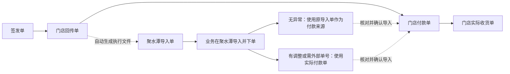

# 回传后聚水潭导入单生成与付款回拉方案 · V2.0

日期：2026-11-01。状态：方案修订，尚未实施本版变更。

本次核对代码：分支 `feat/jst-daily-batch-0.21.0`，提交 `125ad539e7116e7b46b714bb34e2c7be31d4ec90`。当前交付仍为0.21.0 rc2。本方案替代V1.7中的生命周期、页面组织、三列文件及付款待核口径；原方案和已实施版本证据保留在Git历史及0.21.0发行记录中。本次不修改应用代码、数据库、旧交付包或标签。

## 一、已经确认的业务关系

正式生命周期只有：**签发单 → 门店回传单 → 门店付款单 → 门店实际收货单**。

聚水潭导入单是回传后按仓库存自动生成的执行文件，不增加生命周期节点。生成能力放在回传确认结果和订单跟踪中，通过同一个处理面板操作。付款以业务明确选择并确认导入的文件为依据：

1. 聚水潭导入、下单过程无异常，业务确认付款事实后，可以直接使用生成的聚水潭导入单作为付款来源，省去再次从聚水潭导出文件的步骤。
2. 外部实际订单有调整，或者需要携带聚水潭内部单号等信息，可使用聚水潭实际导出的付款单。
3. 两种方式选择其中一份作为本次付款导入结果；不存在“自动生成文件总是覆盖付款单”的固定优先级。
4. 直接回拉生成文件时，允许没有聚水潭内部单号，显示“未提供，可后补”。系统不能编造该单号，也不能用补货单号冒充它。
5. 生成、导出和锁单都不等于付款确认。只有业务核对并确认作为付款单导入，才推进正式付款环节。
6. 后续可以补充凭证或重新导入校准，保留原件和变更记录。一个订单只展示一份当前有效付款结果，业务不必手工维护修订号。

## 二、状态与日批次

| 已确认事实 | 正式待办 | 聚水潭相关提示 |
| --- | --- | --- |
| 已签发，未回传 | 待回传 | 不生成 |
| 回传有要货量，未确认付款 | 待付款 | 可显示生成中、已生成、待处理异常或已锁单 |
| 已生成、已导出或已锁单，但未确认付款 | 仍为待付款 | 提供导入门店付款单入口 |
| 已确认付款且有待收数量 | 待收货 | 保留生成及锁单记录供复查 |
| 生命周期资料已完成 | 已结束 | 历史文件仍可查询 |
| 回传全部不要，且没有矛盾的下游事实 | 已结束／无需后续 | 不生成空的采购文件 |
| 回传有需求，但本次仓库存全部无法分配 | 仍为待付款 | 显示“无可分配库存”，不能伪造零付款使订单结束 |

“生成状态”“锁单状态”“资料待复核”是辅助信息，不单独增加生命周期阶段，也不引入暂缓跟进、恢复跟进。

每日仍是一个日批次，按原作业／签发业务日期归属。次日回传、付款或收货不会把订单移到新批次。一个批次允许不同订单处于不同环节，互不强制等待；未签发作业与正式订单分开计数。日批次只组织任务，不按日期清空仓库存占用。旧订单已有付款或收货时，不要求补走聚水潭生成步骤。

## 三、使用者的操作路径

### 3.1 回传确认结果

正常操作为：**导入门店回传单 → 核对差异 → 确认回传 → 查看自动生成结果 → 导出聚水潭导入单**。

- 回传确认页面展示当前对应仓商品资料的名称、保存时间及本次库存依据；允许使用默认资料，也支持拖拽更新最新资料。库存未知等问题应明确显示，不能按0悄悄处理。
- 回传保存成功后进入后台生成队列，页面先明确“回传已保存”，再显示逐单生成进度。不为正常生成另增加一个必须确认的生命周期页面。
- 常用动作是“导出聚水潭导入单”“查看分配明细”。资料更新、顺序调整、重新分配等影响已有分配的操作放在明确的次级入口。
- 库存不足按既有箱规规则分配并显示缺口；缺价、无效箱规或资料无法确定等异常需要处理，不能伪装成完整成功。
- 一单生成完成即可导出，其余订单继续处理。生成失败不撤销已确认的回传，支持只重试失败任务。
- 批量导入中已包含有效付款事实的订单，按既有生命周期校验处理，不能为了自动生成再造一次库存占用。

### 3.2 订单跟踪

订单跟踪负责大盘：日期、门店、仓、补货单号、当前环节、下一步及异常摘要。顶部统计仍是待回传、待付款、待收货、已结束。

- 待回传订单的主动作：**导入门店回传单**。
- 待付款订单的主动作：**导入门店付款单**；同时提供聚水潭导入单生成情况和文件入口。
- 待收货订单的主动作：**导入门店实际收货单**。
- 点击聚水潭文件入口打开聚焦的生成／导出面板，复用回传确认后的处理能力；不要求使用者进入一个新增的生命周期节点。
- 批量动作先显示适用、跳过及异常订单数量。返回总览保留日期、查询和勾选范围，不能把不可见的隐藏勾选默默带进操作。
- 同仓回传确认时间较早者优先；手动调整顺序属于明确的重新分配操作，先展示受影响范围再确认。

### 3.3 付款导入

统一入口名称：**导入门店付款单**。里面提供两种来源：

| 来源 | 使用动作 | 使用者需要做的事 |
| --- | --- | --- |
| 已生成的聚水潭导入单 | 选择本单已生成文件，或直接使用保存的生成明细 | 核对数量金额，确认外部执行无异常且可作为付款事实 |
| 聚水潭实际付款单 | 选择或拖拽导入Excel | 核对对应订单和差异，确认导入 |

“直接使用保存的生成明细”与导出后再次导入四列文件应得到相同付款业务值，只省略落盘后再选文件的操作。两者均进入同一付款核对页面，不设置隐蔽的自动确认通道。

核对页展示：补货单号、门店、仓、所选来源、回传要货数、本次付款数、数量差异、金额及缺失资料提示。聚水潭内部单号缺少时不阻断确认，但不能显示成已核验的外部单据。业务确认后才进入待收货；只生成或下载文件时仍为待付款。

## 四、导出文件与单号含义

聚水潭导入单改为以下四列，最后追加订单号：

| 商品编码 | 单价 | 数量 | 订单号 |
| --- | --- | --- | --- |
| 000123 | 2.50 | 24 | BH-20261101-T001-ZC-HB |

上表是格式示例，不是真实订单。

- `订单号`逐行写入已有的**门店－仓补货单号**，用于本应用回拉关联；不创建另一套业务单号。
- `聚水潭内部订单号`、`线上订单号`属于外部系统标识，与该补货单号分别保存。缺少时保持缺少。
- 每店每仓分别导出；商品编码、订单号按文本保存，保留长编码和前导零。
- 前三列继续使用当次已保存的生成结果：单价取选定仓资料的基本售价，数量使用库存单位；只导出已分配正数量行。
- 不因后来更新商品资料而改变已生成文件的单价、数量或当时依据。再生成属于明确操作。
- 保留原前三列的顺序、类型、格式、商品顺序及现有命名规则，只在末列追加订单号。保持既有同名文件安全覆盖处理，失败不能留下半个文件。
- 新文件能否直接被聚水潭接收，须按实际接收模板验证第四列；本地写出成功不能替代外部导入验证。不得未经验证宣称已兼容聚水潭真实接收端。

## 五、导入数据契约与校验

### 5.1 生成文件作为付款来源

按字段名称识别，不依赖固定列位置。四列映射如下：

| 原字段 | 导入含义 | 处理 |
| --- | --- | --- |
| 订单号 | 本应用补货单关联键 | 精确关联门店及仓，不按名称相似度猜测 |
| 商品编码 | 付款明细商品 | 精确匹配编码，保留原文本及来源行 |
| 数量 | 本次付款数量 | 沿用付款数量校验；库存单位不做暗中换算 |
| 单价 | 本次付款价格 | 使用文件中的当次价格，正数量行缺价不能补0 |
| 无商品金额列 | 付款明细金额 | 以数量×单价按现有金额精度计算，明确记录为推导值 |
| 无内部订单号列 | 聚水潭内部单号 | 允许未提供，后续可补充 |

门店、仓、上一环节数量等由补货单自动带出，不要求业务重复填。数量为0、空白或缺行，按照既定生命周期规则最终视为0，同时保留不同的原始状态用于提示。新增商品、非法编码、异常数量等继续走原核对规则，不能静默删除或改值。

付款差异的主参照始终是**对应回传单要货量大于0的行**；收货主参照是**对应付款单数量大于0的行**。聚水潭生成数量是可查看的执行依据，不替代正式回传作为付款上游。

### 5.2 实际付款导出文件

保留现有13列付款样式及表头映射能力，包括内部订单号、线上订单号、店铺名称、买家账号、下单时间、平台站点、商品编码、商品名称、箱规、数量、商品单价、商品金额、辅助码。

实际付款单继续以其商品金额作为标价付款金额，不额外要求门店编码、实际付款时间或重复填写单位。缺少补货单号的文件需在导入时明确关联目标订单；多单混合且关系不明确时停在关联核对，不用店名、金额或时间相近度自动猜单。内部订单号不能误映射为补货单号。

### 5.3 批量与重复文件

- 以明确补货单号分组，保持订单首次出现和文件内原始行顺序；跨仓订单严格分开。
- 相同订单同时导入生成文件和实际付款文件时，提示选择本次采用哪份；不能相加、按最后文件覆盖或默认生成文件优先。
- 完全相同来源的重复导入应识别为已处理，不重复增加业务数量或库存占用。
- 四列表头只表明“可作为付款来源”，不能仅凭文件识别就认定已付款；批量导入仍须由业务确认环节和内容。
- 生成文件若没有内部生成标识，使用文件中真实值及精确补货单号进行核对，不猜测它是最新生成版本。直接使用保存明细时绑定确切生成快照。

## 六、后续校准与事实保护

| 情况 | 处理方式 | 保持不动的内容 |
| --- | --- | --- |
| 使用生成文件确认付款，缺少外部单号 | 正常保存付款结果，来源明确标记，外部单号未提供 | 不编造外部凭证 |
| 后补实际付款单，数量金额相同 | 补充外部单号及原件关联，保留来源轨迹 | 不再叠加付款量，不重新占库存 |
| 后补文件数量金额不同 | 展示新增、移除、改量、改价及总额差异，确认后更新当前付款结果 | 原导入文件和旧值保留 |
| 改用另一份已生成文件校准 | 明确选定来源，按相同差异规则核对确认 | 不自动选择最新文件覆盖 |
| 已有收货资料后校准付款 | 保存确认的付款新事实，重算差异并提示收货需复核 | 不回写已导入收货数 |
| 已锁单后补充或校准付款事实 | 允许事实核对及审计记录 | 不解锁、不重新分配、不补扣库存 |

“随时校准”指允许对事实进行明确核对和更正，不意味着无提示覆盖。原签发建议、回传原件、付款原件和收货原件各自保留，后续单据不能反向改写上游。变更影响下游对照时，标明需复核并沿用原有效性规则；不自动把后续事实清空或改成一致。

已知外部内部单号只有在对应关系仍有效时才能沿用；数量金额变化后不能悄悄把旧凭证当成新结果的已核验依据。系统内部保留来源哈希、原始行、确认时间、已知操作人及变更记录，不要求业务手工填修订号，也不虚构操作者。

锁单保护执行分配，付款事实校准与库存更正是不同操作。确需改变已执行分配时，必须从独立更正入口核对外部执行情况及最新库存，不能借“校准付款”绕过锁单。

## 七、保留的库存、箱规及锁单规则

1. 按对应仓精确商品编码取得资料，价格用基本售价，数量用库存单位。不得重新路由到另一仓，或重跑补货模型／预算分配。
2. 同仓按回传确认时间先后及原稳定决胜规则分配，前单占用后，后单使用余额。指定顺序调整须明确预览受影响订单。
3. 最小出库步长按既有有效箱规处理。分配量为不超过回传需求和可分余额的合法步长倍数；库存不足一箱则分配0，不拆箱、不向上凑箱、不用模型保底突破仓库存。
4. 箱规1按单件处理；缺失箱规沿用既有补1规则，非法箱规不能混为缺失。无法整箱表达的回传需求需要按现有口径处理并提示。
5. 已锁单跳过后续批量分配。新导入仓资料中的可用数已扣减这些已锁单，因此不再扣一次，也不能把旧占用加回新可用数。
6. 未锁有效生成仍保留本地占用，避免同一库存重复分给不同订单。日批次和重启不能重置该约束。
7. 相同回传重试不产生新的生成或占用；回传变更影响已有未锁分配时，先核对重新分配范围，不自动改变其他订单。已锁或已有下游事实时，不因回传保存而自动再分配。
8. 付款导入、付款校准、补充外部单号都不创建、扣减、释放库存占用，也不改变锁状态。
9. 不修改模型预测、安全库存、最低持有、一箱例外、21天约束、预算或新品规则。

## 八、数据保存与后台任务

正式生命周期与执行附件分别保存：生命周期由已确认回传／付款／收货事实判断；执行附件保存生成快照、选用仓资料、库存依据、占用、锁及文件记录。

付款来源增加必要审计信息：来源类型、原件哈希、对应补货单号、可确认的生成快照标识、外部内部单号及是否提供、数量金额来源、校准差异。字段由系统维护，不扩充用户必填模板。

自动生成任务采用可恢复任务记录，不能只依赖“确认成功后弹窗里调用一下”：

- 回传提交时记录待执行任务，提交完成后后台消费；未提交回传不能先分库存。
- 生成异常不能撤销已经确认的回传或把界面显示为“回传保存失败”。重启能够识别待执行／失败任务，恢复时重新检查当前事实和锁状态。
- 用确切订单、回传依据及操作标识保证重试不重复；明确更新仓资料或重新分配是另一操作，不能把重试当成新库存基准。
- 每单生成、占用、当前引用和业务日志原子提交；涉及多单重新分配的整体调整保持原事务原子性。
- 仓库存依据、回传、生成或锁状态在预览后变化时，拒绝过期提交并重新核对。等待用户确认期间不持有数据库写锁。
- 取消停止新增任务，已安全提交的单保留，未提交的回滚。提交边界不强杀；清楚列出已完成、取消和失败订单。
- 付款提交同样绑定预览时的确切上游和旧付款状态；直接回拉与文件导入复用同一确认服务。

业务日志展示当时来源、数量金额变化、执行结果、失败原因和文件，不展示JSON。保留一天内跨环节的作业日志，实际操作时间与原订单归批日期分别记录。

## 九、代码落点与兼容边界

本次核对发现：`order_lifecycle.py`已有正式回传／付款／收货判断；`daily_batch.py`目前把待生成聚水潭订单、待核对付款单作为额外投影阶段；`jst_exports.py`仍导出三列；`lifecycle_io.py`已有13列付款文件适配，尚没有本方案的四列适配。以下是待实施调整，不能当成当前能力。

| 位置 | 后续职责 |
| --- | --- |
| `src/daily_batch.py` | 总览恢复四类正式待办，生成和锁单改为辅助信息 |
| `src/lifecycle_home_ui.py`、`src/jst_ui.py` | 从回传结果和订单跟踪进入聚焦处理面板，复用动作，保留返回定位 |
| `src/lifecycle_batch_ui.py`、`src/lifecycle_ui.py` | 两种付款来源共用预览、差异确认和提交；补充资料与校准入口 |
| `src/lifecycle_io.py` | 新增四列表头适配，保留13列原付款样式，区分补货单号与外部内部单号 |
| `src/order_lifecycle.py` | 保存付款来源与确认事实、校准差异及原有下游复核关系 |
| `src/jst_exports.py` | 末列追加已有补货单号，保持前三列和文件顺序 |
| `src/jst_orders.py` | 复用分配、生成快照、库存占用、锁；事实校准不触发库存动作 |
| 轻量任务协调模块 | 回传后生成任务的持久化、恢复、重试、取消和过期检查；具体命名实施时按代码确定 |

不改`model.py`、`one_box_exception.py`、`allocation.py`及默认业务配置，不因界面或文件适配修改模型规则版本。不开新的通用插件系统或复杂任务平台。

兼容原则：

- 历史签发、生命周期资料、三列生成文件及原件不回写。新导出加第四列，旧文件保留原貌；旧文件缺关联号时用明确选择订单的兼容入口，不伪造字段。
- 旧生成记录继续可读，旧待核草稿不能自动变成已确认付款。缺少付款来源信息的历史记录标为历史未记录，不用当前资料补造当时依据。
- 数据结构如需增加字段／表，以增量兼容方式处理，升级前备份并验证失败回滚，不重写全部历史。
- 保留0.21.0交付包。旧包不保证能写入新版数据；回退使用升级前数据库备份，并明确升级后新增资料的处理方式。

## 十、性能、验收与实施顺序

性能采用已有后台读写与索引能力；同仓资料只建立共享索引，分配逐单使用余额，不为每个订单重复读整份Excel或执行模型。进度分成回传保存、资料检查、订单分配、文件写出、付款核对和提交；显示订单数、当前对象、已完成及可取消状态。回传保存完成后即可操作，不等待整批生成才返回。

实施前固定实际代码和输入基线，使用独立QA数据库、仓快照及输出目录；真实样本与可手算合成案例同时覆盖：

1. 正式生命周期没有新增节点；生成、导出、锁单不会伪造付款；旧付款／收货订单不被倒退。
2. 自动生成任务在取消、失败、重启、重复确认和双窗口冲突时不重复占用；明确完成和未完成范围。
3. 导出前三列逐单元格比较值、类型、格式和顺序；只允许新增第四列，逐行关联到正确分仓补货单。
4. 同一生成快照直接作为付款来源与四列文件回拉，数量、单价、金额和关联完全一致；仅文件来源审计信息可有差异。
5. 外部内部单号缺失可确认；后补单号、改量、改价、移除商品和已有收货时的校准可复查，不叠加付款。
6. 原13列付款导入、字段调序、跨仓多单、错误单号、未知商品、重复／冲突文件保持明确校验；不按完成顺序改变订单或商品顺序。
7. 0、空白、缺行最终均为0且提示来源不同；付款对回传正数量、收货对付款正数量的比较口径不变。
8. 所有付款导入及校准前后，仓库存基准、占用、锁严格不变。箱规不足、已锁不重复扣减、跨日及新资料更新继续按既有规则验证。
9. 相同输入配置的模型中间字段、建议量、候选量、执行量、金额、归属及原有导出保持一致；不使用宽泛白名单隐藏差异。
10. 同环境串行测量旧版和新版的保存、生成、预览、导出与付款导入；波动环节至少三次，保留全部值、中位数、内存采样及界面响应。新自动动作的新增成本单独列出，不称为原保存操作提速。
11. 从干净提交构建独立候选目录，实际运行EXE验证导入、逐单输出、重启恢复、取消、锁单、两种付款来源及后补校准，记录构建提交和哈希。
12. 聚水潭真实接收四列文件的验证单独记录；无真实接收模板／环境验证时明确未验证，不把本地文件正确当成外部下单成功。

建议分三步实施：

1. 四列导出、双付款来源、外部单号可缺、直接回拉及校准能力；先验证数据语义。
2. 四阶段总览、回传／跟踪共用生成入口、可恢复后台任务；验证动作与生命周期一致。
3. 历史兼容、严格业务对照、性能及实际EXE验收，保留旧包交付。

本次交付仅为方案修订及代码落点核对，没有实施以上功能、运行新增功能测试或生成新EXE。不登录聚水潭、不远端下单、不推送或合并代码。安全升级、自动外部执行器、跨机共享库存及其他模型规则不并入本方案。
