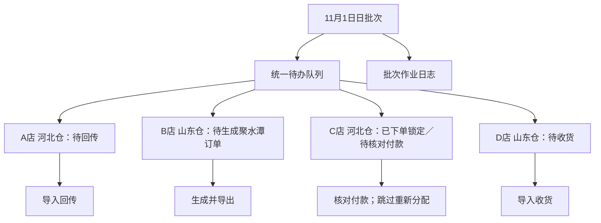
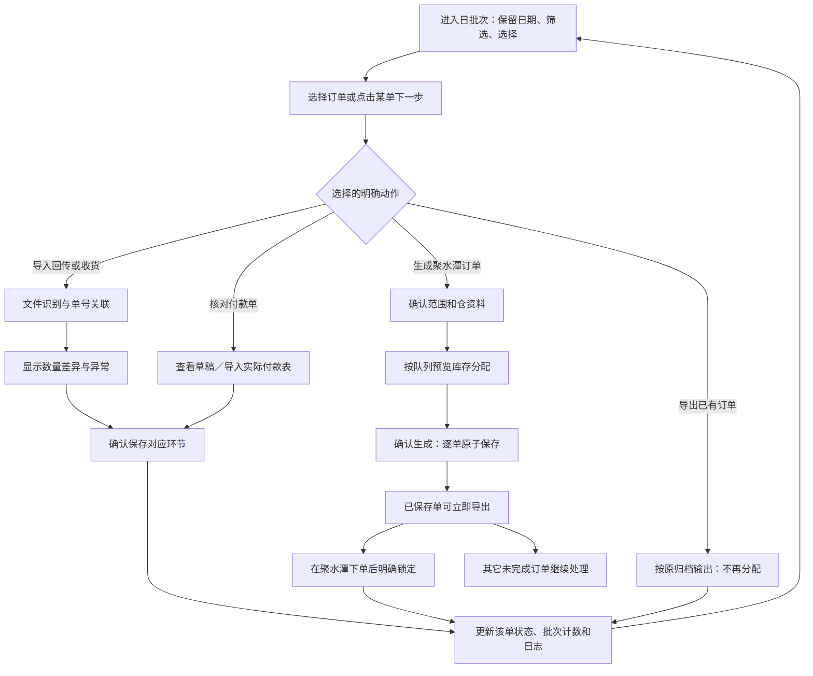
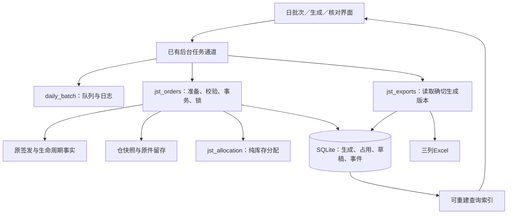

**回传后聚水潭订单分配与付款待核方案 · V1.7 · 2026-11-01**

状态：已获授权实施；0.21.0代码和验收详见使用说明及发行记录。本方案保留设计目标，不能代替实际验收结果。代码固定基线为0.20.0、`a70c00f8b8adaeb3ed425b4181440e2cdf153f08`。

V1.7按开发中的用户纠正：订单跟踪负责大盘，各环节独立聚焦动作。总览只保留阶段数量、订单、下一步及次要查询/文件快捷入口；从总览进入“回传处理、聚水潭出单、付款核对、收货核对”工作页，带入日期与所选范围，返回保留原筛选。每页只放本环节的主操作和对应文件；聚水潭更正/撤销收起。以下旧设计中“在日批次列表集中动作组”的描述由本条替代，不在总览堆放全部动作。

阅读方式：第一至七部分规定业务与数据边界，第八至九部分概述实现及验收，第十部分是交互与业务体验，第十一部分统一设计原则，第十二部分定义数据契约，第十三部分明确业务命令和事务，第十四部分给出代码结构，第十五部分是性能方案，第十六部分规定迁移、测试、交付及暂不实施范围。V1.6是设计文档，不代表已经完成代码、界面、性能或EXE验收。

V1.5修订：按用户明确的业务口径，更新导入的仓资料可用数已扣减此前已锁订单；这些订单跳过分配，也不从新可用数再次扣除。撤销V1.4要求逐单选择“已包含／未包含／不确定”的常规核对步骤。未锁有效生成及本次新分配仍需保留本地占用，详见第六部分。

V1.6补充确认：箱规商品当前可分余额不足一箱时，该商品分配0；不拆箱、不向上凑箱、不用模型保底突破仓库存。补充整箱边界、页面原因及导出验收，详见第五部分。

**一、目标及已确认口径**

将现有补货流程向后连接：签发归档后进入待回传；有效回传确认后，批量按对应仓可用库存分配，生成聚水潭订单文件，并自动归档待核对付款单。使用者主要做选单、检查仓资料、核对分配、确认生成四件事。

用户已经确认：

- 聚水潭文件只有商品编码、单价、数量三列。
- 单价取本次选用的对应仓商品资料中的基本售价。
- 同仓默认按回传确认时间较早者优先，可在生成前手动调整顺序。
- 可使用已保存仓资料，也可更新最新资料，按更新后的可用库存分配。
- 前一单分配后扣减本地可用余额，后一单使用扣减后的余额，直至本次执行范围处理结束。
- 箱规商品不足一箱不能分配；足箱时也只能按整箱倍数分配，不能超回传需求或当前可分库存。
- 生成聚水潭订单时同步保存待核对付款单。
- 单单分配并确认保存后即可导出，提前在聚水潭完成下单的订单可以锁单；后续批量生成忽略已锁订单，不重新分配或追加库存占用。
- 新导入的对应仓商品资料，其可用库存已扣减此前已锁订单。直接以新可用数为起点，不再扣这些已锁单，不要求业务人员逐单确认是否已扣减。
- 一天内的作业归入同一个日批次，统一待办队列和批次作业日志；同日各订单即使处于不同生命周期，也在此统一查看和控制。

其余细节为本方案建议，不当作已有功能或新增业务规则已经实施。本期只生成本地文件，不登录聚水潭、不自动创建远端订单、不修改远端库存，也不接入之前讨论的跨系统自动化执行器。

**日批次、订单与本次执行的层级**

一个本地业务资料库中，同一业务日期只有一个日批次。用户看到“2026-11-01 补货作业”，无需额外编批次号。日批次下包含当日各门店／仓订单及未签发的作业任务；每次读取、计算、生成、导出、重试属于该日批次的一次执行记录，不再作为新的业务批次。

归批依据采用原作业／签发的业务日期，按现有Asia/Shanghai业务日口径组织，不按回传、付款或文件导出日期重新归批。例如11月1日的订单11月2日回传，仍留在11月1日日批次，日志记录11月2日的实际操作时间。次日新作业进入新的日批次；旧日批次的后续生命周期仍可继续处理，不能把旧计算草稿的“历史只读”误用到回传／付款／收货。

上午、下午、补录和重启恢复均回到同日日批次；同日新店仓订单追加，同店仓正常单仍按原唯一性及覆盖确认处理。未签发时可以在日批次记录计算／待签发作业，但不能提前生成正式补货单号、伪造签发或加入待回传。一个已有订单始终只出现一条当前进度行，内部更正与多次执行记日志，不堆成多个待办单。

日批次只统一组织和控制，不把所有订单强制推进到同一个环节。某单等待回传时，不阻塞另一单生成；某单导出完可以先下单锁定，另一单仍可继续计算或等待资料。用户勾选不同环节的订单时，按明确操作筛选符合条件的订单，先展示可处理／跳过数量及原因；不会自动替用户确认付款、收货或已下单事实。

**日批次页面与混合状态控制**

“订单跟踪”默认进入今日日批次，顶部提供业务日期、今日、历史批次和全部未完成入口。跨日未完成可汇总查看，但保持各订单原日批次归属。日批次使用两个页签：

- **待办与订单**：上方按待回传、待生成、待核对付款、待收货、已结束统计；“已结束”区分单据已收齐与无需后续。待签发作业独立展示。订单表显示门店、仓、补货单号、当前环节、锁定标记、执行进度、异常说明及下一步。已锁只是保护标记，不另算一个互斥生命周期订单数。未签发作业与正式订单计数分开，避免统计两遍。
- **批次作业日志**：按实际时间显示本批从导入、计算、签发到回传、分配、导出、锁单、付款、收货的记录。点击记录能查看涉及订单、当时依据、数量金额变化、完成结果及失败原因，使用业务表单，不展示JSON。支持按门店、仓、环节、动作、结果查询及导出日志；日志导出是独立文件，不增加聚水潭三列内容，也不替换既有归档导出。

| 批量动作 | 可处理订单 | 其它已选订单 |
| --- | --- | --- |
| 导入门店回传单 | 目标明确、可核对回传的订单 | 已有下游的更新进入更正核对，不自动重算已锁单 |
| 生成聚水潭订单 | 有有效正数量回传、尚未生成且未锁 | 待回传、已生成、已锁、已有付款／收货分别列明跳过原因 |
| 导出聚水潭订单 | 已持久保存有效生成记录，包含已锁单 | 未生成的明确提示，无新增占用 |
| 确认已下单并锁定 | 业务明确确认外部下单的已生成订单 | 未生成不能锁，已锁保持原状态 |
| 核对门店付款单 | 有付款草稿或已导入实际付款资料且可核对 | 不把生成或导出成功自动确认为已付款 |
| 导入门店实际收货单 | 按原关联规则接收；上游未就绪时只留存待核 | 不把等待资料当成收货0或已完成 |

入口仍按“流程处理／业务文件／依据复查／维护”分组，按钮功能固定。每次操作显示“本日批次共N单，本次选中M单，可执行X单，跳过Y单”；隐藏选择按已有显式范围机制处理。没有一个会自动改变含义的“全部推进”按钮，也没有一键将全批标记付款或收货。

待办队列持久保存订单身份、所需下一步及本次执行的排队状态；进度由真实单据事实更新。等待回传资料的订单停在自己的待办项，不占用执行槽，不挡住其它已就绪订单。仓库存分配仍按已确认回传时间优先，队列表格的生命周期排序不改变分货顺序；同仓涉及同一库存余额的提交必须有序校验。

已确认开始的本次执行会固定订单范围；其间新回传或新订单自动出现在同日日批次的可处理队列，但不悄悄塞进已确认任务或抢走前单库存。执行完后可直接处理新增待办。停止剩余任务只停止这次执行未提交部分，不删除整个日批次，不撤销已保存单或释放已锁占用。崩溃重启后先核实已提交记录，明确列出可继续／待核任务，不能盲目重放生成、付款确认或锁单。

批次日志是追加记录；每日草稿仍按原规则同日覆盖前确认。覆盖草稿不会覆盖日批次日志、签发历史、锁单、回传、付款或收货。日志同时保存所属业务日和真实操作时间：今天操作昨天的订单，其记录归昨天批次，但可在“今日操作”查询中找到同一个事件，不重复记账。没有登录系统或外部回执的事实不编造操作人、聚水潭订单号或远端结果。

日批次统计可随新增订单变化，不因当前所有订单已收齐就禁止同日补录。库存占用按仓／商品跨日连续管理，不能因为新建次日日批次而清零。不同日批次同时生成时，也必须共享同一仓库存与占用的版本校验，防止每个日批次各自分配一遍同一库存。

**二、主干流程与下一步**

付款草稿不是已付款事实；导出成功也不代表聚水潭已接受或付款已完成。新步骤作为订单跟踪内的下一环节，不再放回计算页，不新增模型推荐阶段或人工暂缓跟进状态。

| 当前事实 | 显示状态 | 主操作 |
| --- | --- | --- |
| 已签发，无有效回传 | 待回传 | 导入门店回传单 |
| 回传已确认且有正数量，尚无有效聚水潭订单 | 待生成聚水潭订单 | 生成聚水潭订单 |
| 已生成聚水潭订单及付款草稿 | 待核对付款单 | 核对付款单 |
| 已确认实际付款，有正付款数量 | 待收货 | 导入门店实际收货单 |
| 有效环节资料已齐 | 单据已收齐 | 查看全流程对照 |

回传全部为0：保留“无要货，无需后续单据”，不生成空聚水潭单或虚假付款单。回传有需求但本次完全无货：保留待生成，并显示库存不足；可以保存分配核查记录，但不冒充已生成业务订单。部分商品缺货作为整单差异展示，不建立“部分单”“自动补欠单”或新的跟进状态。现有历史付款、收货已完成的订单不因没有新增聚水潭环节而倒退；未完成的旧单可显式进入新流程。

上游资料有变时，保留原单及原占用，显示“依据已变化，待重新核对”；不静默改量、自动释放占用或把旧草稿当成有效付款。

“已下单锁定”是生成订单的保护标记，与待核对付款／待收货等生命周期状态分开展示。锁单不代表已付款，原付款草稿仍须核对。已锁订单仍在订单跟踪及历史中可查，只从生成／重新分配的候选范围排除。

**三、页面与最少操作**

继续使用现有“补货出单／订单跟踪／决策复查／参数设置”四个入口。签发完成后的结果页增加“进入当日待回传”，打开所属日批次并定位这次签发的门店仓单；保留“继续本次补货”，不强制跳转打断同日其它门店的计算。

订单跟踪增加“待生成聚水潭订单”“待核对付款单”筛选卡，卡片数字按整单当前下一步统计。列表保留日期、门店、仓、补货单号、进度，增加回传需求金额、可下单金额、缺货款数、下一步。单行点击与批量勾选共用生成窗口；勾选跨筛选保留时明确显示隐藏单数，提交范围以显式所选订单清单为准，不因表格重新排序悄悄改分配优先级。

生成窗口分三步，同一窗口切换：

1. **选订单与仓资料**。订单来自有效回传正数量，默认带入每仓已保存且仍有效的资料；河北／山东分别显示文件名、导入时间、商品数、待核项和“更新本次仓资料”。支持拖拽更新、表头映射和下载最低模板。更新成功建立本资料库该仓共用的库存基准，其它未提交预览据此失效，不能另从旧余额继续分货；已经生成的订单仍绑定其原快照。“保存为该仓默认资料”是独立明确操作，不因更新库存自动覆盖默认资料配置；旧默认被新库存基准替代时提示采用当前基准，不能重置余额。库存资料若未提供业务时点，只显示导入时间，不把导入时间称为库存更新时间。
2. **核对分配**。左右仓独立队列，默认回传确认时间从早到晚；同一时刻按原签发日期、补货单号稳定决胜。可上移／下移或拖动顺序，只有明确重排队列才改变分配，不受金额排序等展示操作影响。显示“第几单、门店、回传需求、可下单、缺口”。点击缺口看商品；调整顺序、仓资料或所选订单后重算预览，原确认失效。
3. **确认生成并导出**。显示订单数、仓、数量金额、未安排商品及原因、文件位置。确认范围后按队列逐单保存订单、占用、付款草稿；每单保存完成即可导出，不等待其它订单全部完成。也可先选一单确认生成。界面逐单显示已保存／可导出／导出失败，提供“导出本单”“导出已生成订单”“打开文件夹”“进入待核对付款单”。后台可继续处理后面的订单，不等待用户完成聚水潭操作。

每单提供独立按钮“确认已在聚水潭下单并锁定”，显示本单门店、仓、单号、生成数量金额后确认；支持批量锁定明确勾选的已下单订单。文件导出本身不自动锁单。锁定后显示“已下单锁定”，继续允许原样导出和付款核对，但隐藏／禁用重新分配入口。更正入口独立命名，不将同一个按钮来回变成锁单／解锁。

默认资料有效且无异常时，不要求逐单打开编辑；选一批后一次预览、一次确认即可；有提前处理需求时，可先生成已经就绪的一单。同仓后单只有在所依赖的前单占用已提交后才可提交导出；不能用前单尚未确认的模拟扣减作正式依据。跳过前单或调整顺序时，重算受影响的未提交后单。异常必须明确显示，不能用“成功”掩盖没有分配的商品。进度分别显示读取资料、分配第N/M单、保存、导出第N/M份；可取消阶段即时响应，短事务提交期间明确提示不可中断。

订单详情采用固定分组：流程处理（回传／生成／付款／收货）、业务文件（各环节独立导出）、决策依据（计算表／原资料）、维护操作。生成与再次导出分为两个按钮，导入与导出的名称保持一致。

**四、资料来源及字段用途**

| 来源 | 字段 | 用途 |
| --- | --- | --- |
| 原签发 | 补货单号、门店、仓、内部快照标识 | 唯一关联订单，锁定该单所属仓；不重跑主从仓路由 |
| 已确认回传 | 商品编码、有效确认数量、源行、确认记录 | 本次要货需求；0、空白、缺行沿用已确认归0口径 |
| 本次对应仓资料 | 商品编码 | 同仓精确匹配，保留前导零和长编码 |
| 本次对应仓资料 | 基本售价 | 本次单价和付款草稿金额，与原签发价格差异可见 |
| 本次对应仓资料 | 可用数 | 分配库存的原始起点；不再额外减源表“订单占有数” |
| 本次对应仓资料 | 出库箱规、商品状态 | 核查整箱步长及是否允许下单 |
| 本地已生成记录 | 新库存基准建立时的未锁有效生成，以及建立后的新增分配 | 防止尚未反映在本次资料中的库存重复分给不同订单；此前已锁单不再扣减 |

沿用现有仓资料读取和字段识别，不按固定列号；资料已有的分类等完整字段照常保留，但不重新参与需求计算。最低可直接复用模板采用现有仓资料入口的必需列，不能宣称只给商品编码、价格、库存三列就能通过现有完整资料导入。

缺商品、禁用、缺价、可用数未知、编码冲突分别列为待核／不安排原因，不把未知库存当0或无限库存，不从另一仓自动借货，不改历史签发归属。不靠名称相似度或条码多对一猜匹配。负可用数保留原值并提示异常，可分配数量至多0；0价格须与缺价格区分，是否允许零价商品应沿用既有明确有效值规则并在预览突出显示。

本期输出商品编码先按已验证的同仓商品编码精确对应设计；真实聚水潭导入前必须核验它确实是接收端所需编码。若编码域不同，需增加显式映射，不能猜测或直接把三列生成成功当成聚水潭已适配。数量均沿用库存单位，不因字段叫箱规而乘除数量。

**五、按顺序分配规则**

每个仓各有一份库存余额，主键是“仓＋商品编码”。更新资料时，初始余额等于新可用数减去仍需保留的未锁有效生成占用；此前已锁单不参与扣减。该基准建立后新增的分配逐单扣减；河北和山东的相同编码各算各的。复用已保存资料时继续使用其既有余额账，不重新开始一轮原始可用数。

对队列中的每个订单，按有效回传明细的原顺序处理。需求只取有效回传正数量，不能退回使用模型建议、签发建议或待核回传。普通计件商品的最小出库单位为1，箱规商品保持整箱倍数。

在需求已经通过步长校验的前提下：

`本单可下单量 = 向下取整到出库步长(min(回传要货量, 当前仓可分余额))`

`下单后余额 = 当前仓可分余额 − 本单可下单量`

`缺口 = 回传要货量 − 本单可下单量`

只对有效数值计算，使用精确十进制；永不为凑箱向上突破回传需求或可用库存。箱规1按普通计件商品处理。回传数量本身不符合有效箱规时，显示具体冲突，先核对再下单，不静默把23改24或改0。最新箱规与原签发箱规不同时，先展示差异并核对新出库约束，不回写旧数据。本期不重新进行预算分配、必卖排序、21天约束、最低持有或一箱例外；它是既定需求的执行分配。

**不足一箱的硬边界**：这里的库存指扣除本地仍需预留及前序订单分配后的“当前可分余额”，不是商品资料原始可用数。箱规大于1且当前可分余额小于箱规时，该商品分配量为0，不新增占用；其它商品继续分配。已知正库存但不足一箱显示“库存不足一箱”，明确0库存显示“无可用库存”；未知或非法库存继续待核，不能混成确定的0。

以下为待验证的验收预期，回传需求均为48、箱规为24：

| 当前可分余额 | 分配数量 | 分配后余额 | 未满足数量 | 说明 |
| ---: | ---: | ---: | ---: | --- |
| 0 | 0 | 0 | 48 | 无可用库存 |
| 23 | 0 | 23 | 48 | 库存不足一箱 |
| 24 | 24 | 0 | 24 | 仅可分一箱 |
| 30 | 24 | 6 | 24 | 仅可分一箱，余量不拆箱 |
| 47 | 24 | 23 | 24 | 仅可分一箱，余量不足第二箱 |
| 48 | 48 | 0 | 0 | 可分两箱 |

另验收：原始可用30、已有未锁预留10时，当前可分20，不能分出一箱24；箱规1、可分3、需求5时按单件分配3。零分配商品保留回传需求、缺口与原因供核对，不进入只含正数量的聚水潭三列文件；整单均为0时保留待生成，不生成空订单或付款草稿。不得借用最低持有、一箱例外或人工凑箱把0重新抬为一箱。

例：某仓商品可用100个、箱规24、单价2.50元。

| 顺序 | 回传需求 | 分配前余额 | 本单数量 | 下单金额 | 分配后余额 | 缺口 |
| --- | ---: | ---: | ---: | ---: | ---: | ---: |
| A店 | 72 | 100 | 72 | 180.00 | 28 | 0 |
| B店 | 48 | 28 | 24 | 60.00 | 4 | 24 |
| C店 | 24 | 4 | 0 | 0.00 | 4 | 24 |

合计安排96个，没有超占100个库存；剩余4个不足一箱。C店若整单只有该商品，本次不生成空导入文件，也不形成已付款／无需求状态。原回传仍分别保存72、48、24，分配不足不会改掉门店需求。

**六、本地占用与库存更新：必须一并完成的边界**

预览只做内存模拟，不占库存；确认生成时才持久保存占用。为支持单单提前导出，提交边界明确为一张店仓订单：该单订单、占用、付款草稿在同一事务提交，全部成功或全部回滚；不再承诺新增聚水潭生成任务整批同时成功或全部回滚。批次中已提交的单保留，失败／停止的未提交单不写入，界面逐单说明完成情况。同仓后续分配必须使用已提交余额；前单失败时暂停受影响队列，不用失败单的模拟余额继续提交。既有签发、生命周期批量导入等原有事务边界不改。原Excel和仓资料快照只读；扣减写到独立的本地分配账，不修改商品资料的可用数字段。

同一库存基准下分多次执行生成时，后一次沿用扣减后的余额；这些执行可属于同日日批次，也可属于不同业务日。应用重启、重新选择默认资料、同一导入任务重试都不清空占用。两窗口同时预览后，只允许仍符合库存基准／回传／占用版本的结果提交，另一窗口必须重新预览，不能双重抢占。

**更新导入仓资料时，直接执行用户已明确的口径：新可用数已扣减此前已锁订单。**

- 此前已锁单：不再分配，也不从新可用数重复扣减；保留原生成和占用历史，供追溯，不删除记录。
- 已生成但未锁单：继续保留本地预留，避免其尚未下单的货再次分给其它门店；重新分配时替换原预留，不累加。
- 本次新生成单：从上述剩余余额按队列逐单扣减，直到本次执行范围结束。
- 更新资料之后才锁定的单：锁定本身不再扣一次，也不把已经扣过的数量加回来；继续沿用当前余额。下一次更新资料时再按已锁单纳入新基准。
- 没有更新资料、只是继续使用原保存资料：保留原扣减余额，不能因为某单锁定就恢复到旧表原始可用数。

取消常规“已含／未含／不确定”确认表。界面只说明“新库存已包含此前已锁单，不重复扣减；未锁单预留继续保留”，并可展开查看明细。这里采用用户提供的库存口径，不额外要求远端回执证明，也不宣称已实现实时库存同步。

系统以“更新本次仓资料”的明确操作建立新库存基准，记录仓、原件／内容摘要、导入操作ID及该操作开始时的已锁生成集合；内容相同可以复用原件和解析结果，但不能只用文件哈希代替库存基准身份。同一操作重试复用原基准。导入准备期间发生锁、生成或库存基准变化时，拒绝提交过期准备结果并提示刷新；不把导入后才锁定的单偷偷并入此前已扣减集合。普通选择旧资料只复用原基准；已经被新库存基准替代的旧快照只供历史复查，不能重新用其旧余额分货。

再次导出使用已归档数量和单价，不重复占用，不自动换最新资料。未在外部执行的订单要改量时，通过“重新分配”展示旧新差异；按原队列重新计算受影响的后续未锁定订单，确认后整体替换有效占用和付款草稿，历史仍可回溯。

重新分配涉及多张已有未锁订单时，旧占用释放与新占用建立作为同一个更正事务处理，不能逐单释放后留下可被其它批次抢走的空档；这与首次生成逐单提交是两个不同边界。更正失败时所有旧有效分配保留。

已经外部下单、已确认付款或有收货资料的单据，不直接重新生成覆盖；先核对外部执行事实。取消／移回收站也不能自动释放可能已外部执行的占用。释放只针对明确取消且未执行的本地订单，或根据新的准确库存快照核销；不向原Excel加回库存。旧单重签、回传更新、仓资料更新都只使相关计划待重核，不自动重算并覆盖下游事实。

**锁单规则与后续批量生成**

锁定单位是补货单号对应的一张门店仓单，内部绑定确切生成记录及其数量、价格、金额和仓资料依据。河北仓锁定不锁山东仓。只锁已持久保存的订单，不能锁未提交的预览；锁定记录保存操作时间、操作来源和内部标识，聚水潭实际订单号可选填，不向三列导出增加字段。

| 订单情形 | 后续批量默认行为 | 库存处理 |
| --- | --- | --- |
| 有效回传、尚未生成、未锁 | 纳入分配候选 | 确认生成时建立一次占用 |
| 已生成但未锁 | 不重复新建；可原样导出或明确选择重新分配 | 继续保留已有有效占用，更正时替换而非累加 |
| 已下单锁定 | 自动跳过，不能重算／改量／换价格；可再次导出 | 更新后的库存已含此前已锁单，不重复扣减；未更新资料时沿用已经扣过的余额 |
| 已有正式付款／收货 | 不倒退进入新分配 | 不因导入付款／收货再扣库存，沿用该单在当前库存基准下的既有处理 |

例如原可用100、A店分配40后锁定：未更新资料时余额沿用60；更新导入可用60的新资料后，A自动跳过，B仍从60起算，不能再减A的40变成20。若另有B店已生成但未锁预留10，则新资料60减B预留10，可供后续订单50；若此时锁B，余额仍为50，不再扣或加回10。下次更新资料可用50后，A与B都不再重复扣减，后续仍从50起算。

锁状态持久保存，重启、切换批次、重新勾选、重新导入回传、同日重新签发都不能自动绕过。除生成版本内部锁之外，还按补货单号／店仓检查当前外部执行保护；同一业务单出现新内部版本时先提示与已锁内容冲突，不能当成新订单再次下单。新的业务日期及新补货单号不继承旧单的锁，但仍使用正确库存余额。

后台至少在入队、开始该单、取得写锁后提交前检查锁状态及确切生成标识。用户在另一窗口锁单时，旧计算结果不得写回；该单标记“已锁，已跳过”，有依赖的后续未提交预览重新核验余额。批次结束说明“生成X单、跳过已锁Y单、失败Z单、未处理N单”，不能静默漏单或按成功生成统计已跳过单。

锁定本身不新扣库存。依照已确认业务口径，之后新导入资料的可用数已包含该已锁单的扣减，系统自动排除重复扣减；不再增加是否已包含的人工核对环节。原付款草稿可进入实际付款核对，正式付款差异独立记录，不改写锁定的生成单。

异常更正使用独立的“更正已锁订单”入口，显示原下单信息与后续付款／收货，填写原因并确认外部是否已撤销或更正；本地解锁不能撤销聚水潭订单。仅解除保护不立即释放库存，只有经核对的更正事务或准确新快照才能调整占用；有下游事实时不得静默覆盖。首次版本至少提供受控更正路径，不能以普通批量生成作为解锁捷径。

**七、三列聚水潭文件与自动付款草稿**

每店每仓一份Excel，一个工作表“订单明细”，第一行表头固定如下。多选批量生成多个文件，不把不同门店或两个仓装进一份三列表，否则无法表达订单边界。

| 商品编码 | 单价 | 数量 |
| --- | ---: | ---: |
| 按文本保存的精确商品编码 | 本次选用快照基本售价 | 本次分配正数量 |

文件中不追加门店、仓、补货单号、原因、金额、汇总行或说明工作表。订单关联写在文件名与内部记录中，文件名建议：`001_业务日期_门店_山东仓_补货单号_聚水潭订单.xlsx`。序号对应确认后的处理顺序；文件内维持回传商品原顺序，只去掉不能导出的非正数量行。内部保存所有需求、未分配数量及原因，用户能查到每个删去的行。

单价保留业务精度，不先四舍五入再参与金额计算；数量输出数值、编码输出文本。付款草稿明细金额按本次单价和数量计算，金额精度沿用既有规范。实际聚水潭接收端的工作表名、编码域、数值精度与该三列表样式，需要用真实导入界面做最终验收，不在方案阶段宣称兼容已经验证。

确认生成时自动建立“门店付款单（待核对）”：来源标明“本地生成聚水潭订单”，关联补货单号、仓、有效回传、日批次及本次执行记录、库存快照、价格、数量、金额与缺口；不伪造聚水潭订单号或实际付款时间，不把本地生成编号写成ERP返回编号。

打开“核对付款单”默认带入草稿：左侧回传需求，中间本次聚水潭生成数量，右侧实际付款数量／金额，突出缺货、减量、增量和价差。实际与草稿一致时，经明确确认后形成正式付款记录；有差异时导入实际付款表核对。沿用正式付款单必要信息校验，不要求重新抄写商品数量。付款草稿与已确认付款分别保存，生成动作本身不推进待收货。

付款原有主要对照仍是回传正数量；另加“付款−本次聚水潭生成”的辅助差异，不能用生成数量掩盖门店未满足需求。收货仍对照已确认付款正数量。既有四数量对照、归档三表和原签发导出保持，新增分配依据单独查看；不把新字段偷偷塞进旧导出。

文件写出失败时，明确显示“订单与草稿已保存，X/Y份文件导出成功”；可按原归档版本重试，不能重新扣库存或再建付款草稿。同名原版本文件沿用现有安全覆盖机制；某单提交前取消则该单不落业务数据，已经提交的前单保持。停止本次执行会停止提交剩余新单；当前短事务安全完成后报告实际结果，不终止整个日批次。对已提交单取消导出，只停止剩余文件输出，保留库存占用及已锁状态。

**八、实现边界及数据保存**

现有代码核查：`lifecycle_io.py` 只有return/payment/receipt；`order_lifecycle.progress_state` 当前把有效回传后无付款归为待付款；`warehouse_catalog.py` 是带外部仓标签的商品资料快照，明确不执行库存预占；其必需列已包含商品编码、基本售价、可用数、出库箱规、商品状态等。`business_scenes.issue_result` 和 `lifecycle_home_ui` 可承接签发后跳转及按状态继续的交互。

新增轻量聚水潭分配模块，分开纯分配、事务保存和三列导出；复用已有仓资料校验、订单身份、价格／数量校验、后台任务、进度、导出位置与原文件留存。保持model／allocation／one_box_exception及现有默认模型参数不变。

建议新增批次／订单分配／占用／付款草稿及事件表，保存精确上游标识与哈希，以及店仓订单的持久锁状态、锁定的生成标识、时间和更正记录。锁在业务服务与事务层强制检查，不只靠按钮禁用。草稿不伪装成现有payment记录；现有pending字段用于“上游未就绪”，不能拿来同时表示“付款尚未确认”。确认付款时才进入现有正式付款链，状态投影读取新增生成信息，不直接把一个新stage插入STAGES导致旧付款／收货依赖整体失效。

日批次元数据按业务日唯一，执行记录以内部ID区分每次命令，队列成员以作业／店仓订单唯一标识去重；展示进度尽量从原有事实及可重建索引投影，不维护一套会与付款／回传事实分叉的可任意编辑状态。不能把所有单据和日志塞进每天覆盖的jobs快照中。关键业务成功事件与对应数据同事务持久化，失败、取消和导出结果按执行ID补记；避免数据已写成但日志声称未生成。迁移旧单时按已有业务日期归入日批次，可标记为旧记录汇总，不伪造缺失的历史动作。

保存最少必要审计：补货单号、店仓、内部上游版本、生成顺序、原回传数量、本次单价／步长／库存来源、分配前后余额、生成数量、缺口及原因、有效占用、付款草稿关系、原资料附件哈希、原导出文件哈希、操作记录。用户无需填写内部版本；每天同一店仓仍沿用唯一补货单号。历史资料读取原快照，不用最新仓资料解释旧单。

更新默认仓资料只影响后续明确选用的生成及计算，历史记录和已有计算结果不偷偷更新。数据库升级采用新增表、备份和兼容读取，已确认付款不补造聚水潭历史；旧版本不应继续操作新版新建的占用及草稿，回退使用保留的旧包与升级前备份。

**九、实施顺序与验收**

1. 分配规则和存储：固定0.20.0、冻结回传及双仓资料，做纯函数测试、占用事务、幂等重试和付款草稿隔离；通过后提交。
2. 主链交互：日批次入口、统一待办及批次日志、混合环节操作、待回传跳转、待生成／待核对队列、批量选单、资料更新、优先顺序、差异预览、三列导出；通过后提交。
3. 兼容与实际EXE：新旧模型及既有导出严格对照、历史读取、崩溃恢复、取消及多窗口并发；独立目录打包，不覆盖0.20.0，不自动推送或合并。

验收至少包括：同仓抢同SKU、两仓同SKU隔离、回传时间相同稳定顺序、用户重排、整箱不足、非法步长、缺品／禁用／缺价／库存未知、0需求／全无货、不合格行确认排除、跨批跨重启占用、同一导入操作重试、更新库存自动排除此前已锁单扣减、未锁预留承接、更新后锁单不改变余额、导入期间锁定竞争、相同内容新基准与同一操作重试区分、重复导出、导出失败重试、提交前取消和提交后停止、预览后回传变化、双窗口抢占、重新分配后续单影响、实际付款与生成不一致、历史无生成记录兼容、长编码与前导零、三列表类型及文件顺序。

锁单专项验收：先完成一单即可导出且后续继续；锁后跨批／重启仍跳过；河北锁定不影响山东；锁定和再次导出不二次扣库存；前单占用仍限制后单；更新快照避免双扣；计算中被另一窗口锁定时拒绝旧结果；同日重签／回传更新不能绕锁；未锁已生成不重复累加；首次生成逐单提交中途失败保留已成功单；更正多单事务失败保留全部旧占用；锁后付款仍须独立核对。

日批次专项验收：同日分多次导入／生成只出现一个批次；同店仓不因重试重复出现；多环节同屏且操作逐单判资格；待回传不挡就绪单；异步新回传不会偷偷改变已确认执行范围；次日回传仍归原日批次；跨日共享占用；同日草稿覆盖保留生命周期与锁；中途停止／异常重启不重复占用或确认；成功／失败／取消日志均可关联具体执行与原记录；旧订单按日期只读汇总兼容；批次计数与明细一致，锁标记不重复算订单。

核心不变量：每仓每SKU总新分配不超过本次可分库存；每行不超有效回传需求且满足有效步长；同一生成不会重复占用；已锁单不再分配，其历史记录保留，但不得从之后更新的库存再次扣减；未更新库存不因锁定加回余额；预览不写数据；付款草稿不被识别为已付款；既有模型数量金额、原签发、回传及旧导出不变。实际EXE验收使用隔离数据库和新输出目录，真实聚水潭端最少做一份三列表导入确认后才宣称该外部格式可用。

已确认的价格、排序、单单导出与锁单、同日统一批次及混合生命周期控制要求均已纳入本文；待实施时需补齐的外部验收资料是实际聚水潭三列表接收要求及至少一份可核对的真实样本，不阻碍先评审本地流程方案。

**十、交互逻辑、业务体验与使用设计**

**10.1 使用者要能随时回答的四个问题**

当前是哪一天、哪家店、哪个仓；这张单现在到哪一步；点击按钮会处理哪些订单；操作结束后还差什么。界面围绕这四件事组织，默认隐藏内部版本、哈希、技术任务ID，保留业务单号及依据查看入口。系统记住最近位置，不要求业务人员在每一步重新选日期、门店、仓或重复填写上一步的数量。

金额字段固定说清口径：回传需求金额、聚水潭生成金额、付款草稿金额、已确认付款金额分别命名，不能统一叫“订单金额”。数量未知显示“待核”，未生成显示“未生成”，已确认0显示“0”，三者不混淆。回传0／空白／缺行最终数量仍同为0，核对时保留不同来源说明。原单不因当前筛选或新库存变化而改写。

**10.2 页面清单与进入／返回规则**

| 页面 | 从哪里进入 | 主体内容 | 主操作及离开后的反馈 |
| --- | --- | --- | --- |
| 首页 | 应用启动、顶部首页 | 今日作业摘要、历史未完成数、正在执行任务 | “进入今日作业”；历史未完成另有固定入口 |
| 日批次待办与订单 | 订单跟踪、签发结果、首页 | 日期、阶段数量、订单队列、任务进度 | 按下一步处理；不要求先开详情才能执行常用动作 |
| 回传导入与核对 | 待回传行、批量回传、拖入文件 | 文件识别、单号关联、数量差异、异常来源 | “确认保存回传”；保存后回到原批次并定位已更新订单 |
| 聚水潭生成工作区 | 待生成行或勾选后生成 | 订单范围、两仓资料、优先顺序、库存分配、执行结果 | “确认生成并导出”；也可逐单确认已就绪结果 |
| 下单锁定确认 | 已生成单行或已生成订单多选 | 明确的店仓单号、生成数量金额、外部已下单声明 | “确认已下单并锁定”；仍留在原批次，不冒充已付款 |
| 付款核对 | 待核对付款行、批量选单后核对 | 回传／生成／付款草稿及实际单据差异 | “确认付款单”；下一步变为待收货或无需后续 |
| 收货导入与核对 | 待收货行、拖入收货资料 | 付款正数量范围、实收数量、差异与来源 | “确认保存收货”；状态及批次计数更新 |
| 订单详情／决策复查 | 点击订单、日志中的查看依据 | 全链数量、单据、库存分配和当时依据 | 返回时保持日期、筛选、滚动位置及勾选范围 |
| 批次作业日志 | 日批次日志页签、操作结果的查看日志 | 可搜索事件列表及业务详情 | 导出当前日志范围；可直接定位关联订单 |

已存在的补货计算页、参数页和历史复查入口继续复用。日批次的“待签发作业”跳回既有计算／核对页，不复制一套计算界面。生成工作区从队列打开后，后台任务继续执行；返回队列可看其它单，不用等整批结束或保持一个阻塞全应用的进度弹框。

**10.3 日批次主页面的布局与默认行为**

页面从上到下固定为：

1. 批次身份栏：“2026-11-01 补货作业”，带今日／前一天／后一天／日期选择、历史批次、全部未完成。历史批次内明确标示所属业务日期；今日操作日期不替换它。
2. 概览栏：当日门店数、店仓订单数、当前待处理数、异常数；阶段卡为全部、待回传、待生成、待核对付款、待收货、已结束。未签发作业独立入口，不混进正式订单数。“已结束”分列单据已收齐和无需后续，不能把无要货伪装成收到全部付款／收货资料。阶段卡互斥计数，异常／已锁是另外的筛选条件。
3. 筛选栏：搜索门店／补货单号、仓、阶段；更多筛选中提供已锁／未锁、异常、导出失败。不同条件同时满足，显示当前条件及“重置筛选”；有结果为0时明确说明是筛选无匹配，不误导为本日无订单。
4. 订单表：默认优先显示勾选、门店、仓、补货单号、当前环节、锁标记、下一步、异常说明；金额与时间可展开。固定门店仓与单号列，不能横向滚动后失去订单身份。单行主操作在视口内可见，不把常用入口藏在最右侧。
5. 选择操作栏：有勾选时显示“已选N单，其中筛选外M单”。本次处理默认当前可见勾选，可明确切到全部勾选；“勾选当前筛选结果N单”与“清空全部勾选”语义固定，跨页全选必须显示准确范围。
6. 任务进度区：存在运行任务时显示当前执行范围、已生成／已导出／跳过／失败／待执行，以及查看详情和停止剩余任务。没有任务时折叠，不占据表格主要空间。

阶段卡点击即过滤，不弹确认。筛选、查看详情、切换日志不改订单，也不重新分配库存。查询刷新保留仍存在的订单勾选；已经不符合操作条件的订单仍标明原因，不能悄悄从选择中消失。日期切换清空选择，并提示选择范围已切到新批次；不会把昨日勾选带入今日批量操作。

不同阶段订单混选时，固定操作名称不变；点击某动作后显示“已选8单，本次可生成3单；已锁2单、尚未回传2单、已生成1单将跳过”。在同一个生成确认页完成范围检查，不再叠加多个含义相同的确认框。零单可执行时不启动后台任务，直接列明原因并提供跳转到相应阶段的入口。

**10.4 正常一天如何走通**

| 使用情景 | 必要操作 | 用户应立即看到的反馈 |
| --- | --- | --- |
| 上午完成第一批签发 | 在原计算页确认签发，点“进入当日待回传” | 今日日批次增加对应店仓单；仍在计算的其它店不受影响 |
| 收到几家店回传 | 拖入文件，核对关联与数量，确认保存 | 文件逐份识别；保存的订单进入待生成，失败文件明确保留原因 |
| 给有回传的门店生成订单 | 点击待生成卡，勾选，使用默认资料或更换资料，预览后确认 | 两仓各自队列；按回传时间排列；每单分配数量金额与缺口可见 |
| 一家店先处理完 | 在已完成行导出本单，去聚水潭下单，再回来锁定该单 | 本单出现已下单锁定；其他单继续执行，锁定单不再参加后续生成 |
| 下午又收到几家回传 | 回到同日日批次导入，处理新增待生成单 | 不新增业务批次；新任务使用正确剩余库存，已锁单保持原样 |
| 核对实际付款 | 打开对应付款草稿，核实实际一致或导入实际付款表，确认 | 对照差异清楚，原生成单不改，已确认付款进入待收货 |
| 次日才收到收货资料 | 从历史未完成定位原日批次，导入并核对收货 | 仍归原业务日，真实操作时间记今天；差异留在原订单链 |
| 有人质疑某单金额 | 点订单详情或搜索单号，进入分配依据／当时原资料 | 能看到回传要多少、为什么只分这些、使用何时资料和价格、谁先占用 |

已有有效默认资料的常规生成路径控制为“选单→一次核对→一次确认执行”，不要求每店重复导入仓资料或每行点击确认。重复的查看操作无需弹框；只有确认写入、覆盖、更正、锁单及可能影响外部执行的操作需要具体核对。这是设计验收目标，不是已测得的操作耗时或点击次数。

**10.5 回传导入的具体交互**

拖拽与选择文件进入同一个导入窗口，先识别文件／工作表／业务字段／补货单号，再显示目标日批次、门店和仓；文件名只辅助展示，不能靠文件时间相近猜订单。表头识别失败时只针对该文件进入字段映射；已经识别成功的文件不要求重填。下载模板与当前环节一致，表头标注必填／选填，系统字段不让业务重复填写。

文件范围检查完后，核对页默认展示有变化的商品，并有全部、明确0、空白按0、缺行按0、清单外商品入口；表格显示原签发量、回传量、差额。顶部说明本次保存的是整单范围，筛选不会删掉未显示商品。未读成功的文件不能当作缺行0；上游无效时保留原有待核规则。

有明确勾选订单时，文件导入必须限定该范围；未勾选时按单号识别并在提交前列明跨日、跨仓目标。混合环节导入复用现有已验收能力，解析为回传／付款／收货后先分组核对，不因当前停留在回传卡片就把所有文件当回传。

保存完成显示“回传已保存5单，待生成新增4单，无要货1单”，可点击“查看这4单待生成”。不自动生成聚水潭订单，也不把该次新回传插入已经开始的其它执行。已有下游的回传更正展示受影响订单与锁状态，不能通过导入新文件绕过锁单保护。

**10.6 聚水潭生成工作区：订单、资料、分配和结果**

第一步默认带入显式选择范围。上方按仓显示资料卡：仓名、来源文件、导入时间、商品数、可用库存待核数；“更新本次仓资料”“保存为该仓默认资料”“查看原表”为不同动作。更新资料不顺带覆盖默认；新资料待核时清楚标记受影响仓。更新后直接说明“新库存已包含此前已锁单，不重复扣减；未锁单预留继续保留”，可展开查看对应订单，不再要求勾选已含／未含或不确定。

第二步显示两仓独立队列，可只看一个仓。顺序列旁写“先回传先分配”，移动按钮只调整未提交范围。普通点击表头排序只是查看，不能改变优先队列；正式优先顺序始终有序号。新分配前展示本地仍需预留汇总；每行列回传需求金额、预计生成金额、缺口款数、资料待核款数。此前已锁单列为“新库存已扣减，不再扣减”，只供历史查看，不混入本地仍需扣减汇总，也不在待分配队列再次领取数量。

点击订单展开商品核对，默认缺口／异常优先，提供全部商品。列出商品编码和名称、回传量、箱规、资料可用数、本地仍需预留、分配前余额、本次生成量、分配后余额、单价、金额、原因。非技术用语如“未锁单预留10个”“本次前序订单已用72个”“余4个不足一箱”“该仓资料无商品条目”，不只写内部字段名或KeyError。可点击查看具体订单；此前已锁单的历史扣减单独标明已包含，不能混入待扣减数或在此修改已锁单。

异常商品不得静默删除。用户必须处理异常，或明确确认本次不安排的商品和原因，再生成其余有效明细；回传事实保留。没有正分配量的整单显示“本次无可下单商品”，不能生成一个只有表头的文件或一张虚假付款单。库存不足和资料待核分开统计，不能都归为缺货0。

确认区使用明确文案，例如：“本次为河北仓3单、山东仓2单生成订单；预计金额8,260元，6款未足额。将保存本地库存占用和付款草稿，并导出5份文件。”数字必须来自本次预览，不填固定示例。更换资料、订单范围或优先顺序后，旧预览标记失效，按钮要求重新预览。

执行区逐单更新：排队中→处理中→已保存可导出→导出完成／导出失败；锁定后叠加已下单锁定标记，不把它误当作执行进度。先就绪的单可单独确认保存并导出；依赖前单未提交时按钮说明“等待前序库存占用确认”，只能先确认前序或明确重排并重新预览，不能接受旧余额。

预览完成与正式提交区分：界面出现“预计可分配”时还未占库存；只有“已保存可导出”才存在正式生成单。进入执行后可返回日批次，后台继续当前已确认范围；应用内始终有任务入口可返回查看。导出失败按钮固定为“重试导出”，只输出原生成版本，不变成重新生成。

**10.7 锁单、付款和收货的操作体验**

锁单只针对已生成的明确店仓单。弹框标题“确认已在聚水潭下单”，展示选择的单号、仓、数量金额，并注明锁定后不再分配；主按钮固定“确认下单并锁定”，取消为默认安全选项。可选填写真实聚水潭订单号，不强迫填写不存在的信息。一次确认可以锁多单，但不能把“本日全部”作为默认范围；已锁重复点击给出已锁提示，不重复扣减。

锁定后，订单行保留“导出聚水潭订单”“核对付款单”“查看依据”。“更正已锁订单”放在维护组，独立按钮，不与锁定共用一个会切换意思的按钮；需说明外部撤销／更正情况和原因。正常使用不会因继续本日其它订单而看到解锁提示。

付款核对默认带入本地草稿，清楚标注“待核对，尚未确认为已付款”。原回传需求、本次生成与实际付款分列；如果实际与草稿一致，可在核实后明确确认，不要求重新输入整表数量；实际不同则导入实际付款表。实际付款表识别、必要信息与关联能力沿用既有已验收范围，不顺带新增无单号多店付款表自动猜关联。批量入口可逐单核对或确认明确一致的所选单，不能仅凭生成成功一键确认本日全部付款。

付款确认后的金额来源、商品数量、差异和依据可追溯；新草稿不能覆盖已有正式付款事实。有既有付款版本时走具体差异更正核对，不将“同一天”当成可直接抹掉事实的依据。实际付款为0且确认无需后续时，使用相应事实提示，不构造收货记录。

收货复用原导入核对，以已确认付款正数量为主要对照。空白／缺行按原已确认范围的规则归0，保存后仍展示少收或多收差异。“单据已收齐”仅表示环节资料齐备，不把它写成“足额收货”或“没有异常”。

**10.8 交互逻辑图与返回位置**

返回时保留上次页面位置，更新受影响订单；不刷新成首页或清空全部选择。批次有运行任务时，进入详情／日志不会取消任务。用户关闭窗口前，若尚未确认的预览无需保存库存；若有运行任务，说明已完成与未完成范围，提供继续等待或安全停止后退出；不能强杀正在提交的事务，也不能静默在退出后承诺继续执行。

**10.9 反馈、错误与进度文案规范**

| 情况 | 必须说明 | 可继续的动作 |
| --- | --- | --- |
| 当前日期没有订单 | 本日尚未签发；如有草稿显示可继续的作业 | 进入补货出单／查看其它日期 |
| 筛选后为空 | 当前筛选无匹配，列出有效条件 | 重置筛选，保留原单据 |
| 回传文件不识别 | 文件／工作表、缺少哪个字段，尚未保存 | 修正字段映射／更换文件 |
| 部分订单不可生成 | 可处理和跳过数量、逐单原因 | 明确执行可处理范围／返回 |
| 库存不足 | 哪仓哪商品、需求、可分配、缺口及占用依据 | 核对后按当前数量生成／更换准确资料 |
| 更新资料期间订单或库存依据变化 | 哪个锁状态／生成／库存基准已变，当前准备结果未提交 | 刷新准备结果；不要求逐单判断新库存是否包含已锁单 |
| 预览后依据变化 | 回传／快照／锁／占用哪一项变化，未使用旧预览提交 | 重新预览，不丢已保存事实 |
| 本单已保存、文件失败 | 已保存的订单与占用仍在，失败文件及原因 | 重试导出原单 |
| 请求停止 | 已收到停止；当前短提交正在安全结束，剩余新任务不启动 | 等待安全结束，查看逐单结果 |
| 重启后发现上次中断 | 哪些已经保存、哪些未提交、哪些输出待核 | 核实后继续／只重试导出 |

进度总量可知时显示已完成N/M及正在处理的门店仓；未知阶段显示具体工作内容和活动提示，不编造百分比。进度不长时间停在“处理中”而没有当前对象；展示最近更新时间与可查看日志入口。ETA仅在有可用测量依据时展示，否则不报固定剩余秒数。保存确认与错误提示不靠颜色独立表达，必须有文字。

“停止剩余任务”始终只负责停止当前执行范围，不能同时表示关闭页面、取消已下单或删除批次。收到停止立即反馈，按钮避免重复提交；结束后给出已保存／已导出／失败／未处理数量。已锁单跳过计入跳过数，不计入本次新生成成功数。

**10.10 日志、异常复查与文件用途**

日志列表默认近操作优先，按所属批次聚合；可切“当前批次全部记录”“仅异常”“本次执行”。查询条件为操作时间、门店、仓、单号、动作、结果，支持关键词检索。业务日期和操作日期分别标注，跨日操作不会让用户找错批次。

一条执行摘要可展开到各单，再点开商品变化及原始依据；概要显示“11:10，生成聚水潭订单：成功3单、已锁跳过2单、失败1单”，点失败单即可看到原因和对应重试动作。显示生成／确认时固定的快照，不以现在最新资料覆盖历史解释。没有记录的旧动作显示“旧版本未记录”，不编造补齐。

“查看订单详情”回答当前到哪一步；“查看本次执行”回答这次操作处理了哪些单；“查看分配依据”回答为何少分或未分；“下载当时商品资料原表”取得真实原附件。原文件缺失时明确不可提供，不能拿字段摘要冒充原表。

| 导出按钮固定名称 | 文件用途 | 范围及副作用 |
| --- | --- | --- |
| 导出签发单 | 发给门店填写确认数量 | 原签发快照，不重新计算 |
| 导出门店回传单 | 留存门店确认内容 | 已确认回传，不修改原签发 |
| 导出聚水潭订单 | 导入聚水潭 | 每店每仓三列，读取已生成记录，不重复占用 |
| 导出门店付款单 | 留存正式付款内容 | 只导出已确认付款，不能将待核草稿标成正式付款 |
| 导出门店实际收货单 | 留存实收资料 | 已确认收货 |
| 导出批次作业日志 | 核对本日操作及异常 | 按显示的查询范围导出事件，不替代订单业务表 |

默认路径沿用现有导出设置；确认区显示路径，可直接更换本次目录，是否保存为默认另有明确动作。同名已有文件沿用已有安全覆盖，不额外增加“(1)”；覆盖的是导出副本，内部原生成依据与事件仍保留。导出后提供打开目录与复制路径；后续再导出不要求用户找回上次电脑文件才可继续。

**10.11 控件与易用性约束**

- 常用入口在页面主区域可见，维护／异常更正收在独立组。一个按钮只对应一个固定业务动作；禁用时通过旁边文字或可聚焦提示解释原因，不留无法理解的灰按钮。
- 数量／金额右对齐，单位和金额口径在列头明确；单号、店名可复制，完整值可查看。高频表格为主，标题、说明及卡片不能把表格挤到只剩两行。
- 仓标签固定写河北仓／山东仓，不用颜色代替；外部订单号与补货单号分开命名，不让用户把生成编号当聚水潭返回号。
- 支持Tab顺序遍历、空格勾选、Enter搜索；搜索框Ctrl+F可聚焦。Enter不能在无明确聚焦时意外触发锁单／付款确认；Esc仅返回未提交编辑或预览，运行中的提交使用独立停止逻辑。
- 后台数据刷新不能抢走正在输入的焦点或移动正在编辑的订单；任务结果按其绑定日批次和单号回写，不接受旧任务更新到用户刚切换的新批次。
- 缺少默认资料时就地提示导入；正常文件不强制走手工映射。说明文字优先给具体下一步，详细业务口径放“查看说明”，不让首次使用者先读技术文档。
- 实现验收至少覆盖1366×768和1920×1080，以及125%／150%系统缩放的可用布局；小屏使用表格滚动与可折叠详情，主操作不得被裁切。这里只定义验收目标，尚未实际渲染验证。

**10.12 人工体验验收路径与完成标准**

| 编号 | 业务人员试用路径 | 通过标准 |
| --- | --- | --- |
| UX01 | 同一天上午签发两店、下午再加一店 | 只有一个日批次，三店的店仓单完整且不重复 |
| UX02 | A待回传、B待生成、C已锁、D待收货同屏操作 | 每单下一步清楚，B可生成，不等待A，也不会重算C |
| UX03 | 混选四种状态，点击生成 | 处理／跳过清单与实际一致，不能静默变成全批重新生成 |
| UX04 | 使用有效默认资料，批量生成两仓订单 | 无需逐店重选仓资料；输出各店各仓独立三列文件 |
| UX05 | 前一单完成后立即导出并锁定，后面继续 | 前单不被后续重算；沿用已经扣过的余额，锁定不二次扣减或加回 |
| UX06 | A锁定40，更新资料可用60；另有未锁B预留10 | A不再扣减，不弹已含／未含确认；后续可分50；旧生成单价格数量不变 |
| UX07 | 切筛选、开详情、看日志后返回 | 日期、滚动位置和勾选范围明确；隐藏单不被默认误操作 |
| UX08 | 某单导出失败后重试 | 只重写原文件，不再占库存或新增付款草稿 |
| UX09 | 核对生成草稿，实际付款有减量或价差 | 三个数量和金额口径清楚，正式付款独立保存，原回传／生成不改 |
| UX10 | 请求停止并关闭，重开原日批次 | 提示真实完成范围，不丢已提交单，不重复生成，待办可继续 |
| UX11 | 次日为昨日订单导入付款或收货 | 归属昨日批次，操作日期为今天，能按两种日期找到记录 |
| UX12 | 同日覆盖草稿后查看批次日志和已锁单 | 日志追加、锁及生命周期资料保留，不因草稿覆盖而消失 |
| UX13 | 从少分商品追查当时依据 | 少分原因、前序占用、仓快照和原文件能逐项核对，不见JSON摘要冒充原表 |
| UX14 | 在笔记本分辨率与缩放下完成上述主步骤 | 门店仓单身份、当前状态、下一步和确认按钮可辨识可操作 |

开发前可按此表逐项映射到页面和自动测试；开发后由实际EXE完成关键路径，再由业务人员使用隔离测试单进行手工体验验收。未经实际验证，不把设计目标表述为已经达到的性能、稳定性或易用性结果。

**十一、统一设计原则**

| 原则 | 对本功能的具体约束 |
| --- | --- |
| 结果导向、最少必要操作 | 从日批次直接找到下一步；默认资料可复用；正常批量只做一次范围核对与一次确认，不重复填写已有数据 |
| 名称固定、动作可预期 | 生成、导出、锁单、更正、付款确认分别命名；同按钮不兼做相反操作；导入／导出采用相同单据名称 |
| 事实独立、历史可解释 | 签发、回传、生成、付款、收货数量独立保存；新价格与库存只解释本次生成，不回写旧事实 |
| 业务日期与操作时间分离 | 日批次归原业务日，日志记真实操作时间；跨天继续原链，不制造第二张同号业务单 |
| 一份权威事实、多处复用 | 页面卡片、明细、日志和导出可以重复提供入口，但必须使用同一数据口径，不能各算一份数量金额 |
| 库存分配确定、锁单有效 | 同输入、同库存基准、同有效预留和同队列得到相同结果；已锁从新需求排除，新资料已含此前锁单不再扣减，历史仍可追溯 |
| 未知不伪装成0 | 缺价、缺库存、缺字段和未发生环节保留未知；只有明确规则及确认范围内的空白／缺行转0 |
| 确认可绑定、操作可追溯 | 确认绑定具体单据与资料；预览后发生变化则重新核对；不能把用户同意的旧预览提交到新版本 |
| 小范围失败、明确提交边界 | 首次生成逐单提交，受依赖影响的后续暂停；更正多单整体替换；失败不撤销不相关已完成订单 |
| 后台工作、前台有反馈 | 耗时读取、分配、归档及写Excel不阻塞Qt事件循环；进度有对象、数量和取消边界，不用假进度掩盖卡顿 |
| 简单可维护 | 复用现有Qt、SQLite、后台进程、表格适配和原件留存，不引入Web服务、消息中间件、插件框架或复杂依赖注入 |
| 可验证再交付 | 业务等价、库存不变量、失败恢复、性能和实际EXE分别验收；方案、源码通过、打包通过不得互相替代 |

这些原则不是新增模型规则。销量预测、箱规基础口径、预算策略、21天约束、最低持有与一箱例外继续由原模型决定；新模块只处理已经确认的回传需求如何转为可执行订单。

**十二、数据逻辑与轻量契约**

**12.1 对象关系与唯一身份**

对业务人员仅暴露业务日期、门店、仓和补货单号；下面内部标识均由系统维护。范围限定为一个本地业务资料库，不能据此宣称多台独立电脑的数据库已经共享占用或互相锁单。

| 数据对象 | 唯一性／身份 | 最少保存内容 | 读写规则 |
| --- | --- | --- | --- |
| 日批次 | 本资料库＋业务日期 | 日期、建立时间、兼容标记 | 一天一批；统计来自单据，不让用户手工修改“已完成数量” |
| 店仓订单引用 | 既有订单身份＋仓；对应原补货单号 | 原业务日、门店、仓、当前签发引用 | 不另造一套正常订单号；同日内部修订不绕过外部下单锁 |
| 回传依据 | 订单引用＋确切回传版本／摘要 | 有效数量、来源状态、原文件／工作表／行号 | 引用已确认事实；重算生成不改回传 |
| 仓资料快照 | 仓＋内容摘要及原件摘要 | 商品编码、价格、可用数、步长、状态、原行、导入时间 | 内容不可变，可复用解析结果；快照内容与一次库存基准更新分别记录 |
| 本次执行 | 内部执行ID | 日批次、命令类型、所选订单及顺序、快照、预览依据、开始结束与结果 | 执行ID区分多次操作，不等于新的日批次 |
| 聚水潭生成记录 | 订单引用＋内部生成ID | 上游依据、规则版本、仓快照、分配行、金额、状态、原导出摘要 | 保留历史；每单至多一个当前有效生成，旧版不能并列参与占用 |
| 库存占用 | 生成ID＋仓＋商品编码 | 正分配量、有效性、核销／更正依据 | 一次生成一份占用；取消／替换用有依据的事件，不直接删除历史 |
| 仓库存基准 | 仓＋更新导入操作ID | 资料快照、更新开始时的已锁生成集合／锁版本、承接未锁预留、基准版本 | 按已确认业务口径自动认定此前已锁单已扣减，不设置人工已含／未含选择；同一操作重试复用基准 |
| 下单锁 | 店仓订单引用，绑定确切生成ID | 锁状态、生成摘要、时间、实际外部单号（可选）、更正原因 | 锁状态与生命周期分离；服务和事务层都检查 |
| 付款草稿 | 生成ID | 本次生成数量、单价、预计金额、回传差异、待核状态 | 只有待核依据；正式付款仍存入已有付款事实链 |
| 执行事件／文件输出记录 | 执行ID＋事件ID／输出项 | 动作、作用订单、提交结果、输出摘要、失败原因、时间 | 事件追加；文件写出可重试，不能反向决定业务是否提交 |
| 页面查询索引 | 资料库身份＋订单当前依据 | 当前状态、计数、搜索字段、摘要 | 可失效、可重建；不是业务权威数据，损坏不能使原单据消失 |

原始附件按内容摘要共享留存，生成行只引用文件／快照与源行，不为每家店复制整份仓资料。既有原件留存入口继续适用；源文件已被用户移动或删除时仍可从当时归档的真实附件读取。若旧资料本来没有留存原件，应明确缺失，不补造。

**12.2 每行数据从哪里来、什么值可以变化**

| 字段组 | 权威来源 | 本次新功能允许的处理 |
| --- | --- | --- |
| 签发建议量、原模型中间值与参数 | 原签发快照 | 只读，保留复查入口 |
| 回传要货量 | 已确认回传有效数量 | 只读；需求为正才参与分配；原来源状态保留 |
| 本次单价、仓可用数、商品状态、有效步长 | 本次明确选用的同仓快照 | 固定到本次生成；库存／步长异常先待核，不回填原签发 |
| 分配前余额、本次分配量、分配后余额 | 快照＋有效占用＋队列规则 | 按确定顺序计算并归档；只能由受控生成／更正改变 |
| 生成金额与缺口 | 本次分配量、快照单价、原回传量 | 使用共享口径计算，页面与导出一致 |
| 付款实际数量金额 | 明确确认后的付款资料 | 独立保存；不得被再次生成的付款草稿覆盖 |
| 实收数量 | 已确认收货资料 | 独立保存，继续对照有效付款数量 |

商品编码始终按既有精确编码解析；前导零、长编码作为文本留存。Excel数值编码已经丢失精度时提示待核，不声称可以恢复。商品名称只辅助查看；字段按表头及明确映射识别，重复表头和冲突编码沿用现有校验。读取原始数据和转换有效值分开，不能在UI显示时偷偷修正原值。

新模块数量与金额使用明确的十进制契约，落库时保留精度；金额展示和Excel数字格式沿用既有规范，不把显示成两位小数当成提前修改单价。布尔值、空文本、非有限数及待核文本不得混进数量运算。缺少箱规的原有补1规则可在复用的适配层产生有效步长并保留来源；不能把非法箱规／箱规变更未经核对也当成默认1。

回传需求金额若使用本次仓价格估算，列名或说明写明价格依据；尚未选择资料或有缺价时显示待核数量，不以0补齐金额。款数指商品明细数，数量指库存单位数量，不能把两者混用。

**12.3 库存账的唯一计算口径**

对于仓w、商品s和本次快照t：

`可分余额(t,w,s) = 新基准可用数(t,w,s) − 更新时承接的未锁有效预留(w,s) − 基准建立后新增的有效分配(w,s)`

t代表一次明确更新建立的仓库存基准，并关联不可变资料快照；更新时已锁生成集合自动视为已经反映在新可用数中，不进入两个减项。两类减项不重复收录同一生成，后续更正／取消按当前有效记录替换或终止；基准建立后才锁定的单继续保留其已发生扣减，直到下一次更新基准。锁定动作本身不再扣或加回库存。源表可用数作为已给定口径使用，不额外减一次源表订单占有数。

本次模拟按队列逐单递减；首次提交时，在写锁内重新核对快照、上游、锁状态和占用版本，再提交该单。对本执行自身前单刚产生的占用按计划推进已知版本；对其它窗口或其它业务日发生的变化，不能简单忽略，受影响的未提交结果须重新预览。

旧有效生成被更正时，在同一更正事务替换有效引用及相应占用；当前有效生成也须按库存基准判断是否仍需本地预留，不能把全部已锁历史量计入减项。已经纳入新库存的占用不会因解锁或删文件自动加回源可用数；也不能仅因当前锁标记解除就重新扣减，外部更正后的库存以更新资料为准。换日、重启、重复导出、修改默认仓路径都不重置库存账。

确认生成的约束始终包括：有效需求非负；每行不超过回传需求；满足有效出库步长；有效新分配合计不超过明确可分余额；当可用数异常为负或旧占用已超过新可用时，新分配为0并显示库存冲突，不伪造正余额。待核输入与确定的0库存分别显示。

**12.4 快照、预览和失效条件**

预览至少绑定：店仓订单身份、签发摘要、回传摘要、所选仓快照摘要、库存基准ID及版本、该基准已含的锁单集合依据、有效预留版本、锁状态版本、所选订单顺序以及本次分配规则版本。不能只凭订单总金额相同认定预览仍有效，也不能只凭源文件内容相同忽略库存基准变化。

| 后续变化 | 未提交预览 | 已生成且未锁 | 已锁／已有实际付款收货 |
| --- | --- | --- | --- |
| 回传数量或关联改变 | 失效，重新核对 | 标记依据变化，明确更正 | 保留原事实与保护，进入冲突核对，不自动再生成 |
| 改用新库存／价格快照 | 失效，重新预览 | 原生成继续用原快照，重新生成须明确选择 | 原生成保持，付款实际差异另存 |
| 队列顺序或所选范围变化 | 受影响部分失效 | 不自动重排已提交单，需受控更正 | 不进入重新分配范围 |
| 其它任务占用同仓库存 | 受影响余额须重核 | 已提交占用保持 | 已提交占用及锁保持 |
| 仅筛选、看日志、导出文件 | 不改变业务依据 | 原样读取 | 原样读取 |

**十三、业务主干命令、事务与恢复**

**13.1 命令与事实转换**

| 命令 | 前提 | 成功后写入 | 明确不做的事 |
| --- | --- | --- | --- |
| 确认签发 | 原模型结果有效、原确认规则通过；关联已锁订单时通过保护检查 | 原签发事实、日批次关联、成功事件 | 不自动回传或下单 |
| 确认回传 | 文件及目标已核对，绑定当前有效签发 | 原回传事实、待生成投影、事件 | 不重写签发；不自动挤入在途执行 |
| 预览分配 | 有有效回传及明确仓快照、占用口径 | 内存预览及必要的短期准备数据 | 不建立业务占用，不形成付款事实 |
| 确认生成 | 预览未失效、未锁、余额及步长通过 | 该单有效生成、占用、付款草稿、事件 | 不调用模型重算；不证明远端已下单 |
| 导出生成单 | 有确切已保存生成记录 | 文件输出结果及摘要、事件 | 不生成第二份占用，不换新价格 |
| 确认下单并锁定 | 用户明确确认该生成单已在聚水潭下单 | 店仓锁与确切生成引用、事件 | 不再次扣库存，不确认付款 |
| 确认付款单 | 实际事实核对完成，上游关联有效 | 既有正式付款记录、状态投影、事件 | 不修改锁定生成单或回传 |
| 确认收货 | 实收资料按既有规则核对 | 既有收货记录、状态投影、事件 | 不将差异抹平为付款数量 |
| 更正生成或已锁单 | 明确范围、原因与外部执行事实，下游保护检查通过 | 新有效引用、必要占用替换及审计事件 | 不抹掉旧版本，不隐式撤销外部订单 |

所有修改入口走同一服务校验，不允许UI按钮禁用而导入入口／脚本入口仍能绕锁。同日重签检查以稳定店仓订单身份查保护，不能仅检查新的内部修订是否有锁。现有尚未使用新生成链的单据走原流程；历史已有实际付款／收货不要求补造聚水潭记录。

**13.2 三种提交边界**

首次生成采用每单事务：在取得写锁后复查精确依据，写生成、占用、付款草稿、事件和有效引用，一起提交。某单失败不撤销已提交前单；依赖该余额的同仓未提交队列暂停重核，另一仓可继续，但提交仍遵守SQLite单写者约束。

多单重新分配采用更正事务：完整准备受影响未锁订单的新结果，一次比较所有旧有效引用、占用版本和锁，再整体替换。失败全部保留原有效分配，不能先逐单释放库存再慢慢补写。

文件导出在数据库提交后执行：不能持写锁等待Excel编码或磁盘输出。先写临时文件并校验完成，再按既有安全覆盖方式替换目标；输出日志记录确切生成ID和文件内容摘要。出现“文件已写、完成日志未回”时，重启按预期输出摘要核实或按原快照重新导出，不能通过重新生成订单恢复。

准备、读取、编码、备份、等待写锁和最终提交前均有取消检查；最后一次检查后进入短暂不可中断提交边界，前台明确反馈。提交期间不强杀进程。安全备份可能已形成，即使取消也不能宣称数据库相关文件完全没有任何副作用；业务单据是否提交单独报告。

**13.3 重复请求、失败和并发**

每次明确确认对应一个内部命令标识，逐单使用稳定的操作键和唯一约束。双击同一确认、任务回包延迟或重启恢复，先查该操作是否已提交；有结果返回原结果，没有结果才根据尚有效依据继续。显式重新生成是新的更正操作，不与原操作混为一次重试。

锁、生成、占用与正式付款提交成功后的结果都绑定确切记录。A保存生成G1、B随后更正G2时，A已开始的导出仍输出G1并记录G1，不能在最后再读取“当前最新”导致文件标识与内容串版。已锁之后不允许B通过普通生成更正G1。

库存修改使用短写事务及版本比较，UI不能作为唯一互斥锁。多窗口、多进程、不同日批次都在同一个库存事实域内比较；界面旧任务回包须匹配请求ID和目标订单，不能刷新到新打开的批次。多个独立资料库之间没有共享锁，云端代码仓库也不等于共享库存数据库；本期不扩展跨机多人同时分货的承诺。

批次队列是可恢复的执行清单，不是盲目自动重试器。每项保存待执行／处理中／已提交／输出状态，终止时落真实范围；进程崩溃后查事务结果和文件摘要，未知结果先核实，不重复产生订单。所有跳过、取消、失败原因均关联原执行ID，不以一个最终“批次失败”覆盖前单成功记录。

**十四、代码结构与职责边界**

以下是拟新增／调整的结构，文件名可在实施前按代码实际情况微调；不把每个小函数拆文件，不复制既有业务实现。

| 模块 | 职责 | 主要接口／约束 |
| --- | --- | --- |
| `daily_batch.py`（新增） | 日批次唯一身份、成员、运行记录、待办与日志查询服务 | 只组织已有事实，不计算补货或另存一份可手工改的生命周期状态 |
| `jst_allocation.py`（新增，纯逻辑） | 固定顺序、步长、可用余额、占用解释、分配明细及汇总 | `plan(orders, snapshots, reservations)`；不导入Qt、SQLite或Excel读取器 |
| `jst_orders.py`（新增） | 库存基准、生成记录、有效引用、预留、锁、草稿、预览提交与更正事务 | `prepare / commit / lock / correction`；更新基准自动排除此前已锁单扣减，复用原订单和仓资料校验，统一保护入口 |
| `jst_exports.py`（新增） | 从确切生成ID输出三列文件 | `export(generation_id, destination)`；不触发重分配，不再读最新资料替换依据 |
| `jst_ui.py`（新增） | 生成窗口、资料选择、顺序预览、进度、锁定及付款草稿入口 | 仅组织输入及显示服务结果，不在槽函数内写分配公式 |
| `lifecycle_home_ui.py`／`business_scenes.py`（薄接入） | 日批次页签、下一步、范围提示、首页入口 | 复用现有四场景导航，不另造应用壳 |
| `order_lifecycle.py`／`lifecycle_home.py`（兼容接入） | 新生成／草稿存在性、当前状态、付款确认关联和查询投影 | 保留return/payment/receipt的原依赖语义及旧记录兼容 |
| `normal_orders.py`（必要保护接入） | 同店仓已锁／已有外部事实时的重签保护 | 无新锁记录路径保持原行为；不得改变模型结果或偷偷覆盖下游 |
| `data_contracts.py`（补充轻量契约） | 日批次引用、订单引用、快照、预览令牌、分配结果、执行回执 | TypedDict等静态标注，禁止为“类型统一”隐式转换旧模型字典 |
| `work_io_process.py`／`ui_work_io.py`／`history_tasks.py`（复用） | 耗时命令、后台通信、取消、提交状态、查询结果 | 只传必要引用或紧凑结果，子进程不碰Qt控件，不重复初始化主窗口 |
| `warehouse_catalog.py`／`input_adapter.py`／`table_records.py`（复用） | 仓标签、精确编码、表头、字段与源行校验 | 保留原读入语义和源文件变化检查，无临时Excel中转 |
| `source_archive.py`／`storage_chunks.py`／`business_excel.py`（复用） | 原件、备份、分块读取及公共写表工具 | 不制造第二套原件库或复制样式处理，不为提速关掉校验 |

不修改 `model.py`、`one_box_exception.py`、`allocation.py` 的业务算法及默认业务数值。`allocation.py`继续表示模型预算分配，新仓库存分配使用明确的`jst_allocation.py`，避免名称相同而误复用预算规则。核心模型字母字段及已有存储格式继续兼容。

不允许UI反向承担纯算法、纯算法导入Qt、为导出重新调用完整模型、每订单重新打开相同仓Excel，或把一个日批次全量数据塞进每次进程请求。日志记录使用业务动作和诊断信息，不把报错简化成无法追查的`str(exc)`；详细异常含阶段、单号、仓、商品／源行与内部关联ID，业务界面给出可执行下一步。

**十五、性能方案与测量口径**

**15.1 优先优化真实重复工作**

| 环节 | 实现策略 | 需要避免的退化 |
| --- | --- | --- |
| 仓资料导入 | 同一文件／仓快照一次解析和校验，按商品编码建索引，供本次所选单共用 | 每家店重复读取整份Excel、重复深拷贝资料、用临时Excel写出再读回 |
| 回传读取 | 按所选订单批量取紧凑有效行和来源引用 | 每行查询数据库或完整读取原计算结果来取得回传量 |
| 库存分配 | 一仓一份余额映射，按队列单次遍历；处理成本随所选需求行增加 | 对每家店反复扫描全仓或对每个SKU调用完整模型 |
| 占用汇总 | 按仓库存基准／SKU聚合承接未锁预留及新增有效分配，执行中增量更新 | 把新库存已包含的锁单又扣一次，或每分完一行重新扫描全部历史订单 |
| 日批次列表 | 只查身份、阶段摘要、计数和必要金额；明细按点击读取 | 为首页计数解压全历史计算表或原Excel附件 |
| 日志列表 | 分页查询、按日／单号／结果索引；详情展开时加载 | 启动即把所有历史事件和商品变化装成Qt控件 |
| 表格呈现 | QAbstractTableModel及稳定源索引；提交编辑后再刷新代理 | 每行一组控件、刷新时全表销毁、编辑中排序导致源行错位 |
| Excel导出 | 读取固定生成明细，复用基础样式，逐单写出 | 每导出一次重新校验全部业务输入、重新分配或重做付款草稿 |
| 持久化 | 紧凑行／引用、短事务、批次中复用只读材料 | 为几列新增信息重新编码整份每日作业，长时间持写锁写Excel |
| 查询缓存 | 键包含资料库和精确上游／生成／锁／库存基准版本，变化后定向失效 | 只用日期、总金额或文件哈希做缓存键，漏掉新基准或旧锁变化 |

性能改善不能靠删除前后文件变化检查、禁用备份、放松金额／步长校验、跳过原件留存或减少审计范围实现。备份、编码、哈希分别计时；如这些仍是主要成本，先报告瓶颈，再单独验证可复用范围，不夹带未经核验的存储策略变化。

**15.2 进程、并发与队列上限**

沿用现有后台任务与Windows spawn入口，默认不为每张单启动一个新进程。一次生成执行由一个协调任务加载共享快照并顺序规划各仓队列，避免把同仓同SKU竞争拆成不确定并发结果。已有文件独立检查可复用已验收的有界读取能力，不改变“同时计算门店数”的含义。

生成和导出是两类工作：生成任务按单提交后交出确切生成ID；导出通道按序写文件，不要求用户等全日结束。不增加多份Excel同时写出的并行导出策略；需要让后续生成与已提交文件写出衔接时，使用有界输出队列和一个导出消费者，内存只保留有限待输出明细或引用。子进程只接收资料库路径、订单引用、快照引用及必要参数，不重复pickle整份仓资料或整日模型快照。

数据库写入仍短事务串行；后台不能持锁等待用户确认。两仓可以独立准备和显示进度，但共享SQLite写锁时排队等待，受控取消。线程用于协调和消息传递，不宣称开更多线程就能让Python计算自动更快。

限制运行和待处理任务数量；停止后不再追加任务。已经成功提交的生成ID持久化，导出消费失败可从记录恢复。UI进度事件合并节流，建议每100～250毫秒或明确阶段变化刷新，不能每个SKU向Qt塞一次重绘导致消息堆积。以上为建议实现参数，需实测校准，不是业务超参。

**15.3 性能数据如何取得**

开发前固定同机、同Python依赖、基线提交、输入及配置。当前参考基线为0.20.0；若实施前已有后续版本，按16.3重新固定实际基线。旧功能比较基线与候选版在同一数据上的既有查询、原导出、保存恢复耗时；新增日批次页面与聚水潭生成步骤只能报告绝对耗时和规模变化，不能伪造“比旧版快多少”。

覆盖真实可用样本，并用明确标记的合成数据补足5／20／100订单、两仓同SKU竞争、单仓大文件＋小订单、多日历史日志增长等规模。旧／新公共操作交替、逐个运行，每组至少3轮，记录全部原始值、中位数、最小最大；冷启动与热缓存分开，不能清缓存方式不同后混作同一组。

分别记录：资料读取校验、回传／占用准备、纯分配、预览可显示、备份编码、等待写锁、单单提交、首单可导出、全部导出、付款草稿核对、日批次首次查询／再次查询、总耗时。包含进程启动、数据传递、按序交付和文件落盘开销，不只报纯函数内部时间。

内存用固定间隔（建议50毫秒）采样主进程及所有子进程RSS合计，报告采样峰值及方法；同时可记录结束RSS，但不能用结束RSS冒充峰值。检查任务结束子进程退出、缓存有界以及100单是否出现按“门店数×整仓资料”增长。操作响应使用独立UI心跳和真实Qt编辑测试，不能把被测试脚本主动暂停的定时器间隔当成界面卡顿，也不能反过来丢弃真实长阻塞。

**15.4 验收目标与取舍披露**

以下是开发目标，不是已测结果：普通点击尽快在约100毫秒内产生明确反馈；耗时阶段主事件循环保持响应；有缓存的代表性日批次首屏目标1秒内；冷索引先显示进度和已就绪结果，不能白屏等待全部历史扫描。超过目标需报告样本规模、机器、阶段和原因，不能用后台忙碌动画代替实际可响应。

正确性是硬边界：不为提速变更队列优先、文件顺序、箱规、价格精度、库存上限或锁保护。收益与代价一起报告，特别是首次索引时间、数据库体积增长、原件数量、峰值内存、备份耗时和新版比旧版慢的环节。优化到满足必要验收后停止，不扩展为整个应用的无关重构。

**十六、兼容、验证、实施与交付约束**

**16.1 存储兼容与迁移**

新增表和索引承接日批次、生成、占用与草稿，不把旧jobs／normal_revisions／lifecycle_versions全量重写成新格式。迁移前确认资料库版本、做可恢复备份；迁移操作可重入，失败不留下半套权威数据。读取旧单的日批次归属可由原业务日推导，旧动作日志仅展示实际已有信息。

既有确认回传／付款／收货在没有新生成记录时继续按旧事实判断，不强制所有历史订单补走聚水潭步骤。新规则版本独立记录到生成快照，模型规则版本不随新页面或执行分配自动变化。无旧快照／原件时显示限制，不使用当前仓资料替换历史依据。

旧包保留，不能将只会忽略新锁表的旧EXE当成支持新数据写入的回退方式；回退使用升级前备份，并明确升级后新增记录的去向。此处是版本兼容边界，不要求本期引入远程更新、权限系统或新的安全升级项目。

**16.2 自动验证分层**

| 层级 | 主要覆盖 | 判定依据 |
| --- | --- | --- |
| 纯逻辑便携测试 | 顺序、两仓隔离、步长、余额、缺值、价差、同值重试、金额精度 | 无Qt、无真实Excel依赖；与手工可核算小例子独立对照 |
| 数据与事务集成 | 每单提交、多单更正、取消、写锁等待、双窗口抢占、同日重签锁保护 | 独立SQLite和原件目录，前后事实与事件一致，失败无半单 |
| 属性与组合场景 | 多订单多SKU、日期与锁状态组合 | 新分配合计不超分配前可分余额、分配量不超回传、已锁不变、重复输出不增加业务记录 |
| 旧业务等价 | 模型各预算方案、仓归属、一箱例外、已签发与生命周期原读写／导出 | 固定实施前基线及真实和合成样本，逐字段值、类型及顺序严格比较 |
| UI协议与流程 | 稳定源行、编辑刷新、隐藏勾选、混合阶段、返回定位、异步旧回包 | Qt模型协议检查＋真实输入路径，不能只调用槽函数就宣称可用 |
| 性能 | 读取、预览、首单、整批、查询、备份、内存、UI响应 | 按第十五部分保留原始测量，不只提供提升百分比 |
| 实际EXE | spawn、资源、导入、逐单导出、锁、恢复、付款核对、取消 | 从干净提交构建，独立数据运行实际EXE，记录构建与文件哈希 |
| 外部格式 | 聚水潭真实接收端三列导入 | 经授权的真实模板／界面核对；本地Excel生成成功不能替代 |

补充关键反例：库存100时A占40锁定、未更新资料，后单沿用60；新资料可用60直接排除A扣减，不再弹包含确认；另有未锁B预留10则可分50；B随后锁定仍为50，下次更新可用50时也保持50；同一导入操作重试不重置基准，相同文件内容的明确新更新与重试可区分；导入准备期间新增锁单使旧准备失效。A保存G1、B更新G2时A导出仍绑定G1；锁定恰好发生在旧预览提交前必须拒绝旧提交；取消发生在编码后、写锁前、写锁后和提交后各有准确结果；已有实际付款的订单不能被新草稿改回待确认或重新分货。

允许新增变化仅限：日批次组织、队列与日志、聚水潭执行分配／导出、占用与锁、付款待核草稿及对应保护／交互。旧模型、中间字段、建议量、预算执行量、原签发／回传／已确认付款／收货事实、既有Excel列和样式不在允许变化范围。不存在新生成或锁数据的原路径必须保持等价；因新增锁而拒绝危险更正属于明确新增保护，应单列场景，不藏在忽略字段里。

**16.3 分阶段实施和交付**

开始实施时重新确认实际HEAD、分支及未提交工作，以当时实际代码建立固定基线；如果晚于0.20.0，先审查新增内容，不回退覆盖。建立独立功能分支，用户已有独立方案不纳入无关提交。

1. 数据契约、纯分配、日批次／生成／占用／锁和草稿存储；通过便携与事务测试后提交。
2. 日批次页面、批量范围、单单提前导出、锁单与付款核对、日志表单；通过源码交互和旧流程回归后提交。
3. 兼容迁移、故障恢复、严格等价、性能测量与实际EXE验收；从干净提交构建新目录，保留旧包及原输入，产出证据后交付。

交付包含源码提交和标签、数据表／模块索引、可复跑命令、场景及逐项差异、性能原始值、EXE校验值、人工验收清单、真实外部格式验证状态和未完成事项。不自动合并、推送、登录聚水潭或执行远端下单；另获明确授权时再处理对应外部动作。

**16.4 本期范围及剩余外部依赖**

本期计划实现本地日批次管理、跨环节待办、回传驱动库存分配、三列导出、锁单、付款草稿核对及审计。聚水潭账号／地址填写、远端创建订单、实时库存同步、自动判断外部扣减、跨机多人共享占用、外部系统收货数据的自动抓取／回流、自动补欠单、远程更新分发和此前暂缓的安全升级均不顺带加入。现有收货单导入、关联与差异核对继续保留。

开发可依据本方案进行本地实现；外部导入最终验收仍需真实接收模板／编码单位规则和可核对样本。没有这些外部证据时，只能交付并声明本地三列生成与内部链路已验证，不能宣称真实聚水潭订单创建或扣库存已完成。
