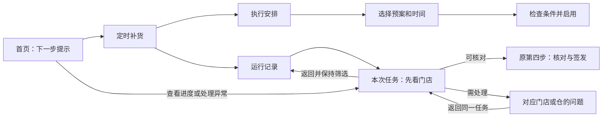
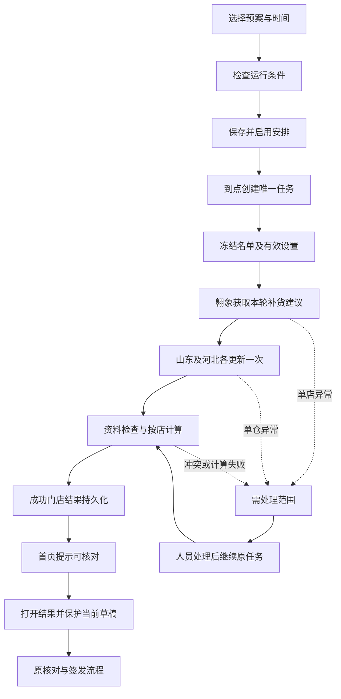

# 定时补货：前端交互与实施边界方案

日期：2026-11-04。设计基线：应用 0.36.2，提交 `6e24b697f0686bab73b2565f45170895c92c2a76`。当前分支 `feat/browser-connection-indicators-0.36.2`。

文档性质：供开发和验收使用的设计规格；没有实施定时器、创建真实任务或运行生产采集。文中的界面数据均为示意；性能数值是验收目标，不是实测结论。开发开始前重新核对实际 HEAD、未提交修改与已保存配置。本轮只新增此设计文件。

## 1. 目标、产品用词与范围

目标：业务提前选好补货预案及执行时间。软件在上班前完成翱象取数、两仓商品资料更新、文件检查和补货计算；业务上班后直接核对并签发。定时任务自身不签发。

统一用词，避免“计划、预案、批次”混用：

| 用词 | 对象与职责 | 人员在哪里维护 |
| --- | --- | --- |
| 补货预案 | 门店名单、顺序、明确勾选的预设参数 | 现有参数设置中的补货预案 |
| 定时安排 | 采用哪份预案、何时开始、是否启用 | 定时补货 → 执行安排 |
| 本次任务 | 一次触发产生的运行，有唯一身份及固定依据 | 定时补货 → 运行记录 |
| 计算结果 | 尚未签发的自动计算结果，可以部分成功 | 任务详情；打开后进入现有核对与签发 |
| 草稿 | 用户明确保存的当日工作内容 | 现有草稿记录 |
| 签发单 | 人员确认签发形成的正式单据 | 现有订单跟踪和决策复查 |

执行到计算结果为止，不新增订单生命周期，不生成“待签发订单号”。任务的内部 ID 不能冒充补货单号。方案使用“预案”统一新入口中的名称；旧界面同一对象的“补货计划”文字在相关入口一起统一，不重命名历史数据字段。

### 首期包含

- 每周指定星期重复、指定日期单次；使用北京时间（Asia/Shanghai），显示下一次准确日期和时间。
- 一份安排对应一份预案；支持多份安排，首期同一时间只执行一个自动补货任务。
- 立即执行一次与定时执行共用同一流程。
- 按原任务继续、单店重试、安全暂停、结束本次、启停以后定时。
- 原件/参数/结果固定保存、首页提醒、进入现有核对签发、必要的数据维护。

### 首期不包含

- 自动签发、自动人工改量、自动勾选首铺商品、自动采购、自动导出签发单。
- 自动开机、唤醒电脑、Windows 服务、跨机器调度、云端运行、自动填写验证码或绕过浏览器授权。
- 自动把更新后的库存用于聚水潭订单重新分配，或改变已生成单的预留。
- 重写模型、预算、箱规、资质/黑名单、仓归属、付款/实收口径、原有导出内容。
- 节假日日历、复杂表达式、跨天补跑历史、批量编辑定时安排。不能把尚未实现的能力放成可点击按钮。

## 2. 已核实的代码现状与需要补齐的部分

| 现状 | 代码依据 | 实施结论 |
| --- | --- | --- |
| 预案保存有序门店及勾选参数，采用不会取数 | `src/replenishment_plans.py`、`src/replenishment_plan_ui.py` | 复用对象，另建安排，不把时间塞进业务参数 |
| 主从仓及预算保持各店设置；全局映射单独绑定 | `src/workbench_actions.py`、`src/parameter_maintenance.py` | 复用参数解析；自动任务不读取未保存的本次改动 |
| 翱象采集校验精确门店、任务关联和文件来源，原任务未决会限制重复创建 | `src/aoxiang_acquisition.py`、`src/aoxiang_jobs.py` | 固定关联原采集，不能用“下载列表前 N 项”代替身份关联 |
| 两仓同步当前会校验并采用默认资料，采用检查目标版本 | `src/catalog_sync.py`、`src/catalog_sync_validation.py` | 必须补“任务内验收并留存”和“发布为默认”两个明确边界，不能直接调用会改当前工作台的窗口回调 |
| 独立计算入口存在，但 AI 快照仍依赖当前窗口数据 | `src/automation_jobs.py`、`src/automation_gateway.py` | 复用无 Qt 的装配和计算，新增从持久设置取快照的入口；不依赖 MCP、Codex 或 WorkBuddy |
| 已有后台周期仅用于采购实收监控；浏览器已有应用级会话和操作权 | `src/aoxiang_workflows.py`、`src/aoxiang_workflow_ui.py`、`src/aoxiang_session.py`、`src/catalog_sync_session.py` | 与原队列协调，不起第二套独占同一浏览器的执行器 |
| 当日草稿保存有明确的覆盖版本检查 | `src/work_repository.py` | 自动结果独立保存；不传入猜测版本覆盖当天草稿 |
| 文件检查最多 2 进程；计算 UI 范围 1–4，默认 2 | `src/file_intake.py`、`src/batch_app.py` | 保留进程上限，不叠加多个任务各自满载 |
| 首页以四个业务场景组织，已有折叠、图标辅助操作与后台读取 | `src/business_scenes.py`、`src/business_flow_ui.py`、`src/ui_controls.py` | 沿用样式及组件，不新增第五个业务主场景 |

此前报告只能证明相应旧功能，不作为本次实施后的验收证据。

## 3. 信息架构：一个入口，两类内容

主入口放在首页“补货出单”卡片内，保留原“进入补货出单”主按钮，新增次级入口“定时补货”。准备数据页可有同名快捷入口，均打开同一窗口、同一任务集合，不复制实现。

首页在既有待办区内增加一条紧凑提示，不再增加一排大指标卡。没有安排时只显示入口，不显示一块空面板；有安排时最多显示一条最需要处理的摘要，附“另有 N 项”。优先级：需处理 → 已完成待核对 → 运行中 → 下次安排。数量统计范围明确为自动补货任务，不计入已签发订单数。

“定时补货”使用非模态窗口，包含两个标签：

- **执行安排**：设置以后何时运行。新用户默认这里。
- **运行记录**：查看已经开始、错过或完成的本次任务。有待处理或待核对结果时默认这里。

详情在同一窗口内切换列表/详情，返回时保留筛选、滚动及选择；不连续弹多个模态窗口。主窗口仍可查看其他页面。主窗口右下角已有三项连接灯继续保留，子页面不另做一套“假绿灯”。

首页全成功时，“查看计算结果”直接到原第四步，不强制经过运行记录和任务详情。上图中的中间页面用于追进度、处理异常或查依据，不是每天必须走完的向导。

## 4. 页面与控件规格

### P0：首页提示

| 情况 | 示例文字（示意） | 主动作 |
| --- | --- | --- |
| 未配置 | 不额外占首页空间 | 卡片内“定时补货” |
| 待执行 | 青岛线 · 明天 06:30 开始 · 12 店 | 查看安排 |
| 执行中 | 青岛线 · 获取补货建议 8/12 店 · 已用时 4 分钟 | 查看进度 |
| 需要人员 | 青岛线 · 河北仓需要登录 · 6 店受影响 | 处理异常 |
| 全部完成 | 青岛线 · 12 店计算完成，尚未签发 | 查看计算结果 |
| 部分完成 | 青岛线 · 10 店可核对，2 店需处理 | 处理异常；“查看10店结果”为次级动作 |
| 错过时间 | 青岛线 · 今日 06:30 未执行：软件未运行 | 查看本次安排 |

完成后保留待办，不能只有一个几秒后消失的提示。默认不发外部消息、不自动弹出抢焦点对话框。进入结果不等于已签发；首页“已查看”与正式签发事实分开。

### P1：执行安排列表

顶部仅“执行安排 / 运行记录”、新建安排和关闭。列表列为：预案、门店数、执行时间、下次开始、启用状态、最近结果。默认按下次开始排列，停用项在后；运行中的任务顺序不受此展示排序影响。

选中一行后右侧或底部显示摘要与操作，不给每一行嵌入大量 QPushButton：

| 操作 | 固定含义与反馈 |
| --- | --- |
| 编辑安排 | 只修改以后的触发；有正在运行的任务时提示本次不变 |
| 立即执行一次 | 弹出范围摘要，确认后排队；不消耗下一次定时触发 |
| 启用安排 | 仅停用状态可用；显示下一次执行日期和时间 |
| 停用安排 | 仅启用状态可用；不停止本次任务 |
| 删除安排 | 在“更多”中，确认名称及引用范围；历史运行记录保留 |

启用和停用是不同动作，不让一个文字固定的按钮随隐藏状态反向执行。删除、结束等动作不用绿色主按钮。手动立即运行与稍后的定时执行门店重合时，提前显示：“本次立即执行不替代 06:30 的定时安排”，可取消后去停用该安排。

空态：尚未设置定时补货，主动作“新建安排”，附“先维护补货预案”次级入口。不展示空白表格。筛选无结果则显示“清空筛选”，不能引导新建。

### P2：新建/编辑安排——一个短表单，不做多步向导

按“选预案 → 选时间 → 看范围与检查 → 启用”自上而下排列。

| 字段/控件 | 必填与默认 | 行为 |
| --- | --- | --- |
| 补货预案：可搜索下拉框 | 必填，不猜选第一项 | 搜索名称；显示店数；无预案时给创建入口 |
| 重复方式：单选 | 默认每周重复 | 每周重复/仅一次；单次显示日期，重复显示周一至周日；每天是全部选中，不另存第三种规则 |
| 星期/日期 | 必填 | 不默认勾全周；一次性日期不得是过去日期 |
| 开始时间：时间控件 | 必填，无暗中默认时间 | 24 小时 HH:mm；旁显示北京时间；不是保证完成时间 |
| 只读范围摘要 | 自动生成 | 门店数、名单入口、预案所覆盖参数数、两仓更新、完成后待核对 |
| 参数来源：折叠明细 | 默认收起 | 每店实际值、业务名称、来源；预算/主从仓单列；不展示 H/AR 等列字母 |
| 运行条件 | 首次为“尚未检查” | 独立检查按钮；逐项就绪/待处理/未检查，不仅红绿颜色 |
| 高级：同时计算门店数 | 默认 2，范围 1–4 | 本安排的执行资源设置，不借用当前草稿滑块值；同一设置供每次运行冻结 |
| 名称 | 自动取预案名与时刻 | 可在高级中改，首次无须另填 |

正常路径底部只有“取消”“保存并启用”。高级中提供“仅保存，暂不启用”。首次缺必填或静态配置错误时，焦点转第一处错误；必填列名用“*”并在表单顶部说明，不靠弹窗逐个报错。

运行条件列出：计划门店准确对应、门店预算/主从仓/必需参数、全局分类映射、必卖清单有效性、两仓账号绑定、三路登录/操作页面、存储可写与容量检查。只读检查不提交导出或采购。若从未连接，可由人员主动点检查发起连接并处理授权；异步显示“等待浏览器授权”，提供停止，不阻塞表单。

“保存并启用”要求本次表单的运行条件检查通过；允许“仅保存”保留未配置安排。检查凭据绑定预案版本、账号绑定、路线/预算、参数等配置签名；相关内容改动后显示“配置已变化，请重新检查”。检查成功显示检查时刻，但不能承诺未来登录仍有效；到点再次核验。不得因底部绿灯就跳过账号或门店核验。

保存前一段摘要足够，不弹额外二次确认：例如“每周一、四 06:30，按青岛线预案处理12店，更新山东/河北仓资料，完成后等待人工签发；电脑需保持开机且不休眠，软件和浏览器保持运行。”

### P3：运行记录列表

默认近7个业务日，并包含更早未结束、未查看的待核对任务。明确显示查询范围。支持日期范围、状态、预案名/门店搜索；状态仅“全部、执行中、需处理、可核对、已结束”。每页50条、后台查询；页面翻页不触发全库快照解码。

列：业务日期、预案、开始时间、当前环节、可核对/需处理门店数、状态。选中后显示总耗时及一个主动作。保持选择和滚动，不随进度跳到第一行。点“刷新”只查询，绝不继续任务、重连或重算。

按钮规则：运行中→查看进度；全部完成→查看计算结果；部分完成→处理异常，旁有查看已完成结果；已暂停→继续本次；错过→执行今日一次；结束→查看记录。结束记录不重新激活，需运行则明确创建新任务。

### P4：任务详情——门店粒度为默认

页面从上到下：

1. 固定标题：预案名、业务日期、触发方式；右侧返回和关闭。
2. 一行结果摘要：12店 / 10店可核对 / 2店需处理 / 已完成店安排金额。金额只统计成功落库结果；缺价和待核款另列，不把未知算0。
3. 紧凑阶段条：检查条件 → 获取补货建议 → 更新商品资料 → 检查并计算 → 等待核对。完成阶段用勾选及文字，失败阶段用说明，不单靠颜色。
4. 当前进度：如“计算6/12店；2店计算中；已用时…；最近业务进度…”。另标“连接仍响应/状态待确认”，不能用心跳冒充业务前进。
5. 门店表：门店、补货建议、所需仓资料、计算状态、安排金额、下一步。仓资料有山东/河北两项共享摘要，不把全仓列表在每店展开。
6. 行内异常提示和选中门店详情；下方主动作依据当前状态确定。

初始不加载任何商品明细、不生成Excel、不读历史订单全集。点门店后先展示问题/金额摘要，再由“查看商品明细”按需载入；计算成功可直接进入现有结果页。

筛选仅“全部门店、可核对、需处理、未完成”及门店搜索，显示“当前X/Y店”。筛选只影响展示；“暂停本次”永远影响整任务，“重试所选失败门店（N店）”才按显式选择执行。成功门店不默认选进重试；成功项不能用重试改数据。

### P5：异常处理——就地处理，不让人搜日志

每条问题固定三行：“哪里没完成 → 影响范围 → 下一步”。面向业务，不默认展示异常堆栈、原始JSON、路径。展开“技术详情”才显示错误编号、原任务关联和诊断内容。

| 业务提示 | 主动作 | 结果与边界 |
| --- | --- | --- |
| 河北仓登录失效，6店暂未计算 | 打开河北仓连接 | 进入现有窗口，处理后返回原任务，再点继续；不自动提交新导出 |
| XX店导出已受理，下载未完成 | 检查原采集任务 | 按原任务号查询；不能用普通“重试”重复提交 |
| XX店缺少主仓设置 | 设置该店供货仓 | 进入对应设置并返回；保存本次修正形成新依据，保留原错误；不默默改全部门店 |
| 同店同商品存在冲突 | 核对冲突 | 复用既有选择界面；不默认取第一份 |
| 山东仓本次更新失败 | 重试山东仓更新 | 沿用原同步任务；成功河北仓不重拉 |
| 明确要使用现有仓资料继续 | 更多 → 选择现有资料继续 | 展示仓、来源、取得时间、影响门店；明确确认并冻结采用依据，不能自动降级 |
| 目标默认资料已被其他操作更新 | 查看资料版本差异 | 保留新下载文件；继续按任务快照算不受影响，但不覆盖更新过的默认资料 |
| 本地保存失败/磁盘不足 | 处理存储后重试保存 | 不把仅在内存中的结果标为“可核对”，不重新提交平台取数 |

未知状态不能包装为成功。可以安全完成的其他门店继续执行；全局账号/映射错误阻断全局，仓错误只阻断需要该仓的门店，单店错误只阻断本店。

从错误入口补齐设置时先展示“应用到本次任务”的差异；默认只修正本次，不顺带保存永久门店默认。确需长期维护时给出独立“同时保存门店默认”选项，按现有确认规则执行。仅去参数页保存了默认，返回后也不能自动把它套进已经冻结的任务，仍需明确采用并重算受影响门店。

若失败仓没有任何本次门店使用，门店可全部算完，摘要应是“12店可核对，河北仓更新需处理”，不能因此拦住12店的查看，也不能把两仓更新阶段标为全部完成。

## 5. 按钮语义、退出与维护

| 动作 | 作用对象 | 确认与反馈 |
| --- | --- | --- |
| 关闭子窗口 | 仅当前查看窗口 | 不停止任务；关闭后首页继续显示进度 |
| 暂停本次 | 当前运行 | 立即显示“正在安全暂停”，停止派发后续任务；运行中的安全步骤可完成；未退出前不能显示已暂停 |
| 继续本次 | 已暂停或已处理异常的原运行 | 核验原回执，复用成功项；不变更冻结依据 |
| 重试所选失败门店 | 明确失败门店 | 沿用原任务和原资料；显示N店；受理不明改为“核对原任务” |
| 结束本次 | 当前运行剩余工作 | 确认范围，安全退出；保留成功结果和平台回执；不关闭以后定时 |
| 停用安排 | 后续自动触发 | 显示“以后不再自动开始；当前任务继续” |
| 删除运行记录 | 已终止任务及仅由它持有的缓存引用 | 明确确认；不删除已采用草稿/签发/共享原件，不触碰平台任务；不进回收站 |
| 删除安排 | 排程配置 | 历史运行仍可查；运行中的本次任务不取消 |

执行中禁止删除运行记录；给出“先暂停或结束”的直接入口。清理必须按引用检查，保留被草稿、签发、其他任务引用的内容；不能用删除整文件夹代替引用释放。小进度、弹窗不暴露备份路径，诊断中可查。

退出整个软件时，若有任务运行，明确选择“保持运行”或“安全暂停并退出”，默认保持运行。若仅有以后安排，提示“退出后不会自动执行”，支持取消退出。首期不悄悄最小化成托盘、不承诺软件关闭仍执行。

辅助动作使用现有 Qt 标准图标：返回、刷新、重试、暂停、关闭；有工具提示和无障碍名称。不可把关闭和停止、停用和结束绑定在同一按钮。业务动作保留文字；主动作深绿色、次操作描边、辅助操作轻量，破坏性操作独立危险样式且默认取消。

## 6. 端到端状态与时间规则

图中“处理后继续”会回到该项实际失败阶段，不一律从计算或取数重做。

内部将执行状态与结果状态分开，避免“有10店成功，因此整个任务成功”：

- 执行状态：排队、运行、正在暂停、已暂停、等待人员、已结束。
- 结果计数：成功落库、失败待处理、尚未完成；三者覆盖本任务完整门店名单。
- 当全部成功且无未完成步骤时显示“计算完成，等待核对”；部分成功显示“部分可核对”。
- 操作系统中断的RUNNING任务恢复为“上次中断，检查原状态”，不直接恢复成成功，不盲目重放外部动作。
- 停用/删除安排、修改预案不会撤销已产生运行或已生效更新。

触发唯一键为“安排ID + 计划触发时刻”，数据库唯一约束；不能把预案修订加入键导致同一时刻因修改而重触发。安排ID、运行ID由系统维护，不要求业务填写。

定时安排使用北京时间，业务日固定为触发日期。运行跨零点仍属原业务日；午夜后不自动生成第二份。错过日期的任务不补采昨天的数据假装历史数据：只允许明确“执行今日一次”，创建今天的独立运行并记录来源为补跑。

首期到点容差为60秒，用于计时器抖动；软件持续运行且到点已登记的任务即使排队很久仍可执行。软件关闭/休眠后超过容差才被发现的触发记为“错过”，不自动补跑。持续时间和等待超时用单调时钟，触发与业务日用带时区日历时间；系统时间回拨不能重复创建。

同一预案/重合门店已有未结束运行时，新触发先显示“等待原任务结束”，允许跳过本次；不能静默合并或抢占。若已有待核对结果或当日已签发，提示重合门店并等待人员选择是否另做新计算，防止一天生成多套未经区分的待签发建议。无交集安排按时间、创建顺序排队。

任务结束释放本地操作权。平台受理不明的关联不能因“结束”被抹掉；新任务遇到同店未决采集时，精准指出原任务并提供核对入口，其他门店继续，不用一个未决店锁死整条线路。

## 7. 数据依据与工作台接入边界

### 7.1 启动时冻结，不能从活窗口偷取参数

按既有解析规则读取持久设置：有效门店参数 → 预案勾选项覆盖；分类映射全局；主从仓、预算、必卖清单等使用已保存依据。未保存的工作台临时参数、另一个草稿的profile、人工改量、新品勾选不进入自动任务。

采用系统默认只限现有业务约定允许的参数；门店编码、仓身份、缺价、资料冲突、必需预算方式不能猜。原有新品识别/策略开关保持，自动任务不模拟业务勾选新品或铺货清单。

预案、门店默认、必卖清单、全局映射、准入资料应形成一致版本集合；跨文件设置使用轻量前后版本复核，不一致则重新读取有限次数，仍变化就等待。签发前仍执行原有当前准入及过期检查，不因夜间计算绕过。

修改预案时，在相关保存确认中列出关联定时安排和下一次时间：“新设置从下次任务使用，本次不变”。新增门店、主从仓或账号绑定变化必须重新检查条件；不向旧运行热更新。

### 7.2 商品资料：本次计算、默认资料、分配库存三者分清

1. 下载、身份/字段/来源验收、原件留存先完成。每个仓得到一个不可变的任务资料引用。
2. 本次计算绑定这两个引用。继续和单店重试不再查询“当前默认”冒充原快照。
3. 默认资料自动更新仍使用现有每仓锁和版本比较，不覆盖采集期间被人工更新过的版本。
4. 若工作台存在已载入作业、未保存变更、正在计算/签发/维护，先不自动发布默认；任务本身继续使用本次新资料计算。详情显示“本次已使用新资料；默认资料更新待空闲”。不在人员编辑到一半把其结果置换或跳页。
5. 无冲突且工作台空闲时按原规则发布默认，并发送准确更新事件；若版本变化，保留候选等待“采用本次资料为默认”明确处理，不延迟盲覆盖。
6. 每仓发布分别原子完成；某仓成功、某仓失败如实展示，不能声称两仓事务一起成功。单仓成功结果不回滚到旧资料。
7. 不调用分配库存更新，不修改聚水潭分配批次或占用；不回写历史商品资料快照。

这需要对 `catalog_sync.run_sync` 的“校验后立即发布默认”做有边界拆分：原手动路径默认行为保持；新增任务内留存/使用入口。不可只复用 `Dialog.on_business_event`，因为它会直接更新当前工作台并触发输入失效。

### 7.3 结果保存与进入现有第四步

每店完成后将结果与有效设置写为持久快照，提交成功才计入“可核对”；其他店失败不能丢掉成功结果。一个run的共享输入、两仓原件及参数只按内容保存一次，门店结果引用共享对象。

“查看计算结果”包含：后台载入 → 保护当前工作区 → 激活该任务结果 → 进入第四步。可清洁切换时一次点击直达；有未保存内容时先“保存当前草稿再打开/取消”，不能静默丢弃。加载失败保持原窗口完整。

载入必须一次性同步业务日期、输入、已选名单、门店记录、结果、profile、来源及重算缓存；不只给表格赋值。所有 `_calculation_*` 缓存明确重建，防止旧必卖清单或旧参数残留。

已签发的结果在任务详情中标明，不自动再选中；未完成门店不伪装0数量。人员决定签发哪些成功门店。每日草稿仍只有原有日期记录，同日覆盖继续询问；已有订单号/修订检查沿用原逻辑。记录已打开、已采用、已签发分别是不同事件。

参数或输入确需改变时，使用“修改本次设置并重算”明确入口，标明哪些门店失效，生成新的依据编号；与“原样重试失败门店”分开。已人工修改或已签发的成功门店不被后台重试覆盖。

## 8. 并发、超时与性能契约

### 8.1 资源与调度

- 首期一个自动补货任务占用执行通道；不同安排排队。任务内门店计算1–4进程，默认2；文件检查继续最多2进程。取数/解析/计算分阶段，不叠加多个任务的进程池。
- 同一翱象浏览器只有一个操作持有者；定时补货和既有采购实收监控共用调度门。短暂锁定协调，不在持有主数据库写事务期间等浏览器。
- 人工操作优先，在当前安全步骤结束后让出连接；未退出不能谎报已释放。后台计算期间手工新计算排队或明确暂停后台，不额外起一套满载进程。
- 聚水潭两仓保持账号、页面及数据隔离；首期按固定仓顺序调用现有组件，不为显示状态另开浏览器。三项连接状态复用0.36.2观察机制。
- 多软件实例共享同一资料目录时，仅一个获得调度权；其他实例可查看并提示占用，不能到点各跑一份。调度权与浏览器业务操作权分开，等待人工时不长期占业务写锁。

### 8.2 等待与重试初始策略

以下是首期工程默认，写入可查常量，不放进日常业务参数表；开发联调可基于实测修改并记录，不能无上限等待：

| 情况 | 初始策略 |
| --- | --- |
| 本地只读状态请求 | 单次至多5秒；超时为待确认，不当成功 |
| 登录/授权等待 | 至多60秒后转等待人员；不反复重连弹授权 |
| 平台任务状态轮询 | 首30秒每2秒，之后5秒，长等待每10秒；停止请求不等待下一轮长周期 |
| 明确未执行的瞬时查询失败 | 最多2次，间隔5秒、15秒；权限/身份/字段错误不自动重试 |
| 导出受理/上传结果不明确 | 立即保存未知状态，只查原任务；不因重试额度尚有剩余而再提交 |
| 导出/下载长时间没有可确认业务进展 | 每项15分钟转需处理，保留平台任务；这是暂停观察，不认定平台失败或自动取消平台任务 |
| 数据库锁忙 | 后台短等待并有限重试，总计10秒后给出可恢复状态；主线程不等待写锁 |
| 重计算/大文件读取 | 可取消边界与实际计数；不凭15分钟平台超时规则强杀计算或正在提交的事务 |

普通刷新仅读本地小摘要。运行心跳、平台状态、业务进度分别存放；心跳不能不断重置“没有业务进展”的等待期限。

### 8.3 前端性能

- Qt主线程只处理控件和小结果，不能读Excel、哈希大文件、深拷贝全部SKU、写快照或等待网络。
- 列表用QTableView/model与分页，门店列表只传计数与摘要；避免每个单元格创建按钮对象。商品列表按需加载、复用现有过滤模型。
- UI进度最多每250毫秒合并更新一次；持久化每次阶段切换、外部受理/下载回执、门店结果提交必须即时记录，普通心跳最多每2秒一次且不形成无限事件日志。
- 首页只查计数和少量摘要，不打开任务全量结果，不随每秒计时重算金额。隐藏窗口降低刷新，后台执行不依赖详情窗口是否打开。
- 图表、Excel和完整诊断均按需生成；不得为显示一条首页金额先导出Excel。
- 固定原件按哈希去重引用；同一任务每仓解析一次供准备阶段复用。现有模型进程传输保持边界，本次不以引入共享内存为前提，不宣称消除原有全部拷贝。

### 8.4 验收目标及测量口径

同一电脑、同一构建、同一数据，分别报告冷/热启动；完整流程受平台影响，不承诺固定分钟数或“提速几倍”。

| 项目 | 首期目标 | 测量 |
| --- | --- | --- |
| 按钮操作的可见反馈 | P95不超过100ms | 从点击到加载/状态反馈；不把网络完成时间混入 |
| GUI响应 | 50ms心跳，P95间隔≤100ms；运行阶段不出现连续>500ms主线程阻塞 | 实际EXE，含读文件、计算、保存 |
| 运行记录首屏 | 1万条合成运行摘要、50条分页，热查询P95≤1秒 | 查询到可见；不加载商品 |
| 首页额外开销 | 热摘要P95≤300ms | 独立记录，不重复触发原生命周期冷索引 |
| 取消/暂停反馈 | 200ms内显示请求已接收 | 安全退出耗时另报；不能承诺当前平台操作立即取消 |
| 空闲附加CPU | 连续5分钟平均≤整机CPU容量1% | 对比同版未启用安排；不以瞬时0%代替 |
| 内存 | 固定活跃规模重复20次任务，最后5次结束后占用不得持续线性增加；相对前5次稳定中位数增长≤10%或50MiB较大者 | 采样主进程及全部子进程RSS每250ms，峰值与结束稳态分开 |
| 编排额外耗时 | 同样原服务调用、同输入，去除真实平台等待后增加≤10%或2秒较大者 | 交替串行至少3轮，保留全部值、中位数、最小/最大 |

用于性能的规模建议：1/10/30店，含已有真实样本；不足部分合成并标注。结果持久化和复核成本计入端到端，不只报子进程内部算法时间。未达标就定位修正或明确未完成验收，不靠隐藏进度和缩小样本宣称通过。

## 9. 布局、可读性与操作次数

沿用 `ui_controls.STYLE`：浅底白卡、深绿色主按钮、现有字体与Qt标准图标。新增页面减小大标题/卡片留白，不改全软件主题。

- 首页新增提示为一至两行；窗口小于推荐尺寸时自然换行，不把现有业务入口挤出可见区域。
- 定时窗口目标逻辑尺寸约1040×720，可缩放；实测Windows 100%、125%、150%，1366×768与1920×1080两档物理屏幕。低可用高度时纵向滚动，固定主动作可达；不要求横向滚动才能看到状态或下一步。
- 表单在窄宽下变单列；列表名称可省略但悬停完整，状态与动作不省略。优先隐藏次要时间列，不隐藏影响门店数。
- 主动作每个视图区至多一个；“查看成功结果”在部分失败时仍可达，不强迫先修完所有门店。
- 键盘Tab按视觉顺序，Enter不默认触发启用、删除或签发；Escape只关闭当前查看/编辑，不停止后台任务；未保存表单关闭询问丢弃。
- 时间明确为“开始时间”；绿色连接与绿色任务完成是不同文字，不以一个小圆点替代状态名称。
- 业务错误可展开技术详情；默认不展示文件路径、JSON、函数名、内部修订号。日期、门店、仓、异常原因和下一步始终可见。

认知负载验收：预案已维护且连接已就绪的情况下，首次创建只需选择预案、时间、重复日期三类业务输入；日常全成功从首页到第四步至多2次点击，不要求重新选门店、重新导入资料或重填参数。有异常从首页至对应处理入口至多3次点击；安全确认不计入此上限但要单列数量。必须实测，不以设计点击数冒充业务试用结果。

## 10. 代码结构与数据契约

新增模块建议按职责分为四组，命名实施时可以微调，但不能把每个小函数拆成文件：

| 模块 | 责任 | 禁止承担 |
| --- | --- | --- |
| `scheduled_replenishment.py` | 安排/触发/运行状态、唯一键、快照引用、事件和维护 | Qt、浏览器选择器、模型计算公式 |
| `scheduled_replenishment_runner.py` | 分阶段协调、恢复、租约、按店处理、取消检查点 | 复制模型/仓路由算法；改工作台控件 |
| `scheduled_replenishment_ui.py` | 安排表单、运行列表、详情及错误操作入口 | 主线程Excel/数据库重查询/全量计算 |
| `scheduled_replenishment_adapter.py` | 持久配置→冻结计算输入、任务结果→工作台、采集/资料服务适配 | 读取上一个工作台未保存参数充当默认 |

复用 `workbench_actions`、`batch_service`、原采集协议、`catalog_sync_validation`、`source_archive`、现有分块编码及UI组件。需要把 `automation_jobs` 中可复用的无UI装配移至共享服务时，保留薄兼容入口，人工/MCP/定时调用同一实现，不能复制三套规则。

任务元数据与快照引用采用现有业务数据库的新增独立表，不向结构严格校验的翱象队列数据库随意加表。大对象沿用现有分块存储与原件留存，不另建用户可见的备份目录、第二个草稿库或回收站。迁移为增量建表，保留历史格式；升级前备份及旧版本兼容以测试证据为准。

最小对象：

| 对象 | 必要信息 |
| --- | --- |
| Schedule | ID、名称、预案ID、时间/星期或日期、时区、启用、revision、并发数、条件检查绑定签名、下次触发 |
| Run | ID、唯一触发键、业务日期、触发方式、执行/结果状态、预案及有效设置快照引用、版本、起止时间、当前阶段、控制请求 |
| RunStore | run_id+精确门店编码、原始顺序、阶段、输入/设置/结果引用、错误、尝试次数、采用/签发关联 |
| RunWarehouse | run_id+仓、账号绑定版本、原同步任务及文件回执、冻结资料引用、默认发布状态与目标版本 |
| Event | 单调事件序号、时间、阶段、门店或仓、业务消息、原外部任务关联；技术详情另按需读取 |

所有平台创建动作先持久化操作身份/意图，再请求平台；返回回执立即留存。请求结果未知时只查询原任务。run状态改变用条件更新和revision，老线程回复带run_id/attempt_id/依据签名，不匹配就忽略，不污染重跑或新任务。

事务只覆盖意图/回执/快照引用的本地提交，不包住网络等待、Excel解析和全量编码。进入写事务前准备大块结果，锁内再次核对版本并短提交；提交边界不可强杀。发布默认的文件替换继续沿用原恢复日志。

三条操作接口区分：`resume_run`（继续原依据）、`retry_failed_stores`（同依据失败项）、`recalculate_with_changes`（明确更改依据及影响范围）。`refresh_list`只查询。UI请求需带expected_revision并返回可追踪操作ID，不能以“已受理”作为完成。

## 11. 分阶段开发清单与依赖

| 阶段 | 可交付内容 | 依赖 | 通过条件 |
| --- | --- | --- | --- |
| A：主链与数据边界 | 固定依据、任务存储、立即执行一次、部分失败、独立结果；下载验收与默认发布分离 | 原采集/资料/计算服务 | 隔离场景端到端；结果与手工严格一致；不依赖Qt点击脚本 |
| B：定时与恢复 | 一次/每周、触发去重、跨实例协调、暂停/结束/重试、中断恢复、错过处理 | A | 可注入时钟测试；外部未知状态不重发；单店重试不动成功店 |
| C：前端与接入 | P0–P5、最少输入、真实进度、直接进入第四步、默认更新保护、数据维护 | A、B | 实际EXE人机流程/关闭/并发抢占测试；无旧缓存串入 |
| D：联合验收与交付 | 性能与严格对照、真实平台最小联调、构建报告、独立包 | A–C | 下节验收齐全；记录未验证范围；旧版保留 |

先实现可立即运行的完整链路，再挂定时触发；不先交一个只会响铃却没法稳定恢复的定时器。每阶段提交与验证，分支独立，模型版本不因编排变化而改变。方案阶段不预占发布版本号；开发时按实际最新版本确定。没有授权则不推送、合并或替换旧包。

## 12. 可执行验收清单

全部使用隔离数据目录/数据库/浏览器测试配置。真实平台联调另列，外部导出由授权运行创建，不从测试误发采购。界面验收须运行实际EXE，源码测试不能替代。

| ID | 场景与操作 | 必须观察到 |
| --- | --- | --- |
| UX01 | 已有预案新建安排 | 只需三类业务输入；预算、仓及参数来源可查；时间不自动填一个未确认值 |
| UX02 | 未登录、未配置、无预案 | 具体错误与就地入口；可仅保存，不假装已启用 |
| UX03 | 运行中关闭详情、切换五个主页面 | 任务继续，首页能找回；关闭不等于暂停 |
| UX04 | 全成功从首页进入结果 | 至多2次点击到第四步；无需重选门店；未签发 |
| UX05 | 10店成功2店失败 | 失败原因/范围明确；可以看10店结果；不把2店计0金额成功 |
| UX06 | 筛选后重试、暂停、清空筛选 | 重试只选中失败店；暂停整任务范围明确；不越界执行隐藏门店 |
| UX07 | 高缩放窄屏、键盘操作 | 主动作/状态不裁切；焦点可见；Enter不误签发/删除 |
| UX08 | 刷新列表与查询详情 | 无重连、重试、重新计算或默认发布副作用 |
| SCH01 | 同一分钟多次tick、两个EXE实例 | 同一触发只一个运行，浏览器不双占 |
| SCH02 | 每周/仅一次、时间回拨、跨零点 | 日期和时区正确、不重复；运行业务日不漂移 |
| SCH03 | 关机错过两天后开机 | 不批量补采历史；显示错过，可明确执行今日一次 |
| SCH04 | 两安排重合门店及当日已有签发 | 明确提示重合并等待处理，不静默替代待核对/已签发结果 |
| CFG01 | 预案覆盖一项，其他门店参数不同 | 只覆盖勾选项；路线/预算/全局映射口径原样 |
| CFG02 | 先算A、未保存临时改动、自动运行B | B不使用A的profile/参数/人工改量；重试B仍正确 |
| CFG03 | 运行中修改预案或默认 | 当前固定依据不变，下次生效可见；不串店 |
| AX01 | 一店失败、一店成功、乱序回执 | 原门店顺序保持，成功文件身份准确、失败可单店继续 |
| AX02 | 导出已受理后断网/重启 | 查原任务，不多提交；不会按最近文件猜绑定 |
| CAT01 | 两仓账号互换/错误仓/缺标签列 | 身份或执行字段异常明确，不能当正常新资料参与执行 |
| CAT02 | 一仓更新成功另一仓失败 | 依赖失败仓的店待处理；不偷偷改单仓；成功仓不重复拉 |
| CAT03 | 更新途中默认被另一窗口修改 | 保留任务新资料，默认发布冲突可见，不覆盖别人更新 |
| CAT04 | 主工作台有草稿和人工改量时自动运行 | 本次任务可用新资料算；默认发布与工作台接入受保护；原人工内容不变 |
| REC01 | 各阶段停止、强制结束进程后恢复 | 检查原回执；已有结果不丢、不重复；安全提交不强杀 |
| REC02 | 单店重试、参数变更后重算 | 两条动作分开；旧线程回复不能覆盖新依据；成功/签发店保护 |
| SAVE01 | 计算完成但保存失败 | 不标可核对；可重试保存，不重新平台取数 |
| SAVE02 | 当天已有草稿，打开/保存自动结果 | 保护当前修改；同日覆盖询问；取消没有写入 |
| DATA01 | 删除结束任务或定时安排 | 不删除已采用/签发/共享原件，不进回收站；运行中不可删 |
| BUS01 | 同冻结输入、参数，手工与自动对照 | 按原门店和商品顺序比较全部输入、中间值、建议/候选/执行数量金额、仓、准入、原因、审计字段，零非授权差异 |
| BUS02 | 签发/导出及历史读取回归 | 原工作表、列序、单元格值/类型/格式、旧快照一致；仅精确时间/构建字段可列白名单 |
| PERF01 | 1/10/30店、1万任务摘要、20次运行 | 按8.4记录原始性能与内存；单独报告平台等待，不借模拟证明真实提速 |
| EXE01 | 实际打包程序启动、spawn、关闭重开、恢复 | 无重复窗口/孤儿进程；源提交、EXE及ZIP哈希可查 |

计算对照必须按精确门店编码及商品编码核对完整性、唯一性，同时严格比较原顺序，不能通过重新排序或只比总金额掩盖差异。参数变更、人工处理导致的允许差异单列，并保持没有相关修改时结果一致。

## 13. 交付判定与本阶段结论

开发交付需提供独立分支和提交、构建提交、实际EXE及ZIP、可复跑用例、逐项证据、同输入业务对照、性能原始值、未完成项目。真实平台授权连续性、睡眠恢复和无人值守整夜运行没有实际证明时必须明确标注，不能因模拟时钟跑通而宣称已完成夜间值守验收。

本设计的首期默认已明确：软件内定时、北京时间、每次取本轮新资料、两仓各更新一次、一个自动任务串行编排、计算默认2店并发、失败按依赖隔离、成功结果独立落库、人员打开后沿用原签发流程。具体预案、日期和时刻由业务在新表单中选择；本方案不代用户启用真实安排。

业务主要路径：提前一次配置；上班打开首页，看到成功与异常范围；成功则直接核对签发，异常则从问题旁进入处理。后台的任务、回执、引用和版本保持可追溯，但不要求业务人员理解这些技术对象才能使用。
