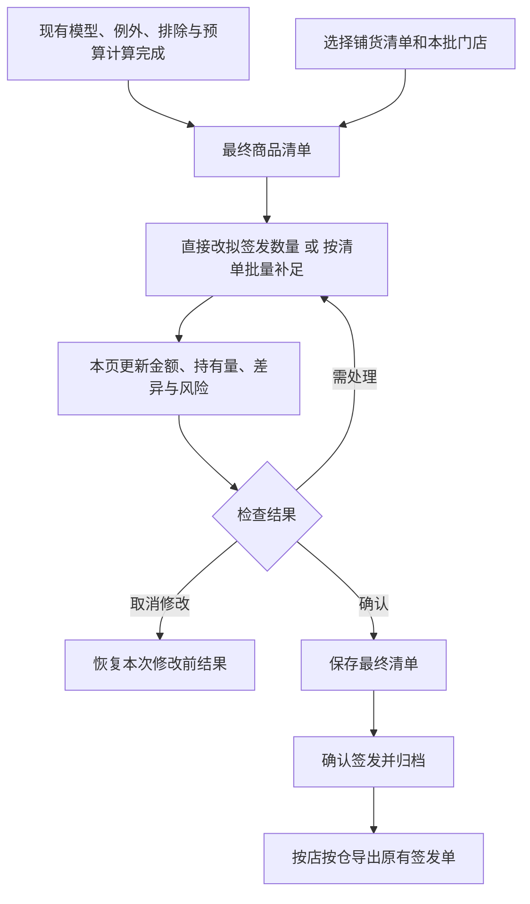

# 签发前最终清单调整方案

版本：方案 v2.2，2026-10-31。状态：方案，尚未开发。

本次按最新意见简化：模型和现有预算计算结束后，所有人工操作都放在最后的商品清单。直接修改拟签发数量，清单补足也是同一张表上的批量修改。业务不需要再理解候选层、申请层和另一套预算流程。

## 1. 页面只保留一条出单主线

**导入数据 → 按现有规则计算 → 查看最终清单、必要时调整 → 确认签发并导出。**

不新增一个必须经过的铺货步骤，也不要求正常出单的人打开调整窗口。没有人工操作时，现有结果与操作方式保持不变。

计算完成后的门店汇总保留，选择门店就能看最终商品清单；多店可合并查看并保留门店、仓库列。这里直接改量，也可以点“按清单补足”批量填写。对业务而言只有一个最终签发数量。

原先要求的两个入口仍可保留，但进入的是同一张最终清单：

- 已经计算完成：从门店列表选店，再选择铺货清单。
- 先从铺货清单出发：选择本批已计算门店，进入同一最终清单。

没有计算结果、计算失败或结果过期的门店，提示先完成计算；不拿旧数据代替本批数据。“全部门店”明确为本批哪些店，显示数量，不默默漏掉无效门店。

## 2. 最终清单怎么用

建议默认显示以下列，其他完整计算过程仍从“查看计算依据”展开。

| 列 | 用途 |
|---|---|
| 门店、仓库、商品编码、商品名称 | 多店或双仓时确认改的是哪一行 |
| 可用、在途 | 看清当前持有情况 |
| 箱规/最小出库单位 | 明确一次至少补多少 |
| 自动安排数量 | 已经完成现有预算分配的原执行量，只读 |
| 拟签发数量 | 默认等于自动安排数量，直接编辑，最终出单用这个数 |
| 差额 | 拟签发数量减自动安排数量 |
| 拟签发金额、补后持有量 | 随合法修改更新 |
| 调整原因、风险 | 解释为什么改，以及尚需确认的事项 |

“自动安排数量”与原始“模型建议数量”不是一回事。预算可能已经压低自动安排量；原模型建议、中间过程、预算前候选仍完整保留在计算依据中，不让用户在主表中面对多套可编辑数量。

表格上方保留固定语义的动作：**按清单补足、批量设数量、恢复自动数量、查看修改**。人工改量直接在数量格完成，不再设置一个与最终清单重复的人工申请页面。

恢复自动数量只作用于明确选中的行，显示将恢复多少行、金额如何变化；不把恢复、删除或应用做成同一个随状态改变含义的按钮。

常用过滤：全部、已修改、拟签发大于0、拟签发为0、资料待核、风险待确认。支持编码/名称搜索。筛选外的选择仍显示数量，批量动作明确作用于所选行，不暗中处理未选行。

多店合并表可以筛选查看，但门店预算仍分别核算；仓库分组不把一家店预算变成两个独立预算。

## 3. 直接改量后的处理

| 操作 | 本方案处理 |
|---|---|
| 12改为18 | 拟签发18，同步更新金额与补后持有量，原自动12不变 |
| 12改为6 | 拟签发6，差额为-6，原自动12保留 |
| 明确改为0 | 本次不补；不能被后续保底再次抬回 |
| 清空编辑格 | 视为未完成输入，提示填合法数量或点“恢复自动数量”，不默认为0 |
| 恢复自动数量 | 删除该行最终覆盖，恢复本次计算的自动安排量 |
| 撤销尚未保存的修改 | 回到打开本次编辑前的草稿，不影响历史签发 |

只有真正改变数量才记录人工调整；录入相同数不制造一次业务变化。存储中明确区分“没有覆盖”和“明确覆盖为0”。

修改只做必要的校验与金额、风险更新，**不默默重跑整店模型，不自动改动其他商品的签发数量**。这是本次简化采用的默认策略。原先方案里“人工申请后再自动重分配整店预算”的步骤取消。

如果业务随后主动修改预算、参数、资料并重新计算，这是一次明确重算：先告知会影响哪些调整，保留原调整供复核；新的自动结果完成后，旧人工调整标记待复核，不静默套用或删除。

### 3.1 箱规改量防呆（已确认）

数量始终使用库存单位。箱规品的拟签发数量只能是归属仓有效箱规的非负整数倍：箱规24仅允许0、24、48、72……；箱规1是单件，仅允许0、1、2、3……。不得用5%数量容差制造多补或少补。

- 数量编辑器的加减按钮、键盘上下键按箱规跳动，24→48→72；减到0后不能继续减。旁边显示“每箱24包，当前2箱＝48包”，避免箱数与库存单位混淆。
- 直接键入或粘贴也执行相同校验。23、25、负数、小数箱数等不合法输入不能应用、保存为有效调整或签发；提示“请填24的倍数：0、24、48……”。不静默向上或向下凑整。输入过程允许暂时清空，结束编辑时必须填合法数或恢复原值，不能把空白当0。
- 批量修改提供“每款设N个最小出库单位”，默认N为非负整数，预览每行实际数量。例如箱规12和24各设1个单位，分别为12和24；不把1当成各补1个库存单位。若批量设置相同库存数量，必须逐行满足各自箱规，全部选中行校验通过后才能应用，不默默跳过或部分写入。
- 单行改量、批量改量、清单补足落表、草稿恢复后的继续编辑和最终签发共用数量校验；后端再次校验，不能仅依赖界面步长。允许改0或确认超库存额度，都不能豁免箱规倍数。
- 箱规取该门店商品实际归属仓的有效资料；同商品不同仓分别判断。箱规或仓归属变化使旧预览失效，重新核对，不能静默改数量。既有缺失箱规补1规则不变，保留“箱规默认1”的来源提示。

“目标持有量”仍可不是箱规倍数，因为它是补后目标；清单补差生成的拟签发数量必须符合箱规。例如目标持有30包、当前0、箱规24，预览拟补48包及超目标18包，由业务确认；不能签发30包。

## 4. 清单补足就是批量改最终数量

适用于新品铺货、计划补货、活动备货。复用保存的清单，也支持拖拽导入与下载最低模板。最低必填只有商品编码；商品名称、逐商品目标、备注可选。按表头映射识别，精确匹配商品编码，不依赖固定列位置或名称模糊匹配。

清单名称、类型、统一策略在界面选择。清单保存仅用于复用，不自动应用到今后的所有作业。需要逐商品不同目标时，用“目标持有量”列或表内覆盖；来源显示为统一目标/商品目标/本行例外。

两个策略：

| 策略 | 业务含义 |
|---|---|
| 有货即可 | 可用＋在途大于0不新增需求；两者均0，要求补1个最小出库单位 |
| 补足目标持有量 | 扣除可用和在途，只补差额；箱规品向上取整到最小出库单位倍数 |

已有货是否参加由业务选择：双零无货、有在途无可用、已有可用；可组合选择，也能逐行取消。选择参与不意味着一定追加，“有货即可”不会把已有3个的商品强行补足一箱。

计算含义：目标策略先得到“本次需要补多少”，再和该行当前拟签发量取较大值。**不直接把缺口加到现有补货量上。**

例如可用3、在途2，目标12，单件出库，需要补7。原拟签发4时改为7，原拟签发10时保持10；不能把7加成11或17。箱规6时所需补货12，补后持有17，界面说明箱规多出5。

清单规则建议先预览再应用到最终表，显示原数量→新数量、增加金额、已满足和待核行。重复应用同一个目标不累计加货；多清单重叠保留来源，对满足目标的需求取最大值。

**已被业务人工修改的行默认保留。** 包括明确改0的行，后续套清单不能悄悄把它改回。若业务希望这次清单覆盖这些行，在预览中明确选中“同时更新所选已修改行”，看到具体差异后应用。手工编辑发生在清单之后时，以新的手工值为准。

本次统一目标、清单商品目标、门店商品例外的优先顺序为：本行例外＞清单商品目标＞本次统一目标。这个优先级只决定此次批量填数，不成为隐藏在最终数量后持续运行的另一层规则。

移除或更换清单不暗中撤销已经确认的最终数量。需要恢复时选择明确的受影响行，预览后恢复自动数量；来源记录保留。清单来源与最终覆盖是可追溯的操作，不是两套持续互相覆盖的计算。

## 5. 约束和风险集中在当前页

### 5.1 人工改0

已确认允许业务将“有销量、可用和在途都为0”的商品改0。必须说明原因、提示缺货风险，并明确确认；不自动补回来。

修改原因用简短选项：活动备货、陈列需要、经营判断、暂不补货、其他。支持对多行选同一原因，其他需要填写文字。缺货风险等例外不能仅靠默认原因自动确认。

### 5.2 超模型库存额度

已确认允许业务指定目标或人工数量突破模型额度，但必须在本页明确选中相关商品、记录原因并确认。只对本次选中行生效，不改变全店参数。

当前默认21天是可配置的“普通库存额度天数”，依据BH/BN额度日均，并非统一预测日均下的21天硬上限。使用当时有效参数，不写死21、不统一日均；cap_days为0时不产生该项额度限制提醒。

原BK受到原BJ需求量限制，不能直接把原BK当作所有人工数量的绝对容量。额度提醒沿用同一额度表达式及原有效库存、BH、BN、箱规和cap_days，将拟签发量作为对照补货量；不重跑销量预测，不覆盖原中间值。

原自动恢复/一箱例外已产生的数量不因新页面重新被拦。只有本次新增突破才要求确认，减少原自动数量不新增阻拦。缺少可靠预测或额度时标记“无法评估”，不伪造持有天数。需要确认的风险绑定当前门店、商品、数量与依据，数量或依据改变后重新核对。

### 5.3 门店预算

显示“目标预算、自动安排金额、修改后金额、超出/剩余”。填数时即时提示，保存或签发前统一核对。人工调整保留其输入，不通过后台再次分配把它改成别的数，也不自动挤占其他商品。

超过当前允许预算时，提示选择改数量或修改门店预算；不能仅把超支变成一条不阻止签发的提示。0元预算的最终数量必须全为0，不能靠零价格签发正数量，除非业务明确修改预算。不限预算与0元预算分别处理。

保留现有“最多一个末尾出库单位、全店超目标不超过5%”的边界；**不是总额低于105%就直接通过**。人工修改后需要整体校验：标明是哪一个末尾单位使金额跨过目标预算，扣掉该单位后不超目标；同店只认一次，不能每次编辑或每个仓各领一次5%。原自动分配已用过该例外时也统一核对，不能重复叠加。

这一段属于最终编辑后的预算校验方案，实施时补充边界测试，不修改原自动分配算法。自动阶段仍按原必卖优先分配；人工改量属于显式业务覆盖，不能再声称修改后仍完全由自动优先级决定。必卖商品被人工减量时在差异中标明。

### 5.4 不能靠填数量消除的问题

禁用、停采仍排除；地采、缺价、单位待核或归属不明保持待处理。先按现有主从仓路由确定价格与箱规，不截断需求、不拆单、不预占仓库存。

门店没有某商品的输入记录不等于销量库存为0。本版列出缺数据明细，不凭商品资料造出全零门店数据。要完成所有门店铺货，必须有各店可靠的库存/在途依据；不存在记录的处理需另立数据契约。

人工增加新品不要求凭空生成销量预测，但价格、库存、单位和归属必须足以支持出单；无法评估库存天数明确提示。清单的新增正量同样经过以上检查，不能因“批量”而跳过。

### 5.5 统一边界表

以下约束同时适用于单行、批量、清单填数和签发。界面负责提前反馈，服务层负责拒绝非法写入；不能通过粘贴、快捷键、恢复草稿或另一个入口绕过。

该编辑区只修改拟签发数量及调整原因，清单操作另可填写目标持有量。商品身份、原销量库存、模型中间值、价格、箱规和仓库归属不在此处编辑。后端从本次有效快照读取价格、箱规和归属，不能使用编辑请求自带的值替换校验依据。

| 类型 | 条件 | 界面与提交行为 |
|---|---|---|
| 硬约束 | 数量不是归属仓最小出库单位的非负整数倍 | 阻止应用和签发；不自动凑整、不让确认按钮豁免 |
| 硬约束 | 空白、文字、Excel公式、负数、非有限数或超出可安全表示范围 | 不写入数量字段；指出具体行，恢复原有效值或继续修改；空白不转0 |
| 硬约束 | 禁用、停采、地采或资料待核的商品被填正数 | 不因人工修改恢复中心仓执行；引导去正确资料入口处理 |
| 硬约束 | 预算为0、超105%或不符合唯一末尾单位条件 | 阻止签发；只能改数量或显式改预算，风险确认不能豁免 |
| 硬约束 | 计算未完成、结果已过期、商品身份不唯一或来源依据不匹配 | 不允许在该结果上应用调整或签发；先解决数据、身份或重算问题 |
| 可确认例外 | 双零有销量商品人工改0 | 明确原因并确认缺货风险后允许；其他商品不受该确认影响 |
| 可确认例外 | 本次新增需求突破有效模型库存额度 | 仅对选中商品、本次数量和依据确认；不改全店额度 |
| 可确认例外 | 人工需求缺少可靠预测/额度，但基础资料可靠 | 明示“无法评估”，记录经营原因并确认；不填写虚构持有天数 |
| 显式覆盖 | 清单再次更新已被手工修改的行 | 默认保留，包括人工0；业务明确选择覆盖并核对差异后才修改 |
| 提示 | 清单补差按箱规取整后超过目标持有量 | 显示多出数量与金额；若还触发额度或预算限制，继续执行相应约束 |
| 提示 | 商品已有在途 | 在途扣减持有目标，但提醒未到货前仍可能缺货；不把在途当可用 |
| 提示 | 人工减少必卖商品或改变原自动安排 | 标明原数量、差额与原因；不自动补回或挤占其他商品 |

缺失值、负库存、价格及箱规的基础有效性沿用现有输入合同，不因新功能重新解释。缺箱规默认1与“有值但非法的箱规”不能混同；后者不能降级成1绕过检查。有限的浮点尾差继续使用原数值合同，只能恢复确定的合法倍数，不能把23当24，也不能引入5%的数量误差带。

### 5.6 预算例外的精确边界

预算核对单位为整店，覆盖该店两个仓的全部最终有效行，包括筛选隐藏行。不能只核对当前可见商品、当前仓或当前选中商品。金额取既有有效价格及金额精度，不采用显示后的四舍五入结果反推预算是否合格。

超目标预算时，必须有一个明确记录的末尾补足单位：门店、商品、归属仓、单位数量、单位成本和本次来源。该单位属于本次实际追加或原自动预算保留的例外，不能临时挑一个原有昂贵商品，靠假设减掉它来证明超支合法。

必须同时满足：目标预算大于0；全店金额不超过目标的105%；去掉所记录的一个末尾单位后不超过目标；最终数量包含该单位；没有第二个超支单位。每次编辑均对最终状态重新核对，不累计领取额度，也不因为之前确认过而跳过校验。

例如预算100元，合法末尾单位5元、此前100元，最终105元可进入确认；105.01元不通过。此前100元、连续追加两个2元单位变104元，也不能因低于105元就通过。减少其他商品而使总金额回到目标以内后，不再需要超支例外。

人工预算例外必须在同一修改预览中明确展示并确认；普通增减且未触发例外，不额外弹窗。恢复自动结果只恢复原计算及其原预算依据，不制造新的人工超支许可。

### 5.7 修改范围、保存与失效

编辑以当前作业、门店、商品和归属仓的稳定身份定位，不能用表格行号定位。排序、筛选和滚动不改变修改对象；源记录顺序、门店顺序和原分仓导出顺序保持。单行只改该行；批量只改明确选中的行，应用前显示范围及筛选外已选数量。

同一清单完全重复记录合并并保留来源；同商品不同目标或单位冲突先解决，不按最后一行静默覆盖。清单补差使用有效可用与在途，不把计划签发当已经到货，也不把同一需求反复相加。

界面输入、草稿和签发分开：

- 非法文字或非法倍数停留在编辑器，不替换原有效数量。用户可以修正或撤销，不能作为有效调整保存。
- 数量合法但预算或风险尚未通过时，可保留为标记“待核对”的草稿，保存其问题与输入；它不是已生效签发结果，不能用原结果冒充修改后的成功结果。
- 只有全部所选范围通过校验、必要风险已确认且依据仍一致，才可应用为有效最终清单并签发。草稿保存不自动确认风险，不自动签发。

预览记录本次输入、有效配置、计算结果、商品资料、价格箱规、清单版本、所选范围和最终数量的依据。应用与签发时重新比对，不只在打开编辑器时检查。其他窗口已更新同日单或本地草稿时，拒绝陈旧覆盖并重新核对。

本次调整不改变其他商品的数量、仓库、价格、建议和原因。允许且必须同步变化的是所在门店的汇总金额、风险数和总体校验状态；不能将这些合理汇总变化误判为串改商品。修改预算、资料或参数属于用户明确发起的另一操作，要提示重算影响。

每个已确认例外绑定具体风险类型及数量，不能用“一次全确认”自动覆盖后来出现的风险。回到0再改为正数、换仓、箱规变化、价格变化、重算或跨作业复用时，相关旧确认失效。

### 5.8 取消、失败与历史

批量应用在提交前取消或校验失败，整次应用不生效；不能出现部分门店已经改量、其余仍旧的隐性状态。需要只做部分门店时，由业务明确缩小范围后重新应用。

后台任务使用本次任务身份，迟到结果不能写回新批次；关闭窗口沿用安全取消策略。进入既有不可中断的事务提交边界后不强杀，界面说明正在提交；提交成功后取消导出，保留已归档单据并说明已完成/未完成文件，重试使用原签发快照。

历史签发和旧导出读取当时数据，不拿当前箱规、预算或新规则重新验证后改写旧单。人工调整只作用于当前未签发草稿；同日再次签发仍走既有覆盖核对及下游过期机制。操作者、时间、原因、前后值、清单来源和确认依据可追溯，无登录身份时不虚构姓名。

导出签发时只使用已确认归档的最终数量；带未确认输入的页面不能直接作为正式签发导出来源。原签发导出字段、工作表、零量筛选和文件命名保持；新功能影响的是明确修改的数量及对应金额、解释和审计数据。

## 6. 分组、理由与现有导出

本次清单参与商品，原月销与可用库存都是有效数值0时归“本月新品”。在途参与补差，缺货天数不作为本次分组条件；空值或缺记录不猜成0。这是本次清单的分组规则，不全局重写原新品识别函数，不重分历史单。

其他计划品和活动品按原补货明细归组。只因进入清单而没有增加数量，不能把模型补货理由改写成“新品补足”。清单实际增加时使用新品补足/计划补足/活动补足；手工覆盖后按人工增量/人工减量/人工不补解释，完整原因留在内部复查。

维持现有导出工作表、字段顺序、按仓命名、单位与零数量筛选规则；新功能不顺带改造旧报表。最终签发数量使用经确认的拟签发量，计算原建议和原过程不覆盖。

订单跟踪仍是签发→回传→付款→收货。回传对比最终签发数，付款对比回传正量，收货对比付款正量。人工调整不增加生命周期阶段，也不要求业务填写内部版本号。

## 7. 保存与历史复查

页面退出或重算遇到未保存调整时，明确选择保存或放弃。保存草稿不等于签发；确认签发时按既有事务归档，导出绑定该次签发快照。

保存内容包括：自动安排数量、最终数量、差额、调整方式、原因、风险确认、清单版本和来源、当时库存及价格箱规、有效参数及预算依据。原模型建议、中间值、预算前候选和预算后原执行量保持可查。

决策复查用一条可读链展示：**模型建议 → 自动安排 → 清单/人工调整 → 最终签发**。来源顺序可展开查看；业务不需要读JSON。

风险确认和修改记录纳入业务指纹。更换输入、资料、参数或重新计算后旧确认失效；旧任务不能覆盖新草稿。历史签发只读，不用最新清单重新解释；再次签发仍走同日覆盖核对与下游过期规则。

铺货清单可多次复用，某店今天的人工0及超限确认不自动变成下次默认。历史缺少调整字段按未留存处理，不回写老快照。

## 8. 实施边界

代码核对基线：云主线0.17.0（db60859），本地应用0.17.1（7360b03，构建f2226dd）；本次资料分支始于0e18274。实际开发前重新确认最新HEAD和工作区，不能拿本方案中的版本回退代码。

目前普通商品结果表只读，已有单店合格新品首铺改量能力；本方案的最终清单普通改量及批量清单填数是新增能力，尚未开发。

实现放在现有自动计算和预算之后：读取自动结果的独立副本，用明确的最终数量覆盖映射维护编辑，统一刷新执行金额、状态、汇总和签发数据。不得只改Excel单元格或表格显示而漏改归档中的执行口径。

原 `model.py`、`one_box_exception.py`、`allocation.py` 算法保持；不重跑原保底来覆盖人工0，不为人工改量追加一次自动预算分配。原建议量与最终执行量分开保存，旧首铺入口通过兼容适配保持原行为。

单行输入不触发全店模型计算；只更新相关行及门店汇总。批量补足后台预览，显示阶段、处理店数和行数，校验后一次应用。取消、失败保留原草稿，不产生半批修改。存储继续复用现有草稿/签发事务边界，不强杀提交进程。

## 9. 验收标准

| 场景 | 预期 |
|---|---|
| 不使用本功能 | 所有原建议、执行、金额、顺序和导出严格等价 |
| 自动12改18 | 最终18，差额6；未选商品保持原执行 |
| 自动12改6 | 最终6；释放金额不自动分给其他商品 |
| 双零有销量12改0 | 原建议保留，原因与风险确认齐全，签发0，不被保底抬回 |
| 箱规6填7 | 不自动改12，明确提示选合法数量 |
| 箱规24按加减键修改 | 仅在0、24、48、72等合法值间切换，不能减为负数 |
| 箱规24键入或粘贴23/25 | 不应用、不保存为有效调整、不签发；原有效结果不被替换 |
| 箱规24明确填0 | 视为合法倍数；仍执行人工取消最低持有的原因和风险确认 |
| 箱规12/24批量各设1个出库单位 | 分别得到12/24库存单位，预览后一次应用 |
| 箱规12/24批量设36库存单位 | 第二行不合法，整次批量应用不落地，提示修正或重新选择范围 |
| 箱规或归属仓变更 | 旧预览失效，原编辑不静默规整，新签发重新校验 |
| 可用3、箱规24，有货即可 | 不追加清单需求 |
| 可用0、在途8，有货即可 | 不追加；提示在途不等于已到货 |
| 双零、箱规24，有货即可 | 需求24，通过预算及风险校验后可应用 |
| 可用3、在途2、目标12、单件、自动4 | 最终7，不是11 |
| 上例自动10 | 保持10，不降量、不累加 |
| 上例箱规6、自动6 | 最终12，补后17，提示箱规超目标5 |
| 已人工改0，再套清单 | 默认保留0；需明确选择覆盖并查看差异才能修改 |
| 同目标重复应用 | 数量不累计增加 |
| 改量后金额超允许预算 | 保留输入和差异，阻止签发，提示改量或改预算 |
| 5%以内但跨过目标多于一个单位 | 不因低于105%就放行 |
| 两仓同店 | 总预算只算一份，超支例外不重复领取 |
| 未选门店/未选商品 | 数量金额不因本次调整自动变化 |
| 超库存额度 | 只对本次新增突破逐行确认；不重新拦原自动例外 |
| 资料或计算依据变更 | 旧预览与确认失效，人工选择保留待复核 |
| 隐藏行或另一仓已有金额 | 整店预算包含这些行，不能按可见小计放行 |
| 预算100、末尾5元、最终105 | 满足唯一单位及来源条件，明确确认后可签发 |
| 预算100、最终105.01 | 不通过，不使用显示舍入或浮点容差放宽金额 |
| 预算100、连续追加两个2元单位到104 | 不通过，不能事后借用原有高价商品作超支证明 |
| 0预算及零价商品填正数 | 不通过；不限预算与0预算明确区分 |
| 排序筛选后修改 | 稳定身份定位，不错改其他行，原输出顺序不变 |
| 保存合法数量但风险未确认 | 只保存待核对草稿，恢复后仍不能直接签发 |
| 别的窗口更新草稿或同日单 | 陈旧预览被拒绝，不能静默覆盖 |
| 批量中一行失败或提交前取消 | 整次应用不生效；迟到任务不覆盖新批次 |
| 已提交归档后取消导出 | 保留归档，准确列出文件完成情况，按同一快照重试 |
| 历史签发重导 | 读取当时最终数量和来源，不受当前清单修改影响 |

另覆盖标准/自定义参数、预算档位、主从仓、一箱及在途规则、未知/缺失资料、新旧草稿、取消重试、同日覆盖、修订冲突、两仓导出、生命周期对比。全量业务字段与顺序严格比对，不扩大忽略白名单。

按三段实施：①最终数量编辑、金额/风险与独立业务测试；②清单批量填数和草稿/历史追踪；③等价回归、实际EXE验收与独立试用包。每阶段验证后提交，保留旧版本，不自行合并或推送。

本次只交付方案。不会把文档检查当业务测试或EXE验收。
