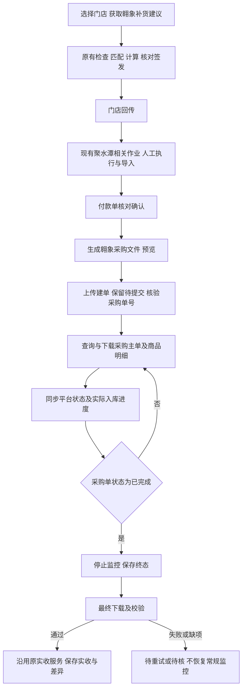

# 翱象数据链路：专项任务与重新评估

日期：2026-11-01。用户已授权开始开发。任务实施状态及本轮验收证据见 `../翱象接入开发记录.md`，本文件保留范围和验收要求。

本文件按用户最新范围收敛原《补货助手自动化接入任务拆解与执行计划》。本轮只做翱象平台数据链路；原计划 P2、P3 的聚水潭自动获取、自动下单、实际配货自动回拉不再属于本轮任务或验收缺口。原计划保留作历史，不继续按其全范围执行。

## 1. 本轮目标

三个业务结果：

1. 选定门店后，自动获取翱象补货建议，进入补货助手已有的检查、资料匹配、计算和核对签发流程。
2. 人工完成聚水潭相关作业并导入、确认付款单后，生成翱象采购文件、上传创建采购单，保存可核实的采购单号。上传建单后保留“待提交”，后续提交由业务在翱象操作，本轮不增加自动提交/审核。
3. 根据已绑定的翱象采购单，自动获取主单和商品明细，同步收货进度；平台状态为“已完成”即停止常规监控，完成最终下载、校验及实收差异保存。

业务生命周期仍是“签发 → 回传 → 付款 → 实收”。自动化任务和采购单关联不增加新的生命周期节点。

聚水潭现有本地分配、导出、人工付款导入功能照常使用。本轮不开发聚水潭账号连接、抓取库存、填地址、提交订单、财务单回拉，也不要求先完成这些功能才能开发翱象采购。

## 2. 当前代码与能力判断

核实基线为应用 0.23.0，提交 `cbaeecad190a2fea54fed8576ab2437341da00ce`。模型为 `0.3.3-rules`，归属 `0.5.1`。

已建立独立分支 `feat/aoxiang-automation-integration`。以下能力判断是开发前核查结论；后续实现及本轮证据单独记入开发记录，历史测试和探测脚本不能当作本次实际平台验收。

| 能力 | 已有依据 | 评估 |
| --- | --- | --- |
| 补货建议原生导出、等待、下载、校验 | `coordinator.mjs`、`aoxiang-ui.mjs`、`workbook-validator.mjs` | 可复用；需接主项目及完善机器命令与恢复关系 |
| 补货建议同日复用、重新采集 | 已有日资产、发布及恢复机制 | 可复用；主项目采用的文件必须冻结，不能被后续刷新覆盖 |
| 最新采购模板下载及结构检查 | `PurchaseTemplateService.prepareImport`、模板契约 | 可复用；仍需把付款业务数据正确填入模板 |
| 采购文件上传、确认和创建核验 | `scripts/controlled-import-*.mjs` 中有受控探测步骤 | 有原型；包含指定测试店、单商品等限定，不能直接作为通用业务功能 |
| 采购主单、商品明细导出与关系校验 | `PurchaseCoordinator`、`purchase-contract.mjs` | 可复用；方法 `submitPurchase` 指导出，不代表采购创建已正式实现 |
| 收货状态自动同步与正式记账 | 本地主项目已有人工生命周期及实收服务 | 自动采集到业务服务的映射、版本绑定、重复同步与进度展示待开发 |
| 主应用调用组件 | CLI 输出为连续格式化 JSON；组件内部使用 Node IPC | 稳定外部协议、主应用适配和业务作业关联待补齐 |

最新业务口径以《翱象字段与业务口径确认_20261101.md》为准：商品编码与基础单位直接对应，数量不作单位换算；山东仓供应商为文本编码 `ZXC2025`，河北仓为文本编码 `2078246`；首期按每店每仓一张本地订单对应一个翱象采购单处理，超上限拆单不实现。门店名称用于展示，门店编码用于关联。

关键代码事实：

- `batch_app.loaded_ok` 会清空本批结果和人工调整。取数结果需先独立收集，再安全采用，不能每来一个文件就重新加载整个工作台。
- `source_archive.retained_import` 对指定函数执行原件留存。新入口必须接上这一环节，不能只把文件路径塞进界面。
- 采购明细已经包含“实际入库数量”“单品入库金额”。用户已明确主单和子单均读取“单据状态”，“已完成”为停止监控的终态，基础单位一一对应；子单样例 B2 为“待提交”，V2 实际入库数量为空，不能据此把实收记为 0。平台技术回执、其他异常状态及完成时间来源在联调核实。
- 当前采购导出可复用旧范围快照。收货同步必须查询新状态，不能循环使用同一份旧导出文件制造“已同步”的假象。

## 3. 调整后的任务清单：15 个任务包

角色：I 为总集成负责人；A 为翱象组件执行端；B 为补货助手业务接入；Q 为独立验证。该表是分工方案，当前没有执行中的子任务或后台平台任务。

| 编号 | 作业任务 | 前置依赖 | 主责 | 可用性验收结果 |
| --- | --- | --- | --- | --- |
| AX01 | 固定主项目、组件源码、依赖、输入及对照；组件测试纳管；记录旧包和业务规则哈希 | 无 | I / Q | 基线可恢复，对照可复跑，既有文件不变 |
| AX02 | 统一组件机器入口、命令和事件；持久命令绑定、进度、暂停、状态查询、异常恢复和会话互斥 | AX01 | A / B，I 定契约 | 主程序可调用、暂停和恢复；旧回执不污染新作业，同命令不重复平台提交 |
| AX03 | 翱象账号身份与门店绑定；精确编码、名称辅助核对；保存可复用映射 | AX02 | B / A | 指定店准确获取，换身份阻断；测试店名称实际对应编码现场核实 |
| AX04 | 补货建议自动获取；选店、请求顺序、同日复用/刷新、逐店失败、文件验收 | AX03 | A / B | 单店/多店取得范围正确的文件，普通失败不冒充成功，未知提交不重发 |
| AX05 | 接入原检查计算和原件留存；自动采用明确版本；工作台入口及未保存结果保护 | AX04 | B，I 接线 | 同一文件自动/手动输入的业务值和顺序一致；已有人工调整不被静默清空 |
| AX06 | 获取并验收最新模板；冻结已确认付款版本；生成采购文件和数量金额预览 | AX02；合法已确认付款样本 | B / A | 付款数量和金额可逐项追溯；模板示例清除，必需结构和隐藏规则保留 |
| AX07 | 门店目录接入、两仓供应商默认配置；商品编码及基础单位直接对应；来源完整性检查 | AX03、AX06 | B / A | 使用已确认的两仓供应商编码；数量不换算；缺商品编码或资料矛盾列待核，不用当前价格替换付款依据 |
| AX08 | 把受控上传原型整理为正式创建流程；提交意图、受理任务、确认和未知状态恢复 | AX07 | A，B 接入 | 泰盛测试店真实上传；中断后查原任务，不能重复创建采购 |
| AX09 | 核对创建结果并持久关联；每店每仓订单对应一个采购单；人工核对/绑定已有单；保留待提交 | AX08 | B / A | 本地订单及付款版本准确关联采购单；不自动提交；意外多单只保留证据并提示待核，不开发拆合单处理 |
| AX10 | 按已绑定采购单查询和下载主单/明细；刷新策略、单号范围、字段及覆盖校验 | AX02、AX03；AX09 或人工核实绑定的采购单 | A / B | 下载最新且属于目标订单的数据，不取“最新文件”猜测归属 |
| AX11 | 收货进度映射与展示；实际入库数量/金额、平台状态、最后检查时间、异常；已完成即停止监控 | AX10 | B，A 核实口径 | 已完成订单重开应用后也不再轮询；显示实收与差额，未知与 0 区分 |
| AX12 | 已完成后最终下载校验，通过原服务保存实收；失败待重试/待核；重复同步幂等 | AX11 | B / Q | 停止监控不丢失最终同步任务；不重复入账；人工校准留痕，不自动恢复监控 |
| AX13 | 三个动作入口及进度/错误/恢复交互；应用关闭后重开恢复；避免生命周期大盘堆满技术操作 | AX02；随 AX05、AX09、AX12 分段完成 | B，I 接线 | 用户能完成取数、采购上传、收货同步，清楚等待原因及下一动作 |
| AX14 | 冻结输入严格对照、故障注入、性能及组合回归；分段实际业务验收 | AX01；随各功能完成 | Q | 数量金额、来源、排序及原导出无非预期变化；新链路可复跑 |
| AX15 | 固定运行时/组件打包、实际 EXE、升级兼容及恢复、交付记录 | AX02；随 AX14 各段通过 | I / Q | 独立候选包可用，旧包保留；构建提交与包哈希对应 |

AX06、AX07 可并行准备模板与已确认配置，正式上传必须两项都完成。AX10 可以先用人工核实绑定的真实采购单开发，不必等待自动创建完成，但最终必须补“上传新单并保留待提交 → 业务在翱象推进 → 查回同一单 → 同步实收”的组合验收。

## 4. 开发顺序与交付点

### 第一段：自动取得补货输入

AX01 → AX02/AX03 → AX04 → AX05，期间同步 AX13/AX14/AX15 所需部分。

交付给业务的动作是“选店 → 获取并检查 → 使用已保存有效参数计算”。缺参数、缺映射或有冲突进入原核对步骤；仍由业务核对签发。第一段不等待采购功能全部完成。

### 第二段：付款确认后创建采购

AX06/AX07 → AX08 → AX09，接入“付款已确认”的订单动作区。

采用人工导入并确认的付款单即可进入本段。预览明确显示门店、供应商、商品数、数量、金额、直接使用的基础单位和来源付款版本。业务执行上传后，系统跟踪导入受理与采购单结果。已创建采购单号与平台单据状态分别展示，例如“已建单 / 待提交”，不把建单成功显示成已提交、已收货。后续提交由业务在翱象操作。

### 第三段：采购下载与收货同步

AX10 → AX11 → AX12，接入“待收货”订单动作区。

按已绑定订单查询；提供“立即同步”，并保存应用运行期间的自动同步计划。初始不承诺关闭应用后继续运行。周期频率、退避和并发上限配置化，在平台实测后确定默认值。

最后对三段串联做实际 EXE 验收；不能用三份孤立测试报告代替整条链路通过。

## 5. 架构与业务边界

### 5.1 主项目与组件各自负责什么

- 主项目负责：哪些门店取数、采用哪份文件、有效参数、付款版本、映射、采购关联、正式实收及业务界面。
- 翱象组件负责：本机浏览器绑定、身份核验、页面动作、平台任务、下载/上传、文件校验、执行证据和技术恢复。
- 两者通过轻量版本化协议连接，传命令和文件清单，不反复传整张表；不引入服务端、通用插件系统或全项目数据层改造。
- 主项目只调用已有计算和生命周期业务服务；组件不直接修改签发、付款、库存、实收业务表。
- 同一浏览器会话串行执行。状态查询和 UI 不阻塞；本地已有检查/计算并发语义不变。

### 5.2 订单关联与来源

最小关联链为：本地补货单（含原有内部版本/仓隔离键）→ 已确认付款版本 → 本次采购创建命令 → 导入任务 → 一个翱象采购单号 → 平台观察快照/正式实收记录。批量作业按门店和仓分别排队处理，不能因为暂不做超限拆单而把多个店仓混成一个订单。若平台意外返回多个采购单，保留已生成单号并转待核，不丢弃、不重传；不把超限拆合单列为本轮功能或验收要求。

内部版本用于保护来源一致性，不要求业务人员填写。付款后续改变时，标出已建采购依据过期、要求核对；不能自动重建、修改或取消平台单据。

门店付款可来源于现有人工聚水潭文件或用户已认可的其他人工来源。系统不因启用翱象链路而替换付款来源，也不再扣减本地分配库存。

### 5.3 收货进度与正式实收必须分开

平台采购数量是订购事实，实际入库数量是收货事实。下载一次文件或观察到某种完结状态，不能直接把采购数量写作实收。

状态尚非“已完成”时，已核实的实际入库数据先保存为采购观察快照并展示进度，不新增“部分单”生命周期。平台状态为“已完成”即停止常规监控，不以实际入库数量等于采购数量为停止条件。

观察到“已完成”时，持久保存终态及最终同步待办，避免程序中断后漏收最后结果；随后最终获取并校验主单和明细，通过后调用原实收服务，保留少收、多收等差异。已有本次可验证的完整终态文件可直接采用，无需重复下载。重开应用只恢复未完成的最终同步任务，不重新轮询该采购单状态。

最终下载失败列为待重试，单位与确认口径矛盾或明细缺失列为待核，均不恢复常规监控。需要时业务人员可手动重新同步或校准，保留修改记录；已完成订单不自动监测后续变化。

缺平台完成时间保留缺失，同时记录本机观察时间；不可用更新时间代替实际完成时间。单位不明、明细缺失、作废/终止含义不明时转待核。

### 5.4 提交和取消

同命令和来源版本关联必须持久化；进程崩溃后查原结果，不能从上传开头再跑。暂停只停止新的平台动作，已被平台接收的任务保留并跟踪/核对，不声称撤销。

测试店“泰盛店【搬品用】”已获用户允许测试。实际执行时仍核实当前商家与目标门店的准确编码；授权不扩展到其他门店。本次重新评估期间没有操作平台。

## 6. 性能方案

1. 浏览器动作串行，复用作业内连接；组件启动、账号核验和大文件读取不重复执行无必要的轮次。
2. 取数先生成有序结果清单，冻结后一次进入原检查流程；不每来一份文件重算全批。
3. 收货同步按已绑定采购单查询，避免反复下载全租户历史订单。能可靠查询状态时，状态未变可减少明细重复下载；不能以缓存命中代替新状态核验。
4. 商品明细按需读取、进度以门店/订单为主，SKU 核对在详情展开；文件哈希和元数据用于复用已验收原件。
5. 记录排队、连接、平台生成、下载、解析、计算和界面可用时间。至少三轮同条件测量，冷启动与热缓存分开；平台等待波动不冒充代码提速。
6. 所有后台任务展示明确阶段和完成数；平台无法提供真实百分比时显示阶段、已等待时间和最近状态，不编造百分比。

## 7. 调整后的工作量

按熟悉两套代码的开发者计算有效工程人日。估算包含实现、局部验证及修正；最后一行公共验收为跨段严格对照、性能、实际 EXE 和交付工作，不重复计算局部单测。

| 工作组 | 估算人日 | 判断依据 |
| --- | --- | --- |
| 公共接口、命令恢复、身份与门店映射 | 3–5 | 两端已存在，稳定接入和跨进程关联仍需实现 |
| 补货建议获取及原流程接入 | 4–6 | 导出可复用，重点在原件采用、批次状态、顺序和界面 |
| 付款转采购文件、上传与创建关联 | 4–7 | 模板和受控原型可参考；已确定直接编码/单位及两仓供应商，暂不做超限拆单，仍需可靠建单和关联 |
| 采购下载、进度映射、正式实收同步 | 5–9 | 下载可复用，业务口径、实时性、幂等和修正待做 |
| 跨段验收、性能、EXE、交付及兼容 | 5–9 | 按三段增量完成，包含实际程序和恢复验收 |
| 合计 | 21–36 | 在原翱象专项 23–39 基础上，按明确的一一对应口径及不做超限拆单收敛估算 |

第一段可用版本约 9–15 人日（公共接口 + 建议接入 + 首段验收），无需等完整闭环。并行会缩短部分日历时间，不能直接除以执行者数量；以上不是交付日期承诺。

业务侧编码/单位关系、两仓供应商、首期单对单范围、建单后保留待提交和已完成停止监控均已明确。剩余工作集中在创建结果精确核验、幂等恢复和最终实收同步的实现与联调。受控原型降低页面探索成本，不等于实际程序已经验收。

## 8. 最小核查项与本轮验收范围

实施到对应阶段时解决，不需要现在一次性向用户追问：

- 当前账号/商家身份需现场核验；门店表已确认“泰盛店【搬品用】”编码为 `TSD20251211`，与“泰盛店”编码 `TSD2025_1` 区分。编码作键，不能按名称模糊合并。
- 两仓供应商及商品/基础单位对应关系已确认，按固定配置和直接对应实现；付款数量/金额仍来自已确认付款版本。
- 当前采购模板字段及示例行；“是否创建外部订单”明确为否，避免额外创建其他平台订单。
- 上传受理、失败明细和准确采购单号的技术获取方式；留言不能充当可靠幂等键。超上限拆单不在本轮范围。
- 主单及子单均按“单据状态”读取，完成终态为“已完成”；核验已绑定采购单查询范围、异常状态及时间来源。主子状态冲突时保存冲突并待核，不继续自动写入正式实收。

每段均验证：原计算/预算/箱规不变；手动入口及旧导出不变；重复派发和重复回执不重复创建或入账；暂停/关闭/重开可解释；来源完整；文件及商品顺序稳定。测试不改日常用户库和旧交付包。

执行以本专项的 15 个任务包为范围，逐项验证后在独立分支提交，不合并主干。聚水潭自动化不属于必须完成项，实际进度以开发记录及本轮验收证据为准。
