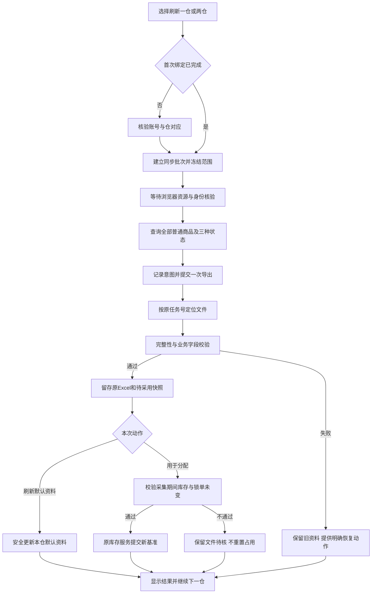

# 聚水潭商品资料自动同步：产品与实施方案

日期：2026-11-03。状态：设计稿，尚未开发或接入正式配置。配套文档：[架构、数据契约与恢复设计](聚水潭商品资料自动同步_架构与数据契约_20261103.md)。

本方案基于补货助手0.30.0、提交 `d331545b563af8fd68239badf24f4252181664da`，以及“聚水潭商品导出助手0.2.0-dev”交接包。正式开发前重新核对HEAD和未提交修改，不回退后来版本。本文不是平台登录、导出、采购或后台定时执行的授权。

## 1. 用户要完成的事情

业务在补货助手内刷新山东仓、河北仓的商品资料，无需另开导出工具、找下载文件、辨别仓库再导入。一次点击完成获取、校验、原件留存和更新，能看见每仓进度、实际资料时间和失败后的下一步。

保留原有手动导入。计算、预算、门店参数、签发、付款和翱象业务规则不改。聚水潭订单仍按现有人工上传方式处理，本次不增加订单上传或付款回拉自动化。

**“不影响翱象”作为交付约束：翱象取数、采购、收货的业务结果和原任务恢复行为保持。允许的体验变化仅为共享浏览器资源时的明确排队、安全让出及继续，不抢占正在提交的动作。**

## 2. 已验证的基础与尚未证明的部分

| 项目 | 结论 |
|---|---|
| 附带真实商品资料 | 9,207条、25列，现有仓资料导入器完整读取；原文件哈希未变 |
| 商品状态 | 启用6,025、备用821、禁用2,361，完整保留 |
| 离线测试 | 本次独立重跑22项全部通过；不是平台联调结论 |
| 依赖底层 | Edge连接、环境发现、锁组件三份代码与主项目内置版本哈希一致 |
| 单账号真实导出 | 交接记录报告通过；本轮未重放平台动作 |
| 双账号、账号对应物理仓、真实库存口径 | 尚需现场核定，不能从临沂公司名或翱象供应商编码推断 |
| 双账号真实轮转、全新电脑EXE | 尚未验收 |

核查证据在 `qa/review_jst_catalog_20261103`；包SHA256为 `bc8625f92d64118456db13ed23cd54109da0d59838de9e7d673bab7deaad841b`。交接包原件保留，不直接修改ZIP内代码。

## 3. 第一版范围与原则

纳入：首次账号和仓绑定、按仓/双仓主动刷新、阶段进度、停止、原任务恢复、单仓重试、完整原件和历史快照留存、默认仓资料采用、分配页显式使用新库存、异常提示与EXE打包。

暂不纳入：无人值守定时刷新、后台永久监控、聚水潭自动下单、自动付款、组合装独立入口、库存实时流、两个账号并行浏览器操作、全项目浏览器框架重构。

- 手动与自动共用字段解释、精确编码校验及保存规则。
- “平台导出成功”“文件校验成功”“已成为默认资料”“已用于分配”分开记录和展示。
- 账号、仓、任务、文件必须准确对应，不能按最近文件、名称相似度或相同行数猜。
- 两仓可以部分完成；成功仓保留成果，失败仓不覆盖旧资料，重新执行只处理需要的项。
- 业务界面显示中文动作、时间、数量、问题及下一步；技术ID、路径、JSON放到技术详情。

## 4. 入口与页面

### 4.1 准备数据页：主要入口

沿用“①准备数据 → 分仓商品资料”，不新建必须来回切换的独立主页面。

```text
分仓商品资料                           [刷新两仓资料] [连接设置]
山东仓  可用 · 9,207款 · 资料取得 11-03 10:04
        上次核验 11-03 11:20 · 本次未改动现有资料
        [刷新山东仓资料] [手动导入山东仓资料] [查看山东仓资料]
河北仓  未连接 · 沿用手动资料 · 资料取得 11-02 16:30
        [连接河北仓账号] [手动导入河北仓资料] [查看河北仓资料]

同步任务：山东仓 下载中；河北仓 等待山东仓完成
[阶段进度与已用时]                     [停止本次同步] [展开任务明细]
```

一次点击“刷新”即表达获取并更新所选仓默认资料的意图。正常校验通过后自动采用，不再要求重复点击保存。若已有本次计算结果，点击时只确认一次：“更新后本次需重新检查，已签发单不变”；默认取消。没有计算结果时不增加这一步。

未绑定仓、身份或库存范围不明、源文件缺失/不完整等情况不自动采用。结果中清楚写“获取成功，未采用”及原因，不能仅显示绿色成功。

“查看资料”展示商品列表；“查看原表”打开或导出完整原Excel。禁止把路径、哈希核对表伪装成商品原表。

### 4.2 首次连接设置

每仓一张配置卡：本地仓名称、已绑定公司/用户、现有Edge配置、可用库存范围说明、核验结果。

流程：选择山东/河北仓 → 选择已有Edge配置 → 用户正常登录 → 核验公司及用户 → 预览该账号的资料统计和库存范围 → 确认对应仓 → 保存。

首次必须明确对应关系，之后复用。不同仓不能绑定同一公司+用户冒充两个独立账号。不能复制登录态、替用户猜账号、用另一个仓顶替失败仓。聚水潭账号绑定不修改翱象的门店目录、供应商编码或浏览器绑定。

第一版优先要求聚水潭使用与翱象不同的已存在个人资料；若选择相同Profile，明确拒绝并引导换选，不自动改翱象配置。即使Profile不同，处于同一Edge实例时也保守串行浏览器动作。连接设置不替用户新建浏览器个人资料。

### 4.3 聚水潭订单分配页：专用库存动作

这里增加 **“刷新并用于本次分配”**，与准备页的“刷新仓资料”分别命名。它明确表示更新分配库存基准，需要关联本次采集时的锁单和占用状态。

已有分配预览时，成功采用后原预览失效，要求重新预览；不自动重新生成订单、不解锁、不重扣已锁单、不更改已付款记录。

准备页刚取得的文件可以作为候选复用，但只有采集时间、锁单集合和库存状态校验通过，且本次明确选择采用，才成为分配基准。证据不足时重新取数，不能把“同一天”当作可直接重置库存的依据。

### 4.4 任务明细与维护

在本区域展开同一份任务列表，按天查看同步批次；它是资料采集任务，不增加订单生命周期环节。每仓显示：取得时间、商品款数、状态、当前是否采用、错误摘要、下一步。

动作语义固定：

| 按钮 | 含义 |
|---|---|
| 刷新山东仓/河北仓资料 | 新采集；不能重命名成“继续”或隐式复用旧文件 |
| 继续原任务 | 查询或下载原已受理任务，不重复提交 |
| 重试未提交项 | 仅存在明确零提交证据时重新尝试该项 |
| 核对原任务 | 处理受理不明；不能按一下就解除重复提交保护 |
| 停止本次同步 | 停止后续账号与动作，保留已完成仓及原任务身份 |
| 关闭 | 只关闭查看窗口；任务是否继续由明确的运行中关闭提示决定 |

运行中关闭同步窗口时提供“后台继续”“停止并关闭”“返回”，每个动作单独命名。关闭整个应用则请求安全停止；不能留孤儿进程或伪称后台仍运行。重试/刷新/关闭使用标准图标与提示，业务主动作使用文字按钮。

不新增回收站。任务清理沿用项目维护原则，但未决平台任务不能通过清空记录绕过核对；删除范围和最小防重复证据在维护入口明确说明，不在正常刷新流程里新增一套数据去处。

## 5. 主干流程



两仓按任务建立时的选择顺序串行采集，结果也按该顺序展示。一仓失败不把另一仓清空。整体结果只有两项都完成才是“全部成功”，否则“部分完成/待处理”。

## 6. 四类数据，不能混用

| 数据 | 何时变化 | 对已完成业务的影响 |
|---|---|---|
| 最新默认仓资料 | 准备页刷新成功采用，或原手动导入 | 后续新作业使用；当前未签发作业按原机制失效重新检查 |
| 当前作业资料快照 | 导入/检查时固定；明确换用资料后重建 | 不在后台计算中途替换输入 |
| 签发时资料快照 | 签发时固定 | 同步不回写；仍可导出当时原表 |
| 聚水潭分配库存基准 | 在分配页明确采用并通过并发校验 | 保持锁单、占用和已有生成版本；不因默认资料刷新被重置 |

当前代码 `jst_orders.catalogs()` 优先返回已建立的分配基准，默认资料只是没有基准时的后备。必须在界面显示“默认资料取得时间”和“本次分配基准时间”，不能仅提示资料更新成功却让人误以为分配已换新库存。

翱象采购使用已确认付款快照的数量、金额，收货以冻结采购/付款依据核对；这两条链不读取最新仓价重新计算。刷新后的库存、价格影响后续新计算属于预期变化，不属于本次改写模型或历史。

## 7. 数据校验与采用规则

保留商品编码精确匹配；不按名称合并、不跨仓去重、不把两账号库存相加。读取按表头识别，不依赖列位置；原表全部列及原始字节留存。

| 必需列 | 当前用途与边界 |
|---|---|
| 商品编码 | 保留文本长编码与前导零，拒绝失真或重复编码 |
| 基本售价 | 原V计价；不使用采购价、原售价或标准售价替代 |
| 出库箱规 | 原出库步长；不改用标准装箱数量 |
| 可用数 | 需求归属/分配依据；未知不变0，不再擅自减订单占有数 |
| 商品状态 | 保留启用、备用、禁用；按现行规则解释，不能只下载启用商品 |
| 分类 | 沿用现有分类和缺失值处理 |

样本26条缺价、5,617条缺出库箱规、1条缺分类；保持现有缺价待核、缺箱规1、无分类快销权重，不新增推算。正常的行级缺失在结果提示，不能因自动同步把整个仓资料全部拒绝，也不能把缺失变成已确认值。

整份阻断条件：身份/仓映射不一致、任务文件对应不明确、缺必需列、重复业务表头、编码重复或失真、文件损坏、行数与原任务不一致、读取期间文件变化、空结果无明确证据、旧任务被冒充新刷新。商品范围或分类规则不因本次接入调整。

数据条数大幅变化显示新增/移除/禁用/缺价数量供业务核对；不私设“下降多少百分比就删除旧资料”等规则。完整性证据不足时待核，不自动填补缺商品。

## 8. 时效、失败与取消

“取得时间”来自原查询/导出证据；“本次核验时间”表示校验原文件的时间，两者分开。恢复原任务、打开程序、重新读文件不能刷新取得时间。新库存需要发起新批次；没有固定“今天下载过就一定新鲜”的豁免。

重新查询后内容完全相同时显示“新采集，内容未变”，保留新的采集证据而不重写历史快照。手动文件缺少平台查询时间时显示“导入时间，原始采集时间未知”，不把文件修改时间当成库存时间。平台快照也不等于实时库存，后续外部下单仍可能改变可用数。

| 场景 | 处理与业务提示 |
|---|---|
| 翱象正在工作 | 明确显示等待翱象当前动作安全结束；可取消等待，不强断提交 |
| 未登录/调试授权等待超时 | 提示具体账号和用户需做的动作；回到可操作状态，不无限转圈 |
| 提交前取消 | 本项停止，无平台导出；后续仓不启动 |
| 提交后是否受理未知 | 保留原意图，待核对；禁止自动再提交 |
| 已有任务号但下载失败 | 按原任务号继续，不能改取“最新一条” |
| 原文件有误/解析失败 | 不更新默认或分配基准；展示失败字段/行号，可继续其他仓 |
| 原件已留存、采用前取消 | 不改当前资料；允许保留未采用原件和技术记录，如实标识 |
| 已完成原子采用后取消 | 该仓显示已完成，停止后续项；不声称全部未改 |
| 用户手动导入或其他窗口更新了资料 | 新任务不得覆盖该更新；提示资料已变，重新核对后采用 |
| 更新期间发生锁单或分配变化 | 分配基准采用拒绝，保留文件；重新刷新或核对，不能漏扣/重扣 |

进度展示真实阶段、当前仓/总仓数、已用时、最近进展。平台不提供百分比时用等待指示，不造0–99%的假进度。行校验和文件字节处理能计数时给真实进度；保存临界区标明“正在完成保存，完成后响应停止”。

## 9. 开发顺序与工作拆分

本轮只形成方案，不提前实现。正式开发后按三阶段提交与验证，不把多处改造一次混进主线。

| 阶段/任务 | 内容 | 依赖与完成条件 |
|---|---|---|
| 一 / T01 | 固定上游来源、协议和组件打包边界 | 独立分支、当前基线/输入/旧包哈希；能在隔离目录启动无业务动作的服务 |
| 一 / T02 | 首次下载按任务号关联，幂等启动和原任务恢复 | T01；同数量不同文件、受理未知、重复消息、损坏文件测试通过 |
| 一 / T03 | 可响应状态/取消、阶段进度、包内校验器 | T01；运行中能查状态/停止；无外部Python依赖，不启动主窗口 |
| 二 / T04 | 两仓账号绑定与浏览器动作门禁 | T02/T03；保持翱象原连接与配置，冲突时明确等待 |
| 二 / T05 | 原件留存、默认采用和恢复日志 | T02/T03；崩溃恢复、并发手动导入、原表完整性通过 |
| 二 / T06 | 准备页入口、分配页显式使用及状态展示 | T04/T05；新默认不暗中覆盖分配基准，采集期间锁单变化拒绝采用 |
| 三 / T07 | 独立业务等价、原导出、故障及EXE验收 | 前述完成；计算/预算/签发/生命周期/翱象输入输出对照一致 |
| 三 / T08 | 两账号真实联调、单仓失败恢复及交付 | 账号和仓范围已确认；保留旧版，完整证据后再声明可用 |

职责按模块划分：采集侧负责平台身份、任务与文件；Python业务侧负责校验、采用和历史；界面侧负责范围、状态与下一步；QA独立验证边界。可以在接口固定后分别开发，但同一文件/持久对象必须有唯一执行负责人，不默认启用多执行者并写。

工作量为中等接入：主要在恢复、并发和打包，而非重写补货计算。真实联调耗时依赖两账号登录和平台任务速度，不把离线通过当作现场完成，不承诺未验证的固定日期或提速倍数。

## 10. 必须通过的验收

1. 同一份原文件，手动入口与自动入口的字段、类型、顺序、商品行号、缺失值和计算输入严格一致；除同步来源记录外，不扩大忽略字段。
2. 固定真实样本和参数的模型中间值、建议量、候选量、执行量、金额、预算、箱规、仓路由、排除及导出零业务差异。
3. 同一付款快照生成的翱象采购输入和金额不变；收货观察采用口径不变；单号与原任务绑定不变。
4. 翱象独立使用、先翱象后聚水潭、反向切换、等待取消、聚水潭失败后翱象继续、关闭恢复均验证；不通过断开翱象连接来掩盖协调缺陷。
5. 默认资料更新、分配基准更新分别验证；未锁预留仍扣一次、刷新前已锁单不再扣、采集中锁单/解锁/重分配冲突拒绝。
6. 两仓部分成功、原批次恢复、同内容/不同内容、坏文件、字段换序、身份错配、同数量异文件、重复回执、服务崩溃与保存中断覆盖。
7. 实际EXE验证全部入口、状态、停止、错误、重试及历史原表导出；测试机无可发现外部Python时仍能运行；模型及翱象组件完整性校验保持。
8. 原始Excel、用户配置、旧发行包保持；测试全部使用独立目录。真实平台采集与采购写入分别授权，本次接入验收不顺带创建采购单。

验收证据分别标注离线模拟、源码界面、实际EXE、真实平台及跨机结果。模型版本不因资料同步升级；应用及集成能力版本在实际开发完成后确定，不提前宣称0.31.0已交付。

## 11. 现场准备与后续决策

开发前可以先完成本地协议、校验器及合成测试。首次真实联调前，需要业务核对山东/河北两个真实账号与可用库存范围，并在对应已有Edge配置正常登录；调试授权由用户在浏览器允许。

当前不要求重新提供商品字段模板，已有9,207行样本足以开发兼容层。第二账号样本用于证明两仓完整接入。若发现一个账号导出的是多物理仓合计、单位口径不一致或平台无唯一任务文件证据，停止受影响仓的正式采用，列出具体冲突，不自行改库存含义。
