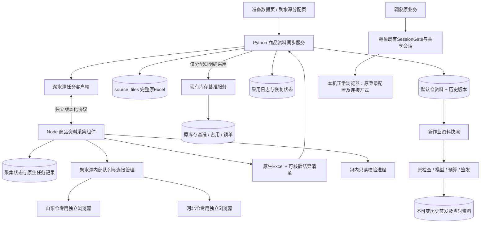
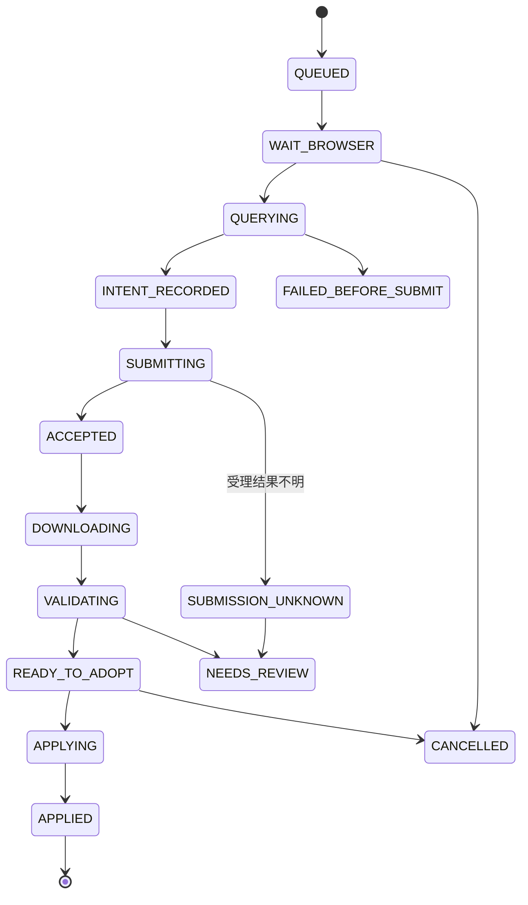

# 聚水潭商品资料自动同步：架构与数据契约

日期：2026-11-03。状态：待开发设计。产品入口、范围和验收总表见 [产品与实施方案](聚水潭商品资料自动同步_产品与实施方案_20261103.md)。本页所有新增模块、表和协议均为拟定，不代表已有实现。

修订约束：聚水潭两仓使用专用独立浏览器；翱象保留本机正常浏览器操作。撤销上一稿的跨平台SessionGate接入及统一浏览器排队，只保留各平台内部调度。共用可执行文件或无状态工具代码不意味着共用浏览器实例、用户数据目录或登录会话。

## 1. 架构决策

采用 **独立聚水潭采集组件 + Python采用服务 + 现有仓资料与原件存储**。保持主应用离线桌面架构，不引入服务器、通用插件框架或多套计算实现。

- Node负责浏览器、账号身份、原生任务、准确接收文件和技术恢复。
- Python负责复用原仓资料解释、采用校验、原件留存、默认保存及业务结果失效。
- Qt只展示状态和发起明确动作，不在UI线程读大Excel、等待平台或写业务大对象。
- 翱象组件继续使用原机器协议、本机正常浏览器和原模块间共享会话。聚水潭具有独立会话管理器，不取得翱象SessionGate票据、不切换其会话，也不引入全局浏览器模式。



两条浏览器链路之间没有会话、启动或排队依赖。聚水潭两仓仍内部串行；翱象只受原有内部调度控制。跨平台时间重叠是否无干扰需要独立验收，不用同一个浏览器下的不同标签或Profile冒充进程隔离。

## 2. 现有代码与拟定改动面

| 模块 | 已有职责 | 拟定改动 |
|---|---|---|
| `warehouse_ui.py` | 分仓手动导入、查看与恢复 | 增加刷新按钮、时间和任务结果；手动入口保留 |
| `warehouse_catalog.py` | 表头识别、仓快照、当前/历史保存 | 复用解析；保存增加可选预期版本及统一短时写入保护，不改变字段解释 |
| `source_archive.py` | 按SHA留存完整原Excel | 直接复用原件留存，不重写表格 |
| `ui_tasks.py` / `business_ui.py` | 后台任务、取消、进度 | 复用；新封装函数须显式调用原件留存，不能依赖函数身份等于import_catalog的隐式钩子 |
| `workbench.py` / 原输入失效入口 | 当前作业与恢复 | 采用后调用原失效路径；不改后台计算输入或历史恢复快照 |
| `jst_ui.py` / `jst_orders.py` | 分配库存基准与占用 | 新增显式刷新入口；原prepare_refresh/commit_refresh继续负责业务提交 |
| `aoxiang_session.py` / 会话管理装配点 | 翱象前后台操作门禁 | 保持原样，不添加聚水潭票据或启动逻辑；仅作为隔离回归检查对象 |
| `app.py` / 打包脚本 | 启动、子进程、资源 | 增加无Qt/无用户配置的商品文件校验模式、组件资源白名单 |
| `components/aoxiang` | 翱象浏览器及平台业务 | 第一版保持原源文件与依赖哈希；可只读复用经核验的底层工具，禁止共享连接对象、默认状态根或启动策略 |

拟定新增模块，按实际代码大小可合并，避免一函数一文件：

- `src/catalog_sync.py`：批次编排、结果清单校验、采用及恢复；不放页面选择器。
- `src/catalog_sync_client.py`：独立聚水潭协议、子进程状态、控制消息；不修改翱象协议兼容代码。
- `src/catalog_sync_ui.py`：连接配置、进度、逐仓结果与下一步。
- `src/catalog_sync_validation.py`：包内只读校验入口，调用现有仓资料解析。
- `components/jst_catalog/`：保留上游导出能力和测试，新增机器入口、专用浏览器适配和接入配置。AccountSessions负责按需打开已绑定实例及连接复用，ExportJobs继续执行同一导出逻辑；不为山东、河北复制平台脚本。上游中文菜单保留用于溯源，不作为主应用自动调用入口；订单上传模块不接入。

不修改 `model.py`、`allocation.py`、`one_box_exception.py`、默认业务参数和原导出列。必要的界面及保存协调改动单独列差异，不以“没改模型”代替完整回归。

## 3. 两条浏览器链路的隔离

### 3.1 固定运行方式

| 链路 | 浏览器与身份 | 连接和调度 |
|---|---|---|
| 翱象 | 当前本机正常浏览器及原登录配置 | 保持既有连接方式、SessionGate及原模块间共享会话；不迁到专用实例 |
| 聚水潭山东仓 | 山东仓专用独立浏览器、持久用户数据目录及账号 | JST自身连接管理，精确绑定目录/实例/端点/公司/用户 |
| 聚水潭河北仓 | 河北仓专用独立浏览器、持久用户数据目录及账号 | 与山东仓保持登录隔离，按JST内部队列串行作业 |

采用用户已可用的聚水潭独立普通浏览器方案，不因名称相同就更换为临时无痕环境或另一种自动化启动模式。上游bindExisting与EdgeBridge支持绑定指定资料根；具体两仓实例配置仍需现场核验，不能将单账号成功记录当作两仓部署已完成。

### 3.2 可以复用代码，不能共享运行状态

可复用锁定的Node可执行文件、格式校验、无状态连接工具；Node服务仍为各自独立进程。已有低层源码相同不构成启动策略、会话对象或锁目录共用的依据。JST所需适配只落在其新组件和客户端，保持翱象组件、配置与完整性清单不变。

JST服务不使用上游默认 `%LOCALAPPDATA%/AoxiangReplenish` 作为自己的锁或任务目录。`AccountSessions.initialize` 改为使用明确的JST独立状态根和本平台锁，不调用翱象SessionGate，也不暂停翱象后台任务。公司/用户/仓映射、任务意图、下载、端点缓存、取消事件和重试计数各自归属。

两仓分别校验专用用户数据目录及实际Profile；目录不得落入翱象正常浏览器的用户数据根，调试端点/实际实例不得与翱象相同。使用解析后的真实路径比较，避免目录别名绕过隔离。同一公司+用户不能伪装成两个仓；发生错误绑定只拒绝该仓，不自动迁移任何浏览器。

每次连接、恢复、重连都重新确认“所属平台、仓、实际实例及账号”，不按任意可用端口、前台窗口或最近浏览器降级。初次登录由用户在对应专用浏览器正常完成，不复制Cookie或登录资料。若后续需要修改聚水潭启动方式，单独验证其兼容性，不把变更传播到翱象。

### 3.3 调度、退出与影响边界

第一版只串行聚水潭两仓，不增加跨平台排队。各平台使用自己的页面句柄，不依靠全局键鼠抢焦点。可重叠执行是架构能力，实际无干扰必须通过EXE和平台重叠运行验收；本机CPU、网络和短时数据库写锁仍为共享资源，不能承诺零资源竞争。

聚水潭停止/重试/连接超时仅作用于JST任务。关闭时只清理自己创建的标签和连接，保留持久登录；不调用Browser.close、不按进程名终止Edge，不重启或断开翱象。整个应用退出时由各自控制器按原有安全边界收束，不能用一方的取消事件取消另一方。

检测到另一导出工具正在占用同一聚水潭专用实例时拒绝/等待，不删锁强抢；两个不同状态目录也不能因此重复接管同一实例。实例占用约束以专用用户数据根/实际端点为键，仅在JST范围实施。用户手动换账号或外部工具干预时，身份或任务校验失败就停止采用。

允许新增：聚水潭专用设置、任务和中文状态。禁止改变：翱象浏览器启动和连接配置、调度依赖、查询范围、采购数量/金额、供应商、提交次数、采购号关联、收货状态及原任务恢复规则。不承诺平台永远不会触发风控，遇到拦截按原规则报错并交给用户正常处理，不以自动切换环境绕过。

### 3.4 一套作业实现，两份账号上下文

山东仓/河北仓仅是配置与状态的差别，不构成两套网页行为。延续上游normalizeConfig、AccountSessions、ExportJobs结构，冻结后向同一个导出函数传入AccountContext：

```text
刷新两仓(batch)
  ├─ item[0] → 山东仓绑定 → runCatalogExport(accountContext)
  └─ item[1] → 河北仓绑定 → runCatalogExport(accountContext)

runCatalogExport：连接/登录核验 → 查询 → 单次提交 → 原任务下载 → 校验
主应用采用服务：原件留存 → 对应仓保存 → 界面更新
```

AccountContext包含本地account_id、warehouse、mapping_version、预期company/coid/uid、本机browser_binding_version、批次/项/operation_id及用途。网页选择器、商品范围、字段解释、下载校验逻辑均共用；页面响应里的公司/用户ID必须逐次核对，不能只靠选了哪个浏览器目录判断账号。

配置维护分两层：可迁移的仓账号业务映射，与不可直接跨机复用的本机浏览器路径/启动绑定。Cookie和登录态由各自专用浏览器持久保存，不进入业务配置、任务JSON、日志或交付包。用户更换账号只建立新绑定版本；运行项和历史回执保留旧版本，不能把旧任务交给新身份执行。

改绑先核查该账号未决任务及活跃连接，再以待绑定配置验证，成功后切换配置引用；有失败或并发配置修改则保留原绑定。不更改任何仓资料或历史业务，停用同步仅影响后续自动任务选择。

### 3.5 按需打开浏览器和登录恢复

现有代码accounts.connect调用discoverEndpoint后绑定，要求浏览器已经运行；application.bindExisting发现登录页只返回WAIT_NORMAL_LOGIN。这不是自动启动或密码登录的实现。接入拟补ensureDedicatedBrowser步骤，仍只作用于JST：

1. 读取已核验绑定，校验可执行文件、真实用户数据目录、Profile、与AX隔离范围及实例占用。
2. 对应实例已经运行则复用；未运行时按该仓已核验的专用启动方式打开。只允许结构化的可执行文件/资料根/Profile及已批准技术参数，不执行配置里的任意命令字符串，不创建随机临时身份、不改AX启动参数。
3. 在有上界的启动/连接时间内发现该实例端点并核验实际Profile。需要用户允许调试时明确提示；超时返回可操作状态，不循环拉起新浏览器。
4. 检查是否登录。已登录必须核对预期公司/用户；未登录保留该项并标记需要登录，退出当前工作槽继续另一个账号。
5. “打开登录页”只打开该仓专用实例；“登录完成，继续本仓”再次核对原身份，然后从保存的恢复点执行。账号错误不自动更新绑定。

BrowserBinding在本机保存启动模式及可验证目录，不保存动态端口作为永久身份。初次配好两份现有专用配置后，正常刷新无需逐次手动打开浏览器。专用启动方式尚未验证的机器仍显示需要配置，不能宣称直接双仓无人值守可用。

登录状态与平台提交状态是两个独立维度：例如connection_state=LOGIN_REQUIRED时，item可能仍是ACCEPTED或SUBMISSION_UNKNOWN。补登只恢复访问能力，绝不能清除native_task_id、提交意图或未知受理状态。已成功采用的另一仓不重导、不重复采用；单项恢复仍属于原批次。

第一版不增加密码自动填写。若后续增加，凭据须通过独立授权的本机保护机制维护，并为验证码/扫码保留人工步骤；不能因UI有“自动登录”字样就把浏览器会话复用当作密码登录验收通过。

## 4. 进程与控制协议

```text
主EXE / Qt主线程
  ├─ 同步后台编排线程：等待事件、校验清单、安排本地采用
  ├─ 已有翱象子进程 → 本机正常浏览器：原协议、连接与业务保持
  └─ JST Node服务：一次启动、跨刷新复用
       ├─ 控制循环：快速处理status、stop、shutdown
       ├─ 专用浏览器连接与账号工作队列：两仓串行，不调度翱象
       └─ 短时只读校验子进程：主EXE的专用无界面模式
```

不能直接使用上游console中“读取一行 → await整个导出 → 读下一行”的阻塞方式。机器入口接收start后持久登记并快速ACK，长任务在异步工作循环执行，status/stop不排在长任务尾部。技术日志写stderr或专用文件，stdout只输出协议帧。

拟定协议 `jst.catalog.v1`；与翱象的protocol_version及action命名空间独立：

| 命令 | 返回/行为 |
|---|---|
| capabilities | 协议版本、支持动作、上游/集成构建身份 |
| accounts.open_login | 按绑定打开对应JST专用登录页，不提交商品导出，不切换AX |
| accounts.verify | 核验指定配置与公司/用户，不提交导出 |
| accounts.bind / accounts.set_enabled | 验证并维护账号绑定或同步启用状态；配置版本冲突及原未决任务不得被覆盖 |
| sync.start | 稳定operation_id、冻结账户和仓范围，返回已有或新batch_id；重复相同请求不新增导出 |
| sync.status | 当前逐仓状态、原任务号、最近进度、可执行动作 |
| sync.stop | 记录停止意图，取消未开始项；活跃项按受理边界处理 |
| sync.resume | 指定原batch_id及item_ids恢复；补登后按原提交阶段继续，其他成功项不重做，不把旧成功文件当新库存 |
| sync.retry_unsubmitted | 有明确零提交证据时重试指定项 |
| sync.acknowledge_adoption | 记录Python采用结果，不由Node写仓资料或业务库 |
| shutdown | 停止新动作，安全收束并报告未决任务，不在平台提交中强杀 |

请求含request_id；长任务含batch_id、item_id、operation_id。事件含单调sequence、阶段、已用时和计数；断线后查询状态补齐，不能根据没收到ACK推断没提交。重复operation_id而范围/身份不同必须拒绝。

需要连接或网页核验的账号命令同样快速返回已受理及operation_id，后台完成后发送结果，不让登录等待堵住status/stop。网页登录采用持久的connection_state及中文提示，不让一个账号等待占满整个两仓工作队列。

拟定默认上界：连接授权60秒、查询60秒、等待原生任务完成120秒、文件传输60秒；到期返回可操作状态。平台任务已受理后超时保留任务号，继续只轮询原任务。总体等待不会自行改变为无限重试；这些技术参数不进入门店计算超参。

控制消息要在长任务运行时可响应，取消ACK目标1秒内；ACK只表示收到请求，不能冒充浏览器或本地提交已经停止。实际停止位置随原生操作边界显示。文件/Excel检查在子进程，不阻塞Node控制循环。

## 5. 首次导出和恢复必须共用准确关联

当前上游首次路径保存nativeTaskRef，但取第一个匹配域名和路径的文件GET；行数校验不能证明该文件属于本任务。新接入必须修正：

1. 在发送前持久保存不可变意图、账号、范围和operation_id；校验原生请求确为普通商品、全部记录、启用/备用/禁用。
2. 只允许一次提交，成功响应必须解析出唯一规范任务号；结构不明确就待核，不把任意json.data对象当成有效ID。
3. 首次和恢复都通过该任务号查原生下载记录，核验账号、商品导出类型、记录数量及完成状态。
4. 从准确任务行触发下载并取得对应文件标识；冻结允许的下载路径/文件身份，后续接收不能改取另一份。签名查询参数不得进普通日志。
5. 再校验格式、行数、唯一编码、状态范围、必需表头、文件前后哈希。相同数量的错误文件必须在任务身份阶段被拒绝。

查询0条、无唯一任务、同ID出现多个匹配、记录被清理或过期都显示明确原因，不通过拿“最近N个任务”降级。受理未知的解除需要可核验的原任务/未提交证据；清空本地缓存不是解除依据。

## 6. 数据契约

所有编码用字符串；数量和价格沿用现有解析，不在传输层隐式转整数、乘箱规或变币种。大商品列表不在Node与Python间反复序列化，跨进程传文件和元数据。

| 对象 | 最小字段 |
|---|---|
| AccountBinding | account_id、company/coid/uid、warehouse、mapping_version、库存范围说明、映射确认依据；本机browser_backend固定jst_dedicated，专用userDataRoot/实际Profile绑定独立保存；连接时核验实例/端点，不把可变端口当账号身份 |
| AccountConnectionState | account_id、binding_version、connection_state、核验时间、中文下一步；与平台提交阶段分开，登录失效不改变任务号或提交次数 |
| SyncIntent | operation_id、batch/item序号、仓、冻结account/mapping版本、全状态范围、purpose、created_at、预期当前仓资料摘要 |
| ExportReceipt | native_task_id、查询/受理/完成时间、账号/范围、expected_rows、file_sha256、字节数、工作表/表头、文件相对路径、原任务身份依据 |
| ValidationReceipt | 校验器版本、同一文件哈希、实际行数、唯一编码数、状态统计、字段缺失统计、catalog_revision、候选JSON相对路径与哈希、可采用/阻断原因 |
| AdoptionReceipt | apply_id、来源item/文件哈希、仓、old/new默认文件摘要、old/new业务revision、采用时间、用途、状态、取消/失败原因 |
| StockObservation | 仓、开始查询前的bid/serial、已锁gid有序集合、源查询时间、对应采集item；仅分配基准用途 |

purpose固定为 `default_catalog` 或 `allocation_baseline`，禁止从按钮标题或当前页面状态猜。自动采用默认资料不隐含allocation_baseline授权。

同文件哈希成功复用不暗中替换当前默认的source_path/imported_at。重新校验旧文件只更新核验记录，不能把旧取得时间改成现在；若确实重新查询并取得内容相同的新导出，则在新ExportReceipt中保留这次真实查询/导出时间，与原默认资料版本关联，界面可展示“新采集，内容未变”。不同原件按完整新快照采用，即使部分数值相同，也保留来源关系。

仓JSON继续保持schema1及现有FIELDS/items/revision结构；同步来源证据放采用记录，不要求重写所有旧快照。旧JSON、作业、签发仍能读取。字段解析继续走 `warehouse_catalog.import_catalog`，不维护第二套匹配/缺失规则。

## 7. 保存责任、原子采用与恢复

### 7.1 存放位置

- 现有 `warehouse_catalogs/<仓>.json`：当前默认指针/快照，不换目录。
- 现有 `warehouse_catalogs/history/<仓>/`：保留完整旧版本。
- 现有 `workbench.sqlite3/source_files`：完整原Excel，按SHA去重。
- 新增技术目录 `settings/jst_catalog/`：本机绑定、导出任务状态、待验收文件；不与翱象目录混写。
- 拟在现有业务库新增小型 `catalog_sync_applies` 采用日志表，保存意图和恢复状态；不迁移旧订单表。Node只写技术任务库，Python只写采用记录及现有资料存储。

技术目录是后台实现，业务只看统一任务页面。保留周期、磁盘清理由后续明确的数据维护策略处理，不默认删除历史或迁移用户目录。

### 7.2 默认资料采用

SQLite与JSON不是一个事务，不得声称“整个保存天然原子”。按每仓独立的可恢复提交处理：

1. 用户发起刷新时就在SyncIntent冻结当前默认文件的完整摘要（不只比较业务revision，尚无文件也明确记录）；下载后校验原件与清单，取得候选catalog。不能在下载结束后重新取当前摘要作为预期，否则会漏掉采集期间的人工更新。
2. 显式调用source_archive.capture保存原始字节；取消可能已留下原件，采用状态仍未完成。
3. 获取本仓短时跨进程保存锁；所有保存入口（手动、恢复、同步）使用同一保护。平台等待/Excel读取期间不持锁，不占业务库写锁。
4. 在锁内核对当前摘要仍等于预期；不相等则冲突，不覆盖其他窗口的手动更新。
5. 持久记录APPLYING、旧/新完整摘要和候选资料；保留历史，准备临时JSON，检查取消。
6. 原子替换当前JSON是不可中断的采用边界。边界之前取消不切换；之后取消只能停止后续仓。随后登记APPLIED并通知界面沿用原file_changed失效范围。
7. 进程重启恢复：当前摘要等于候选→补登记已完成；等于旧值→仍未采用；两者都不是→并发变更待核，不能自动覆盖。原件缺失、哈希不符直接失败。

锁采用自动随进程/句柄释放的机制，不靠“看到PID文件就删除”；最终实现需同时验证人工导入和同步竞争。双仓不做跨文件伪事务，山东成功河北失败要准确呈现部分完成。

采用等待当前计算/签发/库存提交的安全点，不中途改worker输入。已成功结果在换用资料后走现有失效路径；恢复只读历史不会换成新默认。若程序在采用后、界面失效前退出，下次恢复/签发校验必须识别资料依据变化，不能发布旧计算为新资料结果。

### 7.3 分配基准采用

`jst_orders` 已将库存基准、占用与锁单分开维护，不能通过保存默认JSON替代其提交。

开始实际平台查询之前采集StockObservation；排队等待期间不提前假定库存时点。取得文件后，调用现有prepare_refresh，再对比计划的expected及included必须与Observation完全一致，最后由原commit_refresh在事务内再次校验。

因此若采集中出现锁单、解锁、重分配或库存更新，不允许用查询前的库存配合查询后的锁单集合。拒绝本次基准采用，保留文件和证据；重新取数或业务核对，不擅自重算已锁订单。

新鲜库存按现有业务约定已包含刷新前锁单的远端扣减；这些gid不得再次扣。未锁的本地预留继续按原reservations逻辑扣一次。该约定仍需要两仓现场库存范围核验，不是本地锁标志自动证明了远端库存正确。

本地Observation能发现本应用管理的状态变化，不能锁住平台库存，也不能证明用户在其他系统中的所有下单已经反映到导出。导出是一个平台快照，不是实时库存承诺；界面展示查询时间与采用时间，锁单已在远端扣减的前提不成立时拒绝自动用于分配，保留业务核对入口。

准备页采集也可记录Observation作为未来显式采用候选；没有Observation的旧文件不被当成可自动重置占用的证据。选择使用旧默认仍保留原人工入口及说明，不借自动同步默默改变原业务规则。

## 8. 状态机与取消边界



图为主路径，阶段不代替结果字段。Node成功接收后保持ExportReceipt；Python独立维护采用状态。停止请求带stop_requested，不把已受理任务硬改为“从未提交”。

浏览器动作开始前有检查点，受理之后保留原任务；下载/校验可暂停；本地JSON原子替换或库存事务提交期间不强杀。已完成仓不回滚，后续仓停止。程序异常退出后依据持久状态恢复，不能凭UI进度100%推断采用完成。

## 9. EXE与性能

复用主包已有Node，不额外复制一套运行时；新组件和复用依赖进入清单与SHA校验，翱象组件原完整性校验继续执行。冻结依赖、上游ZIP哈希、集成提交和协议能力分别记载。

替换上游“查找本机Python并执行脚本”的依赖：Node通过受限验证接口启动主EXE专用模式，例如 `--catalog-validate --request <请求文件> --result <结果文件>`。入口在Qt窗口和用户Repository创建前分流；结果写独立临时JSON并原子发布，不依赖windowed EXE的stdout。

源码模式使用项目Python+同一入口，打包模式用该EXE；二者调用同一校验实现。请求限定输入文件、预期哈希/行数、仓标签和结果位置，不接受任意代码或命令。主应用采用前再核对文件哈希及回执身份。实际EXE测试确认不会递归启动主窗口、不会读写日常配置。

校验子进程将现有导入器生成的schema1候选写到本任务专属临时JSON，并把路径、文件哈希、来源哈希及校验器版本写入回执。主进程核验任务范围、摘要和结构后复用候选，避免再次完整解析Excel；候选失配就重新校验或报错，不直接采用。此JSON是可丢弃中间文件，不是新增用户资料格式，不使用pickle接收外部数据。

性能策略：两账号串行；每文件只生成一次业务候选对象，在本次校验及采用间复用；跨进程不反复传全表。输入前后必要哈希检查保留，原件按内容去重；不因“优化”删校验。统计阶段耗时：等待浏览器、查询/平台导出、下载、解析校验、原件留存、默认/基准采用。

原文件缓存复用必须保持原采集时间。UI在大表解析时继续响应；工作线程/校验子进程有明确上界。性能报告同环境逐个运行，说明缓存和规模，不把网络/平台等待当作CPU优化收益。

## 10. 分阶段验证矩阵

| 层次 | 核验内容 |
|---|---|
| 协议和离线 | start幂等、丢ACK、重复事件、状态可响应、停在提交前/后、原任务恢复、同数量异文件、缺状态库、不同账号隔离 |
| 文件/数据 | A1错误尺寸、换列、缺列、重复表头、长编码/前导零、坏文件、26条缺价等样本事实、原始字节与源行号 |
| 采用恢复 | 文件变化、保存冲突、人工导入竞争、取消留下原件但未采用、替换后崩溃、恢复时第三方新版本、同内容复用 |
| 业务不变 | 手动/自动候选严格比较，模型/预算/箱规/路由/排除/原导出不变，历史资料版本及原表仍可读 |
| 库存基准 | 新默认不重置占用，锁单含入规则不变，采集中状态变化拒绝，失效预览不可生成 |
| 翱象隔离 | 原三链业务回归、本机正常浏览器与原共享会话保留；两平台重叠作业、JST启动/重连/失败/取消/关闭不暂停或重启AX；错绑AX目录/实例/端点拒绝；同一付款生成内容一致 |
| 实际EXE | 无外部Python、只读校验子进程无主窗口、双仓按钮/进度/停止/重试、独立数据目录、资源路径与模块收集 |
| 真实平台 | 两账号分别核验、串行双仓新采集、原任务恢复、身份变化停止；不顺带上传订单或采购 |
| 账号和登录 | 同一导出函数接收两份账号上下文；未启动专用实例按绑定打开、有效会话复用、过期释放队列、错账号阻断、补登保持原任务、改绑不改历史、停用不删旧资料 |

上线门槛是适用回归、实际EXE和两仓真实验证均完成，不用上游22项离线或单账号旧记录替代。若接入必须改变翱象正常浏览器的运行方式或业务/协议语义，停止该改造，明确提出冲突，而不是借资料同步扩大重构。

## 11. 开发和回退边界

独立功能分支；三阶段分别验证提交。保留0.30.0及原始ZIP；新应用版本使用新构建目录，模型版本保持。源码、EXE、上游及集成版本、全部输入和旧包哈希进入报告。

聚水潭同步可独立停用，原手动资料入口和翱象链路继续可用。回退不删除新资料、已确认历史或未知平台任务；暂停同步后按既有资料恢复功能选择旧默认。未经明确要求不推送、合并、迁移配置或替换现用EXE。
