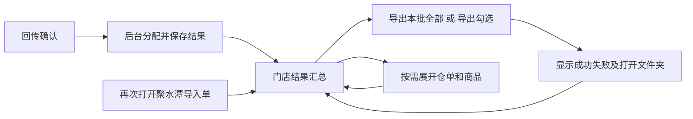

# 聚水潭导出简化方案

状态：方案稿，未修改应用代码。目标：计算完成后看门店汇总，直接导出；再次导出用相同入口，不重新寻找生命周期状态，不重新分配库存。

## 一、现状核查

当前HEAD为0.22.1的63a1b18ee22693c21cbf1024198e43025df652e3；实际包构建2f515afa7d74ae3208871b16d9734f0ea2b8d755。使用隔离合成资料运行实际EXE，本轮截图和记录在qa/design_jst_export_20261101/capture，未操作日常数据库。

|步骤|当前体验与评价|依据|
|---|---|---|
|1 进入聚水潭导入单|有独立入口，但默认待生成，与导出已有单的目标冲突。列表同时出现待生成提示、待付款状态、本环节已处理，动作语义不统一|stage-jst.png；lifecycle_home_ui.py、daily_batch.py|
|2 核对分配|门店汇总能看金额减少和SKU，保留。导出却默认自动发生，又保留确认生成、完成列表及另一组导出按钮，普通路径过长|preview.png；jst_ui.GenerationDialog|
|3 生成后再次导出|服务支持任意次数按原生成记录导出，同名安全覆盖；重开复导测试通过。但主入口默认待生成会隐藏已生成单，窗口内再次导出又依赖临时完成列表选中项|jst_ui.export_saved/export_orders、jst_exports.export；本轮report.json的reopen记录|

首次检查入口：

核对界面：

以上为当前版本和隔离合成资料的截图。重新预览已生成单的截图中长提示未完整显示，不作为完整视觉证据。再次导出服务已测试、筛选与临时选单行为已查代码，但未逐点击录下二次导出的完整人工路径；不宣称完整可用性或无障碍验收。可见的认知风险是多个相近按钮、灰色“本环节已处理”与待生成信息冲突、底部重复选单；键盘焦点和读屏需在实现后另验。

问题根因是把“待计算任务列表”同时当成“已生成结果的导出列表”，以及没有把持久结果直接用于再次导出，不是文件服务限制只能导出一次。

## 二、主流程

聚水潭导入单仍是执行附件，实际生命周期仍为签发→回传→付款→收货。保留现有回传确认后的自动分配，不再默认自动导出文件。普通操作是“看结果→导出”，不是再走预览、确认生成、选择完成项。

需要更新仓资料或调整分配顺序时，使用独立的“更新资料与重算”入口；原有重算预览、库存影响和保存确认仍保留。不能为了少一次点击而把未保存预览当成可导出的正式生成结果。

## 三、一个固定结果页

页面名统一为“聚水潭导入单”，提示“用于聚水潭下单”。回传确认后的“查看分配结果”、订单跟踪中的同名入口，都打开同一个结果页。

默认本日业务批次，结果页不继承总览的待付款/待收货/未完成/锁状态筛选。显式从勾选订单进入时，清楚标注“所选订单范围”，提供“查看本日全部”，不能偷偷限定范围。日期可以切换，历史结果通过相同页面查看和导出。

页面顺序：

1. 业务日期、范围说明和“更新资料与重算”（次要入口）。
2. 分配概览：本批门店数、仓单数、可导出/处理中/待处理/零分配数量；需求、已分配、减少金额和减量SKU。金额继续保持0.22.1口径。未完成及金额待核不可作为已完成或0金额。
3. 门店列表：门店、仓单数、分配金额、减少金额、减量SKU、准备情况、最近导出、下单锁定。点击展开该店仓单，再按需查看SKU。默认“本批全部结果”，导出后不移走行，进入付款/收货或锁单也不移走行。
4. 固定底部操作：“导出本批全部（N份）”“导出勾选（M份）”“打开导出文件夹”。按钮位置、名称和含义稳定。

不再要求在额外“已生成完成列表”中选择一次。导出范围直接来自当前持久结果。

## 四、导出规则

|动作|范围和行为|
|---|---|
|导出本批全部|当前明确的批次/入口范围内，所有当前有效且可导出的仓单，包含以前导出过的单。跨分页处理，不能只导出屏幕50行|
|导出勾选|只导出勾选门店/仓单，门店勾选包含其可导出仓单；展开后可单选一个仓。父项显示全选/部分选中|
|筛选或搜索|只帮助找单；不会悄悄缩小“本批全部”的范围。按钮旁写清“全部含当前搜索未显示的结果”；想只导出筛选项，勾选筛选结果后用“导出勾选”|
|跨页勾选|显示明确已选仓单数；换批次或查询条件时清空勾选并提示，避免隐藏选择误导出|
|重复导出|相同结果、相同按钮、任意次数；不重新计算，不再次占库存、不生成新付款记录|
|已有同名文件|沿用先完整写临时文件再替换；同名直接覆盖，不弹逐个覆盖确认；文件占用时提示关闭Excel后重试|
|锁单/付款/收货后|原有效生成结果仍可导出；锁单只约束重分配，不限制读取和导出|
|零分配|显示“分配为0，无下单商品”，不生成空订单；不隐藏在结果页|
|资料或上游变化|显式标记需核对，不能点击导出时静默重算；依据失效的未锁结果不混入普通“有效结果”。旧结果仍可从历史查看并明确导出；锁单不自动重算|

文件继续每店每仓一份，原命名和四列不变：商品编码、单价、数量、订单号。仅数量大于0的行。文件行顺序沿用保存的分配结果，不能按查看表的排序重写。导出文件顺序沿用原分配顺序。

导出前在页面直接展示范围、份数、金额和目录，正常情况点一次即可执行，不再弹重复的“确认导出”窗口。可导出与未完成的数量并列显示；例如“可导出4份，另有1份处理中”，业务可先导出4份。后续新就绪的订单显示“新增可导出”，不被悄悄加入已经开始的文件任务。

导出时明确“2/5份，当前门店/仓”。成功后留在结果页，显示“成功5份”，按钮继续可用。失败项保留原因，提供“重试失败项”；取消保留已完成文件，未完成项可继续导出。重试绑定原生成记录，不能换成新的计算结果。

## 五、把其他动作放回对应位置

- 更新仓资料、人工调整分配顺序、重新计算：放入“更新资料与重算”，不阻挡已有结果导出。
- 已下单锁定：门店展开后的仓单操作或独立批量动作；不能因导出成功自动锁单。
- 付款来源确认：留在付款核对环节；导出、锁单不等于付款。
- 更正、撤销、日志、当时资料原件：保留次级入口，不占正常导出的主操作位置。
- 全部界面统一使用“聚水潭导入单”，避免“生成订单/下单表/执行附件/已生成单”混作不同对象。

## 六、实现边界

1. 独立结果页服务读取业务日期范围内当前有效gid，聚合门店；普通导出不依赖生命周期next或是否已导出。复用jst_review只读汇总。已失效/撤销记录与普通有效记录明确分开。
2. 调整lifecycle_home_ui及回传后的跳转。保留生成服务和库存事务；jst_ui.GenerationDialog只服务更新资料/重算等需要核对保存的场景，去掉默认自动导出。
3. “导出本批全部”后台按范围读取全部仓单；“导出勾选”按显式所选读取。点击时冻结gid、顺序、目录和范围摘要，预检查后调用同一jst_exports.export。不能在分页界面循环拼业务结果。
4. 重复导出仅新增导出事件，不能改变生成行、回传、库存占用、锁单或付款事实。开始前发生结果替换时拒绝旧预览并刷新提示；任务开始后按冻结gid完成，后续新结果标记待再次导出，避免一批文件混版本。
5. 最近导出是结果展示，不是资格条件。只能从gid对应的成功文件记录确定；生成结果更新后，旧导出记录不能冒充新结果已导出。文件在外部被删除不影响重新导出能力。
6. 按日期查询摘要，后台加载和导出，展开门店才读取SKU；不再次读取Excel或执行模型来显示列表。保留现有有界执行与取消策略，不新增并行导出、存储迁移或计算策略。

## 七、验收标准

- 已有有效结果时，从结果页一键导出全部；同页第二次导出仍一键，不必切换生命周期筛选。
- 关闭重开后，选择同一业务日期仍看得到原结果和导出入口；已锁、已付款、已收货均可重新导出。
- 两仓、跨页超过50单、部分勾选、搜索隐藏行、零分配、部分失败、导出中新增结果均不漏单、不越范围。
- 同一gid前后导出的工作表、列、行、单元格值/类型/格式一致，文件数和顺序一致；只允许ZIP时间等明确动态信息变化。
- 重复导出前后生成记录、分配数量金额、库存预留、锁、回传和付款事实严格一致；导出事件变化单独说明。
- 同名覆盖、Excel占用失败、失败重试、取消、关闭和重新打开经过实际EXE验证。
- 明确测试读屏/Tab焦点顺序、缩放后的按钮和进度可见性；不靠颜色区分“已导出”“可导出”“处理中”。

本轮仅保存方案与隔离审查记录，不改代码、依赖、日常资料或交付包，不提交、不推送、不合并。下一实施优先打通持久结果页和反复导出，再收拢高级操作，保持原计算及文件业务结果不变。
