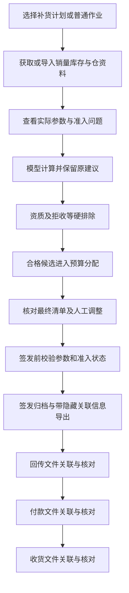
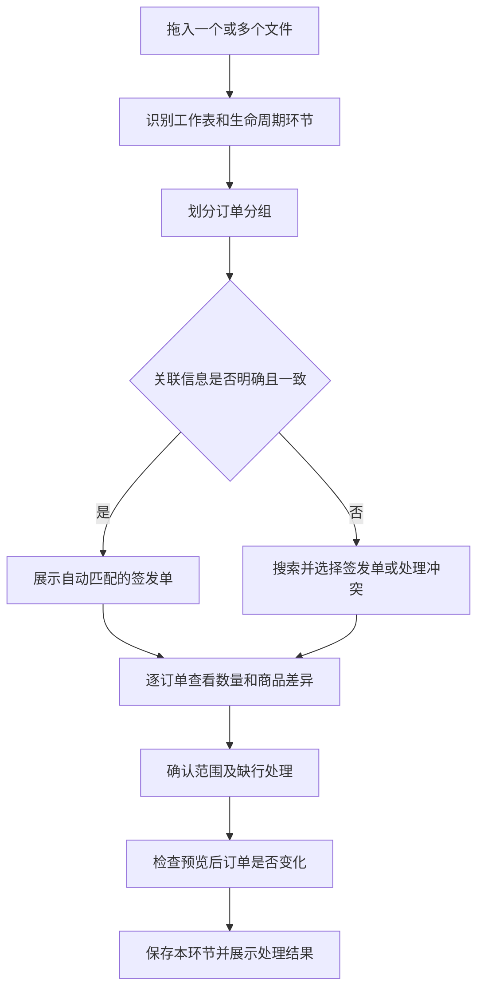

# 补货助手参数维护、补货计划、业务准入与单据关联完整方案

日期：2026-11-03，业务时区：Asia/Shanghai。

状态：完整设计稿。本文件整合本轮已确认需求和实施约定，不代表功能已开发或验收。保存本文不修改程序、正式配置、原始 Excel、历史订单或平台任务。

设计核对基线：分支 verify/jst-full-chain-0.31.0，提交 1f074962b2eba514bfa847854e3493621fdf3671。编写前工作区干净。后续开发必须重新检查实际 HEAD 和未提交修改，保护期间新增工作，不回退到本文基线。

本方案的主线是：维护可复用的参数和业务准入信息，选择门店及预设参数开展补货，核对后签发，再把回传、付款、收货准确关联到对应签发单。业务界面减少必填项，系统保留完整依据。

本次补充：将降低业务人员使用心智成本写成开发约束。新增能力不增加正常补货的必经页面；日常操作默认围绕当前任务，复杂配置按需展开，异常提供就地处理入口。第3节规定操作设计，第19节落实到分阶段通过条件，第20、21节分别规定界面检查和真实业务人员走查。以下是待实现、待验证的要求，不是已经取得的可用性结论。

## 1. 目标与范围

### 1.1 本次交付目标

1. 按用途拆分参数维护，日常分仓周期模板只要求门店和属仓等必要字段。
2. 固化一套系统标准参数，支持明确、可预览的恢复，避免参数被改坏后无法回到有效状态。
3. 保存“门店名单＋完整预设参数值”的补货计划，例如青岛线、济南线，一键采用。
4. 完整保存商品资料的多标签原文和解析结果，支持展示、查询及筛选。
5. 增加跨批次有效的门店拒收清单，可设到期日，未填日期则手动解除。
6. 增加门店二类医疗资质检查，作为最高优先级业务准入条件。
7. 门店签发、回传模板把补货单号从商品明细列移入隐藏信息页。
8. 生命周期表单没有单号时，可选择绑定签发单；多文件、多订单按分组核对。
9. 签发记录保留当时有效参数、标签、准入依据及执行结果，支持业务表单复查。
10. 分阶段开发、验证和独立打包，保留旧版本。

### 1.2 不纳入本次的变更

- 不调整预测公式、权重数值、保护期、安全库存或箱规计算算法。
- 不引入此前讨论但未采用的 3.5＋5 天统一保护期等试验口径。
- 不改变库存单位、基本售价计价、缺箱规补 1、无分类使用快销权重等既有口径。
- 不修改仓路由、仓库存分配算法、既有预算优先级与已验收的有限超预算规则。
- 不因新增标签自动修改必卖来源、箱规、供货仓或活动铺货规则。
- 不把聚水潭导入单新增为订单生命周期环节。
- 不增加外部资质自动核验、证照 OCR 或法规数据库。
- 不全面迁移现有 JSON、SQLite、每日作业和历史归档存储。
- 不自动更新历史建议量、签发量、付款或收货事实。
- 本文不授权推送远端、合并主线、替换正在使用的交付包或执行真实采购。

### 1.3 用户已确认的关键口径

| 事项 | 采用口径 |
|---|---|
| 两仓参数 | 分类超参两仓共用；备货天数和到货天数按仓保存 |
| 参数模板 | 供货关系、预算、策略、超参、分类映射分开维护 |
| 可选参数 | 可不填；明确默认继承关系，不要求所有字段重复填写 |
| 系统标准 | 有一套不被业务编辑覆盖的恢复基准 |
| 补货计划 | 保存门店名单和预设参数值，不引用各店各自的参数方案 |
| 拒收清单 | 门店级商品拒收，跨批次沿用，可设到期日，默认手动解除 |
| 二类医疗 | 商品资料标签含“二类医疗”时，门店需具备已核验资质 |
| 准入优先级 | 资质最高；拒收与禁用、停采同级硬排除 |
| 标签字段 | 一格可以多个标签，完整保存，不能当成医疗专用字段 |
| 门店模板单号 | 从商品明细列移到隐藏信息页 |
| 无号导入 | 允许业务选择与哪个签发单绑定 |
| 生命周期 | 签发 → 门店回传 → 门店付款 → 门店实际收货 |
| 数量比较 | 回传对签发；付款对回传正数行；收货对付款正数行 |
| 零与缺失 | 0、空白、缺行分别提示，确认完整单据后最终均按 0；整个环节未导入不等于 0 |

下文的界面名称、数据结构和模块划分属于实现约定，可在不改变以上业务口径的前提下根据现有代码调整。

## 2. 当前实现与数据核对

### 2.1 当前代码已经具备的基础

- 已有门店参数保存、参数方案、分类参数、分仓周期和策略开关。
- 已有商品禁用、补货停采的排除口径，人工调整与新品入口已有部分公共校验调用。
- 已有分仓签发、生命周期导入、回传对比和历史快照。
- 已有单号隐藏列与文件属性中的内部关联信息。
- 已有后台文件处理、进度、取消及独立工作进程机制，可复用。

### 2.2 本次需要补齐的缺口

| 核对项 | 当前情况 | 本次目标 |
|---|---|---|
| 商品标签 | 两仓原表含该字段；仓资料的计算用字段集合未保留它 | 从原表贯穿当前资料、计算、签发与复查 |
| 黑名单状态 | 输入适配存在“未提供，不作为数量拦截”的占位信息 | 建立真实门店拒收记录和统一硬拦截 |
| 资质 | 尚无本方案要求的门店二类医疗准入链路 | 保存资质并检查全部新增执行入口 |
| 参数导入 | 同表混有主从仓、预算、周期和超参 | 按功能分类模板，兼容旧入口 |
| 计划 | 本方案要求门店名单与预设值一起复用 | 新增独立计划记录，不靠方案引用拼接 |
| 单号 | 商品明细中有补货单号列，目前隐藏该列 | 改为隐藏信息页，导出与导入成对适配 |
| 无号表单 | 现有路径需要结合上下文和字段映射处理 | 形成统一、清楚的选择签发单流程 |

### 2.3 已核实的商品资料事实

核对的是 2026-11-03 双仓同步时保存的两份原始 Excel，不将其描述为实时平台库存。

| 仓库 | 商品行数 | 商品标签列 | 医疗标签实际写法 | 命中行数 |
|---|---:|---|---|---:|
| 山东仓 | 9,207 | 商品标签，当前位于 N 列 | 二类医疗 | 28 |
| 河北仓 | 4,497 | 商品标签，当前位于 N 列 | 二类医疗器械 | 40 |

实现按表头识别，不依赖 N 列位置。命中数包含启用、备用、禁用商品，不代表实际可补商品数。

两仓医疗标记合并去重为 50 个商品编码，其中 18 个两仓均命中；有 11 个两仓共有商品只在一仓标记医疗标签。河北仓命中商品中有 7 个分类不叫“医疗器械”，另有 3 个商品名称写“一类医疗器械”但标签写“二类医疗器械”。因此不能以名称或分类替代标签判断。

原表中的多标签示例包括：

- 差异化百货爆品,开学季
- 开学季,新店开业大礼包
- 待清理,游泳季
- 冬季商品,淘便专属
- 平销,同款换,无需快递拦截

本批医疗标签命中行中未发现医疗标签与其他标签组合，但程序必须支持组合。例如“必卖清单,二类医疗器械”是验收用合成场景，不冒充本批真实记录。

## 3. 产品入口与交互组织

### 3.1 保留四条主干

| 主干 | 用户目的 | 本次调整 |
|---|---|---|
| 补货出单 | 选店、计算、核对、签发 | 采用计划、实际参数预览、准入问题与签发前复核 |
| 订单跟踪 | 维护回传、付款、收货 | 自动关联、无号绑定、分组核对、批量处理 |
| 决策复查 | 追究某次补货或排除原因 | 当时参数、完整标签、准入依据、数量与金额链路 |
| 参数设置 | 维护长期可复用配置 | 参数分类、系统默认、拒收、资质、补货计划 |

### 3.2 参数设置内部分组

1. 补货参数：分仓周期、门店通用参数、分类参数。
2. 补货策略：一箱例外、极端缺货自动恢复、新品铺设。
3. 供货设置：单仓、双仓、主仓、从仓。
4. 门店预算：预算方式与金额，按现有范围保存或仅用于本次。
5. 门店资质：二类医疗资质状态、核验信息、有效期。
6. 门店拒收清单：添加、导入、解除、到期日。
7. 补货计划：门店名单、完整预设参数、复制和采用。
8. 高级设置：分类映射、字段映射及技术说明。

不再让完整参数表承担供货关系、预算、准入规则和所有映射的维护。分类映射继续可维护，但不挤占日常周期调参入口。

以上是维护内容的分组，不是每天必须经过的八个页面，也不要求把八组按钮全部并排铺在工作页。已经配置好的正常作业不进入“参数设置”也应能完成；遇到具体问题时从当前门店或商品直接进入对应维护位置。

### 3.3 通用交互约定

- 日常入口先展示需要行动的业务信息，路径、JSON、内部字段名放到技术详情。
- 所有导入支持拖拽、选择文件、下载本功能模板。
- 保存前展示具体修改范围和差异，不用抽象的“是否应用配置”代替。
- 添加、解除、删除、恢复使用各自明确的动作，按钮不能随状态切换成相反含义。
- 返回、关闭、刷新、重试使用统一的标准图标和提示，不与签发、保存同样突出。
- 原因先显示简短结论，详情再展开来源、值和处理方式。
- 识别错误指出文件、工作表、源行、字段和下一步；不能只展示异常类名。

### 3.4 正常补货保持四步

四步表示业务阶段，不承诺只需四次鼠标点击。新增参数、标签和准入能力融入现有流程，不形成额外的必经设置向导。

| 阶段 | 用户要完成什么 | 默认看到什么 | 正常情况下不必做什么 |
|---|---|---|---|
| ①准备数据 | 选择门店或已保存计划，获取或拖入文件 | 计划名、门店数、资料是否齐全、缺失项 | 重新维护计划中的参数或逐个确认已有配置 |
| ②门店与参数 | 确认本次使用哪套参数，必要时调整 | “本次采用：青岛线预设”等来源摘要及有改动的门店 | 展开全部超参、理解内部覆盖顺序 |
| ③计算进度 | 开始计算，处理失败门店 | 真实进度、完成数、失败项和单项重试 | 因一家失败重新检查或重算全部成功门店 |
| ④核对与签发 | 看金额、变化和问题，确认签发 | 门店汇总、人工及新品金额、受限与待核摘要 | 默认逐SKU检查全部明细或转到多个设置页面查原因 |

未修改参数时，第二步允许直接继续。首次缺少的必要资料在第一步就明确显示，已有资料不要求重复填写。最近使用的计划可以排在列表前面，但不能自动替换当前作业，也不能把“最近使用”当成“本次已经采用”。

计算成功的结果与失败门店分开显示。修复单店问题后沿原批次继续，保留其他门店的成果和当前位置；规则变化确实影响其他结果时才按影响范围失效。

### 3.5 系统管理复杂关系，业务确认实际结果

日常主视图只回答三个问题：本次给哪些门店补、实际使用什么参数、还有什么问题需要处理。

- 参数来源先用一句话说明；门店有本次调整时明确标记，展开后才显示每项值、系统标准和覆盖来源。
- 系统标准、门店默认、计划预设、分类覆盖和内部版本是系统负责解析的关系，不把理解这些关系作为出单前提。
- 门店名、仓库和业务日期作为订单选择的主要信息；单号可查看、搜索和复制，不要求业务人员记住或手抄。
- JSON、哈希、字段字母、源路径和内部修订进入“详细依据／技术详情”，不占用默认操作区。
- 完整标签可查询，但不把全部标签筛选器和维护按钮堆在日常结果页；默认突出影响本次执行的问题。

### 3.6 修改默认只影响本次，长期保存作为次级操作

在作业中调整参数时，默认动作是“应用到本次”。“保存为门店默认”和“更新补货计划”保留为明确的次级入口，不要求每次改一个参数都在三种保存去向中作选择。

当前正在编辑的是长期维护页面时，按钮明确写出保存对象，例如“保存门店默认”或“保存补货计划”，不能与作业中的“应用到本次”混用。恢复默认也只影响当前编辑范围，不偷偷保存到其他位置。

导入不要求用户背诵空白、缺列和模板版本规则。预览直接汇总“更新几项、恢复默认几项、保持不变几项”，可展开查看原值、新值、影响门店及字段；恢复默认不能藏在普通修改中。用户已要求的“不填走默认”语义保持，不能为了简化界面改成另一种解释。

### 3.7 异常就地处理，处理后回到原任务

每个异常摘要同时给出问题、影响范围和可执行的下一步。示例中的数量仅为界面说明，不是本次数据统计。

| 场景 | 首屏提示示例 | 就地操作 |
|---|---|---|
| 已识别医疗商品，门店资质待核验 | “7款商品未安排：本店二类医疗资质待核验” | 查看商品、维护本店资质 |
| 门店拒收 | “3款商品未安排：门店拒收” | 查看拒收记录，按既有权限和确认要求维护 |
| 某店计算失败 | “本店计算失败，其他门店结果已保留” | 查看原因、处理后重试本店 |
| 缺少该仓周期 | “河北仓周期未配置” | 直接打开该店河北仓周期 |
| 文件缺少单号 | “这份回传数据尚未关联订单” | 选择签发单，保留已读取数据 |
| 文件关联冲突 | “文件订单与当前所选订单不一致” | 查看两边信息并处理冲突 |

维护入口预先带入当前门店、仓库或商品。取消维护返回原位置且不改数据；保存后返回原作业，保留筛选、选择和阅读位置，指出哪些结果需要重算或重新核对，不自动签发。

减少跳转不能弱化准入：已知医疗商品无资质仍不安排，标签列缺失仍按信息不完整处理。其他合格商品的状态和可处理范围清楚展示，不能用一个笼统错误遮住整批结果。

### 3.8 生命周期日常入口只处理订单摘要与少量例外

日常路径是“拖入文件 → 查看关联和差异 → 确认保存”。读取、字段识别、分组和差异计算是后台阶段，不各自增加一个必须点击的页面。

关联明确的订单自动带入，不再逐文件弹框要求重复选择；同一订单的多个商品工作表一起确认。无号文件按订单组选择一次，从订单详情进入则直接带入当前订单并在预览中显示。

默认优先展示待绑定、冲突和其他需要处理的组，其余正确关联的组保留在结果列表中供查看，不强迫用户逐组重新确认。数量减少、明确0、空白和缺行按既有口径汇总展示，不能因此额外产生每行一个确认框。

无法辨认的多订单混表才进入异常路径：说明缺少哪些区分依据，允许提供一单一文件或进入高级分组。手动指定记录范围只作为高级处理，不成为日常默认动作；仍无法唯一归属时保持待处理，不能为了少点一次而猜单。

### 3.9 确认次数与命名约束

| 操作 | 交互要求 |
|---|---|
| 查看详情、筛选、展开参数、正常返回 | 不增加确认弹框；有未保存变更时按既有丢弃保护处理 |
| 明确身份文件的自动匹配 | 在整体预览中显示，不再要求逐订单重复选择 |
| 应用普通本次参数修改 | 当前预览确认范围后执行，不连续弹出同义确认 |
| 修改长期默认、更新计划、批量恢复 | 清楚显示对象、范围和差异，保留必要确认 |
| 同日草稿或正常单覆盖 | 保留原有覆盖确认和差异核对，不能以减少操作为由删除 |
| 删除、解除等重要维护动作 | 保留适用确认，按钮名称和含义固定 |
| 未知关联、冲突或并发更新 | 要求解决实际歧义，不能自动确认或静默覆盖 |

同一功能在不同入口使用同一业务名称。普通作业使用“本次参数”，复用作业使用“补货计划”，系统恢复基准使用“系统标准”；不让“计划、方案、模板、默认”在同一个按钮上交替表示不同内容。

## 4. 主干流程

准入问题在准备阶段可提前提示，图中的硬排除表示执行候选必须通过检查，不表示只检查一次。人工调整、清单补足、签发以及后续新建采购动作均需调用公共准入校验。

本图表示内部业务链路，不是用户必须逐个点击的页面列表。前端仍按第3.4节四步组织，系统自动执行中间检查，只有需要业务决定的异常才请求处理。

## 5. 参数分类与生效方式

### 5.1 参数保存粒度

| 类别 | 唯一业务范围 | 规则 |
|---|---|---|
| 分仓周期 | 门店编码＋仓库 | 备货天数和到货天数分别保存 |
| 门店通用参数 | 门店编码 | 两仓共用 |
| 分类权重 | 门店编码＋分类组 | 两仓共用，不能各存一套互相覆盖 |
| 分类专用参数 | 门店编码＋分类组 | 仅支持现有允许覆盖的参数 |
| 策略开关 | 门店编码 | 两仓共用，与周期分开 |
| 供货关系 | 门店编码 | 单双仓和主从关系独立保存 |
| 总预算 | 门店编码＋适用作业范围 | 两仓共享，不因分仓重复预算 |

同一店同一分类的仓差异只来自实际仓周期、商品资料与既有规则，不来自重复的分类超参。

### 5.2 普通作业与计划作业

| 情况 | 生效来源 |
|---|---|
| 未采用补货计划 | 门店已保存参数，缺项使用明确的系统标准 |
| 已采用补货计划 | 对计划门店使用计划中保存的完整预设值 |
| 本次明确调整某店 | 在已经采用的完整值上应用该店本次修改 |
| 恢复历史草稿 | 保留当时参数快照，除非业务明确采用当前配置 |

不能在采用计划后再次应用旧门店默认，不能在计算开始时偷偷重新加载另一套值。每次检查文件、重算和恢复作业，都必须验证最终生效值与界面展示一致。

### 5.3 分类覆盖

分类专用值覆盖同一份配置中的门店通用值；没有专用值则继承通用值。无分类沿用快销，沿用当前模型行为。

计划保存完整配置，包括分类覆盖。采用计划时整体替换其负责的计算参数范围，不保留旧门店配置中隐蔽的分类覆盖。当前作业编辑通用值时，若仍有分类专用值，预览必须明确说明哪些分类实际不会改变，并提供进入该分类编辑的入口。

参数来源记录到具体字段或分类有效值，不能只显示“已采用方案”却无法说明实际覆盖结果。

## 6. 系统标准参数与恢复

### 6.1 固化方式

- 以当前验收基线的内置配置形成系统标准参数包，业务编辑入口只读。
- 标准参数包带版本和完整性校验；方案、门店导入、计划编辑不能写回它。
- 每次读取生成独立数据副本，避免修改共享字典污染下一家门店。
- 已保存配置损坏时报告具体问题并保留上次有效配置，不能静默按另一套参数计算。
- 系统标准升级不得自动重置现有门店、计划或历史作业。需要采用新标准时展示差异。

### 6.2 界面

日常主视图先展示本次参数来源和修改摘要；展开参数编辑或复查时，每项展示中文名称、单位、当前值、系统标准值、来源、影响和调整建议。完整说明可用，不要求正常出单先阅读全部说明。

操作分开：

1. 恢复本项系统默认：在当前编辑范围显式写入标准值，不是删除后又继承到某个自定义计划值。
2. 恢复本组系统默认：仅恢复选定参数组，列出变化后确认。
3. 撤销本次修改：恢复编辑前的值。
4. 保存为门店默认：仅在该明确操作下更新门店长期配置。
5. 更新补货计划：仅在该明确操作下更新指定计划。

恢复模型参数、分类参数、映射和仓周期分别操作。预算、供货关系、资质和拒收清单不在恢复参数的影响范围中。

### 6.3 当前内置值清单

下表是代码核对值，是拟固化基准，不是新建议值。已导入的门店配置不会被本表批量覆盖。

| 参数 | 当前内置值 | 主要影响与调整说明 |
|---|---:|---|
| 河北仓备货天数 | 8 | 与该仓到货天数组成保护期，增加通常提高需求 |
| 河北仓到货天数 | 4 | 影响保护期、到货前风险与紧急程度 |
| 山东仓备货天数 | 8 | 只用于山东仓周期 |
| 山东仓到货天数 | 5 | 只用于山东仓周期 |
| 普通库存额度天数 | 21 | 收紧或放宽普通额度；不是所有分支统一按预测日均执行的绝对上限；0 的关闭含义沿用现有校验 |
| 库存目标分位概率 | 90% | 提高通常增加安全库存；不是不断货率承诺 |
| 单段样本预测倍数 | 1.5 | 仅影响相关单段样本分支，不是所有商品倍增 |
| 严格约束月销上界 | 3 | 决定哪些低销量商品严格受单品资金约束 |
| 完全退出约束月销 | 10 | 必须高于严格约束上界，控制退出单品约束的时机 |
| 销量侧额外金额 | 6 元 | 影响单商品资金基准的一条分支，不替代整店预算 |
| 弱证据额外金额 | 30 元 | 影响另一条单品资金基准分支，效果取决于实际生效分支 |
| 单段额度参考天数 | 13 | 是额度计算参考，不随仓周期自动改变 |
| 极端缺货边界 | 30 天 | 当前固定规则，只读；是否自动恢复通过策略开关控制 |
| 最低覆盖判断量 | 1 个库存单位 | 是触发判断的参考量，不是人工指定补货目标 |
| 增长额度确认天数 | 4 | 调小通常更早认可增长，实际受有效有货天数影响 |
| 常规资格周转阈值 | 12 天 | 影响原资格判定；不等于最小起订数量 |
| 低月销基本售价门槛 | 6 元 | 按基本售价比较，不能标成采购价 |

底层通用周期仍有备货 8、到货 5 的兼容值；新界面按所属仓维护周期，不再重复提供容易冲突的通用周期输入。旧配置解释必须保持原有结果。

| 分类 | 趋势敏感度 | 最近 7 天权重 | 此前 7 天权重 | 剩余时段权重 |
|---|---:|---:|---:|---:|
| 快销 | 0.4 | 0.6 | 0.2 | 0.2，自动计算 |
| 日百 | 0.2 | 0.4 | 0.3 | 0.3，自动计算 |

现有分类专用参数支持库存目标分位概率、常规资格周转阈值、低月销基本售价门槛。现有内置标准中一箱例外开启，极端缺货自动恢复和新品铺设在未提供字段时沿用开启行为。历史读取保留此兼容口径，不把新增字段缺失解释为关闭。

## 7. Excel 参数模板与导入契约

### 7.1 最小模板

日常下载优先提供“分仓周期模板”，一店一仓一行。

| 字段 | 是否必填 | 说明 |
|---|---|---|
| 门店编码 | 是 | 精确匹配，按文本保留前导零和长编码 |
| 门店名称 | 否 | 辅助核对，不能替代编码 |
| 属仓 | 是 | 山东仓或河北仓 |
| 备货天数 | 否 | 留空按本模板版本的默认语义处理 |
| 到货天数 | 否 | 同上 |

模板不带主仓、从仓、预算、资质或拒收字段。填写某仓周期不启用该仓供货。

### 7.2 完整参数工作簿

| 工作表 | 记录粒度 | 必填标识 | 可选内容 |
|---|---|---|---|
| 分仓周期 | 门店＋属仓 | 门店编码、属仓 | 两项周期 |
| 门店通用参数 | 门店 | 门店编码 | 当前允许编辑的通用参数 |
| 分类参数 | 门店＋分类组 | 门店编码、分类组 | 权重和当前允许的分类覆盖 |
| 分类映射 | 门店＋商品分类 | 门店编码、商品分类 | 目标分类组 |
| 填写说明 | 字段说明 | 无需填写 | 必填/选填、空白、默认和范围说明 |

补货策略、供货关系、预算、门店资质和拒收各自提供独立模板。业务无需为了导入一类数据同时填写其他模板。

### 7.3 新模板空白语义

| 输入情况 | 处理 |
|---|---|
| 字段有合法值 | 更新该字段 |
| 存在可选通用参数列，该行单元格为空 | 恢复该参数到系统默认 |
| 存在分仓周期列，该行单元格为空 | 恢复对应仓的系统默认周期 |
| 分类专用参数为空 | 清除该分类覆盖，沿用门店通用值 |
| 分类权重为空 | 对应项采用该已知分类组的系统默认；无标准的新分类组不能凭空生成默认 |
| 分类映射为空 | 已知商品分类恢复系统映射；系统未配置的分类沿用现有无分类处理口径 |
| 整列、工作表或某门店未提供 | 不修改对应部分 |
| 值为 0 | 按数值 0 校验，不当作空白 |
| 非法值、公式错误、未知编码或冲突重复 | 列出错误，不静默修正或选最后一条 |

完整重复行可以明确提示重复；同一业务键存在不同值时必须消除冲突后保存，不用文件顺序决定取值。所有来源行保持可追踪。

旧模板保留原有“空白保持”等语义。通过模板版本及明确的旧版识别规则区分；无法识别时要求选择导入格式，并展示实际变更预览。不能把旧空白静默改成恢复默认。

### 7.4 导入步骤

读取文件 → 表头和编码检查 → 默认展开与参数校验 → 原值/新值/来源预览 → 确认影响范围 → 原子保存。

前面几项由系统后台连续执行，不拆成多轮用户确认。预览先汇总更新、恢复默认和保持不变的数量，重点突出恢复及冲突；详情按需展开。新旧格式由系统可靠识别时不让用户再选一遍，只有无法识别时才请求明确格式。

读取期间保留源文件变化检查。预览后用户又改了文件或其他窗口改了目标配置，则拒绝旧预览提交，要求重新读取。未确认前不改变正式配置。

## 8. 预设补货计划

### 8.1 保存内容

计划保存唯一标识、名称、备注、门店编码有序列表、完整预设参数、系统标准来源版本、内部修订和更新时间。

完整预设包含：两仓周期、通用模型参数、分类权重、分类覆盖、分类映射及策略开关。计划内门店首先共用这套预设；采用后允许对个别门店作本次调整。

不保存登录信息、下载任务、仓库存数、资质或拒收名单。预算和供货关系继续各自维护，不通过计划悄悄覆盖。

### 8.2 创建与编辑

可以新建计划，也可以从当前作业保存为计划。若当前多店参数不同，必须明确选择哪一套作为计划预设或进入编辑形成统一值，不能静默取第一家或把不同配置混合。

创建时可以复制系统标准或已配置好的参数，但保存后是独立完整值，不是指向原方案的实时引用。参数未填部分在保存前展开为明确的默认值，并展示来源。

计划复制后独立编辑。删除计划不删除它曾经产生的作业或签发记录；历史保存当时实际采用的值。

### 8.3 采用流程

准备数据页顶部提供“选择补货计划”，卡片或列表展示计划名、门店数、更新时间及简短周期说明。

1. 选择计划，在当前页展示门店名单、参数摘要和缺失的供货设置，不额外打开一个必须完成的配置向导。
2. 在空白作业中直接带入；已有本次修改时先展示会替换的范围。
3. 带入名单及参数，保留门店顺序。
4. 获取或导入文件，缺文件的门店明确标记，不假装整批完成。
5. 检查并计算，不自动签发。

仅选中计划不自动创建平台导出。已验证门店目录与计划名单不一致时，指出哪些门店需要补充核验，不能按名称模糊替换门店编码。

### 8.4 修改与失效

“仅本次使用”“保存为门店默认”“更新补货计划”分别操作。作业中的默认主动作只应用到本次，后两项为明确的次级操作，不并排要求用户每次选择保存去向。更新计划不会自动改变已经计算的作业；需要业务明确重新采用，并使受影响结果失效。

已经打开的作业使用自己的参数快照，不因另一个窗口编辑计划而悄悄变化。采用时显示计划名称、更新时间与实际值摘要，内部修订在详情中可查；保存更新时校验并发修改，不要求业务填写或记忆修订。

## 9. 商品多标签保存、解析与使用

### 9.1 数据契约

至少保存以下信息：

| 信息 | 含义 |
|---|---|
| 标签列是否存在 | 区分源文件缺字段与商品没有标签 |
| 原始标签值 | 保留原文，不因解析而改写 |
| 解析标签列表 | 用于展示、过滤与规则判断，保留首次出现顺序 |
| 医疗标签命中值 | 记录具体命中了哪个标签 |
| 来源 | 仓库、资料版本、源文件哈希、工作表和源行 |
| 跨仓差异 | 同编码的标签是否不同，以及各仓原值 |

只读取商品资料的“商品标签”字段。补货建议中的同名或类似字段不能静默替代资质依据。

### 9.2 解析规则

- 按表头识别，不固定列号。
- 支持当前英文逗号，兼容中文逗号、分号及换行分隔。
- 解析时去除单个标签首尾空白，重复标签在解析列表中去重，原文仍完整保留。
- 不对未知标签自行改名、合并同义词或产生业务动作。
- 任一标签包含“二类医疗”即命中本次规则，兼容“二类医疗”和“二类医疗器械”。
- “II类”“Ⅱ类”等其他写法本批未发现，不自行增加等价映射；新写法需要明确维护和验证。

### 9.3 本次各标签的行为

| 标签举例 | 本次行为 |
|---|---|
| 二类医疗、二类医疗器械 | 触发资质检查 |
| 必卖清单 | 保存、展示、筛选；不自动替代原必卖清单来源 |
| 箱进箱出、箱规废弃 | 保存、展示、筛选；不改变出库箱规或取整 |
| 转临沂仓 | 保存、展示、筛选；不改变仓路由 |
| 冬季商品、夏季商品、开学季、游泳季 | 保存、展示、筛选；不自动铺货 |
| 待清理、大日期促销、淘便专属等 | 保存、展示、筛选；其他业务含义另行定义 |

### 9.4 展示与筛选

商品表展示简短标签，多标签可展开查看完整内容。标签筛选可以单选或多选；多选默认“满足任一选中标签”，如提供“全部满足”需明确显示模式。筛选只改变查看范围，不自动改变补货数量或签发范围。

标签原文、解析结果和来源在决策复查中可见。不能为了资质检查只保存一个布尔值而丢失其他标签。日常结果页的完整标签筛选按需展开，默认优先显示影响当前执行的资质、拒收及待核问题。

## 10. 门店拒收清单

### 10.1 有效范围与周期

业务键为门店编码＋商品编码，山东、河北两仓共同生效。按精确编码匹配，不能按商品名称、条码相似度或通配符扩大范围。

默认立即生效，跨批次沿用。可填到期日，按业务时区包含该日；未填日期持续有效到手动解除。当前执行按实际操作日期检查，不能通过选择过去的业务日期绕过当前有效拒收。

### 10.2 最小模板与界面

| 字段 | 要求 |
|---|---|
| 门店编码、商品编码 | 必填 |
| 门店名称、商品名称 | 选填，导入后辅助核对 |
| 拒收原因 | 选填，未填写显示“门店拒收，未填写原因” |
| 到期日 | 选填，空白为手动解除 |

支持文件导入、商品搜索选择、多个门店批量添加。列表默认展示当前有效记录，可切换到期或已解除记录查看维护依据。解除不是移入额外回收站，不新增一个需要业务来回查找的数据去处。

### 10.3 更新语义

- 导入更新命中的记录；文件中缺少的旧记录不自动解除。
- 同一键冲突值要求核对，不能按文件顺序覆盖。
- 更新到期日为空明确表示改为手动解除，预览必须提示。
- 到期日早于当前日期提示该记录将不拦截当前作业，不能让业务误以为已生效。
- 解除使用独立操作，展示选中门店及商品范围。
- 保存失败整体回滚，维护记录与有效状态同步提交。

### 10.4 对结果的影响

命中记录保留原模型建议用于解释，候选与执行数量为 0，不占预算。必卖、最低持有、一箱例外、新品与人工改量不能绕过。

新增、更新、到期和解除影响相关未签发作业。解除后不能自动把之前拦截的数量补回已有结果，需要重新计算或重新核对；历史签发不改。

## 11. 门店二类医疗资质

### 11.1 状态与维护

| 状态 | 对医疗标签商品的处理 |
|---|---|
| 已核验具备，且有效 | 通过资质这一项检查，仍需通过其他检查 |
| 不具备 | 不允许安排进货 |
| 待核验 | 不允许安排进货，提示维护资质 |
| 已过明确有效期 | 不允许安排进货，提示重新核验 |

未维护门店默认待核验，不能默认有资质。核验是业务维护动作，本次软件按记录检查，不自行判断证照法律效力。

模板至少要求门店编码、资质状态；门店名称、有效期、核验备注等选填。系统保存维护时间和可获得的操作者信息，不编造不存在的登录人员身份。

### 11.2 判定依据

以商品资料标签为本次业务依据。名称或分类不同不能自动解除已命中的资质要求。名称写“一类”、标签写“二类”的商品单独提示资料冲突。

同商品编码在任一已维护仓资料中明确命中医疗标签，即提出资质要求，保存命中来源。不能把另一仓标签为空当成免资质证据。两仓原始标签分别保留，不自动互相覆盖。

这是本方案的跨仓保守合并口径，不改变商品实际供货仓。两仓资料差异供业务回到资料维护中核对。

### 11.3 缺失信息

- 标签列存在、单元格为空：按本次标记规则未命中，不意味着软件证明该商品无需任何资质。
- 当前拟使用的商品资料缺少标签列：审核依据不完整。可以读取和查看计算需求，但补齐依据前不能完成受该资料影响的新签发或采购动作。
- 商品在其他已核实资料中明确命中时，即使本仓标签缺失，仍执行资质要求。
- 旧历史快照缺字段：显示当时未记录，允许历史查看和原样导出；用于新作业需要补齐当前资料。

缺失信息不能自动转成“标签为空”或“资质具备”。

## 12. 统一准入与执行边界

### 12.1 规则优先级

1. 资质：最高优先级。
2. 门店拒收、商品禁用、补货停采：同级硬排除。
3. 原有资料、价格、编码、箱规及其他可执行性校验：沿用现有含义。
4. 合格候选内部再按现有必卖、紧急程度、预算及决胜顺序分配。

优先级用于展示主要原因，不表示其他命中原因可以丢掉。返回“允许、硬排除、待核”等明确结论及完整原因列表。

### 12.2 原始计算与执行结果分开

- 原模型建议及中间值继续保存，不为排除而改写原建议。
- 受限商品不进入预算候选，不参与执行。
- 预算释放后由原分配逻辑重新分配，其他合格商品执行量可能变化。
- 人工改量、清单补足、新品安排不能给受限商品生成正数执行量。
- 被排除原因可以查看，不将“有销量必须持有”解释为无条件跨越准入限制。

### 12.3 必须调用的入口

| 入口 | 检查要求 |
|---|---|
| 数据准备与计算候选生成 | 提前提示，形成可追溯准入快照 |
| 预算分配 | 只接收合格候选 |
| 人工改量、新品安排、清单补足 | 保存改量前检查，不能先接受后偷偷归零 |
| 确认签发 | 检查当前有效规则和预览绑定的版本 |
| 新生成聚水潭导入单 | 检查新的执行安排，不静默改写原签发或回传 |
| 翱象采购预览及真正上传前 | 复核当前准入，状态变化则停止新的提交 |
| 历史重导出 | 保留原单内容，在界面说明这是历史事实，不重新套规则改量 |
| 回传、付款、收货事实导入 | 如实记录并提示问题，不把已经发生的事实强制归零 |

已存在的平台采购单、已锁单或已付款事实不自动撤销。发现当前准入不满足，阻止新的执行动作并指引人工处理，不能偷偷删除外部单据。

### 12.4 规则变化和提交一致性

计算和预览记录资质、拒收、资料及参数的有效版本。保存或签发前在既有事务边界内再次核对，变化则拒绝旧预览提交，展示受影响门店和商品。

影响范围按门店及商品定位。仅标签集合变化但医疗判定和计算数据未变时，不应无理由重算全部门店；仍需更新本次采用的资料依据或提示其版本变化。

多门店签发沿用原事务原子性。不能一部分按旧规则提交、另一部分按新规则提交后只显示整批成功。

## 13. 签发单隐藏关联信息

### 13.1 范围

门店签发和回传模板移除商品明细里的补货单号列，将系统关联信息放入隐藏工作表。原业务分组、数量和金额口径保持；决策理由列仍保留，其位置随移除单号列正确调整。

山东、河北仍分别出单。文件命名、业务工作表命名及现有字段格式，除明确删除单号列和新增隐藏页外保持原约定。

内部生命周期对比、聚水潭导入单等另有业务用途的单号列不在本次删除范围。

### 13.2 隐藏页内容

建议页名为“系统关联信息”，使用不直接显示的工作表状态，并配合结构保护减少误删。不要把保护当作防篡改或绝对身份认证。

| 信息 | 用途 |
|---|---|
| 模板格式版本、文件标识 | 识别新旧解析规则 |
| 补货单号 | 业务关联主键 |
| 门店编码、仓库、业务日期 | 核对关联对象 |
| 内部签发引用、原签发摘要 | 防止把旧文件静默挂到更新后的单据 |
| 业务工作表与订单映射 | 单订单、多订单分组识别 |
| 生成时间等必要元数据 | 复查来源，不用于猜单 |

隐藏页不保存无关配置、用户凭据或长路径，不参与打印、商品扫描、统计和订单数量计算。旧文件属性可作为兼容来源，但不能与隐藏页矛盾后静默忽略。

### 13.3 合法修改与校验

门店改数量、删行、排序是正常操作。身份校验针对订单引用和必要关联信息，不要求回传文件字节或全部单元格等于原签发。

文件读取期间仍执行来源哈希/变化检查，防止预览后内容被改；该检查与订单身份校验分开。

隐藏信息完整且无冲突时自动关联。信息丢失时进入手动绑定。已有有效单号与所选订单冲突时不能当作“无单号”直接覆盖，需明确解决冲突。

### 13.4 多订单合并文件

- 继续支持一店一仓一份 Excel，以及一份文件包含多订单的导出方式。
- 隐藏页保存所有订单及分组映射，不能只放一个全局单号。
- 可通过门店编码、仓库等现有字段唯一识别的记录自动分组。
- 同店同仓跨日期订单出现相同商品时，不按商品编码、行号、当前排序或文件名猜归属。
- 无法唯一关联时要求业务选择订单并指定记录范围；未明确归属的组不能保存。
- 可以建议拆成单订单文件来减少操作，但不能静默取消已有合并导出功能。

没有单号列并不意味着所有多订单混合文件都能无歧义自动识别；人工绑定是明确的兼容路径。

## 14. 生命周期导入与手动绑定

### 14.1 操作流程

### 14.2 关联依据

隐藏信息页、旧版单号列、已支持的文件属性和当前订单详情上下文共同用于核对。存在多个来源时必须一致，不能用优先级掩盖冲突。

单号缺失不要求业务回 Excel 补填：

- 从订单详情导入：默认带入该订单，在预览中明确展示。
- 从批量入口导入：按文件或订单分组选择签发单。
- 识别出的门店、仓、日期用于缩小候选和提示，不单凭名称或时间相近自动决定归属。
- 付款内部单号不是补货单号；只有已有明确映射时才能用于自动关联。

签发单选择列表显示业务日期、门店、仓库、补货单号、签发金额和当前环节，支持搜索、筛选。内部修订不让用户填写。

门店、仓库、日期和金额作为辨认订单的主要信息，单号可搜索和复制但不要求手抄。界面先展示按已有信息筛出的候选，选择后显示清楚的关联摘要；候选只有一个也不能把不充分的推测变成已核实自动关联。

### 14.3 分组预览

| 显示列 | 内容 |
|---|---|
| 文件／工作表／分组 | 便于找到源数据 |
| 识别环节 | 回传、付款或收货；不明确时选择 |
| 关联签发单 | 自动匹配结果或待选择 |
| 关联方式 | 隐藏信息、旧单号、当前订单或人工绑定 |
| 商品数与金额 | 该组业务规模 |
| 差异摘要 | 增加、减少、缺行、新增商品等 |
| 问题与操作 | 待绑定、冲突、上游缺失及处理入口 |

默认先看订单摘要，展开后看 SKU。一次文件的三个商品分类表属于同一订单时只需绑定一次；同文件多订单分别绑定，不能整批挂到当前选中单。

优先定位待绑定和冲突项，正常匹配组无需逐个重新选择。上表列明可用信息，关联方式、完整文件来源等辅助信息可以在展开区查看，不要求全部并排挤进默认表格。高级手动划分记录范围只在系统无法分组时出现。

若同文件出现同订单同环节的不同版本，提示选择或解决冲突，不直接把两个版本数量相加。

### 14.4 数量与差异口径

| 环节 | 对比基准 | 实际导入值 |
|---|---|---|
| 回传 | 签发单 | 门店确认要货量 |
| 付款 | 回传要货量大于 0 的行 | 付款表商品数量及原有金额字段 |
| 收货 | 付款数量大于 0 的行 | 门店实际收货数量 |

明确 0、空白、缺行分别展示原因，确认完整单据后最终都按 0；未导入整个环节不等于 0。

订单完全未出现在本次导入中，默认不处理。只有业务明确选择该订单并确认空单，才按该单本环节全部为 0 保存。不能因为文件中少了一家店就把这家店整单清零。

新增商品单列核对，不能因不在上游正数行里直接丢弃。具体新增与异常处理沿用现有生命周期规则。

回传继续支持直接修改原签发单的数量。付款继续兼容现有带明细的付款表，保留已约定的价格和金额口径，不增加门店编码、实际付款时间等已排除的必填项。数量仍为原约定库存单位，不乘箱规。

### 14.5 批量、混合环节与保存

- 支持同环节多订单，也兼容已有混合环节导入能力。
- 同订单不同环节按上游依赖校验，不让付款引用尚未确认的回传。
- 沿用既有批量保存的事务和失败范围，不夹带改造整套批量提交策略。
- 预览后上游签发、回传或付款已被更新时，要求重新核对。
- 保存人工绑定关系、源文件哈希、源行及确认结果，不回写原 Excel。
- 缺少文件身份信息时记录为人工关联，不声称软件已验证该文件来自某次原签发。

## 15. 数据保存与历史复查

### 15.1 逻辑数据对象

以下为新增或扩充对象的逻辑契约，不要求把现有存储整体换成新技术。

| 对象 | 业务键或标识 | 主要内容 |
|---|---|---|
| 系统标准 | 标准版本 | 完整值、约束、校验信息 |
| 门店默认 | 门店编码 | 分类后的参数、独立供货及预算设置 |
| 补货计划 | 计划 ID＋内部修订 | 名称、有序门店名单、完整预设值 |
| 门店拒收 | 门店编码＋商品编码 | 有效状态、到期日、原因和维护记录 |
| 门店资质 | 门店编码＋资质类型 | 状态、有效期、核验记录 |
| 商品标签 | 仓资料版本＋商品编码 | 原文、解析值、列存在标记、来源 |
| 本次有效配置 | 作业＋门店 | 完整值、字段来源、计划引用和签名 |
| 准入结果 | 作业＋门店＋商品 | 判定、全部原因、规则与资料版本 |
| 文件关联清单 | 导出文件标识 | 订单引用、工作表及分组关联 |
| 导入绑定 | 文件哈希＋环节＋分组 | 所选签发单、关联方式和来源范围 |

门店、商品编码保持文本，不进行会丢失精度的隐式数值转换。字段缺失、空字符串、0 和待核状态分别保存。

### 15.2 签发时保存的依据

保存完整生效参数及来源、计划信息、商品资料版本和原始标签、命中的拒收记录、资质判断、原模型中间值与建议、预算前候选、最终执行量和金额。

不只保存当前配置的链接，否则配置被修改后就无法解释历史。原始资料按现有快照和原件留存机制保存，不增加每商品重复复制整本 Excel 的做法。

### 15.3 业务复查表单

按“当时参数、销量库存、商品资料、准入判断、建议与执行、后续数量变化”分组展示。每组先给中文结论，再展开完整依据。

示例结论：

- 未安排：门店二类医疗资质待核验；河北仓资料标签为“二类医疗器械”。
- 未安排：门店拒收；有效至指定日期。
- 已采用青岛线预设；当前备货周期来自本次人工调整。

历史缺少的新字段显示“当时未记录”，不能用今天的资料或资质回填后冒充当时依据。

## 16. 代码结构与职责

### 16.1 现有模块的接入位置

| 现有模块 | 本次职责 |
|---|---|
| app_defaults.py、default_config.json | 系统标准来源和既有兼容值 |
| parameter_schema.py、store_defaults.py | 参数校验、有效值、门店默认与来源 |
| store_parameter_import.py、store_parameter_ui.py | 新旧模板适配、预览、明确保存范围 |
| parameter_scene.py、parameter_ui.py | 维护入口分组、标准值与恢复操作 |
| warehouse_catalog.py、输入适配相关模块 | 完整标签及来源保留，兼容旧仓快照 |
| result_semantics.py、engine.py | 公共排除结果和候选编排，不另写预算算法 |
| preissue.py、new_products.py | 人工、新品及清单补足共用准入校验 |
| normal_orders.py、normal_delivery.py | 签发前并发校验、快照与原事务边界 |
| normal_exports.py、lifecycle_exports.py | 隐藏信息页、列布局和新旧导出兼容 |
| lifecycle_io.py 及现有导入界面 | 文件身份、人工绑定、分组差异及回传识别 |
| jst_orders.py、aoxiang_purchase.py 等入口 | 新采购前复核；不改平台连接和库存分配算法 |

### 16.2 建议新增的集中能力

- 一个轻量参数解析入口：把默认、计划、本次修改展开成完整值和来源，复用现有验证。
- 一个补货计划服务：创建、复制、更新、采用与并发校验。
- 一个门店准入服务：资质、拒收持久化及公共判定；标签解析可在此或仓资料模块集中维护。
- 一个订单文件身份模块：隐藏页读写、旧身份兼容、冲突检查及分组关联。

实际文件名在开发时按仓库结构确定，不把每个小函数拆成文件，不引入重型框架。纯业务校验不依赖 Qt，便于使用合成数据自动验证。

model.py、one_box_exception.py、allocation.py 原业务实现原则上不修改。新增准入在输入准备、候选和执行边界集中调用。确需调整入口时单独说明，不混入数值算法变更。

## 17. 一致性、取消与性能

### 17.1 一致性

- 原始建议、候选、执行、签发和生命周期数量保持各自语义，不相互覆盖。
- 单店参数对象独立，修改一店不能污染其他店或系统标准。
- 保存前检查配置与订单版本，避免预览后并发更新造成错配。
- 校验失败、取消或保存异常不留下半套参数、半套拒收状态或部分关联。
- 已成功提交后的取消不伪装成整体未保存，明确说明已完成和未完成部分。

### 17.2 性能策略

- 每批一次加载准入数据，按门店、商品建立查找索引。
- 标签每个仓资料版本解析一次，计算时不重复读取原 Excel。
- 不为每行调用数据库，不把完整商品资料重复传给每个小任务。
- 缓存带配置、仓资料和规则版本，版本变化时失效，不能只按门店名缓存。
- 大文件检查、差异比较在后台执行，界面优先显示订单或门店摘要。
- 采用计划只复制配置与名单，不自动复制历史结果和全量原件。
- 修改影响范围按门店和商品定位，避免无关门店重算。

以上是设计策略，不宣称已有性能收益。实施时用同输入、同环境、交替串行测量前后耗时；波动操作至少三次，保留原始值和峰值内存口径。

### 17.3 进度与取消

导入显示读取文件、检查字段、解析分组、绑定订单、计算差异和保存等真实阶段。总量未知时显示明确阶段与已处理数，不伪造百分比。

预览取消不写正式数据。保存遵守既有可取消检查点和不可中断提交边界；关闭窗口不强杀正在提交的进程。取消后重试使用新任务状态，不能接受旧任务结果覆盖新批次。

## 18. 兼容与变更边界

| 对象 | 兼容方式 |
|---|---|
| 旧参数模板 | 保留旧字段和空白语义，明确识别版本 |
| 旧门店配置、旧参数方案 | 保留完整值，新增界面分类不改变原有有效值 |
| 旧仓资料快照 | 原内容和哈希保留；缺标签按信息不完整解释，不就地填空改哈希 |
| 旧每日作业 | 恢复原参数和结果；明确采用当前配置后才失效重算 |
| 旧签发文件 | 支持原单号列和已有文件身份信息 |
| 旧归档 | 不回填虚构准入记录，不修改历史数量金额 |
| 无号外部文件 | 支持选择签发单并保存人工关联依据 |
| 多订单合并文件 | 保留能力；不唯一时人工分组，不猜单 |
| 已有平台任务 | 不重新提交或撤销，保持原任务恢复边界 |

新增标签会改变新仓快照的内容和摘要，应产生新版本，不伪装成旧快照。不能扩大业务指纹忽略字段来让差异消失。

历史重导出保持原业务内容；新格式可增加隐藏关联页，但不能使用当前资质、当前价格或当前参数重新计算旧签发。

## 19. 分阶段开发与依赖

### 阶段一：参数分类、标准与模板

交付：参数界面分类、系统标准恢复、新版最小和完整模板、旧模板兼容、参数来源预览。

依赖：先固定当前配置和计算基线。先建立统一有效值解析，再调整界面与导入，避免界面显示一套、计算使用另一套。

通过条件：相同有效参数下业务结果一致；两仓只在周期等既有仓数据上不同；默认恢复和导入语义可复跑验证。业务可直接看清本次参数来源，不必理解内部覆盖顺序；导入预览能辨认恢复默认与普通修改，作业修改默认只作用本次。

### 阶段二：多标签、门店准入

交付：标签留存与筛选、资质及拒收维护、公共校验、候选和所有新增执行入口接入、历史复查。

依赖：先打通原表到快照的标签传递，再增加资格判定；不能先用一个没有可靠来源的布尔字段上线。

通过条件：多标签、跨仓差异、未知资质、过期、解除及人工入口全部覆盖；不触发规则时原结果一致。异常给出具体影响及就地维护入口，处理后回到原任务，不让业务重新寻找门店或重复录入上下文。

### 阶段三：预设补货计划

交付：计划创建、复制、编辑、删除、采用、保存当前配置和作用范围提示。

依赖：复用阶段一有效值解析和阶段二当前准入，旧计划不能绕过当前硬规则。

通过条件：名单和参数准确带入，旧门店参数不反向覆盖，计划更新不影响已开始作业和历史单。已配置计划可在正常四步中完成出单，不进入参数设置，不重复要求确认已保存的各项超参。

### 阶段四：文件身份与生命周期绑定

交付：隐藏信息页、签发/回传导出适配、无号绑定、批量分组与冲突处理、完整 EXE 验收。

依赖：导出与导入必须一起开发交付，不能只删单号列就发布。

通过条件：新旧文件、正常改量删行排序、丢失隐藏页、多订单合并、混合环节与并发更新均可正确处理。明确身份文件不要求重复选单，无号文件按订单组绑定一次，正常流程不依赖逐SKU或手工行范围关联。完成第21.2节业务人员独立走查并记录证据。

每阶段验证通过后本地独立提交，再进入下一阶段。实施分支和版本号按当时最新仓库流程确定，不覆盖当前交付包，不自动合并或推送。

## 20. 自动验收矩阵

以下为待执行验收，不代表已通过。

### 20.1 参数与计划

| 编号 | 场景 | 预期 |
|---|---|---|
| P01 | 一店单仓导入周期 | 仅更新指定仓周期，供货关系不变 |
| P02 | 同店两仓周期不同 | 分仓生效，分类超参共用 |
| P03 | 新模板可选值空白、0、缺列 | 三者含义严格区分 |
| P04 | 旧模板空白 | 保留旧语义，不触发新版恢复 |
| P05 | 概率90%/95%、权重和约束关系 | 合法值真实影响结果，非法值不保存 |
| P06 | 恢复单项/整组/撤销 | 影响范围正确，不触碰预算和准入 |
| P07 | 修改一店参数 | 其他店和系统标准不变 |
| P08 | 重新检查文件与恢复草稿 | 不出现旧默认回盖计划或丢失本次修改 |
| P09 | 系统标准版本变化 | 现有计划和历史参数不静默改变 |
| P10 | 重复业务键冲突、长编码、前导零 | 拒绝歧义，精确匹配 |
| G01 | 一键采用计划 | 名单、顺序和完整预设正确 |
| G02 | 多店当前参数不同后保存计划 | 明确选定预设来源，不默取第一店 |
| G03 | 本次改量/参数后更新计划或门店默认 | 各保存范围独立 |
| G04 | 计划编辑、复制、删除 | 历史签发和已有作业不被删除或重写 |
| G05 | 计划门店缺文件或供货配置 | 清楚提示，不显示虚假全批完成 |

### 20.2 标签与准入

| 编号 | 场景 | 预期 |
|---|---|---|
| T01 | 两仓现有医疗写法 | 都命中同一资质要求 |
| T02 | 必卖清单,二类医疗器械 | 多标签解析，必卖不能绕过资质 |
| T03 | 多分隔符、重复标签、首尾空白 | 解析明确，原文保持 |
| T04 | 其他标签变化 | 不改预算、箱规、路由和自动铺货 |
| T05 | 标签列缺失与单元格空白 | 分开处理，不把缺列变为空标签 |
| T06 | 名称一类、标签二类 | 按标签检查并提示资料冲突 |
| T07 | 一仓有医疗标记另一仓空白 | 合并要求资质，不改原仓资料和实际路由 |
| Q01 | 有效、无资质、待核验、过期 | 判定分别正确 |
| Q02 | 资质与拒收、禁用、停采同时命中 | 保存全部原因，资质优先展示 |
| B01 | 拒收跨批次与跨仓 | 持续有效，不能换仓绕过 |
| B02 | 拒收到期当天和次日 | 业务时区边界正确 |
| B03 | 未填到期、手动解除、缺行导入 | 手动解除前有效，缺行不解除 |
| B04 | 同键冲突和保存失败 | 不误覆盖，不残留半套状态 |
| A01 | 人工、新品、补足、一箱、最低持有 | 均不能生成受限正数执行 |
| A02 | 准入变化后原预览提交 | 拒绝并提示重新核对 |
| A03 | 受限商品释放预算 | 使用原分配算法，逐商品解释变化 |
| A04 | 已签发/付款/收货后资质变化 | 历史事实不改，新执行动作受约束 |

### 20.3 导出与生命周期

| 编号 | 场景 | 预期 |
|---|---|---|
| I01 | 新单店单仓签发导出 | 明细无单号列，隐藏页关联正确 |
| I02 | P/R等格式与决策理由列移动 | 值、类型、格式和业务含义保持 |
| I03 | 改量、删行、排序后回传 | 仍关联正确，不依赖原行号 |
| I04 | 旧单号列文件 | 兼容读取 |
| I05 | 隐藏页丢失或外部无号文件 | 可以选择签发单 |
| I06 | 单号列、隐藏页和所选单冲突 | 不静默换绑 |
| I07 | 同文件三商品分组、一张订单 | 一次绑定覆盖正确分组 |
| I08 | 多订单同表、同店同仓跨日期重复SKU | 不猜归属，按明确分组绑定 |
| I09 | 原文件预览后被修改 | 拒绝旧预览保存 |
| I10 | 原签发预览后被另一窗口更新 | 拒绝旧签发引用 |
| L01 | 回传0、空白、缺行 | 原因分开，确认后最终0 |
| L02 | 整个订单没在本次文件中 | 默认不处理，不整单清零 |
| L03 | 明确绑定并确认空单 | 保存该环节全0并记录依据 |
| L04 | 付款对回传正数、收货对付款正数 | 基准正确，新增商品单列 |
| L05 | 同订单混合环节 | 按既有上游依赖和事务行为处理 |
| L06 | 手动绑定与自动绑定同一内容 | 业务值一致，关联来源如实区分 |
| H01 | 旧JSON/SQLite/仓快照/每日作业 | 可读取，历史内容和哈希未被重写 |
| H02 | 历史重导出 | 不套当前参数和准入规则改旧业务值 |

### 20.4 对比范围与允许差异

固定修改前源码、样本、参数、仓资料和必卖清单，在独立 QA 目录运行。保留门店及商品顺序，逐商品比较完整性、输入、中间字段、建议、候选、执行、数量、金额、归属、状态和来源；不只比较汇总。

允许变化：

- 新增字段：标签、准入依据、参数来源、计划和文件关联元数据。
- 明确命中新准入规则的候选及执行，以及由释放预算产生的后续分配变化。
- 用户显式采用新参数或恢复默认后的计算变化。
- 门店模板移除单号明细列、增加隐藏信息页及相应列位置调整。

不允许通过删业务字段、放宽浮点容差或扩大忽略白名单掩盖差异。动态时间、临时路径等如需排除，列出精确字段，不整块忽略元数据。

Excel 比较工作表、业务行列顺序、值、类型与约定样式。新增隐藏页是明确结构变化，其余未授权结构不能变化。

### 20.5 操作成本与界面状态检查

下列项目可通过界面回归和定向操作验证，但不能代替第21.2节真实业务人员走查。不得把自动化点击成功等同于业务人员容易理解。

| 编号 | 场景 | 预期 |
|---|---|---|
| U01 | 资料和计划均已配置的正常补货 | 沿原四步完成，不新增必经维护页或逐参数确认 |
| U02 | 查看本次参数 | 首先显示有效来源和变化摘要；完整值与来源可展开查 |
| U03 | 作业中修改参数后应用 | 默认仅本次生效，长期默认和计划内容未被更新 |
| U04 | 新旧模板空白处理预览 | 系统识别明确格式，恢复默认与普通修改分别汇总 |
| U05 | 门店资质或拒收问题就地维护 | 带入准确对象，取消无修改，返回保留原选择和阅读位置 |
| U06 | 一家计算失败后修复重试 | 沿原批次继续，无关成功结果保留，失效范围说明准确 |
| U07 | 明确身份的多订单生命周期文件 | 自动关联正常组，不逐组重复弹框选单 |
| U08 | 无号文件与一单多个商品工作表 | 每订单组绑定一次，不要求手抄单号或逐SKU关联 |
| U09 | 复杂混表与关联冲突 | 高级分组按需出现；无法判断保持待处理，不猜单 |
| U10 | 日常返回、覆盖、恢复和删除动作 | 普通导航无多余确认，已有覆盖及重要操作保护仍有效 |

## 21. 业务人员手工验收清单

### 21.1 功能与边界操作

1. 下载最小周期模板，填写一店山东/河北两行，导入后看两仓周期及共用分类参数。
2. 故意填一个非法参数，确认保存被阻止且旧配置不变。
3. 修改参数后分别试“撤销本次修改”和“恢复系统默认”，确认含义不同。
4. 保存青岛线计划，重新进入作业采用，确认门店顺序和实际参数。
5. 对某店搜索添加一个拒收商品，重新计算并尝试人工加量，确认无法执行。
6. 解除拒收，确认旧结果不自动加量，重新核对后才能安排。
7. 用无资质门店核对医疗标签商品，包括合成的多标签场景，确认被拦截且理由可读。
8. 切换两仓及检查标签差异，确认不会绕过资质。
9. 导出签发单，在 Excel/WPS 中修改数量、删除一行、排序后导入回传，确认仍绑定正确。
10. 复制业务数据到不带隐藏页的新文件，导入时选择签发单，核对差异后保存。
11. 批量导入多店、多仓及混合环节，确认每组关联对象清楚，无法识别的组不会猜单。
12. 故意遗漏整张订单，确认它保持原状态；再明确确认一个空单，确认两种情况有区别。
13. 打开历史决策复查，确认看见当时参数、标签和规则依据，旧资料缺项显示当时未记录。
14. 验证关闭、取消、失败重试及预览期间另一窗口修改的提示。

手工验收与自动回归都需单独记录实际结果；源码通过不等于 EXE 通过。

### 21.2 业务人员独立走查

使用独立测试数据和实际候选 EXE，请业务人员按任务目标操作。观察者不提前解释按钮位置、参数继承和技术字段；需要提示时如实记为一次人工帮助，不能在提示后仍报告为独立完成。

| 任务 | 准备条件 | 成功表现 |
|---|---|---|
| 用既有计划完成正常出单 | 计划、资料和供货关系已有效配置 | 沿四步完成，不进入参数设置或重新填写已有参数 |
| 调整本次周期，保持长期默认 | 一份可计算作业 | 能辨认当前修改范围，应用后门店默认及计划未变 |
| 处理医疗资质待核验商品 | 提供待核验场景和测试维护资料 | 能找到受影响商品及维护入口，不把数量改大当成解决办法；处理后回到原任务 |
| 处理单店失败并继续批次 | 一家失败、其他店完成的测试批次 | 能重试本店，不重复重算无关门店 |
| 导入有号和无号回传文件 | 准备可自动关联及需人工选择的样本 | 前者无需重选订单；后者按订单选择一次并完成差异核对 |
| 导入包含复杂冲突的多订单文件 | 至少有一组无法自动唯一判断 | 能识别待处理范围和下一步，不误绑、不把未导入订单清零 |

每次走查记录：任务是否独立完成、实际业务步骤与点击、页面往返、额外确认次数、人工帮助、寻找入口的停顿、误操作及恢复过程。时间区分后台等待和用户操作，保留实际原始记录；不预设未经测试的“几分钟完成”结论。

如与旧版比较，使用相同任务和资料，明确哪些新能力在旧版不存在，不能把不可比任务混成一个提速百分比。

### 21.3 可用性交付判定

- 已配置的正常作业不新增必经设置页，不要求用户理解系统内部参数优先级。
- 用户能从界面辨认本次参数来源、修改影响范围和订单关联对象，不依赖记忆版本号或路径。
- 正常自动关联不重复索要同一信息；无号文件每个订单组只需绑定一次。
- 不通过省略同日覆盖、重要维护或冲突确认来减少点击。
- 发生错误后能看见问题、影响与可执行下一步，返回不会丢失已完成成果。
- 不把逐SKU核对、手动行范围划分或频繁往返设置页作为正常流程的前提。
- 未解决的误保存范围、误绑定订单、误解整单缺失等问题阻止交付；普通文案或布局问题也要记录修正及复测结果。

若未取得真实业务人员走查记录，必须明确标为待验收，不宣称已经证明低心智成本或业务可独立使用。

## 22. 交付标准

- 更新必要的 README、参数字段说明、模板说明和业务操作说明。
- 本地独立开发分支，分阶段提交；模型算法版本与新增准入版本分别说明。
- 从明确、干净的构建提交生成新候选目录，保留旧版。
- 验证 Windows spawn、资源路径、新模块收集和实际打包程序。
- 保存正常四步、异常就地处理和生命周期绑定的操作证据，并按第21.2节记录业务人员独立走查；程序能运行不能替代使用成本验收。
- 保存可复跑命令、等价报告、性能原始记录、EXE/ZIP哈希及构建提交。
- 核对原始 Excel、正式用户配置和旧交付包未被测试改写。
- 报告完成阶段、未完成事项、明确差异和剩余限制。
- 未经后续明确要求，不推送、不合并、不替换用户正在使用的版本。

## 23. 后续单独立项的内容

以下内容不因本次保留标签而自动启用：

- 商品标签“必卖清单”与现有必卖清单的合并、优先级和冲突规则。
- “箱规废弃”“箱进箱出”对出库单位的影响。
- “转临沂仓”等标签对路由的影响。
- 季节、活动、待清理标签参与自动铺货或补货量调整。
- 新的医疗类别别名及其他资质类别。
- 外部证照自动核验、无人值守业务审批或平台采购自动提交。

本次只建立可保留、可查询、可复查的标签基础，并接入已经明确的二类医疗准入规则。

## 24. 核对依据与代码查找索引

### 24.1 代码依据

- [系统默认](../../src/default_config.json)与[默认仓周期](../../src/app_defaults.py)。
- [参数说明与验证](../../src/parameter_schema.py)、[门店默认保存](../../src/store_defaults.py)、[现有参数导入](../../src/store_parameter_import.py)。
- [仓商品资料](../../src/warehouse_catalog.py)、[结果口径](../../src/result_semantics.py)。
- [签发导出](../../src/normal_exports.py)、[生命周期导入](../../src/lifecycle_io.py)、[回传导出](../../src/lifecycle_exports.py)。
- [人工调整](../../src/preissue.py)、[策略开关](../../src/restock_policy.py)。

这些路径用于定位当前实现，不表示已完成本文所述改造。

### 24.2 商品资料核查来源

| 来源 | SHA-256 |
|---|---|
| [山东仓原始商品资料](../../qa/catalog_full_20261103/live/service/downloads/1e5d7951-ac81-4976-871f-784b5e988c5b/f2deb874-060c-48bf-9a43-326a642680cf/聚水潭商品资料_206074295_1a6469d50cca.xlsx) | 1a6469d50cca7d14ba0a63ff1bb7df7614d305da59ab25a8597f9cedda02c1ac |
| [河北仓原始商品资料](../../qa/catalog_full_20261103/live/service/downloads/1e5d7951-ac81-4976-871f-784b5e988c5b/07897607-13b2-4740-b26c-6f9689379470/聚水潭商品资料_206073780_1bfacd758423.xlsx) | 1bfacd75842306d0185f9a028cb6ef316456f2a74d54e45863c9f49b5b400a92 |

读取时对两份原件执行过前后哈希核对，未改原件。样本只证明该次保存资料中的标签写法和差异，不证明以后平台数据不会变化。

### 24.3 本轮实施状态

本文仅完成设计和核对记录，并已纳入降低业务人员心智成本的操作要求。未开始功能编码、数据迁移、业务回归、实际用户走查或 EXE 构建。第20、21节都是实施后的验收要求，不能作为已通过报告使用。
