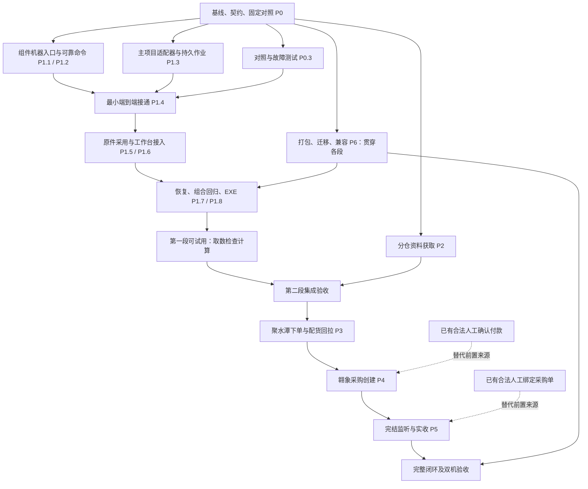

# 补货助手自动化接入：任务拆解、依赖与分工

日期：2026-11-01。状态：执行计划，尚未启动本计划中的开发、任务委派或平台操作。

依据：《补货助手需求清单与翱象组件接入设计_20261101.md》及本地源码核对。本文件细化任务与交付顺序，不替代原需求，也不把设计文档中的外部下单步骤视为实际下单授权。

## 1. 接管结论与固定边界

先交付“一键获取指定门店补货建议 → 原有检查 → 原有计算”，形成第一个可用版本；后续按分仓资料、聚水潭下单及配货回拉、翱象采购、完结与实收逐段推进。独立测试、打包、恢复和迁移设计从第一段开始，不能全部留到最后。

### 1.1 本次核实的基线

| 对象 | 当前依据 |
| --- | --- |
| 主项目 | `D:/优团工作文件夹/outputs/replenishment_mvp_20261029` |
| 分支 / HEAD | `main` / `cbaeecad190a2fea54fed8576ab2437341da00ce`；本地跟踪状态为 `main...origin/main`，本次未重新查询远端 |
| 应用 / 模型 / 归属 / 存储 | `0.23.0` / `0.3.3-rules` / `0.5.1` / `2` |
| 已有未纳管资料 | 原接入设计和《跨系统自动化闭环待办开发方案_20261031.md》，均保留、不覆盖 |
| 翱象交付包 | `D:/优团工作文件夹/翱象补货建议助手/dist/翱象补货建议助手 0.2.1 测试版.zip` |
| 翱象包 SHA256 | `d2061a906133cd788154e6ab0c0ff4414d9faa93172daf546624b1c62b8c43d1` |
| 组件开发来源 | 本机开发目录有 24 个 src 模块，与交付包源码已核对一致；另有测试及构建脚本，发行 ZIP 没有包含这些开发材料 |
| 当前缺口 | 稳定机器协议、跨进程业务关联、主项目入口，以及后续平台下单/实收链路尚未完成 |

开发实际开始时必须再次检查 HEAD 和工作区；若有后续提交，评估后固定新的开发基线，不回退到本文提交。现有测试记录是基线参考，不能替代新功能验收。

### 1.2 全程不变的业务约束

- 生命周期仍为 **签发 → 回传 → 付款 → 实收**。自动取数、聚水潭导入单、外部执行任务是辅助记录，不增加生命周期节点。
- 计算、预算、箱规、一箱例外、在途保底、人工改量规则不在本次变更范围；复用现有实现，不建立第二套计算或分配引擎。
- 聚水潭下单依据是已确认回传对应的有效本地生成版本 `gid`，不是直接拿模型推荐量下单，也不在自动化层重新分库存。
- 山东、河北的账号、库存、价格、地址依据和外部订单关系必须明确隔离；同编码不得跨仓凑数据。
- 自动回拉的实际财务配货单需要业务确认后才成为付款依据。现有人工选择聚水潭生成表作为付款来源的入口保留，并明确来源。
- 翱象采购依据已确认付款版本；实收依据平台可验证的实际入库事实。生成文件、导出成功、锁单、下单成功均不能代替付款或收货事实。
- 未知提交先查询核对；不能通过重启、换入口、换机或点击重试再下相同订单。
- 保留旧版本、原 Excel、日常用户配置、旧归档。新增自动化记录采用增量存储，不顺带重写日常作业格式。
- 第一阶段不实施自动下单、自动确认付款、自动签发、无人值守常驻服务，也不优化或改写模型。

## 2. 已发现、会影响排期的接入点

| 已核实情况 | 对任务拆分的影响 |
| --- | --- |
| `batch_app.loaded_ok` 会重置 results、overrides、run_codes 等本批状态 | 下载结果先存入独立作业；整批按既有流程接入。不能每下载一份就重新加载整个工作台，清掉人工调整 |
| `source_archive.retained_import` 按具体导入函数身份留存原件 | 新包装入口必须显式接上原件留存或复用原 Worker 调用，不能只确认读取成功 |
| 组件 `cli.mjs` 含启动、绑定、交互和连续格式化 JSON 输出 | 抽公共启动能力，新增专用 NDJSON 机器入口；旧 CLI 兼容，不解析人类终端文字冒充协议 |
| 组件已有 run、intent、平台 task、文件校验和恢复记录 | 复用这些能力，补 `command_id + 内容指纹 → run_id` 的持久关系，不另写网页导出器 |
| 同一浏览器会话由组件锁控制，当前单次 run 出错可能结束本次流程 | 明确单店失败与整批暂停的边界；独立入口共用执行锁，不能靠换数据目录绕过同会话互斥 |
| `PurchaseCoordinator` 当前提交的是已有采购单的导出任务 | 不能把方法名中的 submit 理解为采购创建已实现；采购创建单独安排 P4 |
| 主项目构建当前主要收集 Python 运行时和资源 | 首阶段就验证 Node、依赖、资产、许可证、路径和隐藏子进程；不能只证明源码能运行 |

第一阶段的批处理策略：先完成所选门店的取数状态收集，冻结可采用的文件版本，再按用户选择的门店顺序接入原检查流程。存在失败时明确列出，用户可只采用成功项或处理失败项；不能默默少算门店。已有有效门店设置可复用，缺设置、映射或冲突时停在对应业务步骤，不默认为新店设置无限预算。

刷新不能覆盖已被本次计算采用的文件。组件可保留自己的同日发布方式，但主项目采用时必须绑定不可变文件副本/已留存原件及哈希。

## 3. 角色分工与写入责任

这是计划分工，当前未启动执行者。开始开发后最多采用“我 + 三个执行角色”；资源不足时按相同依赖串行推进，不依赖必须有多人。

| 角色 | 主要责任 | 主要写入范围 | 交付给谁 |
| --- | --- | --- | --- |
| I：总负责人 / 集成，由我承担 | 业务边界、协议冻结、依赖协调、共享入口修改、阶段集成、版本与交付 | 协议与设计、现有主窗口/工作台入口、版本和构建集成 | 用户及各执行角色 |
| A：外部自动化 | 翱象机器入口、组件命令状态、浏览器恢复；后续聚水潭执行端 | 组件 src/test；后续明确归属的外部执行模块 | B 使用稳定协议；Q 验证 |
| B：主项目业务接入 | Python 适配器、持久作业、映射、原件采用、业务服务和新界面模块 | 新增自动化业务/数据/界面模块；指定业务服务接入点 | I 接入主流程；Q 验证 |
| Q：独立验证 | 固定对照、故障注入、顺序和业务等价、性能、EXE 与迁移证据 | 测试、夹具生成、QA 报告、复跑脚本 | I 决定是否放行 |

执行约束：

1. 每个文件只有一名当前写入负责人。`application_window.py`、`batch_app.py`、`workbench.py`、`ui_tasks.py`、`source_archive.py` 的跨模块接线由 I 统一处理；B 先实现独立服务和界面模块。临时转交必须记录起止，不能并行写同一文件。
2. A 负责组件 CLI、状态库、worker 和新机器入口；B 不直接改这些实现。协议变更由 I 确认后更新契约，A/B 同步升级，Q 追加验证。
3. Q 不通过修改业务预期来修绿测试，不与实现者共同维护同一份“现算现比”的预期结果；基线来自改动前固定提交。
4. 独立代码工作采用各自隔离工作区/分支，不允许在同一目录切分支干扰别人。I 按依赖集成，集成后的组合版本必须重新验证。
5. 性能测量、同浏览器会话的操作、真实平台验收不能并行抢资源。测试可以并行编写，测量必须按约定逐次运行。
6. 需求/协议/核心文件发生跨任务变化时先停受影响任务，其他不相关工作继续；不等全部完成才发现接口不合。

### 3.1 组件源码管理建议

推荐将核实后的组件源码、资产、依赖锁、测试和必要构建脚本纳入主项目受控目录（拟为 `components/aoxiang/`），保留独立 package、CLI 和测试入口。现有外部开发目录及 0.2.1 ZIP 保留，不直接在交付 ZIP 内补丁。

不纳管用户状态、浏览器配置、Cookie、下载数据、node_modules 和 Node 二进制。运行时及依赖按固定版本/哈希在构建阶段装配；发行包包含必要许可证。无需先引入 Git 子模块或多个独立远端。正式开发时将被纳管清单和授权范围核对清楚后落地。

## 4. 依赖图与开发顺序

开发顺序分为两类：

- **必须先完成**：基线和契约 → 两端可通信并恢复 → 文件被安全采用 → 原有检查计算 → 实际 EXE 验收。不能跳过协议和任务状态直接往按钮里放浏览器脚本。
- **允许提前准备**：Q 在 A/B 开发时编写对照和故障夹具；P2 的平台只读核查可提前做；采购模板、单位映射、完结字段可提前核查。真正的外部提交仍等业务来源和验证门槛满足后进行。

P4 并不硬性等待自动聚水潭链路全部结束：已有合法人工确认付款可用于独立开发验收。P5 同样可通过人工核实绑定的采购单开发。但最终完整闭环仍必须额外验证 P3 → P4 → P5 的组合路径，不能以各段独立通过代替。

## 5. 可验收任务清单

主责代码 I/A/B/Q 对应上文角色。每个任务的完成是“代码或明确契约 + 对应证据”，不是仅写完函数；需求 R、验收 A 编号沿用原设计。

### P0：固定基线与接口

| 任务 | 交付内容及完成条件 | 前置任务 | 主责 | 对应需求 |
| --- | --- | --- | --- | --- |
| P0.1 | 复核 HEAD/工作区；固定主项目和组件来源、哈希、测试及运行时；建立开发分支与组件纳管清单；保护旧包及用户数据 | 无 | I，A 配合 | R25 |
| P0.2 | 定义机器命令/事件、能力、错误码、身份/门店映射、状态和恢复契约；明确 command_id 指纹、顺序、暂停与未知提交；给出协议样例和读写责任 | P0.1 | I，A/B 评审 | R01、R02、R21、R22、R23、R25 |
| P0.3 | 用固定旧提交及隔离数据建立原检查/计算/导出对照；保存输入、参数、仓快照、必卖清单及哈希；建立模拟组件/平台故障夹具 | P0.1 | Q | R03、R06、R07、R08、R26 |

### P1：一键取数、检查与计算（第一交付段）

| 任务 | 交付内容及完成条件 | 前置任务 | 主责 | 对应需求 |
| --- | --- | --- | --- | --- |
| P1.1 | 抽取公共启动/账号绑定能力；增加独立 NDJSON 入口与能力握手；stdout 仅协议，日志分流；原 CLI 测试仍通过 | P0.2 | A | R01、R22、R25 |
| P1.2 | 命令指纹与 run 创建/绑定持久化；同命令返回原结果；共用会话锁；暂停/恢复/未知提交策略；单店失败与整批停止分类 | P1.1 | A | R02、R21、R22、R23 |
| P1.3 | Python 子进程适配器及自动化作业存储；先保存命令后派发；事件序号和回执幂等；超时、坏帧、退出、断连可解释；接口可用模拟组件独立测试 | P0.2 | B | R01、R22、R23 |
| P1.4 | 两端小范围接通：一个指定实体、一个文件、原结果查询；验证同命令重放不新建平台任务；先离线再在授权的取数对象上验证 | P1.2、P1.3、P0.3 | I，A/B 配合 | R01、R21、R22 |
| P1.5 | 按请求顺序整理成功/失败文件；核验身份及哈希；固定采用版本并留存原件；调用原 batch_service 与资料匹配；保留字段、去重、冲突和来源顺序 | P1.4 | B，I 接线 | R01、R02、R03、R06 |
| P1.6 | 入口与业务交互：门店绑定、选店、同日复用/刷新、步骤进度、暂停/恢复、失败处理；复用有效门店设置；保护未保存草稿及人工修改，不能静默重置本批 | P1.5 | B，I 接线 | R01、R02、R21、R23 |
| P1.7 | 恢复与组合验证：完成未登记、主/子进程异常、关闭、旧回执、普通失败继续、身份/未知提交整批暂停、重新检查；业务顺序及导出严格对照 | P1.6、P0.3 | Q | R02、R03、R22、R23、R26 |
| P1.8 | 第一段候选包：实际 EXE 调起组件，取数/检查/计算/暂停/重开/手动导入；同条件三轮性能与 UI 响应；发布证据和使用步骤 | P1.7、P6.1 | I，Q 验收 | R25、R26 |

P1 的自动计算仅在既有有效配置和原检查条件满足时推进。缺必需配置或存在冲突时进入原处理入口；签发与回传仍保留业务确认。首期不做“下一店下载与上一店计算”流水执行，避免扩大工作台状态改动；实测有必要再单列优化。

### P2：两仓商品资料自动获取

| 任务 | 交付内容及完成条件 | 前置任务 | 主责 | 对应需求 |
| --- | --- | --- | --- | --- |
| P2.1 | 只读核查聚水潭账号/仓绑定、商品全量范围、库存口径及更新时间；核实商品与库存是否需两表；冻结字段和异常样本，不用推测填缺字段 | P0.2 | A，I 核定口径 | R04、R05、R10 |
| P2.2 | 分仓获取与文件验收、分页/全量证明、来源清单；账号不符或缺可用库存阻断；不可把缺失转成 0 | P2.1、P1.2、P1.3 | A，B 适配 | R04、R05、R10 |
| P2.3 | 复用 warehouse_catalog 导入与原件留存；更新预览、时间提示及失败保旧；双仓同 SKU 和有效 gid 状态回归 | P2.2、P1.5、P0.3 | B，Q 验证 | R04、R05、R06、R07、R08 |

P2 的前期核查可与 P1 并行；完整集成候选包需在 P1 通过后验收。它是后续下单最容易受真实平台字段制约的前置阶段。

### P3：聚水潭下单与实际配货回拉

| 任务 | 交付内容及完成条件 | 前置任务 | 主责 | 对应需求 |
| --- | --- | --- | --- | --- |
| P3.1 | 门店收货人/电话/地址/备注维护，账号仓绑定；冻结本次地址版本；核实导入模板、外部引用、订单查询和拆合单情况 | P2.1、P0.2 | B，A 核查页面 | R09、R10 |
| P3.2 | 将有效 gid 转为下单执行任务；检查回传、资料版本及锁单；提交意图先落库、提交结果精确核验；同会话串行，未知提交不重试 | P2.3、P3.1、P1.7 | A，B 业务接入 | R07、R08、R11、R21、R23 |
| P3.3 | 精确回拉本次外部订单的财务配货单；保存实际数量/金额与未配差异；不能用本地分配推算“远端已配” | P3.2 | A，B 关联 | R12、R22 |
| P3.4 | 自动来源进入原付款核对；保留人工来源选择；确认后推进；两仓同码、少配、重复回执和跨版本组合验收 | P3.3、P0.3 | B，Q 验证 | R13、R21、R22 |

外部订单一对多或多对一关系先在数据契约中允许表达；若平台实际拆合单规则未能证明，相关订单转人工处理，不猜测绑定。本阶段不自行扩大到部分付款等新生命周期规则。

### P4：付款单转翱象采购

| 任务 | 交付内容及完成条件 | 前置任务 | 主责 | 对应需求 |
| --- | --- | --- | --- | --- |
| P4.1 | 每次准备使用验收合格的最新模板；确认门店/供应商/SKU/数量单位映射；按已确认付款生成采购输入，校验 12 列、金额、示例清理与模板隐藏规则 | P0.2、P1.4；另需合法已确认付款及映射样本，来源可为人工或 P3.4 | B，A 模板获取 | R14、R15 |
| P4.2 | 上传、创建及采购单号核验；付款执行版本绑定单次创建；中断前后不盲重提；人工接管能登记同一任务结果 | P4.1、P1.7 | A，B 业务接入 | R16、R21、R22、R23 |
| P4.3 | 模板变更、单位错误、缺供应商、提交未知、旧付款版本与人工补单回归；EXE 上验证完整采购环节 | P4.2、P6.1、P0.3 | Q，I 集成 | R14、R15、R16、R25 |

### P5：采购完结监听与实收

| 任务 | 交付内容及完成条件 | 前置任务 | 主责 | 对应需求 |
| --- | --- | --- | --- | --- |
| P5.1 | 持久监听计划及到期查询；绑定准确采购号；强制获取新状态、节流、离线补查、登录失效暂停；先限定应用运行时执行 | P0.2、P1.4；另需合法已绑定采购单，来源可为人工或 P4.2 | A/B 各自负责执行/调度 | R17、R18、R23 |
| P5.2 | 核实完结、作废、终止、实际入库条件；采购主单/明细字段与关联核验；实际完成时间与观察时间分开，不重复加总主单金额 | P5.1 | A，B 数据契约，Q 样本核验 | R17、R19、R20 |
| P5.3 | 通过原实收服务幂等登记；重复观察不重复入账；后续修正可追溯；不完整/单位不明转待核；付款至实收组合及异常验证 | P5.2、P0.3 | B，Q 验证 | R19、R20、R21、R22 |

### P6：贯穿各阶段的发布、迁移与验收

| 任务 | 交付内容及完成条件 | 前置任务 | 主责 | 对应需求 |
| --- | --- | --- | --- | --- |
| P6.1 | 固定组件和运行时装配；构建时完整性校验；Windows 隐藏子进程、资源路径、协议版本、许可证及日志路径验证；独立候选目录 | P0.1、P0.2；可先用模拟入口，再验证 P1.1 实现 | I，A 配合，Q 验证 | R25 |
| P6.2 | 新增记录升级/旧版兼容及回退；主/组件/文件一致迁移；旧机停止，新机重绑身份，恢复原任务；不搬登录态，双机不重复执行 | P1.7、P6.1；后续随 P3/P4/P5 增量扩充 | B，A 配合，Q 验证 | R21、R23、R24、R25 |
| P6.3 | 每段固定提交、组合回归、同条件性能及实际 EXE 证据；源码提交/包哈希/发行记录对应；最终人工+自动全链路及双机验证 | 每段功能任务、P6.1、相应 P6.2 验证；最终含 P5.3 | I，Q 验证 | R24、R25、R26 |

共 27 个任务包。第一段范围是 P0、P1 以及 P6 在第一段所需部分，不等于先做完后续所有平台能力。

## 6. 第一段的实际排班方式

| 波次 | I：我 | A：外部自动化 | B：主项目 | Q：独立验证 | 进入下一波的条件 |
| --- | --- | --- | --- | --- | --- |
| W0 | P0.1 / P0.2，明确版本和契约 | 核实组件纳管及现有恢复逻辑 | 核实存储、原件和工作台入口 | P0.3 固定基线对照 | 契约可测试、业务不变项明确 |
| W1 | P6.1 构建骨架及接口评审 | P1.1 / P1.2 | P1.3 | 模拟组件、事件/故障测试 | 两端分别通过协议测试 |
| W2 | P1.4 接通及共享入口接线 | 补真实执行端问题 | P1.5 / P1.6 | 文件采用、顺序和草稿保护验证 | 单店到多店流程完整 |
| W3 | 集成、候选包与问题分派 | 恢复/互斥问题修正 | 业务接入问题修正 | P1.7 / P1.8 / 首段迁移测试 | 业务等价与 EXE 均通过 |
| W4 | 第一段交付，按证据重估下一段 | P2 执行能力 | P2 仓资料接入 | 两仓组合回归 | 转入第二段 |

第一波优先完成固定基线、契约和对照，不先大改 UI。允许在不占用关键资源的情况下提前核查 P2 平台字段，但不能挤占第一段收尾。

## 7. 验收分配与放行门槛

### 7.1 原验收清单覆盖

| 验收项 | 主要执行任务 | 核查重点 |
| --- | --- | --- |
| A01 | P0.3、P1.5、P1.7 | 同文件自动/手动入口的完整业务输入、中间值、数量金额及理由 |
| A02 | P1.5、P1.7、P2.3 | 门店、仓、文件与商品顺序；身份及映射准确 |
| A03 | P1.6、P5.1 | 同日复用/刷新可见；监听不使用旧状态 |
| A04 | P1.2、P1.3、P3.2、P4.2 | 重复命令不重复平台动作；内容不同不能复用编号 |
| A05 | P1.7、P3.2、P4.3 | 提交前/中/后中断；未知状态不能当可重试失败 |
| A06 | P1.7、P3.4、P4.3 | 组件已完成主程序未登记；重启查回、补登记一次 |
| A07 | P1.7、P2.2、P4.3 | 页面、身份、文件结构变化停止错误采用 |
| A08 | P1.7、P6.2 | 暂停、关闭、重启，无失控后台提交 |
| A09 | P2.3、P3.2、P3.4 | 回传/库存刷新后的旧 gid，不自动混用或重新扣减锁定单 |
| A10 | P2.3、P3.4 | 两仓同 SKU、不同价格/库存/账号隔离 |
| A11 | P3.3、P3.4 | 实际少配与本地分配差异；付款采用明确版本 |
| A12 | P4.1、P4.3 | 模板列位置/单位/金额/示例与隐藏规则 |
| A13 | P4.2、P4.3 | 创建结果未知，查询/人工核对后登记 |
| A14 | P5.2、P5.3 | 主子单完整、单位可比、完结不等于全部实收 |
| A15 | P5.3 | 重复观察/回执、事实修订不重复入账 |
| A16 | P5.2、P5.3 | 缺平台完成时间仍缺失；观察时间单列 |
| A17 | P1.7、P4.3、P6.2 | 文件占用/下载失败/磁盘满；失败保旧，不假成功 |
| A18 | P6.2、P6.3 | 双机交接、重新登录核验、任务身份不变 |
| A19 | P0.3、P1.7、P2.3、P3.4、P4.3、P5.3、P6.3 | 固定基线组合回归；原模型、分配和导出不变 |
| A20 | P1.8、P6.3 | 每段至少三轮可比测量；保留全部原始值 |

### 7.2 每段统一完成条件

1. 实现、复跑脚本、输入来源与参数、基线/候选提交和差异报告齐全；测试使用独立目录/数据库，不读写日常配置做验证。
2. 逐记录比较值、类型、来源、顺序和关键元数据；Excel 比较工作表/行列顺序、单元格值、类型及样式。新入口增加的来源采集元数据单列核验，不能整块忽略。
3. 允许变化项提前列明，例如新增任务事件、采集时间、采用方式和诊断信息；模型、数量、金额、优先级、归属、既有导出业务值不因自动化改变。
4. 跨系统故障至少覆盖“发送前”“可能已发送”“平台已完成主项目未登记”；外部事实不明时停止相关动作。暂停/取消不能宣称已撤销平台已接收的动作。
5. 同机同输入同配置，至少三轮顺序测量；缓存复用与实际刷新分开统计。计入进程启动、平台等待、传输、检查、准备、计算和 UI 可用耗时，以及进程树内存与界面响应，不预设倍数收益。
6. 实际候选 EXE 验证用户动作及异常恢复，构建提交、组件版本/哈希、协议版本和 EXE/ZIP 哈希可对应；源码测试不等于 EXE 测试。
7. 所有真实平台操作按实际授权对象执行。若下单等真实验收尚无确定对象和影响范围，先完成离线、只读及可审查输入，明确将“真实提交验收”列为未完成，不冒充全链路通过。
8. 旧版仍可使用。涉及新增状态的回退先备份并给出读取能力边界，不让旧程序误读新字段继续提交外部订单。

发布顺序：独立分支 → 修改及隔离验证 → 本地提交 → 固定提交构建 → 实际 EXE 验收 → 变更和校验值记录 → 新标签。版本号实际开发时确定；模型版本不因接入自动化而变。未获本轮明确指示，不自行推送、合并或替换正在使用的版本。

## 8. 工作量与调整条件

以下为一名熟悉当前两套代码的开发者的有效工程人日估算，包含开发、集成、验证和问题修正；不是工具运行时间，也不是交付日期承诺。并行可以缩短部分日历时间，不能把总量直接除以人数。账号等待、业务核对及平台不稳定等待另计。

| 交付段 | 有效工程人日 | 最主要的不确定性 |
| --- | --- | --- |
| P0 + P1（含首段 P6 工作） | 9–15 | 命令恢复、原件采用与工作台状态保护、打包通信 |
| P2 两仓资料 | 4–7 | 可用库存口径、全量范围和账号身份核验 |
| P3 聚水潭下单及回拉 | 8–14 | 导入页面、地址、精确订单关联、少配与拆合单 |
| P4 翱象采购创建 | 6–10 | 单位与供应商映射、模板变化、提交结果核验 |
| P5 完结与实收 | 5–9 | 完结/入库口径、主子单覆盖、幂等修正 |
| P6 最终增量发布与双机迁移 | 3–5 | 跨机身份、历史状态和运行环境；不重复计算首段打包工作 |
| 合计 | 35–60 | 按阶段核查结果滚动重估 |

外部平台未核实部分另预留约 20%–30% 不确定性余量。P0 完成后细化第一段排期，P2.1 和 P3.1 完成后重新评估外部下单段；暂不承诺一个固定日期完成全闭环。

## 9. 尚需在对应阶段核实的条件

这些不会阻止现在拆任务或先做 P0/P1，不要求用户一次性回答所有问题。

| 条件 | 最迟在哪一步解决 | 未满足时的处理 |
| --- | --- | --- |
| 翱象当前账号、商家、门店实体的精确绑定；允许使用的取数范围 | P1.4 实际平台取数前 | 保持离线联调，界面等待绑定，不凭店名模糊猜测 |
| 两仓聚水潭账号、商品全量和可用库存字段/时点 | P2.1 | 保留手动资料入口，不能假装自动获取已完成 |
| 聚水潭下单模板、收货资料、外部引用、财务单和拆合单关系 | P3.1 / P3.2 | 只生成待核输入；未知映射不自动提交 |
| 翱象门店/供应商/SKU/采购单位对应关系 | P4.1 | 缺映射列待核，不能按名称或箱规自行猜单位换算 |
| 采购完结、实际入库量、完成时间和作废终止规则 | P5.2 | 记录状态不自动实收入账 |
| 真实下单验收的精确对象、数量金额、地址和执行授权 | P3.2、P4.2 的实际提交前 | 准备完整可审查结果后再确认该次真实动作 |
| 关闭应用后是否需要监听 | 若以后要扩展常驻能力 | 本计划先仅应用运行期间监听，不承诺后台任务已建立 |

## 10. 当前成果与下一步

本次完成的是任务拆分、依赖、角色写入范围、阶段验收和工作量计划。未修改业务源码、用户数据、组件包；未执行真实平台任务，未创建开发分支、提交、标签或推送。

开始开发时按 W0 执行：先复核基线并建立隔离开发环境，固定契约与对照，再分配 A/B/Q 的可并行任务。每阶段以可试用结果和本次证据交付；任何后续方案变化，都在对应任务和验收范围中明确记录。
