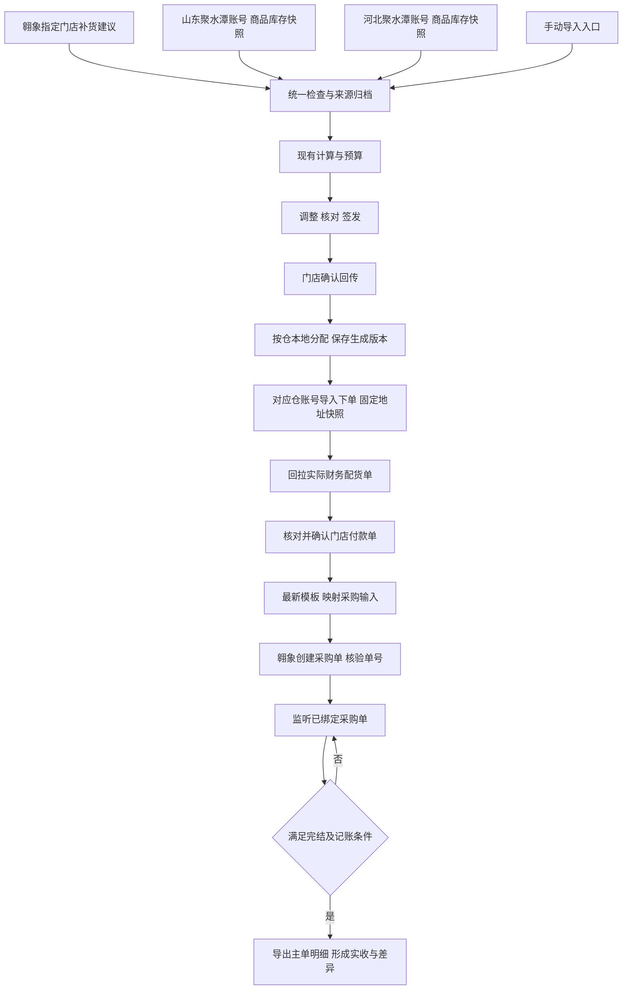
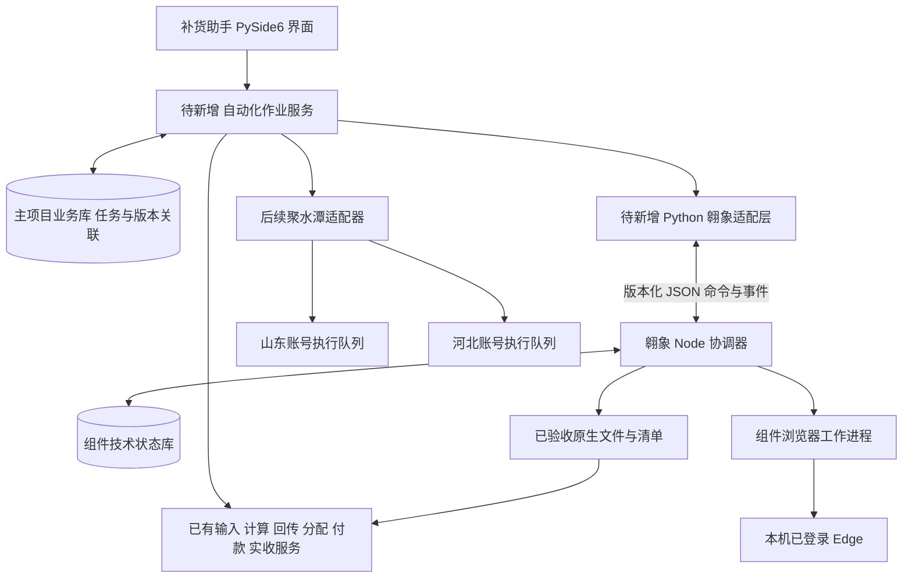

# 补货助手需求清单与翱象组件接入设计

> 历史设计基线：本文保留 2026-11-01 的设计与核验记录，其中版本和“待开发”状态已有变化。当前项目意图、实现进度、问题状态与下一阶段安排统一见 [项目意图与实施进度](../项目意图与实施进度.md)。不要用本文历史状态覆盖最新事实。

文档版本：1.0

整理日期：2026-11-01

用途：供业务确认、开发拆分、作业会话实施和验收使用。

状态：需求汇总与设计建议。本文不代表已完成自动化接入，不授权执行真实下单、采购创建或建立后台心跳。

## 1 结论与使用范围

保留补货助手现有 Python 业务与计算核心，保留翱象包的 Node.js 浏览器实现，增加主项目自动化作业服务和适配层。产品表现为一个应用，内部通过独立进程协作。无需现在将浏览器代码拆散重写成 Python，也无需部署独立服务器。

先打通“指定门店获取补货建议 → 原有输入检查 → 匹配分仓资料 → 计算”这一段；之后接聚水潭资料获取、聚水潭下单及实际配货回拉、翱象采购创建、完结监听和实收账册。

保留手动导入和受控的异常处理入口。自动与手动共用业务校验和计算规则，不能形成两套数量、金额和状态口径。门店回传确认、付款确认、现有签发核对继续保留。

本文件以当前会话明确要求为业务依据，以固定代码、发行包和本次检查为实现依据。旧计划、README、验收报告中的历史时点状态不自动作为当前事实。后续版本变化时先更新第 2 节，再调整待办。

## 2 最新版本核对

### 2.1 补货主项目

| 项目 | 本次核对结果 |
| --- | --- |
| 仓库 | SakuraCulture/replenishment-assistant |
| 当前本地分支 | feat/jst-results-export-0.23.0 |
| 应用版本 | 0.23.0 |
| 模型版本 | 0.3.3-rules |
| 当前提交 | cbaeecad190a2fea54fed8576ab2437341da00ce |
| 构建源码提交 | 527f9d15d91ffb96bd9a30e376ed92ca9b002de7 |
| 云端状态 | 本次 git ls-remote 确认 main 与上述功能分支均指向 cbaeeca；本地 HEAD 相同 |
| 发行包 | 交付_0.23.0_rc1/补货助手_0.23.0_rc1.zip |
| ZIP SHA256 | eae5e3a9a3b321363c43818ddcca53b4077ec30f28c0ed5a56ccc0149fe8cef5 |

已有实现应直接复用：

- 门店确认回传后，持久化后台任务，按仓资料执行本地库存分配并保存生成结果。
- 聚水潭导入单目前为四列：商品编码、单价、数量、订单号。每店每仓一文件，只写正数行，保留已保存的商品和生成顺序。旧“三列”设计已过时。
- 0.23.0 增加独立结果页，按业务日期查看门店及仓单汇总，可直接导出全部或勾选结果，并在同页重复导出；生成、导出、锁定、付款和收货的含义没有合并。
- 导出绑定不可变生成记录 gid。普通导出拒绝失效依据，导出开始后新生成结果不混入本次文件；失败与取消后保留已完成文件。
- 新增 jst_result_index.sqlite3 查询缓存，可重建；不是新业务事实库。模型和原业务存储无需为接入迁移。
- 原有付款、实收导入及生命周期能力继续作为业务落点。

本地分配不等于聚水潭远端实际配货。四列文件已生成不代表已经上传、下单或付款。当前代码中尚无本方案所需的聚水潭浏览器执行闭环。

版本记录存在时效差异：0.23.0 发行报告和 release.json 仍记录“未推送、未合并”，这是出包时的历史状态；本次云端核对已确认 main 与发行证据提交一致。本文不据此推断采用了何种 PR 合并方式。

### 2.2 翱象组件

| 项目 | 本次核对结果 |
| --- | --- |
| 当前发行包 | 翱象补货建议助手 0.2.1 测试版.zip |
| 技术组成 | 随包 Node.js、Playwright、Edge 工作进程、SQLite 状态库 |
| ZIP SHA256 | d2061a906133cd788154e6ab0c0ff4414d9faa93172daf546624b1c62b8c43d1 |
| 文件校验 | ZIP CRC 正常；846 个清单文件的大小与哈希一致 |
| 当前能力 | 补货建议导出、采购主单和明细导出、最新采购导入模板下载与结构验收 |
| 尚缺能力 | 通用采购填表及创建命令、采购完结监听和实收记账、聚水潭自动化 |
| 迁移逻辑 | 支持换机器重绑、配置与任务恢复记录迁移、可选结果随迁；不是完整运行现场备份 |

补货建议为 V2 的 54 列。旧 52 列仅作为历史任务恢复口径，接入时不能用旧列数契约验收新文件。

组件目录本次不是 Git 仓库，不能给它编造云端分支或提交号。固定发行 ZIP 的哈希作为本次检查对象。后续应建立自己的源码版本和发行契约。

### 2.3 验证证据及限制

已在本次会话完成：发行包哈希核对、翱象包完整性检查、迁移与恢复源码检查；使用 ZIP 内源码和运行环境，在隔离目录运行 8 项迁移相关测试，全部通过，覆盖新状态根、新输出根、结果哈希一致、原任务号、重复导入和未知状态保护。

主项目本轮重新运行普通模式 363 项回归测试，全部通过，耗时 34.415 秒，具体记录见第 14.1 节。发行记录另记载普通与优化模式各 363 项通过、31 店 62 仓单新旧导出有序对照零差异、6 次 EXE 启动验收；优化模式、冻结导出对照和 EXE 记录不能算作本轮重新执行。

发行性能记录：31 店 62 仓单合成样本，结果查询首查中位约 0.514 秒、缓存查询约 0.075 秒，不含进程启动和 Qt 渲染，没有同规模旧界面的端到端性能对照。不能据此承诺整体作业提速倍数。

本轮没有真实下单、采购创建、双机浏览器迁移验收，也没有重跑完整 EXE 自动操作和所有历史模型场景。

## 3 业务规则与数量来源

1. 门店补货建议来自翱象，商品资料来自聚水潭全量导出，分别保存原件和采集来源。
2. 山东仓和河北仓对应两个聚水潭账号。商品资料、库存快照、订单和执行队列按账号及仓隔离；同一商品编码不能跨仓混用库存和价格。
3. 模型结果经过签发、门店确认回传后，才能作为聚水潭下单需求。不能退回采用模型初算量或未经回传确认的签发量。
4. 现有本地分配按仓资料约束回传需求，形成实际提交候选。自动化必须使用已保存并核验有效的生成版本，不自行再分配一次。
5. 聚水潭实际财务配货单代表该系统为订单实际分配的数量与金额，作为本会话自动闭环的默认付款来源。该文件的存在本身不证明资金已经实际支付，仍需业务确认。
6. 付款单确认后，使用确认版本的数量与金额生成翱象采购输入。不能用原回传量覆盖实际少配的数量。
7. 翱象采购完结后，读取实际入库数量并与采购、付款依据分别核对，形成实收记录与差异。完结不能自动解释为全数到货。
8. 原始销量、可用库存、在途库存按库存单位；翱象采购模板按基础单位。两者必须有明确且可核验的单位关系，不能仅凭字段名称认定完全相同。
9. 接入不改变现有预测、预算、箱规、一箱例外、归属、JST 分配或付款生命周期规则。既有缺失箱规默认 1 等规则沿用实际引擎实现，自动化不得额外填零或另设默认。

**最新版本与本会话的付款来源区别。** 0.22 之后代码还支持业务人工确认后，把生成的聚水潭导入单直接作为付款来源，并允许未提供外部内部单号。这是已有可选能力，本方案不删除它；但不把它当成已验证的远端配货回执，也不让自动任务默认用它替代实际配货单。若以后希望自动闭环采用该捷径，需要明确确认政策；当前不依赖该决策即可先实施真实配货单路径。

正式业务生命周期继续为“签发单 → 门店回传单 → 门店付款单 → 门店实际收货单”。自动化任务、聚水潭生成单和翱象采购任务是关联的执行记录，不额外冒充付款等业务节点。

## 4 完整需求清单

状态定义：“已有”表示当前源码具备相应本地能力；“组件已有”表示翱象组件单独具备但未接入；“待开发”表示尚未形成该流程；“待验收”表示已有基础但尚无端到端证据。

| 编号 | 需求 | 当前基础 | 待完成与验收重点 |
| --- | --- | --- | --- |
| R01 | 一键获取指定门店补货建议 | 组件已有 | 门店绑定、获取策略、接入主项目、自动检查计算 |
| R02 | 多店批量取数 | 组件已有串行执行 | 保持选定店序；逐店状态与失败恢复；单店失败不能误报整批成功 |
| R03 | 手动补货建议导入 | 已有 | 保留，与自动入口共用输入校验 |
| R04 | 山东仓商品与库存自动获取 | 待开发 | 正确账号、全量范围、快照时间、原件与字段契约 |
| R05 | 河北仓商品与库存自动获取 | 待开发 | 与山东隔离，禁止跨仓复用 |
| R06 | 分仓资料手动导入 | 已有 | 与自动快照共用仓资料检查及更新规则 |
| R07 | 门店回传后本地库存分配 | 已有 | 复用 jst_tasks 与 jst_orders，不重建第二个分配引擎 |
| R08 | 聚水潭执行文件生成与重复导出 | 0.23.0 已有 | 复用四列文件、gid、文件及商品顺序 |
| R09 | 门店收货资料管理 | 待开发 | 收件人、电话、地址、配送备注及版本；任务固定地址快照 |
| R10 | 聚水潭账号与仓绑定 | 待开发 | 山东、河北各自登录核验及队列；不能按界面名称猜账号 |
| R11 | 聚水潭自动填写与导入下单 | 待开发 | 使用有效生成版本；确认收货信息；提交前后核验；记录外部单号 |
| R12 | 聚水潭实际财务配货单回拉 | 待开发 | 精确定位本次单据；保留实际数量金额与未配差异 |
| R13 | 门店付款单核对确认 | 本地能力已有 | 增加自动来源适配；真实配货与人工来源明确标记 |
| R14 | 翱象采购模板获取 | 组件已有 | 接入使用；每次准备获取最新结构，变化时停止 |
| R15 | 付款单转翱象采购文件 | 待开发 | 映射门店、供应商、商品、单位、数量和金额；保留来源版本 |
| R16 | 翱象上传并创建采购单 | 待开发 | 单次提交、平台结果核验、记录采购单号、未知结果不重提 |
| R17 | 翱象已有采购单导出 | 组件已有 | 复用主单 25 列、明细 43 列，精确按单和范围获取 |
| R18 | 采购单完结监听 | 待开发 | 可配置频率、登录异常暂停、状态变化记录、强制刷新 |
| R19 | 完结后实收与差异记账 | 本地实收基础已有 | 明细单位核验、父子单关联、完结与实际入库条件、幂等入账 |
| R20 | 完成时间记录 | 待开发 | 平台完成时间和本机观察时间分开；缺平台时间不得编造 |
| R21 | 手动异常接管 | 部分基础已有 | 共同任务记录、查明外部结果后补录，避免重复订单 |
| R22 | 自动化状态与审计 | 组件部分已有 | 跨系统业务关联、来源哈希、事件、异常分类和恢复入口 |
| R23 | 暂停与重启恢复 | 组件部分已有 | 主项目与组件一致的暂停协议；接收回执后恢复不重复提交 |
| R24 | 换机迁移 | 翱象核心已有 | 主项目、组件、文件的配套迁移；双机真实验收 |
| R25 | 打包与版本兼容 | 组件单独发行已有 | 主产品携带固定组件、协议版本和许可证，支持组件回退 |
| R26 | 性能测量与有限重叠执行 | 待开发及验收 | 分阶段耗时、内存、UI 响应；先保持同会话浏览器串行 |

## 5 业务流程与人工节点



| 环节 | 自动入口 | 保留的人工入口或确认 |
| --- | --- | --- |
| 取补货建议、仓资料 | 原生导出与验收 | 手动导入及来源核对 |
| 输入检查与计算 | 合格后进入现有服务 | 冲突、缺资料、规则异常待处理 |
| 签发与回传 | 沿用现有辅助流程 | 最终核对、门店回传确认 |
| 聚水潭填表上传与回拉 | 逐步自动化 | 登录、异常下单、来源选择及核对 |
| 付款单 | 自动填入真实来源 | 付款业务确认 |
| 翱象采购创建 | 符合条件后执行 | 未知提交先核对；人工补单要登记外部单号 |
| 完结与实收 | 自动观察、验收与记账 | 状态冲突、单位不明、明细不全和异常差异处理 |

手动入口初期保留在原位置；自动入口稳定后可置于主操作区，手动入口归入“手动导入／异常处理”。任何“提交结果不明”状态都不能靠切换到手动按钮重新下单。

## 6 接入架构与职责



### 6.1 主项目负责什么

主项目决定业务条件、执行顺序、门店与仓映射、采用哪份输入、哪个付款版本可以触发采购，以及最终实收如何入账。复用当前业务库和原服务，新增小范围的自动化任务及映射记录，不启动全应用数据库重构。

主项目显示等待登录、运行中、已复用、已取新数据、待核对、暂停和完成；不能只显示一个没有业务含义的 success。来源、采集时间和实际执行范围在业务需要时可查看，内部进程和协议字段不堆到日常操作界面。

### 6.2 翱象组件负责什么

组件继续负责 Edge 发现与绑定、身份核验、页面交互、提交意图、平台任务号、下载、字段和内容验收、文件发布及技术恢复。保留现有独立调试入口，但与主项目使用同一个执行锁域，避免两个入口争用同一会话。

不把浏览器选择器放进 model.py、allocation.py 或按钮回调；不让组件直接修改主项目付款、库存、实收等业务表。

### 6.3 首期进程形式

建议先采用主项目管理的子进程：一次作业内维持现有长寿命浏览器 worker，通过标准输入输出通信。无需先建 HTTP 服务。主项目后台任务负责读取进度、发出暂停和处理退出，GUI 主线程不等待浏览器。

现有 CLI 的 --json 连续输出多个格式化 JSON，并非整个 stdout 一个 JSON，也不是严格逐行 JSON 协议。新增专用机器入口输出 NDJSON；旧 CLI 保持兼容。stdout 仅输出协议事件，诊断放 stderr 或日志。需要明确帧大小、乱码处理、协议错误和进程异常退出的行为。

首期允许单个翱象执行队列，不急于实现多账户多进程并行。后续聚水潭两仓按账号隔离，是否并行以会话隔离和实际平台验收为准。

## 7 接口与状态契约

以下字段和操作名是建议的新接口，不是 0.2.1 已发布能力。

### 7.1 命令

必需字段：protocol_version、command_id、operation、account_binding、scope、basis_versions、policy。业务作业号 job_id 与组件运行号 run_id 分开；同一 command_id 配合相同内容指纹才能恢复，换了内容必须拒绝复用该编号。

```json
{
  "protocol_version": 1,
  "command_id": "由主项目创建并持久化的唯一编号",
  "operation": "replenishment.export",
  "account_binding": "已核验账号绑定引用",
  "scope": {"warehouse_codes": ["已绑定的翱象仓店编码"]},
  "basis_versions": {"store_mapping": "映射版本"},
  "policy": {"freshness": "refresh", "on_unknown": "stop"}
}
```

建议基础操作：capabilities、submit、status、pause、resume。业务操作先开放补货导出、采购导出和模板获取；采购创建等能力必须在实现与验收后才出现在 capabilities 中，主项目不能仅看版本字符串推断支持。

### 7.2 事件与文件结果

事件带 command_id、sequence、state、observed_at、error_code、evidence_ref。文件结果带 run_id、平台 task_id、账号与商家、实体编码、数据范围、字段契约版本、精确路径、bytes、sha256、rows、columns、collected_at、复用或新采集标记。

主项目校验结果的来源身份和文件哈希后再进入原输入检查，不扫描 Downloads 取“最新文件”。批量结果按请求顺序交付；执行完成顺序不改变门店、文件和商品顺序。相同内容或同一回执重复到达，只登记一次。

### 7.3 持久化和恢复

建议公共作业状态：待执行、运行中、等待登录、等待平台、文件已验收、完成、暂停、待人工处理。提交结果不明是独立异常事实，不能简化成可直接重试的普通失败。

主项目先保存命令，再派发；组件先保存提交意图，再操作页面。组件完成但主项目未登记时，通过 command_id 查询原结果并补登记。重复提交请求返回原作业，而不是再次点击平台按钮。

暂停意味着不开始新外部动作，并在安全边界记录结果；已发送的外部提交不能宣称“撤销”。主项目关闭或子进程退出时，保留最后状态和未知提交；重启先对账，不能默认从头执行。

两侧没有跨数据库事务，需通过持久命令、回执重放和幂等登记处理中断。库存、付款与实收写入必须走原业务服务；不能让技术恢复顺手再次扣库存或重复记账。

## 8 数据归属与文件契约

### 8.1 映射与快照

建议增量补充以下记录，名称可按项目现有规范调整：

- 门店绑定：内部门店编码、翱象商家及仓店编码、显示名称、核验时间、映射版本。
- 聚水潭仓账号绑定：内部供货仓、账号引用、外部仓身份、核验时间；登录凭据不写入普通业务快照。
- 供应商映射：内部供货仓或供应方到翱象供应商编码，不根据名称自动猜测。
- 商品映射：源系统、账号、仓、原商品编码、目标编码、有效期及核验依据。编码相同也需验证身份和单位。
- 地址版本：门店、收件人、联系电话、省市区与详细地址、配送备注、核验时间；下单固定快照。
- 来源文件：哈希、大小、行列、账号、实体范围、源任务、采集时间、字段契约与本地归档引用。
- 外部订单关联：内部订单及修订、仓、回传版本、生成 gid、付款版本、聚水潭订单号、翱象采购单号和提交请求号。

订单关联设计应允许一对多，但首期自动处理的拆合单范围需显式限制；未验证的拆合单进入待处理，不能强行按一对一拼接。

### 8.2 刷新策略

0.2.1 补货普通运行会复用当天有效资产；采购相同筛选会复用原快照。主项目必须显式选择“复用已采集数据”或“重新采集”，记录实际采用的时间。采购监听需要新状态，不能循环复用同一采购导出文件。

仓资料更新不是自动重算指令。已有结果、锁单、库存预留按当前业务实现判断有效性，保持 0.23.0 的“需核对”和旧结果显式导出规则。

### 8.3 聚水潭执行文件

当前四列为：商品编码、单价、数量、订单号。复用 jst_exports.export，不另外写一套 Excel。顺序取已保存生成记录，单位与价格遵循当前分仓资料契约。价格缺失进入待核，不能以 0 补齐；零分配不生成空订单。

执行数量来自确认回传经本地分仓库存约束后的有效生成版本。平台实际接受与配货仍需回执核验；本地预留不能冒充远端扣库存结果，也不能在财务单回拉时再次预留同一需求。

### 8.4 翱象采购导入模板

包内当前契约为原生 XLSX：第 7 行表头，第 8 行开始输入，12 列。第 8、9 行存在原生示例，业务生成时必须去除示例内容，保留模板结构、隐藏选项及必要校验。

| 列 | 原生字段 | 生成口径 |
| --- | --- | --- |
| A | *仓库/门店编码 | 显式绑定的翱象目标编码 |
| B | *供应商编码 | 核验后的供应商映射 |
| C | *商品编码 | 翱象商品编码 |
| D | *采购数量（基础单位） | 确认付款版本的实际配货数量，完成单位核验或换算 |
| E | 采购单价（元） | 对应基础单位的单价 |
| F | 采购金额（元） | 付款来源对应商品金额；金额口径须与平台一致 |
| G | 物流单号 | 有真实来源则填，多个以中文逗号分隔 |
| H | 商品名称 | 辅助核对，不代替编码 |
| I | 规格 | 有来源则填 |
| J | 网采订单留言 | 500 字以内，同一仓店与供应商一致 |
| K | 是否创建外部订单 | 本闭环建议明确填“否”，只创建翱象采购单 |
| L | 外部采购账号 | 本流程不创建额外外部订单时留空 |

模板规定只填单价或金额之一会自动计算另一项，两个都填时金额优先，都不填则尝试取平台最新采购价。本闭环建议显式带入可核验金额或单价，防止平台当前价格替换已确认业务口径；税费、优惠、运费和舍入方式在真实样本确认前不得猜分摊。

模板没有明确的我方业务单号专用列，不能把留言当作可靠幂等键。需核验平台能否接收外部引用，并记录创建回执；无可靠查询能力时，未知提交转人工核对。

### 8.5 翱象采购导出与实收

主单 25 列，明细 43 列；主单“采购单号”关联明细“采购订单号”。组件已做主单集合、明细归属和逐单不同 SKU 数核验，重复物理行保留。主单总金额重复在多条商品明细中时不能逐行累加。

导出包含基础单位、箱规、包装单位、采购数量、实际入库数量、采购价、单品采购与入库金额，以及创建、更新时间等。实际入库数量的单位、完结状态枚举、部分入库后终止、退货、金额含税口径仍需真实样本核验。更新时间不是当然的完结时间。

实收记录保存平台业务完成时间（能取到才填写）和 observed_at 观察时间。差异至少区分付款对采购、采购对实收的数量及可比金额差异；不跨不同单位或币种直接相减。

## 9 迁移与部署

当前核心支持 Windows x64 换机使用：启动相对定位随包运行时，系统目录动态获取，重新发现 Edge、读取调试端口并核验实际用户配置。业务配置、未决任务和可选结果通过迁移包传递，本机浏览器路径及登录态不随迁。

必须明确以下边界：

1. 程序发行 ZIP 不包含旧机业务状态；需要单独导出迁移包。只复制程序属于重新配置使用。
2. 接续原任务需相同 accountId 和 merchantCode，同商家的另一个子账号不自动具备接管资格。
3. 已知任务仍可在平台获取时才可接续下载。暂存文件没有完整随迁，旧任务过期可能导致无法自动恢复。
4. 提交未知状态继续保留；迁移不能作为解除阻断或重提手段。
5. 补货完整历史批次、未开始队列和全部技术现场不是整库迁移；需要明确哪些任务重新规划。
6. 只有本机锁，没有分布式锁。正式交接应停旧机并启新机，不能承诺双机同时运行无重复。
7. 新机必须满足 Edge 调试和登录条件，本地输出目录可写、磁盘空间足够；当前输出校验拒绝 UNC 网络目录。

接入主项目后，迁移还需包含主业务库、不可变文件、组件恢复记录及两者关联编号。迁移包应明确组件与协议版本；不直接把旧浏览器 Profile、Cookie 或认证凭据复制给新机器。安排第二台 Windows 真实测试后再宣称跨机完整验收。

## 10 性能设计

现有翱象多门店导出和采购主单／明细处理仍串行。主项目已有本地检查、计算及后台查询能力，应先复用。进程之间传命令、事件和文件清单，避免大表多次序列化传输。

建议先记录排队、连接、查询、平台生成、下载、验收、输入检查、计算、归档各阶段耗时；记录整批墙钟时间、峰值进程树内存、UI 最长响应间隔、失败及重复提交数。

后续有实际瓶颈证据时，可让下一门店浏览器取数与上一门店本地检查计算重叠。调度有界，保持用户店序、文件序、商品序及相同业务结果；本地跨店库存分配仍按已有确定顺序执行，不能通过并行改变谁先获得库存。

同一 Edge 会话页面操作先保留串行，不直接同时点击不同门店筛选。重叠执行只在文件验收和业务依赖满足时开放。性能评估至少用同机同输入、相同缓存状态三轮对照，不把平台等待波动或缓存命中冒充算法提速。

## 11 分阶段开发待办

每阶段单独固定提交、协议、输入夹具和输出证据；不要求等全闭环完成才交付第一段。

| 阶段 | 范围与开发项 | 依赖 | 交付条件 |
| --- | --- | --- | --- |
| P0 基线与契约 | 固定主项目 0.23.0、组件 0.2.1；建立组件版本管理；定义机器协议、门店映射和来源清单 | 无 | 接口字段、能力清单、错误码和测试夹具可审查 |
| P1 一键取数计算 | Python 适配层、NDJSON 入口、作业状态、暂停恢复、刷新策略、54 列文件输入对照 | P0 | 指定门店一键获取检查计算；手动入口结果等价；不产生采购或付款 |
| P2 分仓资料自动获取 | 聚水潭两账号绑定、商品库存全量获取、字段契约、快照入库、手动入口共用 | P0 | 两仓资料不串；无完整库存信息则明确阻断，不伪造可用库存 |
| P3 聚水潭下单与配货回拉 | 地址管理、使用有效 gid、填表导入、单次提交、外部订单关联、财务配货回拉 | P2 及现有回传分配 | 平台结果可验证，配货差异可解释，付款确认仍由业务执行 |
| P4 翱象采购创建 | 最新模板、采购生成、字段单位映射、上传确认、单号核验、人工接管 | P3 或合法人工确认付款来源 | 同一付款执行版本不会重复创建；生成数量金额符合确认依据 |
| P5 完结监听和实收 | 持久监听计划、刷新查询、完结条件、导出验收、幂等实收记账、时间记录 | P4 或人工绑定的合法采购单 | 未变不重复记账；差异可追溯；异常停止自动推进 |
| P6 发布与迁移验收 | 固定运行时打包、升级回退、旧机交接、新机重绑、完整跨进程恢复和性能测量 | 随各阶段增量完成 | 双机真实验收、保留原件、旧业务与计算不回归 |

具体模块名可按现有代码组织调整。建议新增 automation_service、automation_repository、aoxiang_adapter；复用 ui_tasks 的 UI 协调方式、batch_service.intake/prepare、warehouse_catalog、jst_tasks、jst_orders、jst_exports 和 order_lifecycle 的业务入口。不得把新自动化队列直接塞进已有 JST 本地分配队列而混淆外部提交状态。

首期可保持 Node 子进程由主应用按作业启动。长期监听需另外明确执行宿主：仅应用运行期间有效，或使用实际部署的本机常驻／计划任务运行器。没有部署运行器之前，不承诺关机或关闭应用后继续监听。

## 12 验收清单

| 编号 | 场景 | 通过标准 |
| --- | --- | --- |
| A01 | 自动与手动输入同一文件 | 关键字段、模型输入、数量、金额和理由一致；源文件哈希不变 |
| A02 | 多门店、多仓资料 | 门店身份、仓归属、账号与版本准确；固定店序文件序 |
| A03 | 同日复用与强制刷新 | 界面与回执准确显示采集时间及获取方式，采购监听不复用旧状态 |
| A04 | 重复派发同一命令 | 返回原作业，不重复提交外部动作 |
| A05 | 提交前后断线 | 未发送可安全恢复；可能已发送保留未知状态，不重提 |
| A06 | 组件完成但主应用崩溃 | 重启查回原结果，补登记一次，不重新导出或创建订单 |
| A07 | 页面或字段变化 | 保存诊断与原文件，阻断自动输入及提交 |
| A08 | 暂停、关闭与重启 | 安全结束当前步骤、保留已完成结果、无失控后台提交 |
| A09 | 回传或仓资料更新 | 旧 gid 状态正确，不能被自动任务悄悄替换或混入普通导出 |
| A10 | 山东河北相同 SKU | 库存、价格、账号与结果分别取正确仓；缺失不可跨仓补齐 |
| A11 | 聚水潭库存少配 | 远端真实配货与本地候选差异保留，付款采用明确来源版本 |
| A12 | 采购模板生成 | 12 列位置、基础单位、金额、示例清理和外部订单选项准确 |
| A13 | 采购创建结果未知 | 禁止盲重试；查询或人工核对后登记准确单号 |
| A14 | 实收及差异 | 主子单覆盖、单位、数量金额可比；部分到货不能当全收 |
| A15 | 重复观察完结 | 同一外部事实只入账一次；后续修正新增可追溯版本 |
| A16 | 时间缺失 | 业务完结时间标缺失，观察时间单列，不以更新时间冒充 |
| A17 | 文件占用、磁盘满、下载失败 | 保留既有文件及状态，恢复针对原任务，不制造假成功 |
| A18 | 换机 | 不携带登录态，新账号身份核验，原任务号保持，输出根可变 |
| A19 | 旧业务回归 | 模型与 JST 分配核心未授权变化为零；原导出结构、顺序及样式按冻结标准对照 |
| A20 | 性能 | 相同条件对照；报告原始轮次、耗时拆分和内存，不虚报提速 |

涉及真实订单的验收先准备可审查输入与影响范围，在明确授权的测试对象上进行。单测和模拟回执不能冒充平台已经接收。

## 13 待核实事项与实施限制

- 聚水潭商品全量导出是否包含所需可用库存，还是需要独立库存导出；库存口径、更新时间和订单扣减时点需明确。
- 聚水潭导入模板、地址控件、订单唯一引用、实际配货单字段和拆合单规则需从真实页面和样本验证。
- 翱象门店与仓店、供应商与供货仓、两系统商品及单位映射需要实际配置和核验。
- 翱象采购完结状态、作废／终止／部分收货的处理、实际入库数量单位、完成时间来源需要验证。
- 主项目已有人工选择生成单作为付款来源的路径；自动化默认使用实际配货单。不能擅自把二者合并为同一事实来源。
- 监听频率、运行时段、离线补查和执行宿主尚待实施时确定。默认仅在状态变化、完成、失败或需要人工介入时通知，不做无变化刷屏。
- 真实规模性能、跨机登录及浏览器策略仍需现场测试。任何阶段都不得承诺尚未建立的后台运行机制。

## 14 证据与后续维护

主项目位置：D:/优团工作文件夹/outputs/replenishment_mvp_20261029。翱象包位置：D:/优团工作文件夹/翱象补货建议助手/dist/翱象补货建议助手 0.2.1 测试版.zip。

主要代码索引：

| 内容 | 文件 |
| --- | --- |
| 主项目当前版本 | src/version.json |
| 输入检查、准备与计算调度 | src/batch_service.py、src/warehouse_catalog.py、src/ui_tasks.py |
| JST 本地分配与持久任务 | src/jst_allocation.py、src/jst_orders.py、src/jst_tasks.py |
| 当前四列导出 | src/jst_exports.py |
| 0.23 结果资格与固定版本导出 | src/jst_results.py、src/jst_results_ui.py |
| 付款来源适配 | src/lifecycle_io.py、src/order_lifecycle.py |
| 发行证据 | releases/0.23.0/rc1/交付报告.md、ordered-jst-exports.json、release.json |
| 翱象协调及协议现状 | 组件 src/coordinator.mjs、src/purchase-coordinator.mjs、src/cli.mjs |
| 翱象迁移 | 组件 src/migration.mjs、src/purchase-migration.mjs、src/state.mjs |
| 翱象环境与浏览器 | 组件 src/environment.mjs、src/edge-bridge.mjs |
| 翱象采购模板 | 组件 assets/purchase-import-template-contract.json、src/purchase-template.mjs |

本次翱象检查快照及迁移测试位于 D:/优团工作文件夹/outputs/aoxiang_021_review_20261101_2m3yld9q；migration_test_package/migration-test-result.txt 为 8 项迁移测试输出。

此前《跨系统自动化闭环待办开发方案_20261031.md》中“翱象只有规格包”的实现状态已过时，应以本文件的版本核对为准。旧文件保留用于追溯，本次不覆盖。主项目其他较新专项方案若有差异，先核对用户确认和代码证据，不凭文档日期自动变更业务规则。

本文件仅新增设计文档，不修改业务代码、原文件、登录状态、云端分支或外部业务数据。未提交或推送此文档。

### 14.1 本轮独立核验记录

- 主项目命令：`pwsh -NoProfile -File dev.ps1 Test`。使用独立 QA 设置目录，环境检查通过，363 项测试通过，用时 34.415 秒。
- 本轮日志：`qa/dev/runs/20261101-222828-06675659/tests.txt`；环境：同目录 `environment.json`。
- 对比 0.22.1 的固定提交 `63a1b18` 与当前 HEAD：10 个 src 路径新增或变化，137 个原 src 文件与当前工作区逐字节一致；`jst_allocation.py`、`jst_orders.py`、`jst_tasks.py`、`jst_exports.py` 均相同。这证明本次版本未修改这些实现，不替代完整真实数据结果复跑。
- 主项目 ZIP 和翱象 ZIP 的实际 SHA256 均与第 2 节记录相同。
- 云端 `git ls-remote --heads origin` 实时结果中，main 与 feat/jst-results-export-0.23.0 均为 `cbaeecad190a2fea54fed8576ab2437341da00ce`。
- 文档结构检查：R01—R26 全部存在，A01—A20 全部存在，Mermaid 与 JSON 代码块成对，无 Unicode 替换字符。

本轮新增文件为本设计文档，另有测试命令生成的 QA 日志；没有修改应用源码、发行包或原计划文件。
