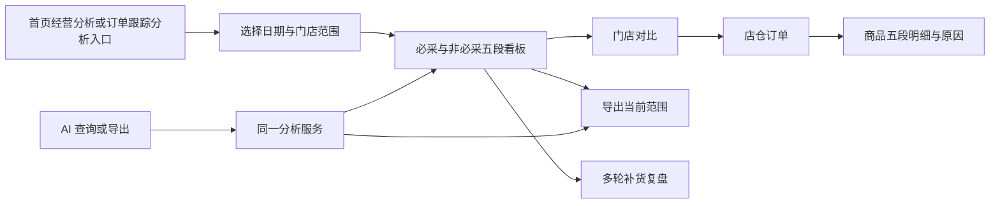
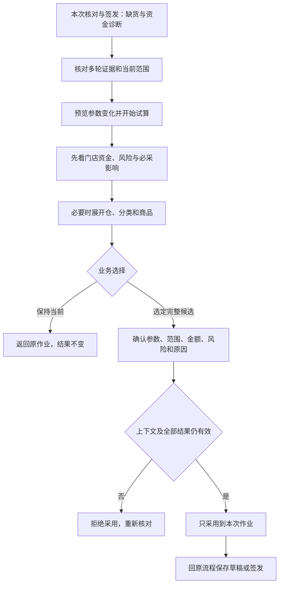
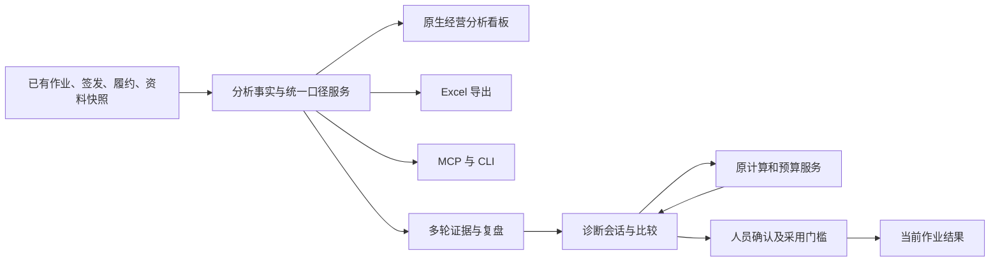

# 补货经营分析看板、多轮复盘与 AI 协作统一方案

日期：2026-11-05　状态：已授权开发，分阶段承接至0.39.0候选版。

实施范围、验证证据与已知边界见[0.39.0开发记录](../0.39.0经营分析开发记录.md)及[业务使用指南](../0.39.0业务使用指南.md)。下文保留原设计时的基线判断；“尚未实施”等原始描述不是当前交付状态，也不能代替本轮验收。

本方案统一此前五段订单漏斗、必采/非必采分组、排除范围、多轮补货复盘、安全库存与资金诊断、手动及 AI 导出的约定。本文为后续设计和开发的主文档；旧《AI安全库存与资金占用诊断完整方案》保留链接入口，不再分别维护两套口径。

代码核对基线：应用 0.38.1，分支 `feat/parameter-help-0.38.1`，提交 `efb85bf2c532daa5e1ffed9ca6e0ec323009b359`；模型 `0.3.4-rules`，需求归属 `0.5.1`。

本轮只整理方案。没有修改程序、默认参数、业务资料或订单，没有运行实际业务试算，也没有提交、推送、合并或打包。

## 1. 产品定位与建设顺序

### 1.1 三层能力，各自可以使用

| 层级 | 业务人员要解决的问题 | 使用方式 |
| --- | --- | --- |
| 基础经营分析 | 推荐了多少、签发多少、门店要多少、实际下多少、收多少，哪些环节减少或增加 | 原生看板、筛选、下钻、手动导出、常用报表 |
| 多轮效果复盘 | 这家店为什么连续几轮仍缺货，或者长期积压；问题发生在参数、决策还是履约 | 门店与商品时间线、证据核对、原因清单 |
| AI 辅助决策 | 用业务语言查询、生成报表、解释差异，并在明确范围内试算参数 | MCP/CLI 共用业务服务，业务确认后采用本次候选 |

**五段漏斗是一项独立的日常数据分析与看板能力。** 没有 AI、没有进入调参流程，也应能够完成查看、分析和高频导出。AI 是同一能力的另一入口，不能拥有另一套统计口径。

建设顺序：统一数据口径 → 日常看板与手动导出 → AI 查询/导出 → 多轮效果复盘 → 受限试算与确认采用。基础报表可以先独立交付，不必等 AI 调参全部完成。

### 1.2 已确认要求与设计默认分开

| 已确认要求 | 本稿落实方式 |
| --- | --- |
| 五段为模型建议、签发、门店确认、实际下单、实际收货 | 统一定义见第 3 节，不增加订单生命周期环节 |
| 去掉门店禁采、对应仓禁用、对应仓虚拟标签淘汰品 | 五段一起排除，不算作流失 |
| 必采品和非必采品分别看漏斗表现 | 两组默认并列；属性不明另列待核 |
| 既要正常分析、看板，也要经常导出和 AI 导出 | 三个入口共用统计、范围与导出服务 |
| 参考上一轮及连续多轮，控制缺货与资金 | 历史复盘先查执行事实，再提出参数疑点 |
| 先形成方案，不改代码 | 本轮仅更新文档 |

以下为可执行的设计默认，不是已经写入模型的规则：历史默认最近 8 轮、最多 90 天；试算默认最多两个候选、单次小档 2.5 个百分点、最大改动 5 个百分点；历史排除与必采身份按当时快照；试算采用仅用于本次作业。实施前应把这些默认一起审定，不要求业务逐 SKU 配置。

## 2. 当前具备什么，缺少什么

| 能力 | 当前代码核对结论 | 本项目补齐 |
| --- | --- | --- |
| 四段生命周期比较 | 已有签发→回传→付款→收货；订单级、门店级、分仓和差异商品导出 | 补模型建议与全量五段明细 |
| 历史决策依据 | 已有当时输入、有效参数、中间值、建议与签发快照 | 跨轮关联、可比性和原因分析 |
| 后续履约记录 | 已有独立回传、付款、实收、原件及上游依赖 | 用同一有效性判断进入看板和漏斗 |
| 必卖标记 | 计算结果有 `_must_sell`、清单版本和成员审计 | 按当时清单拆分完整五段表现 |
| 禁采和禁用 | 有门店准入/拒收、补货建议停采、对应仓禁用的执行判断 | 形成明确、统一的漏斗排除依据 |
| 虚拟标签淘汰品 | 未发现专门映射与排除；仓资料明确保留的是“商品标签” | 核实虚拟标签实际字段并映射，不能猜成同一列 |
| 日常五段看板 | 尚无完整实现 | 建设原生分析页面和可导出的统一结果 |
| AI 入口 | 已有参数说明、查询、试算、结果、采用；没有完整漏斗导出/多轮复盘接口 | 增加窄范围的查询与本地报表导出能力 |
| 专门的诊断比较 | 简易参数比较不满足全量记录、预算后覆盖及多轮归因要求 | 共用确定性指标与严格比较器 |
| 试算保留与采用 | 当前保留 3 个近期根批次；采用会拦截已有人工/新品安排 | 诊断会话保留、完整性门槛、确认及撤回 |

2026-11-05 已用隔离合成数据重跑现有 `test_lifecycle_comparison.py`，14 项通过，覆盖已确认零/未导入、签发价、双仓、跨页、导出类型与样式、取消和只读保护。这证明现有四段源码服务的适用行为，不代表新五段看板、AI 接口或 EXE 已通过验收。

复跑命令：`.venv\Scripts\python.exe -B -m unittest discover -s tests -p test_lifecycle_comparison.py -v`。

本轮没有逐单扫描用户业务库；有保存机制不代表每笔历史的后续单据、虚拟标签和真实收货时间都齐全。

## 3. 统一事实与统计口径

### 3.1 五段定义

| 页面名称 | 数据依据 | 不可混淆的边界 |
| --- | --- | --- |
| 模型建议 | 当时自动计算建议，含已启用的一箱例外，位于门店总预算和人工安排之前 | 展开可看例外前、预算前候选、预算后自动量；不从签发量倒推 |
| 签发 | 当轮最终有效签发中的执行数量 | 包含预算、准入、人工改量及新品安排后的结果 |
| 门店确认 | 对应店仓单、已确认且上游有效的回传数量 | 未导入不等于门店不要 |
| 实际下单 | 现有业务中已确认有效付款单的商品数量 | 注明平台付款明细或业务采用的聚水潭导入单来源；仅自动生成不能计入 |
| 实际收货 | 对应有效实收单的库存单位数量 | 实收数量不自动证明准时到货 |

“模型建议”显示说明“自动建议，含例外、门店预算前”。当前业务生命周期仍以签发为起点，付款仍是现有下单/付款环节；五段只增加分析视角。

没有签发的当前计算可预览模型建议，其余环节标未发生，并单列“未签发作业”。不创建假订单、不自动归档来补齐漏斗。

### 3.2 数据粒度、关联与版本

- 订单分析粒度：补货单号＋实际供货仓；商品分析粒度进一步加精确商品编码及一致库存单位。
- 跨轮商品主线：精确门店编码＋商品编码。换仓不切断经营历史，但每轮保留实际仓归属。
- 回传、付款、实收用已有订单内部绑定与单号关联，不按名称相似、文件名或时间接近猜单。
- 同日正常单重签只按有效单计一次；内部修订用于精确绑定，不要求业务额外维护版本号。
- 各段在同一读取快照内装配；被删除、替换、上游失效或单位不明的资料明确待核。
- 业务日期默认按签发业务日筛选；报表“数据截至时间”是另一个字段。不能把按付款日期或收货日期选出的不同订单混在一条漏斗里。
- 当时参数、清单、价格、准入和仓资料读取当时依据；当前资料不能悄悄回填历史。

### 3.3 先排除，再贯穿五段

候选全集来自该店仓计算记录和有效下游记录的商品并集。不能仅使用签发正数量行，否则模型有量、最后没有签发的商品会消失。之后在订单＋仓＋商品粒度统一排除：

| 排除项 | 依据 | 范围 |
| --- | --- | --- |
| 门店禁采 | 本店有效禁采/停采或拒收依据，保留不同来源 | 不影响其他店同商品 |
| 大仓禁用 | 本张单实际供货仓当时商品状态 | 山东禁用不排河北正常单，反之亦然 |
| 虚拟标签淘汰品 | 对应仓当时虚拟标签命中确认过的淘汰品标签值 | 不跨仓套标签 |

三项任一命中即从**五段全部数量、货值、款数、差额、保留率和漏斗明细**剔除。不在模型段留着、后面写 0 制造流失；也不计为少要、漏下单或模型多补。原有资质等业务准入限制继续保持，不能借分析放开原限制。

排除总数按订单商品去重，多原因可重叠。统计口径中列范围和数量，原记录仍可在归档复查，不新增回收站或维护列表。全单被排除时标“无纳入漏斗商品”，查询选中单数和有效纳入单数分开，不能当正常零单进入比率分母。

地采、无明确仓归属的记录不混入中心仓订单金额，单列范围说明。下游追加商品同样要核对排除依据，不能天然绕过过滤。

历史默认按当时快照排除，当前预览按本轮冻结依据。跨轮经营范围改变要显示，不把后来淘汰造成的样本减少解释成资金或缺货改善。如以后需要按“今天可经营范围”重筛历史，另立明确口径。

实施前核实虚拟标签实际列名、值和分隔方式。完整标签匹配及别名必须有依据，不能包含“淘汰”就把“待淘汰”“不淘汰”一起排掉。列存在但为空与从未留存字段分开；缺关键排除依据进入待核范围，不冒充已完成三项过滤的正式总计。

### 3.4 必采和非必采两组独立漏斗

本稿“必采”沿用系统现有必卖清单，不新增另一份清单，不代表必须突破预算或禁采。统一排除始终先于必采分组。

- 用每张单当时可核实的 `_must_sell` 与清单快照/完整成员审计分组，五段属性不变。
- 有明确完整清单且未命中才是非必采。未提供清单时程序也可能写 False，不能单凭 False 就认定非必采。
- 历史标记缺失或下游新增商品，只有完整的当时清单能据编码补判；否则标“必采属性待核”。不按等级、名称、销量或 AI 印象判断。
- 必采新品仍属必采；新品/动销是另一维度。
- 清单跨轮变化按各单当时身份展示，不能拿今天清单改写过去。

看板和导出默认并列两组，待核单列；支持只看某一组。订单级、门店级、门店分仓、多轮趋势和 AI 同口径。

### 3.5 缺失、零和可比集合

| 状态 | 处理 |
| --- | --- |
| 未导入、上游变化待核、旧记录不完整 | 未知/待核，不算 0，不进入相关有效对比 |
| 已确认完整单据里的 0、空白、缺行 | 沿用既有按 0 规则，并保留各自来源说明 |
| 无需后续环节 | 单独状态，不冒充已完成零值 |
| 缺价或无效数量 | 已知部分可展示，未知部分单列，不当零成本 |
| 合法单价 0、数量 0 | 作为真实 0 保留，不与缺失混同 |

页面同时显示“各段已知情况”和“可比样本”。相邻环节差额及比率必须使用同一有效订单商品集合。完整五段样本单列覆盖数，不能通过只看已经收完的单隐藏未完成订单。

## 4. 指标：金额、款数、差额和缺口

### 4.1 五段及必采分组指标

| 指标 | 业务定义 |
| --- | --- |
| 五段已计价货值 | 该段数量×该单签发时基本售价，仅统计范围内已知值 |
| 五段正数量商品款数 | 该段正数量 SKU 数；订单、门店、跨轮分别标明去重口径 |
| 相邻变化 | 增量、减量、净差货值与变化商品数，分别保留，不能净额抵消后称无变化 |
| 相邻保留率 | 在同一可比集合内，后段货值/前段货值；每个比率显示可比范围 |
| 全链路落实比例 | 模型和实收都可比时，实收货值/模型建议货值；不要求其他缺失环节被伪补 |
| 各段资金结构 | 必采、非必采及属性待核货值占比 |
| 数据覆盖 | 查询订单数、纳入订单数、各段有效订单数、可比订单数、待核及缺价范围 |

前段为 0 不计算百分比；后段大于 0 显示新增，两段均为 0 显示“无数量”。后段可以大于前段，保留率可超过 100%。新品、人工和后续追加可能放大漏斗，图形不能强行画成只会递减。

不同商品的瓶、包、箱不能相加成一个业务总件数。商品级看数量，订单/门店总览优先看货值和款数。

同一环节应能对账：必采＋非必采＋属性待核＝总体已知货值。跨轮同 SKU 身份变化时，两组去重款数可能重叠，不能直接相加当总体去重数；需区分 SKU 数与订单商品条目数。

### 4.2 价格与实际付款

五段统一签发价，实际付款金额独立列。基本售价计价属于计划货值，不等于采购成本、利润或财务现金周转。

过滤后主表的“纳入商品付款金额”只能加总有明确行金额的纳入商品。原单全部商品付款总额保留在独立表并注明范围，不能改名成过滤后的原单金额。只有整单金额、没有可拆分明细时不按比例猜分；多币种不混加，无币种保持未标。

跨轮比较默认沿用各单签发价，并披露价格变化。需要剥离价格因素时另列固定参照价视角，标参考日期，缺价不回填。

### 4.3 原因与统计边界

展开模型建议至签发可查看预算压减、人工调整、新品/计划补足及一箱例外。被统一排除的商品不计入这段流失。后续按回传、付款、实收留存事实解释，原因缺失只报差额，不补写主观原因。

漏斗回答“量在哪变了”，不直接回答“为什么缺货”。实收较少、门店少要与缺货的联系需要第 7 节多轮证据。

## 5. 日常经营分析看板

### 5.1 独立入口与业务路径

建议在原“订单跟踪”中明确分为“流程处理”和“经营分析”两个固定入口：首页增加“经营分析”快捷入口，决策复查提供带单号/门店的跳转。页面复用原桌面风格，不新建网站或独立业务数据库。

- 流程处理：回传、下单/付款、实收等业务动作。
- 经营分析：五段漏斗、必采表现、门店对比、历史趋势和导出。

经营分析可独立打开，不依赖当前有计算任务、不要求启用 AI、不进入参数试算。后续多轮复盘在该区域下钻，参数试算仍回到本次可编辑工作台。



### 5.2 首屏组织

从上到下只安排五块，默认停在门店/订单尺度，不让人员先面对大量 SKU：

1. **范围栏**：业务日期、门店/路线、仓；展开后再选必采属性、环节进度、分类和搜索。显示当前已应用条件。
2. **覆盖提示**：选中订单、纳入订单、五段资料齐全订单、待核范围与数据截至时间。说明日期是签发业务日。
3. **两组五段对比**：必采、非必采并列，展示各段货值、款数、有效覆盖；待核单独提示。采用可增可减的五列图/表，不能用固定收窄图隐藏新增。
4. **问题摘要**：哪个环节减量最多、哪家店必采落实偏低、哪些单缺资料。这里只给有依据的变化提示，不自动作归因。
5. **门店对比表**：货值、保留率、变化商品数和覆盖情况，点击进入分仓订单，再进入商品。

金额和保留率都能点开查看组成。不可比时显示原因，不显示看似精确的 0%。两组数据采用同一筛选范围，分母不同必须分别标明，不通过颜色直接暗示业务好坏。

### 5.3 筛选、下钻与刷新

- 默认查询今天；支持近 7 天、近 30 天、自定义及保存的常用视图。默认天数为界面建议，不改变订单统计口径。
- 路线/预案用于确定查询门店，不把其当前参数写入历史。每次报告冻结本次解析出的精确门店集合。
- 选择日期等条件后点击“查询”；未应用条件标记“尚未查询”，导出基于最后成功查询的范围，不能用屏幕新条件配旧数据。
- 由图或门店下钻自动继承日期、仓、必采属性和其他范围；返回保留上级筛选与滚动位置。用可见面包屑说明当前位置。
- 默认包含未完成订单并显示已知进度，不能默认只统计完整五段单。
- 同页支持“只看变化/全部明细”；变化的业务方向、资料状态、仓、必采属性分开筛选。
- 页面展示“数据截至”。相关业务数据更新后显示“有更新，刷新查看”；不在人员核对或导出时静默替换其快照。
- 查询在后台执行，旧请求晚返回不得覆盖较新的查询；取消保留原已知页面并注明未刷新。

### 5.4 高频操作减少步骤

查询完成后常用导出可直接使用已配置目录，不反复填写字段或找保存位置。范围明确时直接开始后台导出；没有有效查询则先指出需查询。

“导出当前范围”“导出勾选订单”“保存常用视图”分开命名，不让一个按钮随着勾选状态变成另一种操作。返回、刷新、取消采用原有轻操作样式及通用符号，与主动作区别。

常用视图只保存筛选和展示设置；导出方案只保存范围规则、报表样式和位置，不修改订单或参数。滚动日期与固定日期必须明确，不能跨天仍悄悄导昨天。

## 6. 高频导出与 AI 查询导出

### 6.1 三类日常报表

| 报表 | 默认内容 |
| --- | --- |
| 门店经营对比 | 门店汇总、门店分仓、订单漏斗、全量商品五段、差异与原因、付款来源、统计口径 |
| 订单漏斗明细 | 店仓单及必采属性分组、全量商品五段、差异与原因、付款来源、统计口径 |
| 当前明细 | 当前有效筛选的商品五段记录、状态、属性与依据；明确包含范围 |

默认同时输出必采和非必采，待核单列。全量指通过排除的分析全集，包括无差异商品；不能只输出差异行后称全量。

表头统一中文业务名称，金额与数量保持数值类型，编码和单号保持文本；包含必要来源引用、筛选、数据截至与规则版本。技术细节放“统计口径/依据”，不把长路径和 JSON 塞进业务主表。

订单报表一文件可多单；门店报表可多店并保留分仓。默认文件名包含报表名、日期范围和生成时间，避免覆盖以往分析快照。现有签发单同名覆盖规则、原四段报表及生命周期模板保持原行为；新报表另立格式契约。

### 6.2 同一查询结果生成看板与文件

一次查询形成范围快照标识，绑定精确订单集合、签发和生命周期依据、过滤/清单规则及统计版本。看板、明细分页和导出均使用该依据。

全筛选导出必须跨全部页，不能只出当前页。同数量但订单集合已换也视为范围变化。导出前复核数据是否变化；有变化则提示刷新或明确选择已固定的报告快照，不静默换数。已删除记录不能借缓存重新导出。

任务有进度、停止、结果路径与校验值。写到临时文件，成功后发布；失败或取消不留下冒充完整报表的半成品。重复打开和再次导出是正常行为，不设置只准导出一次。

### 6.3 AI 共用能力

拟增加窄接口，名字可按项目规范落地：

- `query_order_funnel`：按日期、精确门店/订单、仓、必采属性和层级读取指标、覆盖及明细分页。
- `export_order_funnel`：绑定查询快照与报表类型，写入软件已配置或明确指定的本地目录。
- 后续 `store_history_review`：读取同门店多轮证据和待核范围。

AI 先核对工作台与范围，不猜门店编码。结果由软件聚合，AI 负责解释，不用模型自行逐行求和或重建 Excel。输出文件应与人工同范围导出的单元格值、类型、工作表和顺序一致。

查询权限只读；导出仅写本地报告文件，不授权保存草稿、签发、确认付款、采购、删除、上传或发送。已明确要求生成报告且范围/位置清楚时，不要求人员再次逐店批准。

异步任务先返回受理，再查 `task_status` 与 after 游标；新请求用新 operation_key，状态不明查原任务，不重复新建。每页不超过 100，读完按游标；未读完标范围。连接不可用或上下文失效时停在受影响步骤，不以终端、SQL 或源码绕过对外接口。

内置常用提示词示例：

> 导出今天青岛线订单漏斗，按当时清单分别看必采和非必采，剔除门店禁采、对应仓禁用及虚拟标签淘汰品。按门店汇总并附分仓、逐单和全量商品五段明细。统一签发价，实际付款另列，未导入不当 0。保存到软件已配置的导出目录，说明哪里减量最多、缺哪些资料，不修改订单。

### 6.4 自动更新与自动写文件分开

基础能力每次查询/导出读取最新有效记录，签发后就可看，后续资料到达后再刷新，不需要重算模型。

首期交付手动一键导出和 AI 按指令导出。每次签发或履约导入后自动落 Excel、定时日报，是另一个可选触发器，不默认开启。若以后启用，必须有真实任务、范围、目录和开关；业务事务提交后后台执行，连续更新合并，失败不回滚订单、不阻塞工作流。

## 7. 多轮补货效果复盘

### 7.1 范围与关联

上一轮解释最近一次链路，多轮判断持续性，本轮验证调整影响。默认最近 8 个有效签发轮次、最多 90 天，可调整；实际只有 3 轮就报告 3 轮。

以同店不同业务日的正常签发为主要轮次，两仓不算两轮，重复导出及同日修订不增加轮数。未签发草稿只作为观察点，不能当已补货。显示找到、可比、履约齐全、尚未成熟的轮数。

同商品跨仓补货数量按有效单据分别统计，但相同门店库存观察不能因两仓订单引用而加两次。重叠的多笔在途都要列出来，不能把当前缺货强行归给最近一单。来源编码或单位变化、已删除或失效单据进入不可比范围，不恢复旧数据。

### 7.2 保存依据与未知项

按需读取当时销量库存、缺货原值/有效值、参数、模型与清单版本、仓周期、商品资料、原自动量、预算和人工变化、五段履约及后续库存观察。

原件/快照缺失就说明缺项，不用当前资料回填。旧业务记录可以立即用于复盘，不必等完整日流水；但依赖日流水的结论不能提前给出。

采集时间、数据所属时间、业务日、导入时间、付款时间和真实收货时间分别保留。当前翱象实收可能没有真实完成时间，导入或观察时间不能代替到货时间。

### 7.3 先区分“缺货”与“需要补”

| 观察 | 表达 |
| --- | --- |
| 有销售依据且可用不大于 0 | 有销无现货观察点 |
| 有货但预测撑不到到货 | 预计到货前存在缺口 |
| 模型建议补货 | 存在补货需求，不等于已经缺货 |
| 来源有缺货记录 | 源数据报告缺货，保留统计窗口与冲突修正 |

两个观察点都无现货，只能说重复无现货，不能说期间一直缺货。滚动月销不相减成期间销量、不跨轮相加；窗口重叠的缺货天数不累加成真实累计缺货天数。

尚未到当时预计到货日的新单，不因下轮快照无货判为补货失败。在途减少不直接当收货；实收齐全但时间不明，只能证明数量到位，不能证明及时。

### 7.4 原因分层与建议动作

| 连续记录中的证据 | 可以确认或提出的判断 | 优先动作 |
| --- | --- | --- |
| 需求有量，预算执行被压减 | 预算削减事实 | 核对预算和优先级，不先加安全库存 |
| 自动安排被人工降低 | 人工减量事实 | 看当时经营原因 |
| 签发高于有效回传 | 门店确认减量 | 核对门店原因，不猜嫌贵或陈列不足 |
| 回传高于付款/已记录仓分配 | 下单差异；有审计时可确认仓库存限制 | 检查供给和下单处理 |
| 付款高于有效实收 | 实收不足 | 核对供货、配送及收货 |
| 按量按时收到、没有减量，多轮仍无现货 | 需求或参数偏低的疑点 | 继续核对预测、周期和余量 |
| 明确期间销量持续超过当时预测，且有可售证据 | 预测偏低证据 | 另查趋势权重与有效有货天数 |
| 预测无明显偏差，但需求/到货波动超出余量 | 安全余量可能不足 | 试算适度上调概率 |
| 实际补货间隔/到货周期持续长于配置 | 周期不匹配证据 | 指向周期维护，当前安全场景不暗改 |
| 活动或陈列变化有记录 | 经营条件变动 | 区分临时铺货与长期参数 |
| 缺时间、实收、明确销量或存在库存调整 | 证据不足 | 列待补依据，不定性模型错误 |

一品可有多因素，按直接证据展示“已确认事实、参数相关疑点、尚缺依据”，不编造归因概率。即使签发和实收相等，仍需核对时间和需求；回传减少也不意味着全额确认就一定不缺货。

### 7.5 多轮指标与展示

展示重复无现货次数/可比观察次数、已知履约减量、持续高覆盖、参数稳定性；有真实期间销售与可售信息才报预测误差，有真实到货时间才报到货偏差。快照无现货比例不是时间缺货率。

库存余额是存量，不跨轮相加为资金投入。各轮有效订单货值可累加为累计计划货值，不能冒充平均库存资金。

页面先给“反复缺货、持续高覆盖、履约偏差、资料待核”，标签可交叉则不把数量相加。点击门店→商品，一行一轮展示：当时销量/库存/在途、参数、自动量、签发、回传、付款、实收和后续观察。每条建议能回到原订单证据。

### 7.6 不把静态重放当经营回测

历史快照重放只能说明“当时输入下候选会建议多少”，前提是算法与参数可复现。各轮后续库存仍是原策略造成的，不能独立重算后相加声称少缺多少天或长期省多少钱。

完整库存轨迹回测需时间对应的销售、实收、其他出入库与可售状态；按“期初可用＋实收＋其他入库－销售－其他出库＝期末可用”核对，残差待核，不倒推编造销量。较早轮次形成假设、较近成熟轮次核验，不用未来数据解释当时决策，不用缺货受限销量直接代表真实需求。

## 8. 本轮安全库存与资金联合试算

### 8.1 范围与进入条件

首次试算只允许所选“门店＋分类组”的库存目标分位概率上调或下调，其他参数固定。全部参数、依赖与不变规则见附录 A、B。

同店两仓共用分类参数，只分仓维护周期。调整快销会影响无分类及两仓相关商品；必须整店重算预算，列出其他分类被资金重新分配波及的商品。不能只算当前筛选 SKU，不能把单仓查看理解为单仓调参。

当前资料只登记未检查、存在冲突、结果失效或目标范围关键字段待核时，停止对应步骤。已有人工改量、清单补足、新品选择的门店，首期只诊断自动部分，不直接覆盖最终安排，也不把安排丢失当节省。

基线固定当前已检查输入、源行与顺序、仓资料、路由、价格箱规、准入、必采及关注清单、预算、全部有效参数、映射、策略开关和模型版本。资料新旧由业务判断，哈希用于同源检查，不推断库存过期。

能证明一致则复用原自动结果；否则隔离重算基线。重算与应一致的当前结果不同就停止推荐并解释差异，不挑有利的基线。历史只读订单不能直接采用参数。

### 8.2 资金归因与固定参考指标

按已有链路解释销量预测、保护期需求、安全余量、净需求、整箱、额度、恢复、一箱例外、排除、预算和最终执行。用已有中间值，不复制模型。

同时比较计算建议金额、预算前可执行需求、最终执行金额，以及增量/减量商品货值、必采金额、未计价和预算余额/超支。预算前需求下降但总预算仍花完，只能叫需求减少或资金转移。

安全余量×基本售价是理论余量货值，不等于可节省金额；箱规、已有库存、在途和最低持有可能使执行不变。存量过高不靠今天少下单立即回收。

固定基线参考日均 `r=AN×AM`，候选不得通过改变分母美化覆盖。首期预测不调，需验证候选 r 与基线相同。令 T 为商品实际仓的备货＋到货天数，Q 为预算后执行数量：

```text
K⁺ = max(原可用库存, 0)；L⁺ = max(原在途, 0)
现有可用覆盖       = K⁺ / r
现有库存位置覆盖   = (K⁺ + L⁺) / r
执行后库存位置覆盖 = (K⁺ + L⁺ + Q) / r
保护期需求缺口     = max(r × T - K⁺ - L⁺ - Q, 0)
理论安全余量天数   = 安全余量数量 / r
```

原负库存仍展示并标异常；上式是诊断口径，不修改模型输入。r≤0 或字段无效则不计算，不能填 0 天或无穷大。总库存位置含在途及计划到货，不等于货架现货。执行后位置货值与本次执行货值分开，不相加。

覆盖分布按箱规大于 1、单件、箱规待核拆开；展示相对 T 的 `≤T、T～T+2、T+2～T+4、>T+4` 和固定长尾 `>21、>30、>60天`。后三档互相包含，不能相加。分档是诊断，不新增模型限制；原额度日均 BH/BN 与预测日均不同，不把预测超过 21 天一律报违规。

到货前风险看现有可用是否撑到到货，本次正常到货的 Q 不能解决其到货前缺口。在途无预计到店时间时给现货/现货加在途两个数量覆盖边界，及时性未知。原在途保底被拦截的提示保留，不自动补回来。

另保留以基线需求为参照的削减明细，不能只看候选自身目标降低后变小的缺口。

### 8.3 候选、筛选与取舍

一轮为当前基线＋最多两个完整候选。建议小档 2.5 个百分点、最大绝对改动 5 个百分点，合法范围 0.50～0.99；实际 95% 可对照 92.5% 与 97.5%，或经确认同向两档。从实际值出发，触界去重并显示实际步长，不默认恢复 95%。这些是试算建议，非模型默认。

历史证据决定方向：持续高覆盖可考虑下调；执行充分而余量不足的疑点可上调；少回传、缺供或迟到优先处理对应环节。预测/周期疑点可以指出，但不混入本场景改动。分类内缺货与积压冲突时可维持参数，不能偷偷按 SKU 建另一套概率。

推荐顺序：

1. 硬校验通过：资料一致、记录完整、原业务规则通过、固定参数不变、无新增计算异常。
2. 默认不推荐新增或加重逐商品保护期和最低持有缺口；必采及被挤占商品突出，不能只看总体风险数。
3. 再比较本店问题改善、必要投入、长尾与改动幅度。没有合适方案就维持当前；不设不透明的最优总分。

关键数据不足、部分完成、上下文过期或规则失败不能靠确认绕过。满足硬规则但不符合软推荐的候选，须明确展示风险、按店核对并记录原因。金额变少不等于真实不断货改善，金额变多也必须说明具体增加了哪些执行保障。

### 8.4 操作流程与采用



默认不选最低金额，确认默认取消。采用绑定确切候选、完整所选门店及原上下文，再核验资料、准入、预算、清单和人工/新品状态。新字段设置的真实生效值在试算预览中验证，分类覆盖通用的关系要显示，不能改了未生效字段仍声称完成。

首期整体采用一个候选，不从多个试算拼接商品。若不同店选不同方案，可分别对互不重叠门店开新会话；需要自动组合时必须生成新完整候选重新确认。

采用范围内一致更新配置和结果，失败恢复采用前状态，不留半采用。结果只在当前作业，尚未保存或签发；永久门店默认、预案和系统标准不自动更新。

采用后未再编辑、计算或签发时，可“撤回本次采用”恢复原结果；有后续变化则先复核，不能覆盖后续人工工作。部分完成、缓存被清理的摘要不能采用；状态不明查原任务与采用标记，不重复提交。

保存或签发时带上实际参数及诊断依据：原/新值、来源、资料和模型引用、基线/候选签名、风险摘要、确认原因、实际可识别操作者与时间、采用/撤回结果。历史缺字段不回写，不编审核人。新审计不随意扩大业务指纹忽略范围。

## 9. 架构、数据契约与权限

### 9.1 一套服务，多入口复用



建议少量职责明确的模块：

| 服务职责 | 建议模块 | 复用边界 |
| --- | --- | --- |
| 五段事实、排除、必采分组与汇总 | `order_analytics.py` | 复用生命周期有效性与历史读取，不复制规则 |
| 分析看板与导出 | `order_analytics_ui.py`、`order_analytics_exports.py` | 共用同一查询快照与基础写表工具 |
| 多轮关联与证据 | `history_diagnostics.py` | 按需读现有存储，不反向拼接导出文件 |
| 试算会话与比较 | `stock_diagnosis.py`、`stock_diagnosis_metrics.py` | 原门店计算与预算；纯指标模块不依赖 Qt |
| 诊断页面 | `stock_diagnosis_ui.py` | 三步交互和确认，不另建模型 |
| AI/CLI 适配 | 现有 automation 模块的薄扩展 | 查询、导出与采用分别控制权限 |

命名可按实际代码整理，不引入重型框架或一函数一文件。模型、一箱例外和预算业务实现不变，模型规则版本不因分析功能升级。

### 9.2 最小契约

| 对象 | 必需内容 |
| --- | --- |
| 分析查询 | 日期口径、精确门店/订单、仓、必采属性、条件、报表与规则版本 |
| 分析快照 | 精确订单集合、签发/履约/清单/过滤依据、数据截至、状态及不可比范围 |
| 商品五段事实 | 稳定身份、五段数值及有效性、签发价、属性与来源、排除判断、源行、原顺序 |
| 聚合结果 | 各组与阶段总值、可比分母、未知计数、增减与净差、明细游标 |
| 导出回执 | 任务与操作标识、查询快照、完整范围、文件路径/哈希、结果状态 |
| 多轮证据 | 轮次、观察时间依据、单据绑定、参数/版本变化、事实/疑点/缺项 |
| 试算与采用 | 基线、完整参数变化、候选结果、逐商品比较、确认与采用前后签名 |

数据契约保留原字典、数值类型与字段，不隐式把空白转成 0。归档、SQLite、JSON 和旧作业读兼容；新增审计优先用现有可选元数据。若确需存储版本升级，单独验收，不为看板迁移全部历史。

### 9.3 权限与数据生命周期

看板、复盘只读业务事实；本地导出只写报告；试算不改正式结果；采用需明确确认；永久默认、签发和采购仍通过现有独立流程。

已有 `workbench_context`、`find_resources`、`parameter_definitions`、`effective_parameters`、试算与结果工具继续复用。`STALE_CONTEXT/NEEDS_REVIEW/BUSY/UI_WAITING` 或资料异常要说明原因并停止受影响步骤，不自动换参数或绕过接口。

派生缓存可重建，绑定签名并在更正/删除后失效；彻底删除的数据不能从索引、缓存或新导出中恢复。人员已导出的本地文件保持当时报告快照，不偷偷改写。

## 10. 性能、进度与失败恢复

- 看板先查范围和汇总，明细分页，商品资料原表按需展开；不为每 SKU 读取全仓或全历史。
- 共享门店签发快照在两仓之间复用，避免重复解码；批量读，缓存键覆盖订单、履约、清单、排除及报表版本。
- 看板、导出和 AI 共用一次事实投影；图形切换与排序不重新计算模型。视图排序不改变业务计算和源记录顺序。
- 冷索引后台构建，给处理订单数/总数、阶段、心跳与取消；未完成明确标范围，不把部分结果当全量。
- 数据更新只失效相关范围，聚合重算在后台；长时间读取与导出不持有业务写锁，避免阻塞保存、删除和签发。
- 报表任务有界调度，不因每次单据变更启动一堆导出；输出失败可重试，业务事实不受影响。
- 历史复盘默认读取已有结果，不重算所有轮次。历史重放另预览范围与版本可复现性，不挤掉当前试算结果。
- 本轮基线最多一次，每候选每店完整计算一次；候选串行，门店内部沿用现有并发，不乘出过多进程。
- 当前 3 根批次缓存需增加诊断会话保留权；基线加两个候选有界保留，其他任务不能静默淘汰待确认结果。
- 停止后不启动后续任务，正在计算门店按既有安全策略结束；界面说明仍在结束什么。部分结果可看但不能整体采用。
- 查询、读取、比较、写表与压缩各阶段真实报告进度；无法估算时显示对象与心跳，不伪造 99%。返回/取消/重试可用，旧任务不能更新新页面。

性能验收同机同环境、串行交替测至少 3 次，保留原始耗时、最小/中位/最大与总峰值内存。分别测冷启动、缓存命中、筛选、下钻、导出、历史复盘、试算和采用；不只报计算函数内部时间，不预承诺固定秒数。

## 11. 开发阶段、依赖与交付

| 阶段 | 交付范围 | 通过条件 |
| --- | --- | --- |
| 0：字段与口径冻结 | 虚拟标签样例、必采历史依据、五段字段与范围、历史兼容清单 | 实际字段可识别，不猜缺项；建立固定 QA 输入 |
| 1：经营分析基础 | 统一五段服务、排除、必采分组、原生看板、手动高频导出 | 不启用 AI 也可完整查询、下钻和导出；同范围金额可对账 |
| 2：AI 查询与导出 | MCP/CLI 薄入口、业务提示词、异步状态 | 与人工完全同口径；只生成本地报告，原数据不变 |
| 3：多轮复盘 | 轮次与观察关联、成熟度、证据分类、商品时间线 | 不重复计仓/轮次，不把少要或未到货误归模型 |
| 4：试算与采用 | 小范围候选、严格比较、风险确认、一致采用、撤回及审计 | 原算法不变，参数实际生效，失败不半采用，历史可追溯 |

每阶段独立验证与提交后进入下一阶段；阶段 1 可作为正常业务分析独立交付。阶段 4 依赖已可信的数据事实和复盘，不先靠 AI 文本补齐数据基础。

实现时保护已有修改，独立分支、干净提交构建新目录、保留旧版。提交/打包需另获开发授权，本轮不执行；推送、合并和发布不随本方案默认授权。

## 12. 验收与完成条件

### 12.1 必测矩阵

| 范围 | 必测内容 |
| --- | --- |
| 五段全集 | 模型有量签发 0、无差异商品、后续新增、整单无纳入商品、未签发预览 |
| 统一排除 | 三项单独/重复命中、分店分仓差异、历史与当前不同、空标签/缺字段、多标签及淘汰近义值 |
| 必采分组 | 必采新品、无清单但 False、追加商品、旧标记缺失、跨轮换组、金额对账与款数不误加 |
| 零与缺失 | 未导入、完整单空白/缺行按 0、旧回传不全、无需环节、上游失效、缺价和合法 0 价 |
| 可比性 | 各段不同有效样本、0 分母、比例超过 100%、增加/减少抵消、跨仓和跨页范围 |
| 付款与导出 | 签发价统一、原单总额与过滤金额分开、多币种、缺平台号、原导出字段及行为保持 |
| 看板 | 无 AI 可用、筛选未应用、旧响应晚返回、下钻返回、冷启动进度、全部筛选导出与跨页勾选 |
| 数据更新 | 订单集合相同数量但换单、生命周期更正、删除、缓存失效、旧报告截至与当前区分 |
| 多轮 | 同日重签、两仓一轮、换仓改名、单位变化、观察未成熟、多单在途、无真实到货时间、滚动窗口不累加 |
| 归因 | 预算压减、人工、少回传、仓少分、实收不足、参数疑点输出不同；不把相关性当确定因果 |
| 参数与预算 | 双仓不同周期、分类覆盖通用、无分类跟快销、0/不限/紧张预算、有限超支、必采资金挤占 |
| 原规则 | 单件/箱规/缺箱规、双零持有、已有在途限制、一箱例外、正常缺货和 N>30 且 J>0 修正 |
| 试算保护 | 有人工/新品不覆盖、失效拒绝、部分完成不可采用、同参无变化、无合格候选、异常与缺预测 |
| 采用 | 原子更新、失败恢复、状态未知查询、重复确认、撤回限制、草稿保存恢复、旧历史缺字段 |
| AI/CLI | 人工同范围单元格/类型/顺序一致，分页读全，任务取消重试，无额外业务写入 |

### 12.2 等价验证方法

使用修改前固定源码、输入、配置、必采清单及仓快照，独立 QA 库，不写用户资料和旧包。原业务不变的场景逐商品比较值、类型、输入、中间值、执行、金额、状态、原因与审计。

按门店＋商品检查完整性和唯一性，同时检查仓归属及原顺序。不能只 zip 或只比总额，也不能先排序掩盖顺序差异。

零参数变化候选应完全一致。概率变化候选仅允许目标参数及原算法下游结果变化，销量预测、周期、路由、价格箱规和其他固定配置不变。新增报告的过滤和统计差异按新口径说明，不倒过来修改原业务结果。

允许排除的运行动态字段仅预列 `result.created`、`result.task.pid`、`result.task.started`、`result.task.finished`；会话/任务标识属比较外围信息。资料、参数来源和审计不能整块忽略，不放宽容差或改旧预期迎合实现。

Excel 比较工作表、列顺序、单元格值/类型及约定样式；报告动态时间不要求逐字节相同，文件哈希仍用于交付和完整性记录。

### 12.3 实际交付验证

源码通过后，从干净提交打包独立 EXE，验证资源、Windows spawn、看板查询筛选、手动导出、取消/重试、AI 真实客户端查询导出、复盘及采用链路。实际 EXE 验证不能由源码测试替代。

交付注明分支、提交、构建、EXE 哈希、目录、可复跑命令、差异与性能报告及未完成项。只有各阶段必需验收完成才宣布该阶段完成，现有 14 项旧测试不作为新功能验收。

## 13. 总体边界与实施前需核实的事项

本次完整建设范围包括正常看板、手动与 AI 按需导出、多轮证据复盘、概率受限试算与人员采用，按第 11 节分阶段交付。第一阶段先完成经营分析基础，不等待 AI 或调参。不包含自动学习、自动改永久默认、自动签发/采购、事件触发 Excel 或定时日报、全面销量预测重构。

真正需要核实的是：虚拟标签在实际资料中的列名与值；旧快照对该字段及必采清单的保留程度；实际下单来源的有效确认标记；真实收货时间可用范围。这些能通过样例及代码核查解决的，开发先核查；不能证明时准确标待核，不替业务猜。

本方案建议默认使用当时依据筛历史、近 8 轮/90 天、小档 2.5 和最大 5 个百分点，只作用本次作业。参数边界及全部不变规则见附录，业务未确认或资料未满足时不写入生产默认。

文档整理保留这些事实边界：已有四段服务与 14 项隔离测试；五段看板、分组漏斗、AI 导出、多轮诊断和新增采用保护仍待开发；用户历史数据是否逐笔完整尚未普查。


## 附录 A：全部参数与本轮调参范围

下表为全部当前参数组的处理方式。默认以实际生效值为起点，不假定每家店都为 95%，也不自动恢复系统默认。

| 参数或配置 | 对结果的主要影响 | 本场景处理 |
| --- | --- | --- |
| 库存目标分位概率 `probability` | 影响库存分位目标、安全余量及后续整箱、额度和执行结果 | 首期唯一可试调项；按门店分类有效值调整 |
| 备货深度 `depth`、到货时间 `lead`、分仓周期 | 决定保护期，部分规则和紧急程度也依赖周期 | 按当前实际生效仓周期固定；不能为省钱缩短真实物流周期 |
| 普通库存额度天数 `cap_days` | 通过额度日均限制常规补货，0 为关闭；不等于预测覆盖天数硬上限 | 固定；可解释它为何拦截或未拦截 |
| 趋势敏感度 `alpha` | 改变对近期增减趋势的响应 | 固定；以后另做预测效果诊断 |
| 最近 7 天权重 `w1`、此前 7 天权重 `w2` | 改变预测日均和分段销售贡献 | 固定；`w3=1-w1-w2` 仍自动推导 |
| 单段样本预测倍数 `single_sample_multiple` | 影响仅有早期销售样本时的预测和部分额度 | 固定 |
| 严格约束月销上界 `strict_monthly`、完全退出约束月销 `exit_monthly` | 控制低销量单品资金约束的释放 | 固定，保留两者大小关系 |
| 销量侧额外金额 `monthly_extra_money`、弱证据额外金额 `weak_extra_money` | 影响单品资金上限，不等于门店预算或每品追加金额 | 固定 |
| 单段额度参考天数 `historical_reference_days` | 影响单段额度日均 | 固定，不随仓周期自动修改 |
| 增长额度确认天数 `growth_reference_days` | 影响增长证据被额度接受的速度 | 固定 |
| 最低覆盖判断量 `minimum_reference_units` | 影响部分恢复触发判断，不是补货目标数量 | 固定 |
| 常规资格周转阈值 `moq_days`、低月销基本售价门槛 `moq_price` | 影响是否有常规补货资格 | 固定，不通过改变资格制造省钱 |
| 极端缺货边界 `extreme_days` | 当前固定为 30 天，模型还有对应固定窗口 | 只读，不作为可试调数值 |
| 极端缺货恢复、新品铺设、一箱例外开关 | 决定已有策略是否启用 | 沿用当前状态，AI 不开关它们 |
| 全局分类映射 | 决定商品使用哪个分类组；所有门店共用 | 固定；不将映射错误当作调参问题修正 |
| 主从仓、价格、箱规、门店预算、必卖清单 | 影响归属、计价、取整、资金竞争顺序 | 全部固定 |
| 资质、黑名单、禁用、停采 | 决定商品是否允许执行 | 全部固定，继续按原优先级过滤 |

分类概率优先于通用概率。改变通用值不一定影响已有分类覆盖。候选应明确修改最终生效的分类值；需要建立分类覆盖时，预览注明“原来沿用通用值，本次新增分类覆盖”，不可改通用值后误报已经生效。

## 附录 B：必须保持的业务规则

- 销量、库存、在途和补货数量仍使用库存单位；金额按基本售价。
- 缺失箱规补 1、无分类跟随快销、精确编码匹配和主从仓归属不变。
- 仓库存用于需求归属，诊断不截断模型需求、不拆单、不预占库存。
- 有销量双零的模型最低持有、一箱例外、已有在途追加保底的限制均不改。
- 必卖优先、同级决胜顺序、现有“最多追加一个最小出库单位且超支不超过 5%”规则不改；0 元预算仍按现行规则执行。
- 预算不足导致最低持有暂缓的既有行为不变，不宣称执行层绝对保证每品持有。
- 保留原始缺货天数；仅按现行规则处理“缺货天数超过 30 且月销大于 0”的冲突，不取消正常缺货拉回。
- 不引入 8.5 天目标、固定安全余量 2/3/4 天、统一模型内各种日均等历史试验方案。

## 附录 C：现有代码查找索引

以下为本轮只读核对位置，均相对项目根目录。函数名比行号更适合后续查找。

| 文件 / 入口 | 用途 |
| --- | --- |
| `src/version.json` | 应用、模型、参数和存储版本 |
| `src/parameter_schema.py`：`HELP/WEIGHT_HELP/validate/profile_values` | 全部参数、合法范围、分类覆盖及同店两仓共用关系 |
| `src/parameter_guidance.py`：`describe/definitions` | 中文解释、参数范围及 AI 可改标记 |
| `src/automation_queries.py`：`parameter_result` | 当前/默认/试算参数与来源口径；方案名不是每字段完整编辑轨迹 |
| `src/model.py`：安全库存及 AQ→BJ→BK→AR、恢复与 AS 链 | 保护期需求、概率、安全余量、取整和原模型规则 |
| `src/one_box_exception.py` | 原一箱例外，不复制算法 |
| `src/allocation.py` | 原门店预算、必卖优先和有限超支 |
| `src/batch_service.py`：`calculate_store/run` | 路由、参数装配、准入、完整门店计算和有限并发 |
| `src/engine.py`：`run_calculation/apply_budget` | 分类规则生效、原建议与例外、预算前候选和执行 |
| `src/result_semantics.py`：`order_quantity/order_amount/coverage/summarize/inbound_risk` | 结果展示口径及现有在途风险；旧 coverage 用 AS，不能冒充预算后执行覆盖 |
| `src/parameter_trial.py`：`metrics/compare` | 现有简易比较基础及其适用限制 |
| `src/automation_protocol.py` | 开放工具范围与参数契约 |
| `src/automation_jobs.py`：准备逻辑、`parameters/explain_row/calculate` | 冻结参数、配置变更、业务字段解释和计算调用 |
| `src/automation_gateway.py`：`begin_calculation/check_adoption/adopt_trial/apply_result` | 3 根任务缓存、人工/新品拦截、上下文检查及本次作业采用 |
| `src/automation_playbooks.py` | 当前业务提示词；已有对比不等于本诊断场景 |
| `src/normal_orders.py`：`Repository.get/headers/confirm` | 原决策及签发快照、参数和技术绑定 |
| `src/work_repository.py`：`list_jobs/get_job`；`src/history_forms.py`：`form/work_parts` | 多日作业、当时输入与参数、原自动/人工调整依据 |
| `src/order_lifecycle.py`：`snapshot/upstream/make_plan` | 分仓环节、上游依赖、有效性及原始/有效数量 |
| `src/lifecycle_rules.py`；`src/lifecycle_comparison.py` | 已确认完整单据缺行按 0、未导入不按 0、签发价对比和可比范围 |
| `src/aoxiang_receipts.py`：`prepare` | 实收数量及观察证据；平台未给完成时间时不推测收货日期 |
