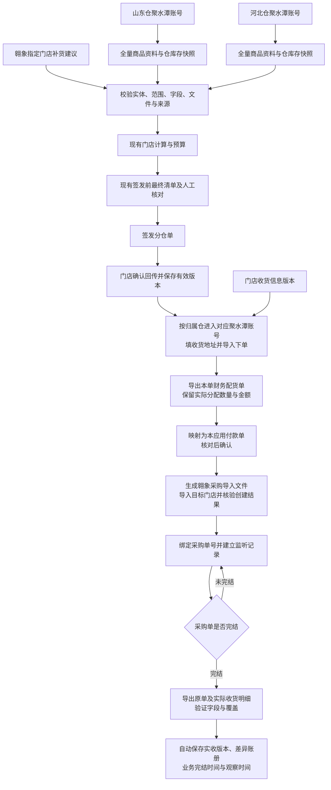
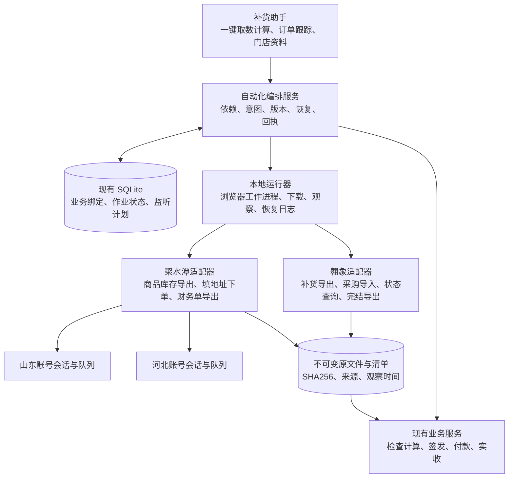

# 补货助手跨系统自动化闭环：待办开发方案

> 历史初稿：保留 2026-10-31 的目标与方案依据，本文“未实施”等状态仅代表当时。最新版本、实现进度和验收缺口见 [项目意图与实施进度](../项目意图与实施进度.md)。

版本：v1.0，2026-10-31。状态：**开发规划，未实施本方案、未建立心跳、未向外部系统提交业务单据。**

本次读取的应用基线：`feat/preissue-adjustment-0.18.0` / `7f5eccfd80e271dad1bc7d66fa99f6c198c56956`，应用 0.18.0、模型 0.3.3-rules。仓库已有该版交付记录，本轮只核对文档与接入代码，未重跑该版验收。开始实现前再次固定实际提交及夹具。

## 1. 目标与已确认口径

目标：逐步替代影刀的跨系统串行作业，将资料获取、补货计算、聚水潭下单、翱象采购生成、完结监听和实收账册接入补货助手。保留原有手工导入作为可审计的备用入口，与自动流程共用业务校验。

| 用户确认 | 本方案落点 |
|---|---|
| 门店补货建议来自翱象 | 按指定门店绑定的实际导出实体获取，合格文件自动进入现有输入检查并计算 |
| 商品资料来自聚水潭全量导出 | 增加聚水潭资料同步，形成可核验、可追溯的仓资料快照；需核实全量资料是否包含仓库存及其字段口径 |
| 山东仓、河北仓各一个聚水潭账号 | 两套账号身份、仓资料、库存、下单队列严格隔离，不合并成不分仓商品表 |
| 聚水潭下单用门店确认回传数量 | 输入锁定已确认回传的版本与仓，不能回退使用模型 AS 或未经回传的签发量 |
| 聚水潭下单后导出的财务单是本应用付款单 | 将该单记录为聚水潭实际配货结果来源；不是仅凭文件名称推断现金已经支付 |
| 付款单确认后，向翱象导入采购单 | 付款单有效版本成为采购导入依据，核验外部创建结果并保存采购单号 |
| 翱象采购单完结后自动形成实收账册及时间记录 | 观察已绑定采购单；验证完结状态、实际收货字段、原单覆盖后，保存实收事实、差异和时间来源 |
| 聚水潭下单要填写地址 | SQLite 保存版本化门店收货资料，下单固定地址快照并读回核验 |

本方案不恢复已撤销的“8.5 天目标”“无销量统一走首铺”，不修改模型、预算、箱规、一箱例外、签发前调整或已验收的生命周期规则。

## 2. 完整业务顺序

用户提出的四个功能按真实依赖组织：聚水潭下单及财务单导出位于翱象采购导入之前；聚水潭资料同步位于计算之前。



“一键作业”的首个可交付范围是：选门店 → 检查资料及登录 → 获取补货建议 → 自动检查 → 使用已选参数计算 → 展示结果。它不自动替代门店回传、付款单确认和已有签发核对。外部自动提交只在相应业务版本有效、身份及范围明确、功能已启用时触发；异常集中进入待处理队列，不反复弹出无意义确认。

## 3. 组件接入与技术边界

### 3.1 轻量接入，暂缓全项目迁移

复用现有 PySide6、Python 计算核心、SQLite、签发和生命周期服务，仅新增自动化编排与系统适配接口。浏览器代码不进入 `model.py`、`allocation.py` 或窗口点击回调；新功能通过明确应用服务接入。



### 3.2 复用翱象现有方案，明确尚未实现

已查到《Edge补货建议脚本方案_20261031》v2.0，它是**规格包，不是现成可嵌入程序**。建议按该方案验证后实现共享组件，保留独立脚本入口，同时增加补货助手适配入口。复用账号/配置绑定、单次提交、已知任务观察、文件核验和发布恢复设计。

该方案选择 Node + Playwright 控制本地 Edge，补货助手为 Python。首选保持进程隔离，通过版本化 JSON 消息和文件 manifest 通信，不为统一语言立即重写浏览器组件。具体运行时、连接和下载方式必须通过该方案 G01–G06 关卡后锁定；旧样本成功不代表新环境已通过。

接口建议包含 `command_id / operation / account_binding / scope / basis_versions / policy`；事件包含 `command_id / sequence / state / facts / evidence_ref / observed_at / error_code`。文件成功返回精确路径、大小、SHA256、真实行列、账号及实体范围、采集区间和校验结果。不得只返回 `success=true` 或让 Python 扫描下载目录挑最新文件。

职责分离：Python 是业务版本和流程状态的唯一写入方；浏览器组件可以保留自有技术日志/恢复库，但不直接修改 `workbench.sqlite3` 的业务表。组件先持久化外部提交意图再操作，Python 用同一 command_id 查询恢复记录；组件已成功但 Python 尚未登记时，恢复回执并补登记，不再次执行外部动作。配置面板中的启动/暂停/恢复和独立脚本共用同一份本机账号锁，避免双入口同时操作。

### 3.3 并行安排

- 每个账号/浏览器会话内的页面交互首版串行，导入提交与查询共用账号队列；高频心跳不抢占正在提交的页面。
- 山东、河北账号可分别调度，但首版先分别验收；只有独立会话隔离和平台能力验证通过后才开放跨账号并行。
- 翱象相同导出实体去重取数。不同门店共享导出实体时，先证明实体到门店的关联与过滤依据，不能把同一文件任意复制成多个门店输入。
- 下载、解析、计算可按依赖分段执行。已具备资料的门店可以先算；界面保持用户选择顺序，不按完成先后重新排序。
- 复用现有文件检查及门店计算进程能力，避免在每个浏览器任务内再次启动一套无界进程池。

## 4. 功能包与验收要求

### F0：门店、账号、商品与收货信息基础资料

1. 建立内部稳定门店键，分别绑定经营店身份、翱象补货导出实体、采购导入目标、聚水潭客户/店铺身份。记录各字段所属对象域；名称仅展示，不能充当关联键。
2. 固定山东仓与山东聚水潭账号、河北仓与河北聚水潭账号的绑定；账号切换或身份不符暂停该账号任务，不尝试切换其他账号凑结果。
3. 保存收货人、电话、行政区划、详细地址，以及目标系统实际要求的客户/地址ID和配送字段；字段必填性以真实页面为准。支持一店多个地址和明确默认地址，默认选择不能歧义。
4. 地址有版本、启停状态、验证时间及来源；提交时记录实际地址快照。后续改地址不改写已下单的配送事实；预览后地址版本变化要求重新核对。
5. 商品跨系统关联键包含系统账号/仓库域与实际商品/规格ID。不能假定翱象编码等于聚水潭编码，更不能按条码或名称模糊合并。单据来源允许同SKU多行，保留外部行ID、规格、批次等实际粒度。

验收：同名门店、同码不同仓商品、两个账号分别登录、无效地址、改地址后的旧单回看均不串数据。完整电话和地址只在必要界面/填表中使用，普通日志脱敏；凭据、Cookie和浏览器配置不进业务库、Git或迁移包。

### F1：聚水潭分账号全量商品资料与仓库存同步

输入：账号绑定、仓库绑定、导出契约版本。输出：原文件、分仓资料快照、库存快照、验证报告。

- 分别登录/核验两个账号，按真实功能入口导出全量商品资料；核实“全量”的状态范围、规格展开、分页/分卷以及停用商品等范围。仅“导出成功”不能证明全量。
- 若商品导出不包含所需仓库存，增加同账号库存导出，并按该账号商品/规格键关联。库存数量必须说明是可用、实物、锁定还是其他口径；缺失不可当0。
- 按现有模型要求映射商品编码、基本售价、分类、出库箱规、状态等。聚水潭哪个价格字段对应当前 V 列“基本售价”必须用真实文件确认，不擅自换为成本价或成交价。
- 保留两仓不同的价格、箱规、分类、状态、库存和采集时间。模型中的 K/L 是门店可用及在途，仓库存只用于既有供货归属及相关展示，不替换门店库存。
- 仓级原文件先完整验证再发布为新的有效快照；旧快照保留。一次运行保存明确的快照组合，禁止中途刷新其中一仓后继续混算。
- 建议“一键取数计算”默认获取新快照；可配置复用时效，但要显示真实采集时间，并由用户选择复用策略。两仓采集区间分别记录，不声称是同一瞬时快照。
- 下单前可用库存可能变化，以聚水潭最终分配结果作为后续付款单依据，不能把计算时仓库存当作库存预占承诺。

验收：两账号完整导出、缺分卷、同SKU两仓属性不同、失效登录、库存缺字段、错误价格映射、快照发布失败均有可复现证据；不合格文件不替换当前有效资料。

### F2：翱象补货建议自动导出并一键计算

界面：选择门店，显示映射、两仓资料状态、参数及预算，点击“一键取数并计算”；保留“仅取数”“恢复未完成”“重新获取”三个明确动作。

步骤：核验当前账号 → 解析指定门店实际导出实体 → 设置并读回范围 → 单次提交原生导出 → 跟踪准确任务 → 下载准确文件 → 校验 → 调用现有 `batch_service.intake/prepare` → 按有效门店计算。

- 对应补货建议来源 D13，默认“全部商品 / 全部信息导出”，不默认筛掉建议量为0的商品，否则会丢失新品及零建议场景。
- 历史全量导出曾不完整，按明确实体切片和验证；旧52列表头仅为兼容参考，保留重复表头列位，当前页面及列结构仍需实测。
- 原文件不可变留存，传入精确文件列表及顺序；通过适配器转换后保持原文件、工作表、原行身份。
- 冲突、资料待核或缺参数时停在现有处理入口，不为了“一键”静默选重复项或补造数据。其他独立门店可完成，批次显示部分完成与失败门店，不能报全成功。
- 重新获取生成新资产版本，旧计算按现有输入变化规则失效；再次计算不得静默沿用旧签发前人工调整。

验收：同一组原文件手工导入与自动导入的字段、行序、模型中间结果、执行量、金额和异常一致；自动链路只改变输入获取方式。完成指定门店真实闭环，包含单店、跨仓多店、零行已证、下载中断及重复冲突。

### F3：门店回传驱动聚水潭下单与财务单回流

触发依据：**已确认的门店回传版本**，锁定父单、签发修订、仓、回传版本与摘要。

1. 按供货仓分发到对应聚水潭账号。零数量行不形成采购需求；缺回传、待核回传不自动下单。沿用现有回传语义，不能用签发数量填补未知。
2. 生成聚水潭实际导入格式，填写该门店明确的收货地址和客户资料；读取系统回显核验账号、仓、目标门店、商品、数量、地址及其他必需字段。
3. 持久化提交意图后执行一次导入/下单，取得系统实际单号。具体业务单据类型、导入模板、可能拆单/并单、审核状态及是否真正预占库存，均需真实页面和影刀流程勘察后确定。
4. 核验已生成订单与请求行的覆盖及数量。不接受“点击成功”作为业务完成，也不能假定单个导入文件只生成一个订单。
5. 跟踪到可导出的财务配货结果，按已绑定订单导出，验证分配数量、金额、单位、原单号和范围；部分分配保留差异，不能抬回回传需求量。
6. 通过现有 `lifecycle_io` / `order_lifecycle` 生成付款单预览，来源明确为“聚水潭财务配货单”；核对后确认有效版本，再进入 F4。

当前代码存在13列表头的付款原表适配器，但不能据此宣称真实聚水潭导出已适配。需使用真实文件验证内部订单号、商品数量/金额、规格及单位。财务单上的日期按真实字段命名，不把导出时间写成实际付款时间。

验收：两账号分别下单、不同地址、部分分配、零分配、多订单/分卷、回传改版、提交超时、登录失效和相同文件重导；来源金额与商品数量无损。确认回传改版后旧提交不能被自动重放，已创建外部订单保留并进入调整核对。

### F4：付款单确认后生成翱象采购单

触发：现有付款单确认事务成功后，在本地同一事务中登记唯一待办意图；浏览器提交在事务外执行，避免持有数据库写锁等待网页。

- 锁定有效付款版本、来源聚水潭订单、账号及仓，生成目标门店采购导入文件。数量取该付款/配货单有效商品数量，不取原回传量或模型建议。
- 采购单对应供应商、供货仓、目标门店、商品ID、规格、价格和税额字段的要求需实际模板核验。D13全信息导出与采购导入模板不能互换；D15是否适用于本目标路径另行验证。
- 所有内部计算数量统一为库存单位；外部表要求箱/采购单位时，只能按有证据的转换关系生成，并记录原单位、系数、换算量和依据。缺少系数阻断受影响订单，不凭单位名称猜测。
- 导入并核验系统实际采购单号、归属、明细、状态和金额口径后，建立外部单据绑定。若外部支持备注/业务关联号，则写入本地关联标识辅助查询；先验证字段能力，不假定平台提供幂等键。
- 一张内部仓单对应多个外部采购单时，保存行级拆分和数量分配；每一部分有明确归属。失败部分单独恢复，不重建已成功单。
- 成功建立采购单绑定后登记 F5 监听待办。若程序此刻崩溃，重启扫描已绑定未挂监听的记录补登记，不能重新创建采购单。

验收：正确门店、账号、仓、SKU/规格、单位数量、币种与金额口径；重复确认付款只产生同一待办；付款改版不会静默覆盖已生成采购单；部分导入、无回执、外部创建成功但本地登记失败均可恢复。

### F5：采购完结监听、自动实收和差异账册

监听键：系统账号/租户 + 外部采购单ID，不按名称、日期或列表最近记录匹配。保存原状态、状态映射版本、最近观察时间、下次检查时间、失败次数、当前责任运行器。

- 核验翱象“完结”的准确状态及其业务含义；取消、作废、强制关闭、部分收货和正常完结分别处理。完结状态本身不证明实收数量等于采购数量。
- 未完结时按配置轮询；登录失效、权限变化、单据失踪或状态未知时进入等待/异常，不生成零实收。
- 检测有效完结后，导出准确采购单及可证明实际收货的明细/收货单；验证拆单和全部相关子单覆盖。只有来源明确的实收数量才入账，不能拿申请量、采购量、到货计划量或差异值冒充实收。
- 保存全部商品实收账册，差异视图从完整事实派生，不仅保存差异行。保留原文件、行级来源、原签发/回传/付款/采购单关联。
- 自动写入现有 receipt 生命周期之前，必须满足来源语义、完整覆盖、单位及上游版本校验。字段缺失或上游变化时保存待核材料，不强行标记实收完成。
- 同一完结事件/文件版本重复观察不得重复记账。若采购单重新打开、明细改版或上游改版，保留原实收版本并进入重新核对；原记录不覆盖。停止监听后的更正通过显式复查或配置化终态复核发现，不声称无限期自动发现。
- 完整闭环的完成条件：所有关联外部采购子单均处于有效终态，最终文件已核验，实收版本已保存，差异已记录；有差异可以“已完结、有差异”，不能写成“完全一致”。

时间必须分开保存：`external_created_at`、`external_completed_at`、`first_seen_completed_at`、`exported_at`、`receipt_recorded_at`，附原时区/来源。外部未提供完结时间就标未知；首次观察到完结不能冒充精确完结时刻。现有 receipt 要求的日期字段若无法取得合适业务时间，应进入待核或经单独确认扩展缺失语义，不擅自填今天。

心跳机制是未来应用组件，不是本聊天创建的提醒：首版应用运行期间由本地调度器持久调度，重启继续。若要求关闭应用后仍监听，另实现可见状态的本地运行器/Windows任务入口；运行器存活不代表浏览器会话可用，睡眠、锁屏、退出登录等需实际验证并显示暂停原因。轮询间隔、退避、静默时段、最大等待和并发限制可配置，数值由平台能力与业务时效验收确定。

通知仅在完结入账、实质状态变化、失败或需要人工处理时出现；状态不变保持安静。用户停止后不继续发起轮询/导出/提交，不自动撤销已经在外部生效的采购单。

## 5. 数量、金额与差异链

在同一内部订单、签发修订、仓、商品/规格和已核验单位上比较；外部多行按有证据的映射归集，原行身份保留。不同账号/仓的同编码不得直接相加。

| 数量 | 来源 | 差异视图 |
|---|---|---|
| Q_signed | 实际签发量，包含已确认的0.18人工调整 | 基准，不取原模型AS替代 |
| Q_return | 门店有效确认回传 | Q_return − Q_signed：门店确认变化 |
| Q_allocated | 聚水潭财务单实际配货数量 | Q_allocated − Q_return：配货不足/增加 |
| Q_purchase | 翱象实际创建采购单数量 | Q_purchase − Q_allocated：采购导入差异 |
| Q_received | 翱象有效实收明细 | Q_received − Q_purchase：采购收货差异；同时展示相对Q_allocated差异 |

相同SKU的单位和规格不能确定一致时不计算差额。金额采用精确十进制，分别保存基本售价估算、财务实际金额、采购单金额及币种/税口径，不能强行使它们相等。历史缺失、未取得整单与已证实零值分开；只有取得完整且已验证的业务单后，才调用现有相应空白/缺行规则。

## 6. SQLite增量数据设计（候选表，实施前定稿）

保留 `workbench.sqlite3`、现有签发/生命周期表及快照格式，不先做全库重构。新增信息优先存关联表，避免往模型结果逐SKU重复塞浏览器状态。

| 候选实体/表 | 主要字段及约束 |
|---|---|
| integration_accounts | system、稳定tenant/account标识、warehouse、binding_version、状态；不存密码/Cookie |
| store_system_bindings | internal_store、system、account、entity_domain、external_id、用途、映射版本；禁止名称猜测 |
| store_delivery_addresses | store、address_id、version、收货人/电话/区划/地址、默认标识、有效性、验证来源；订单固定快照 |
| product_system_bindings | system/account/warehouse、商品及规格ID、内部SKU、库存单位、换算依据、映射版本 |
| source_snapshots / artifacts | 系统、账号、仓/实体、范围、采集区间、路径或原件引用、SHA256、成员清单、契约版本、质量结果 |
| automation_runs / steps | run_id、目标门店有序列表、冻结依据、步骤依赖、状态、重试分类、进度、时间、错误与恢复入口 |
| external_operations | command_id、操作类型、依据版本、输入摘要、意图状态、外部受理证据、回执、执行代次；不可重写旧尝试 |
| external_documents / document_lines | 内部oid/revision/warehouse及生命周期版本、外部系统/account/doc_id、父子关系、原行ID、映射量与单位；支持一对多 |
| purchase_watches | 外部采购单键、状态、状态契约、最后/下次观察、调度租约、停止原因、终态观察版本 |
| receipt_observations | 原状态与时间证据、完结文件摘要、实收生命周期版本、处理状态；唯一观察/入账键防重复 |

实收账册复用现有 `lifecycle_versions(stage=receipt)` 与原文件保存能力，差异表作为视图/导出，避免另造一套不一致的实收总账。付款确认与待办登记采用本地事务；外部系统不参与 SQLite 事务，不宣称跨系统原子提交。

数据库扩展需要备份、升级版本检查和失败回滚方案。旧包与旧库副本保留，不能让不识别新增语义的旧程序写入新流程数据。

## 7. 提交状态、恢复与多人/多机边界

```text
准备 / 等待资料或登录
  → INTENT_RECORDED（持久化本次范围、内容、依据）
  → SUBMITTING
  → ACCEPTED（取得可信外部受理身份）
  → VERIFYING（核对实际订单或文件）
  → SUCCEEDED（外部事实已核验、本地回执已登记）

提交后无法确认 → SUBMISSION_UNKNOWN → 查询原受理/订单证据 → 恢复上述分支
确定未发出或明确拒绝 → 保存证据 → 修复原因后新尝试
文件下载/解析失败 → 恢复原任务或原文件处理，不重建外部业务单
```

本地 operation_key 包含系统账号、操作类型、内部单据/修订/仓、确认回传或付款版本及内容摘要。它只能防止本机重复调度，**不能证明外部系统支持幂等**。点击后超时、列表没找到、登录跳转都不等于未提交；未知状态不得自动重新上传。

同一账号本机使用独占执行租约，崩溃恢复先核对未决操作，不把过期租约当作“上次没提交”。首版限定同一业务范围单机执行；跨机需明确交接未决记录，不把SQLite本地锁描述为分布式锁。并发窗口使用现有版本校验拒绝过期预览。

外部写入成功后，后续版本变化进入补单/撤销/更正人工核对；首版不自动撤销外部订单。原程序和影刀在切换范围内只能有一个提交者，验收期间必须明确由哪一套执行真实下单。

## 8. 开发待办与依赖

下表状态统一为**待开发/待验证**，文档完成不表示功能已完成。编号用于作业会话拆分提交和记录证据。

| ID | 待办 | 前置依赖 | 交付与验收重点 |
|---|---|---|---|
| A00 | 固定0.18或实施时稳定基线；建立隔离QA | 无 | 记录提交、原文件哈希、既有回归和恢复点 |
| A01 | 盘点影刀步骤与两个系统真实页面/模板 | A00 | 一条代表订单全链路、必填字段、单据类型、正常/异常证据 |
| A02 | 建立账号、仓、门店及商品域映射 | A01 | 两聚水潭账号分别识别；翱象实体域不混用 |
| A03 | 建立门店收货地址版本管理 | A02 | 导入/编辑/校验/默认地址/订单快照/脱敏 |
| A04 | 自动化运行记录、意图、账号锁与恢复协议 | A00、A02 | 崩溃、重复触发、未知提交状态不重复下单 |
| A05 | 翱象v2.0环境及会话、下载关键关卡 | A01、A04 | 正确配置/身份、授权等待、精确任务与文件、断线恢复 |
| A06 | Python与浏览器组件通信及嵌入入口 | A04、A05 | 版本化协议、进度、取消、错误、同command恢复 |
| A07 | 山东聚水潭商品资料及库存完整导出 | A01、A02、A04 | 真实字段、范围、分卷、单位、库存和价格口径 |
| A08 | 河北账号复用适配及隔离验收 | A07 | 不串会话/仓/资料；同码不同属性正确 |
| A09 | 两仓资料快照发布与现有catalog适配 | A07、A08 | 同原文件手工/自动适配一致，缺失不补造 |
| A10 | 翱象指定实体补货建议原生导出组件 | A05、A06 | 单次提交、精确下载、全部商品、来源及覆盖 |
| A11 | 一键取数→检查→计算的界面编排 | A09、A10 | 门店顺序、部分失败、参数沿用及结果等价 |
| A12 | 同日复用、明确重取、失败续跑 | A11 | 保留原采集时间；不混快照、不重复平台提交 |
| A13 | 回传版本→分仓聚水潭下单计划 | A02、A03、A04 | 使用用户确认回传量；冻结地址/映射/依据 |
| A14 | 聚水潭自动填表、导入、创建核验 | A13、A01 | 两账号、拆单、部分导入、提交未知恢复 |
| A15 | 聚水潭财务单准确导出及付款预览 | A14 | 只认本单实际配货、金额/单位/行覆盖、部分分配 |
| A16 | 付款确认与翱象采购待办原子登记 | A15、A04 | 单次触发、付款改版、崩溃恢复 |
| A17 | 翱象采购模板生成和目标映射 | A01、A02、A16 | 供应商、门店、规格、单位、价格口径验证 |
| A18 | 翱象采购导入与外部单据绑定 | A17 | 精确单号、明细核验、拆单恢复、不重复创建 |
| A19 | 持久监听计划与账号调度 | A18、A04 | 重启恢复、退避、暂停、静默通知、登录过期 |
| A20 | 完结语义与实际收货导出适配 | A01、A18 | 正常完结/取消/部分收货区分、实际量与时间来源 |
| A21 | 实收自动入账、差异账册和导出 | A19、A20 | 幂等、全量明细、多采购单覆盖、上游版本一致 |
| A22 | 全链路关联与问题处理界面 | A11、A15、A18、A21 | 从门店单追到两系统订单、原件、版本、时间与异常 |
| A23 | 端到端回归、故障恢复及性能对照 | 各阶段逐步执行 | 同范围影刀/新流程对照，单一真实提交者 |
| A24 | 独立后台运行器（如需关应用后监听） | A19及运行方式确认 | 登录、锁屏、睡眠、启动恢复、退出控制实测 |

### 推荐交付顺序

1. **M0 基础核验**：A00–A06、A03；固定对象映射、真实模板、地址与恢复协议。先解决可执行性，不先承诺全自动成功。
2. **M1 一键取数计算**：A07–A12。两仓资料同步 + 翱象建议导出 + 原计算接通；可独立替代原拖表工作。
3. **M2 聚水潭下单回流**：A13–A15。用门店回传量下单，财务配货结果回到付款预览。
4. **M3 翱象采购生成**：A16–A18。付款确认后自动创建采购单并保存可靠关联。
5. **M4 实收闭环**：A19–A22。采购状态观察、完结导出、实收账册、差异与时间记录。
6. **M5 切换与稳定性**：A23，按业务需要实现A24。逐范围退出影刀，不把首次跑通当成完整替代。

不预设版本号或承诺工期；M0获得真实模板与运行耗时后再估算。各阶段独立提交和发行，既有计算/签发功能不得因未配置自动化账号而不可用。

## 9. 核验清单与替代影刀的完成条件

### 数据与业务

- [ ] 山东、河北账号和数据分别通过，门店和SKU映射可追溯。
- [ ] 聚水潭“全量资料”及库存范围有证据，不以样例行数或成功提示证明完整。
- [ ] 相同输入下手工与自动导入的模型字段、最终签发量、金额、顺序、异常一致，保留0.18调整约束。
- [ ] 聚水潭输入等于有效回传；付款单等于实际分配；翱象采购等于确认付款；实收取实际字段。
- [ ] 所有外部单位转换有依据，原商品/规格行身份保留，无串账号或跨仓合并。
- [ ] 部分分配、部分收货、零需求、取消、强制关闭、缺失上游与数据改版均明确处理。
- [ ] 业务完结时间、发现时间、导出时间及入账时间分开，未知不补造。

### 恢复与运行

- [ ] 提交前后崩溃、断网、超时、登录失效、浏览器人工改页、权限变化均有恢复路径。
- [ ] 重启、双击按钮、重复文件、重复完结观察不会重复创建外部单或重复实收入账。
- [ ] “外部成功、本地未知”能够通过事实核验恢复，不依赖盲目重放。
- [ ] 文件占用、损坏、分卷缺失、错账号文件、原件变化不发布为有效输入。
- [ ] 日常浏览器、下载设置与无关标签不被接管或关闭；账号资料迁移不带凭据。
- [ ] 应用关闭/系统睡眠后的行为与所选择运行模式一致，不承诺没有运行器时继续心跳。

### 性能与实际替代

- [ ] 分别计时：登录/身份核验、资料导出等待、建议导出等待、下载、解析、计算、制表、导入、核验；记录P50/P95前先有足够样本，小样本只报逐次值。
- [ ] 将平台排队和本地耗时分开；同机、同范围记录影刀与新链路耗时、内存、失败率、人工操作次数。
- [ ] 并行优化通过账号隔离、顺序和完整性验证，不能用更快掩盖漏单或重复单。
- [ ] 使用代表性真实门店连续完成多个业务周期，包括异常恢复；覆盖范围和剩余人工项形成清单。
- [ ] 每次切换只保留一个真实下单执行者，备份、回滚与未决订单交接可操作。

## 10. 尚待M0确认的事项

这些是开发前的具体勘察任务，不阻止本方案成稿，也不把未知写成已实现：

1. 两个聚水潭账号的真实商品/库存导出样本，价格、规格、库存、有效状态、分卷和时间语义。
2. 聚水潭下单的具体业务单类型、客户/店铺选择、地址必填项、导入模板、审核与配货发生时点，以及实际财务导出样本。
3. 翱象采购导入的真实入口和模板、供应商映射、创建结果查询方式、是否支持业务关联标识。
4. 翱象采购完结状态字典，实际收货明细、分次收货/拆单关系、完结时间及重新打开后的版本变化。
5. 同一SKU跨系统编码/规格/单位映射，是否存在多行、替代品、赠品、退货或其他不能直接合并的事实。
6. 现有门店地址清单的权威来源和更新责任，两个仓是否对同店使用不同客户ID或配送资料。
7. 心跳时效、运行时段、应用关闭后是否必须继续、账号跨机器使用方式、通知渠道；首版先在应用内通知，不默认发外部消息。
8. 零分配、合并单、多次财务导出修正、采购单改量或撤销的业务处置。未经确认不自动改原订单或生成补单。

## 11. 来源与本轮范围

- 用户本轮四项需求、后续确认“聚水潭下单使用门店确认回传后的数量”，以及“两仓两个聚水潭账号、商品资料全量导出、分仓库存”是本方案业务依据。
- 当前应用：[0.18.0签发前最终清单](../0.18.0签发前最终清单.md)、`src/lifecycle_io.py`、`src/order_lifecycle.py`、现有计算与分仓资料入口。
- 翱象组件前置规格：[当前入口](D:/优团工作文件夹/翱象RPA方案_20261014/补货建议脚本_当前方案入口.md)、[v2.0开发执行方案](D:/优团工作文件夹/翱象RPA方案_20261014/Edge补货建议脚本方案_20261031/开发执行方案.md)。本方案扩展GUI嵌入、采购和监听范围，不能把旧规格的“首版无GUI/定时”误当成本项目目标限制；浏览器与文件能力关卡仍需实测。
- 操作参考：[aoxiang-operations技能](C:/Users/lenovo/.codex/skills/aoxiang-operations/SKILL.md)及其浏览器/导出、身份与恢复说明。历史单店证据只用于设计约束，不证明当前两系统已经连通。

本轮只新增这份待办方案；未修改产品源码、未连接浏览器、未导入/创建外部单据、未启动监听、未提交或推送Git。
