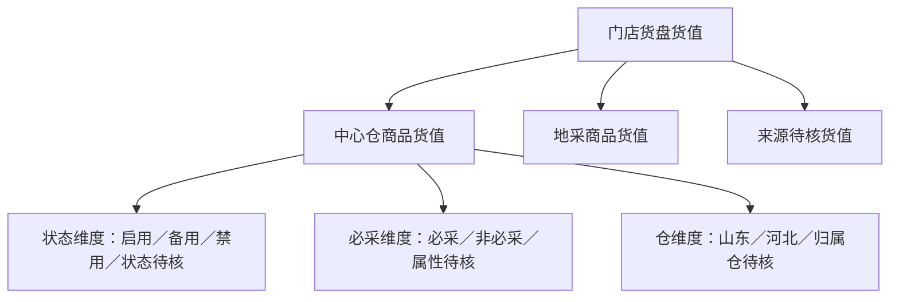

# 门店货盘结构与逐轮货值分析方案

日期：2026-11-06。状态：设计方案，未开发、未执行用户数据统计。

源码核对基线：0.44.0 rc2，构建提交 `d89d3c8`，交付证据提交 `feeafa5`。本方案与已实现的“预计可售天数”衔接，不修改计算、预算、签发、五段漏斗或历史数据。

## 1. 业务目标与主口径

每轮补货前回答：门店整个货盘值多少钱，中心仓与地采各占多少，中心仓商品中启用、备用、禁用各占多少，必采品持有了多少；与上一轮及多轮相比如何变化。

这里的“大盘”指本轮导入并核验的门店商品范围。只有来源确认覆盖全店，才可称全店货盘；若上游只导出了部分分类、供应商或有销量商品，页面必须显示“本次导入范围”，不能声称全店。没有记录的商品不能猜作库存为0。

首屏默认看**补货前现货货值**，可切换“在途货值”“现货＋在途总持有货值”。三种视角共用相同商品范围，现货和在途不混写成一个不带解释的库存数字。货值按基础库存单位计价，不等于采购成本、账面成本或现金回收金额。

本功能是日常分析能力：业务可直接看、手动导出，AI可查询和导出同一结果；不要求开启AI才能使用。

## 2. 三层货盘及核对关系

状态、必采、仓是中心仓货盘的三个独立维度，不是六七个可直接相加的下级分类。必采与启用可能重叠。

在同一轮、同一库存视角和同一有效计价范围内，必须满足：

- 大盘已计价货值＝中心仓＋地采＋来源待核的已计价货值。
- 中心仓已计价货值＝启用＋备用＋禁用＋状态待核。
- 中心仓已计价货值＝必采＋非必采＋属性待核。
- 中心仓已计价货值＝山东＋河北＋归属仓待核。

未知类别若有合法库存和价格，仍能估值，计入对应“待核”类别；不能因为无法分类就从大盘消失。金额本身不可计算的记录单独统计，不放入“待核货值”伪造金额。

默认指标与占比分母：

| 指标 | 占比分母 | 业务用途 |
| --- | --- | --- |
| 门店大盘货值 | 不显示上层占比 | 看存量规模及逐轮涨跌 |
| 中心仓／地采／来源待核货值 | 大盘同口径已计价货值 | 看货盘来源结构 |
| 中心仓启用／备用／禁用／状态待核货值 | 中心仓同口径已计价货值 | 看经营状态结构，暴露禁用存量 |
| 中心仓必采／非必采／属性待核货值 | 中心仓同口径已计价货值 | 看必采资源持有情况 |
| 山东／河北／归属仓待核货值 | 中心仓同口径已计价货值 | 看所属仓结构 |

每项附本轮金额、占比、上轮金额、增减金额、增减比例、持有SKU款数。分母为0时比例留空；上轮没有记录显示“无可比上轮”，不显示增长100%。有未计价正库存时，标题改为“已计价货值”，占比标注“已计价范围内”，不能冒充完整总额。

## 3. 商品范围、状态与必采归属

1. 从门店完整输入/计算快照取数，包括补货量0、地采、待核、停采、禁用、拒收、淘汰和资质受限商品。有无补货资格不影响已有库存是否存在。
2. 不沿用五段漏斗的 `scope=纳入` 过滤；不从加盟商签发Excel反推大盘。后者会漏掉地采、0补货及部分受限商品。
3. 中心仓/地采以本轮已经确认的精确编码匹配和冻结归属结果为依据。沿用现有路由，不为分析重新选仓。匹配待核不自动归为地采；仓资料缺失也不证明商品属于地采。
4. 山东、河北展示的是商品本轮所属供货仓，不声称门店存货当初实际采购自该仓。现有库存没有批次来源分解时，不能把一份门店库存分到两个仓重复计价。
5. 中心仓状态取**本轮对应归属仓**的“商品状态”原值，标准类别为启用、备用、禁用，空值/其他值进状态待核。状态原文保留；未核实别名不擅自映射。无货、停采、拒收、淘汰、医疗资质受限是其他属性，不能自动替换成禁用或备用。
6. 两仓同SKU状态不同，按本轮归属仓统计，同时可在商品依据中查看另一仓资料；不取两仓中更宽松或更严格状态来改写本轮结果。
7. 必采使用当轮冻结必卖清单和匹配依据。明确空清单可判非必采；清单未保存或来源不明为属性待核，不能当作全非必采。地采即使命中清单，也不加进“中心仓必采货值”，原属性可在明细保留。
8. 支持状态×必采交叉查看，如“禁用且必采”。交叉表可加总至中心仓，但不可再与独立状态合计相加。

## 4. 数量和计价契约

对门店s、轮次r、商品i，K为本轮门店可用库存，L为门店在途，P为本轮冻结的分析单价：

- 现货货值＝Σ(K×P)。
- 在途货值＝Σ(L×P)。
- 总持有货值＝Σ((K＋L)×P)。
- 持有SKU数：该视角数量大于0的去重商品编码数。另列本次导入SKU数，二者不能混用。

使用Decimal按原精度计算，汇总后显示两位小数；不先逐行四舍五入再求和。货币、价格单位和库存单位必须一致。不把包、瓶、个的合计当作同质物量。

**计价来源：**

| 商品来源 | 首选依据 | 不能采取的处理 |
| --- | --- | --- |
| 中心仓 | 本轮冻结归属仓商品资料的基本售价；与已确认V口径一致 | 不用最新仓价重估旧轮次，不用另一仓价格偷偷补缺 |
| 地采 | 本轮完整门店原表中经确认、与库存单位一致的售价字段；没有时可使用明确导入的分析专用价格资料 | 不拿中心仓不相关商品价格、采购价或未确认字段直接替代，不因缺价计0 |
| 历史缺价 | 若原始快照有已确认字段，可只读解析；仍不足则未计价 | 不用当前默认资料回填历史，不把未计价金额当作0 |

地采价格是实施前需要补齐的资料契约：当前标准适配没有可靠地采价格字段，须核对一份实际完整补货建议的原表表头及价格含义，再确定列映射。若原表确实没有合适单价，提供分析专用“门店编码、商品编码、库存单位、分析单价、币种”补充资料入口，只作用于分析快照，不修改模型V、采购或签发价格。现阶段不擅自决定某个未核实列就是地采单价。

**异常处理：**

- 有效数量0对应货值0，即使价格缺失，也不能将“0库存”显示成未知库存；另保留缺价提示。
- 正库存缺价/价格无效：该项货值未知，报告缺价SKU及未计价库存记录数，不能计算未知金额。
- 0或负价格默认列为价格待核，不把有库存商品当作免费；以后若有明确赠品零价口径，另行确认。
- K或L缺失、格式异常或为负：相应视角待核，不静默截成0。K正常但L未知时现货可算，总持有待核；反之同理。
- 同一SKU不同基础单位、无法消解的重复记录或冲突：不直接合并；保留源行和待核原因。
- 每个视角单独显示有效覆盖率。按“有持有量且数量有效的SKU中已计价款数”计算计价覆盖率，另列数量无效款数；不能声称未知金额的覆盖比例已知。

## 5. 每轮快照与自动产生时点

无需业务新增一次填写或保存动作：

- 当前工作台可从“核对与签发”点击“查看本轮货盘”；签发前明确标“本轮预览”，不混入正式历史趋势。
- 历史默认一店一业务日一个当前有效轮次，与现有正常补货链路一致。同日重算但未签发不新增正式轮次；同日重新签发后按当前有效修订显示一次，旧修订只作追溯，不能重复累计。
- 记录库存观测时间、源表更新时间（如可靠且存在）、读取时间、业务日期、签发时间，语义分开。业务日期不等于库存实时更新时间；未提供则显示未提供，不能用文件修改时间冒充。
- 使用门店父级完整快照一次取库存，再按归属仓切分，不拼接两份分仓订单复制同一门店存量。
- 首期优先按已有不可变快照只读派生，缓存按依据指纹失效，不为新增分析强制升级旧业务存储格式。若原快照不能证明全量输入覆盖，明确标为有限范围；不声称已完整还原。
- 当前资料更新不改变已签发历史。分析补充价格如需归档，依附新轮次并记录其版本；旧轮次补证应是显式独立分析版本，首期不做静默回填。
- 删除与数据维护沿用现有可见性和生命周期边界。删除订单/相应仓资料后，缓存不能让数据重新出现在看板或AI；部分仓被删除时，本轮标为不完整范围，不把剩余部分称全店大盘。父级轮次全删后移除其分析派生记录；不另建用户必须管理的回收站。

## 6. 上轮对比与多轮解释

“上一轮”默认同店、本轮之前最近一个仍有效的正式业务日，显示具体日期和间隔天数。首期同日只看当前有效轮次，不把修订当作补货次数。连续多轮按日期展示，不累加库存。

每轮存量变化分成两类阅读：

1. **观察到的变化**：两轮各自范围、当轮价格下的已计价货值差额。数据不完整时标“已计价部分变化”，不称为库存消化额。
2. **可比商品的变化解释**：精确匹配同店同SKU、单位一致、两轮数量/价格均有效的集合，拆分数量变化、价格变化；新增/缺失记录、估值范围变化另列。

对共同有效商品，先用上一轮价格计算数量变化，再以本轮数量计算价格变化：

`数量变化影响＝Σ((Q本轮－Q上轮)×P上轮)`

`价格变化影响＝Σ(Q本轮×(P本轮－P上轮))`

二者之和必须等于共同集合的货值差额。Q按现货/在途/总持有视角选择。若还需解释分类变化，按“数量 → 价格 → 来源/仓/状态/必采迁移”的固定顺序计算贡献，最后一步在本轮数量与价格下换分类，避免一笔变化重复归因。

以下单列，不能算成真实销售、退货或新增采购：

- 本轮首次出现的记录、上轮有而本轮未提供的记录。
- 上轮缺价本轮有价，或本轮缺价导致退出有效估值范围。
- 原来源/供货仓/商品状态/必采属性发生迁移；SKU整体没变时，中心仓或某个状态货值也可能改变。
- 数量或单位异常、导入范围变化、历史数据被删除造成的不可比。

跨店大盘不默认混加不同日期的库存。多店默认按共同选定业务日看，显示门店覆盖数；可另选“各店最新轮次”，必须显示每店依据日期及最早/最晚日期，明确不是同一时刻全店库存。上轮比较采用共同门店集合，缺轮门店单列。

货值与预计可售天数可联查，但货值总盘不能只保留有预测的商品。无预测的新品/零销库存仍进入已计价货盘，其天数单独待核。两轮货值降低不能自动说明销售好；升高不能自动判模型多补。

## 7. 页面与业务人员操作

### 7.1 主入口

数据分析下并列“五段漏斗”“货盘结构”，不在原漏斗中塞一套互相矛盾的纳入规则。保持同一门店/日期导航；跨页继承的过滤条件必须明示，未适用的过滤不暗中带入。

### 7.2 默认一屏

1. 顶栏：门店、业务日期/近几轮、库存视角（默认现货）；“查询”“导出当前范围”。不先要求选商品或维护新参数。
2. 三张主卡：大盘、中心仓、地采；每张卡附上轮增减和持有SKU数。有来源待核时紧邻显示，不能藏在折叠区导致三卡总数不平。
3. 中心仓状态区：启用、备用、禁用及待核，占比横条和金额并列。
4. 中心仓必采区：必采、非必采及待核，另可切换状态×必采交叉表。注明“不与上方状态金额相加”。
5. 多轮趋势：按轮次的货值折线/堆叠柱，切换来源、状态或必采维度；从0开始的金额轴、缺轮断线、缺价轮次标记，鼠标提示含日期、金额、范围。
6. 底部表格：各门店/轮次摘要与主要增减商品。先看门店，需要时才展开SKU，不默认展示源路径、JSON或模型字母字段。

首页可放当前有效轮次的简短入口卡，不默认扫描全部历史。订单跟踪继续负责生命周期动作，不把货盘维护放进去。

### 7.3 点击与导出逻辑

- 点击“禁用货值”→列表按禁用筛选；点击“必采”→中心仓必采；两条件组合要在顶部显示标签，支持单项清除或全部重置。
- 点击一轮→该轮商品；点击增减→共同商品变化与新增/缺失/估值变化明细；双击商品→当时库存、单价、所属仓、原状态、必采依据和计算公式。
- 默认“导出当前范围”与当前筛选一致；“导出商品明细”单独明确，不让用户猜按钮会导出哪张表。导出前展示门店数、轮次数及范围；大明细后台执行，可取消，已完成文件有明确反馈。
- 历史轮次原始依据只读；过滤、查看和导出不修改参数、数量或资料。加载失败保留上一成功结果并显示状态；不会把旧结果误标为新查询。

## 8. Excel与AI同一口径

新增独立“货盘结构分析”导出，不往原37＋5列经营分析表硬塞更多字段，也不改原五段导出结构。

| 工作表 | 内容 |
| --- | --- |
| 货盘逐轮总览 | 门店编码/名称、业务日期、观察时点、库存视角、大盘/中心仓/地采/待核金额、占比、持有款数、上轮日期及增减、数据完整性 |
| 中心仓状态 | 门店＋轮次＋仓＋状态的金额/占比/款数和上轮变化，含待核 |
| 中心仓必采 | 门店＋轮次＋仓＋必采属性；可附状态交叉列，明确独立合计 |
| 商品与变化明细（按需） | 本轮/上轮库存、在途、单价、货值、来源/仓/状态/必采及变化贡献、缺失原因 |
| 口径与待核 | 范围、指标版本、计价来源、覆盖率、异常数量和原因；技术定位信息按需，不占主表 |

金额数值型2位小数，占比数值型百分比；编码保留文本。未知金额留空，明确0保留0。共享记录主键保证不能因Sheet拆分、双仓、不同必采组重复计价。

AI新增独立的货盘查询/分页结果/导出能力（建议名称 `query_inventory_structure`、`inventory_structure_results`、`export_inventory_structure`，最终按现有协议审查确定）。返回metric_version、snapshot_id、业务中文定义、库存视角、每店轮次、覆盖数、未计价原因和变化分解。原生、Excel、AI调用同一纯指标服务。

沿用本机连接、上下文核对、operation_key、后台任务、游标分页、只读权限与失效检查。导出仅明确写指定本地文件，不增加签发、采购、删除或调参权限。提示词先要求检查覆盖率再解释；不能把禁用存量遗漏说成库存减少，也不能把货值当成本或将相关变化解释成确定因果。

## 9. 代码边界与性能设计

已核实的现状：

| 当前代码 | 本次意义 |
| --- | --- |
| `src/order_analytics.py:collect/build_facts/inclusion` | 读取有效中心仓分仓单并应用漏斗排除；不适合直接提供全货盘，保持原逻辑不动 |
| `src/normal_orders.py:Repository.confirm` | 父级签发记录关联完整result与work_revision；优先复用其不可变依据，实施时验证未被裁剪 |
| `src/work_repository.py`、`src/storage_chunks.py` | 提供作业及分块快照读取；按门店/所需字段加载，不全库解码 |
| `src/batch_service.py:intake/prepare` | 已有多文件去重、冲突选择、原记录来源；本功能不重新发明匹配规则 |
| `src/input_adapter.py` | K/L来自门店补货建议，V来自匹配商品资料基本售价；未匹配时V为空，地采计价契约确有缺口 |
| `src/warehouse_catalog.py:route_store/import_catalog` | 已冻结供货归属、商品状态和仓资料版本；按本轮结果引用，不在分析中改路由 |
| `src/coverage_metrics.py` | 可联查预计可售天数；货值独立计算，不能以预测有效性过滤全盘 |

建议新增少量职责清晰的模块：

- `inventory_structure.py`：从当前/历史完整门店快照构造事实、核对范围、聚合指标、逐轮分解；纯指标函数与读取函数界限明确。
- `inventory_structure_ui.py`：卡片、结构、趋势、下钻、待核反馈。
- `inventory_structure_exports.py`：新增Excel结构，复用已有样式/写表工具。
- 现有AI分析适配层增加独立命令，使用同一服务，不复制一套公式。

事实建议主键为“父级订单/作业依据＋当前有效修订＋门店编码＋商品编码”，仓是属性。保留K/L、单位、单价及价格来源、归属、状态原文、必采依据、源行、数据时间、完整性和指标版本。分析缓存可丢弃重建，不成为业务真相；不在用户目录堆出另一套无人维护的副本。

性能边界：查询使用后台线程；一次读快照，多维聚合复用；同一仓资料版本只解析一次；不逐SKU重读Excel，不重跑模型；按店/轮次分页加载明细。缓存键包含源快照/修订/清单/价格补充依据/删除可见性/指标版本/筛选。来源变更或删除立即失效，导出前后复核，避免旧缓存继续导出。

首屏先显示汇总，明细和原表按需读取；进度明确显示“读取轮次x/y、归集商品、计算变化、写出报表”。取消停止后续任务，不损坏成功缓存、不产生半成品正式文件。首期不引入多进程并行写库或改变现有业务存储格式。

## 10. 开发顺序和验收

1. **资料契约和独立事实层**：确认完整快照覆盖范围、地采单价来源和状态实际取值，固定新旧输入、建立人工算例；数据契约未落实的部分显示待核，不猜填。
2. **只读指标及逐轮核对**：实现全盘、中心/地采、状态、必采、仓和变动分解，验证恒等式、跨仓去重和缺失语义。
3. **业务页面与Excel**：先门店总览再下钻，新增独立报表，当前计算预览及正式签发后入口打通。
4. **AI与性能/EXE**：统一服务、协议说明、分页导出；同快照逐值对比、真实打包验证后独立交付，保留原版本。

必测清单：

- 有库存但补货0、地采、停采、禁用、备用、淘汰、拒收和资质受限仍在货盘；五段漏斗原排除不变。
- 中心仓/地采/待核、状态和必采三组恒等式；必采且禁用不得重复加总。
- 同店SKU两仓重复、主仓禁用转从仓、从仓无条目保留主仓、单仓供货及归属待核。
- 0库存、缺价、0/负价、缺单位、负库存、仅K或L有效；全0与全未知必须区分。
- 同日重新签发只显示一次；取消/失败不增加轮次；历史缺字段不取最新资料补齐。
- 多轮纯数量变、纯价格变、状态/来源迁移、缺行、计价范围变化、不同门店缺轮；变化分解可核对，不推断销售。
- 一仓订单删除后的不完整标识、整单删除、未选订单不受影响、缓存和AI失效；不产生复活的数据。
- 原生/Excel/AI逐字段、顺序、类型及公式一致；原模型、原漏斗、原导出严格对照不变。
- 合成10店×10轮×1万SKU及可获得的真实冻结样本，分别测首查/复查、下钻、导出、取消，至少3次串行记录耗时和内存；不把合成数据当真实规模收益。
- 实际EXE验证查询、切换视角、筛选组合、逐轮比较、导出、MCP、取消/关闭/重试；完整输入、旧包和日常用户资料不变。

可独立手算的验收例（合成，不是经营数据）：四个商品现货分别为中心启用必采10×2＝20、中心备用非必采5×4＝20、中心禁用必采3×10＝30、地采4×5＝20。大盘90、中心70、地采20；中心启用20、备用20、禁用30；中心必采50、非必采20。必采50不能与状态70再相加。另加一个正库存缺价商品后，90只能叫“已计价货值”，不能仍声称总货值完整。

## 11. 本轮成果及尚未确认事项

本轮只完成设计与代码读取，没有实施功能、读取日常数据库统计、迁移存储、测试新功能或打包。

开发前须落实：地采计价字段及其基础单位；实际输入是否覆盖全店；“备用”等状态的实际原值。其余口径按本方案推进即可，不要求业务逐商品填写新标签。涉及缺失信息时先呈现可确认范围，不用推测补齐。
