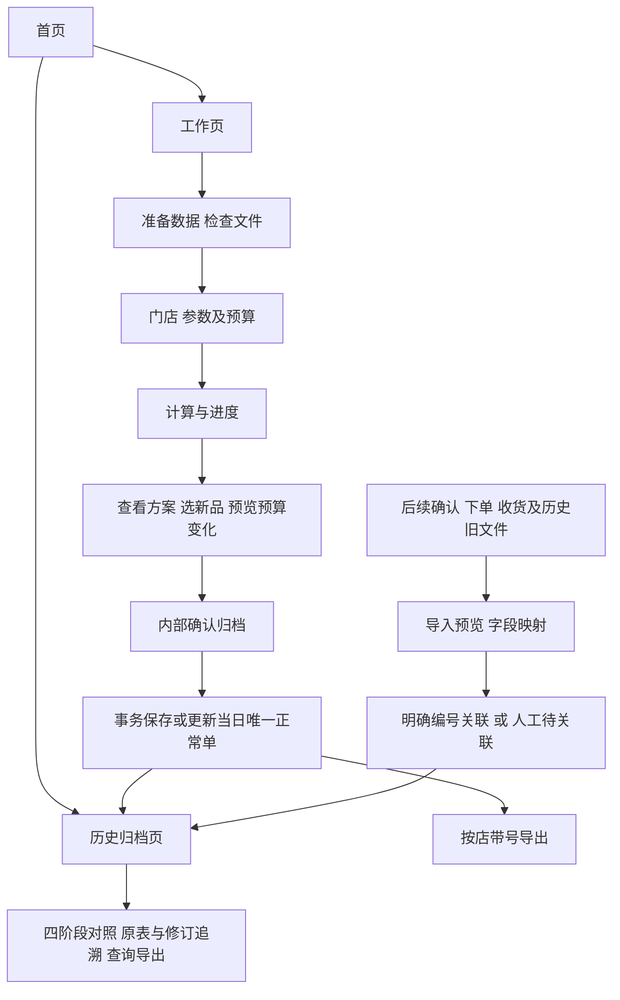
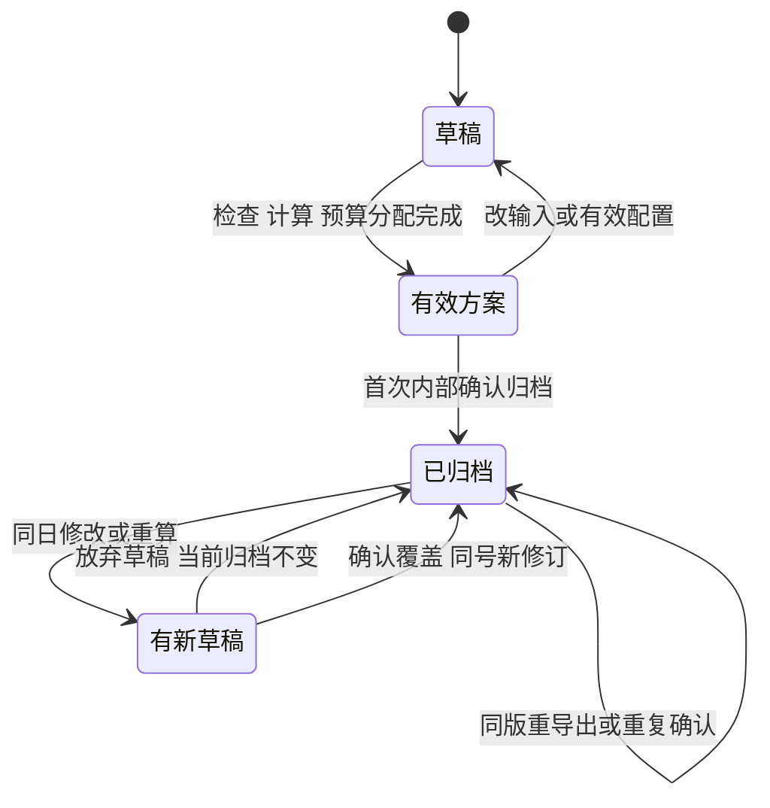

# 补货助手产品与交互方案 V1

日期：2026-10-29。状态：设计方案，未开发。代码依据：已验收0.6.2，发行证据提交25c11ba。本文件统一此前草案和补充中的规则，是后续开发的主方案；旧文档作为讨论记录。

## 1. 目标、已定规则与建议默认值

目标：工作人员完成补货计算、选择新品和资金分配，确认后自动归档并带号导出；事后能将不同格式的加盟商确认、实际下单、实际收货资料准确关联，按商品追溯数量变化。

### 已由用户确定

1. 首页进入工作页或历史归档页；既有资料、参数、计算及导出操作放在工作页。
2. 模型正常补货单按**业务日期＋门店编码＋正常补货类型**唯一。同日重新计算、再次确认归档，覆盖该正常单当前版本，不新增第二张正常单。其他类型补货另行归档。
3. 内部确认归档后，签发建议自动进入历史归档，不需要人工重新上传建议表。同日覆盖前询问。
4. 工作页正式传出的表带订单身份；后续四阶段资料关联属于历史归档，不构成工作页的下单、收货管理流程。
5. 新品判定为月销0、可用库存0、在途0、缺货天数0；新品可选。
6. 勾选新品参与同一门店总预算；必卖新品优先于普通动销，允许因此改变普通商品执行分配。
7. 保留现有模型、仓归属、库存单位、基本售价计价、箱规倍数、禁用/停采排除等口径；新品首铺与原模型计算建议分开保存。

### 本方案建议的默认值

新品默认不选，勾选后首铺1个最小出库单位；正式对外每店一个文件；首页只展示当天概况和最近作业；历史默认最近30天、可选任意区间；批量确认归档对本次明确选择的门店整体成功或整体失败。采用本地桌面、SQLite和文件归档，不新增在线加盟商平台。这些属于产品默认建议，后续开发若调整应更新方案，不改动已定业务规则。

## 2. 四个对象必须分开

| 对象 | 唯一性与用途 | 可否变化 |
|---|---|---|
| 每日工作草稿 | 当天一个工作区，可含多店；保存进度、选品、参数 | 可修改，同日替换已保存草稿仍确认；不是已签发业务单 |
| 正常补货单 | 每店每天正常链路唯一，单号稳定 | 当前修订可更新，不能同日另建第二张正常单 |
| 正常单修订 | 如V001、V002；冻结输入、配置、数量和依据 | 已确认修订只读；更新产生新修订并移动当前指针 |
| 阶段资料及关联 | 加盟商确认、采购单、收货单、旧资料、其他类型单据 | 原文件不改；事实修订和关系更正追加留痕，不回写模型 |

“内部确认归档”不等于“加盟商确认”；“已导出”不等于“已发送”，更不等于“已下单/已收货”。同日覆盖指更新正常单当前建议，不删除旧修订和真实后续事实。

## 3. 信息架构与主流程

后续资料尚未收到、尚未关联或数量有差异，不阻止今日继续计算和归档。历史资料关联不触发工作页重新计算，不自动下单或操作库存。

## 4. 首页交互

首页使用当前浅色背景、深绿色主按钮及中文表格风格；优先业务信息，不做复杂大屏。

| 区域 | 内容与操作 | 点击结果 |
|---|---|---|
| 顶部 | 业务日期、当前草稿/计算状态、最后保存时间 | 有运行任务时可回到该任务 |
| 主入口 | “开始今日工作”或“继续今日工作” | 打开同一个工作页实例，恢复相同状态 |
| 次入口 | “历史归档” | 进入最近30天的当前正常单列表 |
| 今日概况 | 已确认归档门店、待归档门店、需处理门店 | 带对应条件进入工作页或历史页 |
| 归档待办 | 待关联资料、跨版本材料、缺阶段资料、已记录差异 | 带精确条件进入历史归档；不称其为工作审批阻塞 |
| 最近正常单 | 日期、门店、当前版本、签发金额、资料完整度 | 打开单据详情 |

“签发金额”按当前修订去重统计，不把V001与V002相加。混合基本售价估算和真实采购金额时分开显示。无结果显示“待计算”，未归档显示“未归档”，不以0代替未知。

顶部固定导航：首页 / 工作页 / 历史归档。回首页不销毁工作区、不自动保存。任务运行时允许查看首页和只读归档，但禁止启动冲突任务；关闭应用沿用安全取消和回收策略。退出应用或替换工作区时提示保存草稿、放弃、取消，默认取消；保存草稿不会偷偷执行确认归档。

## 5. 工作页交互：保留四步，补齐最后一步

### 第一步：准备数据

沿用多文件、分仓资料、必卖清单及兼容混合资料入口。多文件检查仍默认最多2进程、单文件串行。展示文件结果、门店数、重复与冲突；有问题的门店明确标记，其他门店可继续。未知来源、缺字段、原文件变化保持原处理，不为新品逻辑吞掉错误。

### 第二步：门店与参数

保留门店选择、参数方案、主从仓、总预算和逐店设置。页面始终显示业务日期；同一店当日已有正常单时显示“已归档V00x，本次确认将更新该单”。不提供“同日另建一张正常单”按钮。

“保存门店默认/参数方案”仍是显式动作。新品当日选品不是门店长期默认，不自动传播到其他店或下一天。

### 第三步：计算与进度

保留门店排队、计算、成功、失败、取消及重试状态。取消后已完成结果按既有行为保留，尚未完成门店不被伪装为完成。重新计算只更新草稿，不改变历史当前正常单。

### 第四步：查看方案与归档

页面上方：门店/日期、有效方案状态、原归档版本；金额卡片分别显示经营候选、新品首铺、预算后提案、必卖占用、预算余额。下方结果按“动销补货 / 新品候选 / 缺货恢复及其他 / 全部明细”切换。

底部主操作依次为：**保存草稿 → 确认归档 → 导出加盟商确认单**。允许提供“确认归档并导出”的便捷入口，但必须先完成相同归档确认，再执行独立文件导出；导出失败不能回滚已成功归档的业务单。

| 当前状态 | 保存草稿 | 确认归档 | 正式导出 |
|---|---|---|---|
| 正在读文件/计算/分配预算 | 禁止变更性操作，提示等待或取消 | 禁止 | 禁止 |
| 未计算、冲突未解或结果失效 | 可以保存待处理状态 | 对受影响门店禁止 | 当前工作页禁止；历史仍可导出明确旧版本 |
| 有效结果，未确认归档 | 可以 | 可以，显示首次归档预览 | 引导先确认归档 |
| 新品选择改动、预算待更新 | 可以 | 先完成预算预览并应用 | 禁止导出旧值冒充当前方案 |
| 已归档且无业务变化 | 可以 | 显示“已归档”，重复操作不生成修订 | 可重导出同版本 |
| 同日有效新结果，与已归档不同 | 可以 | 显示覆盖差异，确认后同号新修订 | 归档前不能以当前方案名导出 |
| 历史只读作业 | 不修改历史草稿 | 不从此入口重算覆盖过去日期 | 可按明确历史版本导出并标“历史版本” |

数据存在待核行不必一刀切阻止整店归档：沿用现有可计算资格，待核/排除行随内部审计保存且不进入正式可补货行；输入冲突未解决、任务失败等使整店结果无效的情况才阻止该店。有效计算结果为0也允许归档，明确“本次无可执行建议”。

### 三条典型操作路径

- **今天首次做单**：首页“开始今日工作”→检查文件→选择门店/参数→计算→新品候选按需勾选→预览并应用预算→确认归档→看到单号和V001→导出。历史页无需再上传这份建议。
- **同日重做**：首页“继续今日工作”→修改并重算→页面提示“当前草稿未归档，历史仍为V001”→查看覆盖差异→确认后同号V002；取消则保留V001。无需用户判断本次是否“新建另一单”。
- **几天后收到回传**：首页“历史归档”→导入资料→选择模板→预览关联→明确匹配保存，缺依据的先存待关联→在原业务日期和相应修订查看数量对照，不打开今日工作区改数。

确认归档需要同时保存相关工作修订时，用同一个确认弹窗汇总工作保存和正常单覆盖的影响，不连续弹两次同义确认；“保存草稿”单独点击仍只保存草稿。

## 6. 新品与预算规则

### 判定

按门店，从现有解析后的原输入J/K/L/N检查四项有效数值零。N是原缺货天数，不是修正后的BA；空白、None、待核、负数及布尔值不补成0。现有解析可接受的文本数字沿用原解析，不另加隐式转换。

该标识表示“本店四项为零”，不是实际上市日期。不得复用model.py内部另有含义的Q“新品”。只在仓资料中存在、未出现在本店销售输入的商品缺少四项证据，不自动进入新品池。

| 条件 | 新品显示 | 是否可勾选首铺 |
|---|---|---|
| 四项均0、资料匹配且资格通过 | 新品候选 | 可以，默认不选 |
| 四项均0但禁用/停采、缺价或关键资料待核 | 新品＋阻断原因 | 不可选，先解决相应问题 |
| 四项均0但日销/周销与月销冲突 | 新品判定证据保留＋销量异常 | 不直接形成首铺提案 |
| 判定项有缺失 | 新品识别待核 | 不按新品自动处理 |
| 月销/可用/在途0，缺货天数大于0 | 非新品，可能为缺货恢复 | 按原模型处理 |

缺箱规仍按当前规则补1，显示该事实；这不等于外部表的箱/个换算可默认1。价格继续按V基本售价计提案金额。仓路由、从仓需求保留、禁用/停采排除不变，不因新品而拆单、截断或预占仓库存。

### 选品交互

新品表前置：勾选、商品、编码、必卖、分类、归属仓、库存单位、最小出库单位、首铺数量、估算金额和不可选原因。勾选默认1个最小出库单位，增减按倍数；手填不符时提示，不静默改量。

支持“只看必卖 / 可选 / 已选 / 未获预算”，与仓、分类、搜索组合。批量勾选明确作用于当前筛选的可选商品，操作前展示款数和金额；清空当前筛选与清空全店分开。筛选隐藏不取消已选项，显示筛选外已选数量。排序和搜索不改变底层分配顺序。

### 分配及变化预览

原模型AS/BV保留。以通过资格的经营候选，加上勾选新品的独立首铺候选，进入同一个门店预算。每个门店商品只有一条候选；异常情况下新品条件与经营正建议并存，先标记待核，不简单相加。

先必卖组、后普通组；同组保留现有缺货、预测持有天数、单次成本、商品编码及原位置排序。新品不伪造日均，在同组通常属于无预测项；必卖新品先于普通动销，不意味着所有新品先于所有老品。不得新增未确认的“每个新品先一箱”轮转规则。

选择变更后本店标“预算待更新”，其他店不变。“预览预算变化”列新增/增加/减少/暂缓商品及前后金额、最低持有缺口；应用后替换本店草稿分配，取消恢复进入预览前的选择和有效分配。预算不足的已选新品保留为“已选/预算暂缓”，不悄悄消失。

有预算时执行口径取分配量，无预算时取通过资格的组合候选量，不能因当前无预算直接回读AS而丢掉新品。确认归档冻结这份签发建议。未选新品时必须与0.6.2逐字段等价；选新品后只允许组合候选及其预算竞争导致的预期差异。无预测的新品持有天数显示“无动销依据”，不写0天。

## 7. 正常单、编号、版本与确认归档

### 身份

业务唯一键为`business_day + store_code + normal_model`。门店用稳定编码，不能按名称识别；仓、版本、计算时间、输入文件数量均不进入唯一键。多店当天批量归档形成每店各一张正常单。

展示单号建议为`BH-20261029-门店代码-ZC`；内部ID稳定，另有修订V001等。补货单号不冒充后续采购系统真实订单号，历史关联另外保存来源系统和采购订单号。明细ID在同一正常单中按稳定商品身份维护；新增商品产生新ID、移除商品留在旧修订，不能靠Excel行号或表格排序建立身份。

### 确认弹窗

第一次：标题“确认归档本次补货建议”，显示业务日期、明确选择的门店、每店经营/新品款数及金额、预算、待核/暂缓摘要。主按钮“确认并归档”，默认焦点“取消”。

再次：标题“更新当天正常补货单？”，显示同一单号、原/新修订、数量金额变化和减少/不再出现商品。若旧版已导出或已有后续资料，增加具体提示：“旧版已导出X次，关联确认/订单/收货Y份；更新不会改写这些资料。”详情可看旧版来源及受影响商品。主按钮“确认覆盖当天正常单”，默认取消。

多店确认只操作显式选中且有效的门店，显示将更新/新建/不能归档名单。禁止静默跳过失败店后声称全批成功。可以返回修改选择，再以清楚的N店范围确认；未选择店的原正常单保留，即使该店已从当前工作输入移除，也不能顺带删除归档。

### 原子保存和重复操作

确认归档在同一数据库事务内保存已确认工作修订、正常单当前指针、不可变建议快照、查询索引及事件。使用用户看到的旧修订校验并发冲突；另一窗口已更新时重新展示差异，不能盲重试覆盖。失败则旧正常单保持原样，草稿仍可重试。

业务指纹包括有效输入及来源版本、参数、仓/必卖快照、新品选择和有效结果；不含运行耗时、进程号、查看排序、导出路径。相同业务内容重复确认不增版本；数据来源/有效配置确实变更但数量相同，仍允许形成新修订并明确“依据变化，数量未变”。未确认的新草稿不影响已有归档。

### 跨天与历史

业务日期与计算时间、签发时间、文件日期、导入时间分别保存。跨零点不自动把昨日草稿确认成今日单；先提示已跨天，保留昨日草稿，明确转今日后重新检查数据，展示来源时间，不能宣称旧Excel已自动更新。默认历史正常建议只读；过去数据补建由历史归档处理，不开放普通工作页任意回写过去正常单。新一天正常单用新日期，不能继承昨日确认量。

## 8. 导出及加盟商填写交互

### 工作页两个清楚的出口

| 出口 | 默认内容 | 关键控制 |
|---|---|---|
| 导出加盟商确认单 | 当前已确认修订、每店独立、全部有效提案 | 不受当前搜索/筛选影响；预览门店、版本、款数、金额 |
| 导出内部明细 | 全量或明确的当前筛选，保留模型/预算/排除依据 | 筛选导出标“分析明细，非完整确认单”，不冒充正式建议 |

确认单工作表：概览、动销补货、新品推荐、缺货恢复、填写说明。没有该类时仍保留说明。推荐类型与必卖、排除、预算状态分别表达；零销量恢复不归为动销，新品未选或未获预算不塞进可确认行。零执行的有效正常单仍可生成明确的零建议概览。

文件名、概览及明细均带补货单号和修订；行带明细ID。展示商品/编码、推荐类型、必卖、简短原因、月销/可用/在途/缺货天数、归属仓、库存单位、箱规、签发量、基本售价和估算金额。加盟商可填写确认意见、确认数量及备注，编辑列统一浅蓝色，其他列保护防误改。

原建议列不能被确认量覆盖。“同意”对应签发量，“不采纳”明确0，“调整”填写实际确认量，“待确认/缺行”保持未知。加量或改变商品等可以作为历史事实材料保存并列差异，不自动改内部提案，不视为应用已批准新增预算。第一期不建设线上加盟商身份认证，也不自动发送群消息。

全店文件绝不包含其他门店数据或内部源路径；隐藏sheet不是隔离措施。导出范围选择、签发版本及文件SHA一并记录。文件先写临时文件，成功后登记归档附件；失败标记并允许重试，重启核验生成中状态。归档成功/文件导出成功分别显示，不能假装数据库和文件系统天然同一事务。

有新草稿未归档时，工作页正式导出提示先归档；用户若需要旧单，去历史详情明确选择旧版本。外部修改后的回传文件保存为另一份材料，不覆盖当时传出的原文件。已导出仅表示文件生成；实际发送只能人工登记或未来有真实发送回执后记录。

## 9. 历史归档页面与导入向导

### 页面布局

顶部业务日期区间、门店、正常/其他类型、单号、商品搜索；更多筛选包括推荐类型、资料完整度、待关联、版本不一致和差异类型。可保存常用筛选，返回列表保留位置。

三个主要视图：**正常单列表 / 待关联资料 / 操作日志**。正常单每店每日显示当前修订一条；其他类型有独立入口，不混进模型正常单统计。详情上方显示单号/门店/业务日期/当前修订，下方为：

1. 四阶段对照：签发建议、加盟商确认、实际下单、加盟商实际收货。
2. 商品依据：原模型、候选、新品选择、预算和来源。
3. 关联材料：原文件、外部单号、来源系统、单位口径和关系依据。
4. 修订对比：当前与历史修订的输入/参数/数量差异。
5. 操作时间线：归档覆盖、导出、材料导入、关联确认/更正、查询导出及失败。

列表的资料完整度、关联确定性和业务差异分开显示。没有收货表是“缺收货资料”，不是“未收货”；资料齐全也不等于数值完全一致。全局搜索商品可定位不同日期的同店商品及其来源。

### 五步导入交互

| 步骤 | 用户看到和操作 | 系统处理 |
|---|---|---|
| 1 选择资料 | 多文件拖入；选择确认/下单/收货/旧建议/其他类型 | 检测格式、哈希及已导入记录，不修改原文件 |
| 2 选模板或映射 | 工作表/表头行预览，字段和单位映射；展示未识别项 | 复用经过确认的模板；表头变化不静默套错 |
| 3 预览数据 | 业务日期与导入日期、店码/商品码/单号、数值及异常 | 保留原值和源行，标缺失；未关联材料允许先存 |
| 4 关联预览 | 明确匹配、人工候选、未匹配三组；人工指定单号/修订/数量分摊 | 仅确证关系自动匹配，相似度和群时间仅作提示 |
| 5 确认保存 | 本批归档份数、有效/待核行数、重复及新关系摘要 | 事务提交该批可归档材料及明确关系；失败不伪报成功 |

解析失败文件可保留原附件并标“未解析”，不得进入数量统计。业务材料存在矛盾不等于不能归档：原件保留，受影响行待核且不得进入确定口径。关系尚不确定时提供“仅归档，稍后关联”；不要求编造一个目标单才能保存。

模板维护包括来源系统、资料类型、字段映射、数量单位、文件是累计快照还是增量、外部单据及行身份、修订/撤销规则。新模板先预览和保存版本；模板变更不自动重解释已归档事实，重解析须显式对比并保留旧解释。

### 关联规则

自动关联要求有效补货单号+修订+明细ID且身份一致，或已有明确外部单据关系。采购订单号需附来源系统/供应商等作用域，不能认为号码跨平台唯一。编号丢失但商品码精确时，须先由人选择对应业务单和修订；商品码只能帮助行匹配，不能证明单据关系。

同一单可以分仓、分供应商、分批收货；同一外部采购单也可能合并多笔业务，须显式分配到明细，分摊之和不能超过该外部有效数量，同一数量不得重复记入两笔。无法拆清则保留未分摊，不默认按时间顺序或比例分配。替代品须有证据和独立替代关系，不改原商品码。

人工更正关系提供“原关联→新关联”和受影响数量预览，需备注原因；追加更正事件，可回溯原关系。只改历史归档，不改变工作页的正常单建议。操作人仅为本机/人工登记标识，不能声称已认证加盟商身份。

## 10. 四阶段数量与版本的展示口径

四阶段主列中的第一列为**建议数量（签发）**。内部展开保留原模型AS/BV、经营候选、新品首铺、预算后签发量；新品首铺不能冒充模型预测。

例如“签发12、确认6、下单6、收货5”，仅当证据和版本明确时显示“确认减6、下单比收货多1”。若收货资料缺失，该格是未知，不能计算成少收6。只归档部分资料时标“截至目前/部分”，差额标阶段性，不自动判定业务事故。

核心规则：

- 库存单位下比较数量，保留原单位、原量及换算依据；未知换算待核。模型缺箱规补1不能作为外部单位换算依据。
- 确认表通常是该次确认结果快照，不能把同一确认的多个导出相加；实际订单修订按外部有效版本解释；收货增量按唯一收货事件累计。
- 文件SHA相同是重复文件；另存导致SHA不同仍可能是同一业务快照。业务去重另依赖来源、单号、行ID、版本/事件，不靠文件日期。
- 撤单、撤销收货、退货分别保存，区分原量、撤销量、有效量和净收货；负数只有明确表示修正/退货的模板才可参与相应计算，不能一律截成0。
- 真实超确认下单、超订单收货保留事实并标差异，不因超计划而丢弃。仓发货、物流签收不能冒充加盟商实际收货。
- 估算金额与实际采购/收货金额分开；单位、价税口径不齐全时不强行合算金额差异。

### 同日覆盖后的旧材料

V002更新为当前正常单，V001已有确认/下单/收货仍关联V001。默认详情显示当前建议并提示“有资料基于V001”；可切换V001查看完整同版本对照。不能直接把V001实际数放在V002旁边算确定差额。

正常单根层可显示去重后的实际资料总量，但须标明涉及修订；跨修订对应关系不清时不输出确定的建议差额。多个确认快照不直接求和，多个实际订单/收货事件也先去重、处理修订和撤销。没有确证不自动迁移到新修订，也不抹掉旧事实。

已签发后删除商品、改变单位或仓、换商品码，修订对比逐项说明。新输入未出现旧商品表示“不再出现”，不自动等于加盟商拒绝0或实际订单取消。新修订只是新的建议，不自动产生撤单行为。

## 11. 边界与异常处理矩阵

| 场景 | 明确行为 |
|---|---|
| 同店同日重算多次 | 草稿可多次变，只有确认归档才更新唯一正常单 |
| 重复点击确认/导出 | 相同业务指纹与请求身份不重复建单；状态未知先查询再处理 |
| 两窗口同时覆盖 | 按旧修订校验，后提交者重看差异，不最后写入者无提示获胜 |
| 同日覆盖含旧回传资料 | 明示受影响修订，保留旧关联，不搬数不清零 |
| 从工作区移除某店 | 不删除该店已归档正常单 |
| 预算为0或全无需求 | 有效计算可归档0建议，未知不能填0 |
| 商品禁用/停采/地采 | 保留证据；新品不能绕过现有资格及排除 |
| 缺价/无效箱规 | 沿用计算待核；外部事实可原样归档，未核验不形成确定金额/单位换算 |
| 用户关闭或取消 | 草稿按原确认处理；已提交归档保留，未提交事务回滚；读取安全回收 |
| 归档成功但导出失败 | 正常单不回滚；提示文件未生成，可同版重导出 |
| 文件生成后应用异常 | 根据生成中任务及文件哈希恢复状态，不能再次计一份业务 |
| 原导入路径消失 | 自有快照/附件仍可回溯；缺少归档附件时明确提示，不假称完整 |
| 只收到部分回传行 | 未出现的行保持未知，不自动同意或拒绝 |
| 外部表加量/改码/多出商品 | 原件归档，行标差异或待关联；不改原提案，也不自动拒收真实事实 |
| 外部文件无单号/仅群时间 | 人工候选，不自动定案；可留待关联 |
| 历史同日多份建议无版本证据 | 不按导入时间自动选最新；人工认定当前正常版，其余标历史材料待核 |
| 多机归档同一正常业务键 | 识别业务键冲突，核对修订；UUID不同不能生成两张当前正常单 |
| 跨天工作/迟到回传 | 业务日期不随电脑时间或导入时间悄悄改变 |
| 历史归档导出 | 默认全部查询命中、预览范围；当前页与全部匹配明确区分 |
| 包含多店的源文件对外提供 | 只导出本店标准化视图；原多店附件仅内部可用，不能仅隐藏其他店 |

已归档正常单第一期不提供物理删除；错误单可提出有原因的作废设计，但不默认开发为另开正常单的捷径。如实施作废，仍保留业务键和历史，恢复/纠错更新同一单，不把实际订单同步撤销。

## 12. 数据、归档文件与实现边界

使用现有PySide6/SQLite，复用模型、输入适配、预算分配器、仓资料及结果公共口径，不引入通用审批引擎。

建议数据对象：每日工作修订；正常单及当前修订指针；不可变建议快照；导出附件；外部资料及解析版本；阶段明细；数量关联/分摊；操作事件；可重建查询索引。正常单唯一约束在数据库层实现，不只靠按钮禁用。

原件存入应用管理的归档目录，按内容哈希或内部文档ID保存，原文件名作为属性；业务查询不依赖用户下载目录。重复内容可复用物理文件，但仍区分来源及业务关系。备份需要数据库、归档附件和校验清单一并保存；恢复前核验一致性，不承诺仅复制SQLite就能恢复完整附件。

模块建议：应用容器/首页；复用Workbench的工作页；正常单与确认归档服务；新品候选组合；历史查询页；资料模板/导入；关联及差异服务；受众明确的导出模块。UI和Excel共用新品、执行及数量状态定义，不各写一套。

草稿、正常单建议、阶段事实各有自己的修订，不把加盟商确认状态塞进模型行后再当新输入计算。历史旧schema1继续可读，缺少新字段显示“旧版未记录”；旧作业不自动宣称已确认归档为正常单。选择补建时保留来源和人工认定，先备份再迁移，迁移失败保持旧库可用。

轻量索引支持日期/门店/商品/单号查询，默认分页；进入明细才解压需要的快照。列表不逐个读取所有历史Excel。导入和大导出在后台可取消，已提交/未提交状态清晰；取消不强杀写事务。技术日志与业务事件分开，保留业务结果和失败原因，避免逐行刷新或每次键盘输入产生日志。

模型规则版本是否不变由代码实际差异决定。即使原预测与预算算法不改，新品候选组合也改变执行语义，应记录应用版本、新品规则版本、确认模板版本及快照格式；不能称为纯结构整理。

## 13. 实施阶段与交付边界

| 阶段 | 可验收成果 | 暂不包括 |
|---|---|---|
| A 首页与导航 | 首页、持久工作页、历史入口；原读算取消/保存行为不回归 | 新品和外部资料关联 |
| B 正常单与自动归档 | 每店每日唯一、确认覆盖、修订、自动建议归档、历史查询及带号导出 | 后续表格全部模板 |
| C 新品与预算 | 四项判定、选择首铺、预算变化预览、分类导出；无新品等价 | 改预测、改主从仓规则 |
| D 历史关联 | 模板导入、原件保存、明确/人工关联、分单收货、四阶段对照及查询导出 | 在线加盟商门户、自动采购和库存预占 |

阶段B、C构成近期可试用的工作链路；阶段D另做样本驱动验收，不阻塞工作页交付。首版只支持提供样本并验证过的外部模板；未知格式允许保存待映射，不宣称自动读懂任意Excel。

## 14. 验收清单

| 编号 | 必须验证的结果 |
|---|---|
| N01 | 同店同日不同文件、参数、仓和多次计算只存在一张当前正常单 |
| N02 | 未确认重算不改归档；确认自动写入；覆盖取消、失败、并发冲突均保持旧单 |
| N03 | A店覆盖不动B店，工作区删店不删历史，重复确认不增版本、不累计金额 |
| N04 | 同版重导出保持单号/修订/行ID；新修订保留旧附件和关联；业务日期跨天明确 |
| P01 | 新品严格四项零，缺失/负数/异常/在途/仅仓资料情况都按定义处理 |
| P02 | 新品未选与0.6.2逐字段及顺序一致；选择新品仅影响授权候选和本店预算 |
| P03 | 必卖新品优先于普通动销，同组原顺序不变；预算0、无预算、箱规、缺价、排除正确 |
| P04 | 筛选排序不改变选品/资金；预览取消恢复，应用后金额与分配一致 |
| E01 | 正式导出全店已归档版本，不被当前筛选漏行；动销/新品/恢复易区分；原建议不被确认覆盖 |
| E02 | 每店文件不泄露其他店或内部源路径；零建议、导出失败、重启恢复和重复导出正确 |
| A01 | 原件、模板映射、日期/版本/源行可追溯；未知格式和缺字段不造数 |
| A02 | 改量仍能按明确身份关联；无号、跨店、错版本、同SKU多单不得自动错配 |
| A03 | 拆单、合单分摊、部分收货、重复导出、撤单、退货不重复计量 |
| A04 | 缺表不当0；单位缺依据不换算；估算与实际金额不混算 |
| A05 | V001事实在更新V002后保留，跨版本不输出伪确定差额，关系更正可追溯 |
| C01 | 数据迁移/备份恢复、只读历史、取消、并发写入、事务失败及附件丢失有明确结果 |
| X01 | 实际EXE覆盖首页/工作/历史切换、新品、自动归档、导出、模板导入及原有预算/仓/作业回归 |

实现前固定0.6.2源码及样本，用独立QA目录；无新品基线等价与新增业务预期分别验证，不能用旧回归报告代替新验收。所有新包独立目录，保留旧发行和用户资料，不自动推送、发布或替换正在使用的程序。

## 15. 后续落地所需的最少资料

方案无需依赖额外材料即可定稿。阶段D开发前，需一组人工能够确认对应关系的“签发建议、加盟商确认、实际下单、实际收货”样本；最好包含一次改量和一次分批收货，明确各表数量单位、累计/增量以及外部单号作用域。没有样本的格式先不承诺自动关联。

尚未承诺：任意Excel自动识别、从相似度自动确证历史、自动跨系统传递补货单号、加盟商账号认证、云端多人同步、实际下单/收货操作、不可篡改审计。这些不作为本轮工作页交付的隐含要求。

本轮交付仅为统一业务、交互及边界方案，无应用代码、数据库或业务文件变更。
