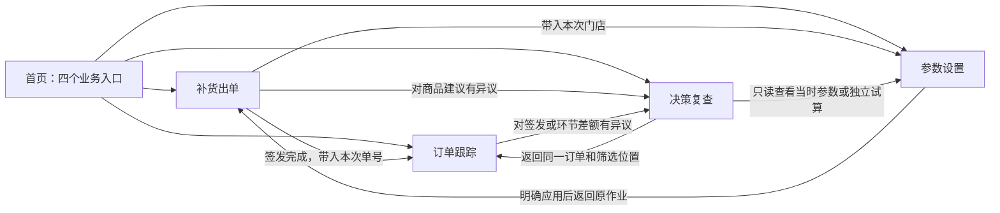

# 四个主干业务场景与低认知交互方案 V1

日期：2026-10-31。设计依据：0.16.1，提交3e167f5c86f64d1d8a98adffda8287b35ab76361，以及同日实际EXE与代码走查。本文是待实施设计，不代表功能已开发或验收。模型规则保持0.3.3-rules。

## 1. 目标与设计取舍

第一目标：业务人员用最少的必要操作完成目的，尽量不用记忆页面位置、技术概念、字段对应和先后顺序。

四个主干业务结果：

1. 正常补货出单：生成可以发给门店的分仓签发单。
2. 订单跟踪：将回传、付款、实际收货资料准确保存到相应补货订单，知道现在缺什么。
3. 决策复查：针对某张单、某个商品的异议，找到当时的事实、参数、计算过程及后续变化，形成有依据的解释。
4. 参数设置：明确设置会影响哪些门店、哪次作业、什么结果，并能保存复用。

允许同一功能出现在多个场景。重复入口调用同一个业务能力和同一界面组件，带入当前订单、商品、门店、日期等上下文，不维护不同口径的两套功能。

不以点击少为由隐藏覆盖范围、跳过必要核对或猜测关联。减少的是重复填写、重复选择、无意义弹窗和跨页寻找；业务确认、范围变化、覆盖已有事实等必要操作保留。

## 2. 四个稳定业务入口

首页只保留四个任务入口及各自的近期上下文，不再重复铺设完整工具条。主导航始终可见：

| 入口 | 主要回答 | 默认动作 | 完成标志 |
|---|---|---|---|
| 补货出单 | 这轮给哪些门店补多少，怎样交给门店？ | 开始补货／继续本次作业 | 选定店仓单已签发，目标文件已生成，成功与未完成范围明确 |
| 订单跟踪 | 哪张单缺回传、付款或收货？收到的表放到哪？ | 导入单据／查看待办 | 资料已确认保存，订单状态与待核信息刷新 |
| 决策复查 | 当时为什么补这些？问题出在什么环节？ | 搜索订单或商品 | 能定位事实与数量变化依据，或明确缺少什么证据 |
| 参数设置 | 调整哪些值、对谁生效、怎么复用？ | 查看门店设置／选用参数方案 | 生效范围、当前值和保存位置明确，可按需应用和复用 |

首页中的作业信息与订单待办分区，不再使用一个“未完成”数字混合店数和仓单数。订单待办标明日期范围；跨日未收齐订单提供直接入口，不因今天没有作业就消失。

业务资料作为共享支持能力，不增加第五条主干：补货准备中的“管理商品资料／清单”和参数页中的“资料与清单”都可打开同一维护面板。参数设置页仍区分模型参数与资料，不能把商品资料叫作参数。

默认导出位置、数据维护、回收站、版本诊断放入稳定的辅助入口。高频导出仍保持独立名称与按钮，不合并成含义不明的万能按钮。

## 3. 统一语义和用词

### 3.1 业务对象

| 统一名称 | 含义与边界 |
|---|---|
| 补货作业 | 一次准备和计算若干门店补货的工作上下文；草稿不是已签发订单 |
| 补货订单 | 每日、每店、每仓的正常补货链路，以补货单号关联 |
| 签发单 | 对外给门店确认的正式补货建议表；原“门店确认单／加盟商确认单”的业务身份统一为签发单 |
| 门店回传单 | 门店在签发单上调整要货数量后回传的资料；也可使用最低标准模板 |
| 门店付款单 | 带商品明细的已付款订单资料，商品金额按已确认口径作为实付金额 |
| 门店实际收货单 | 门店实际收货数量的资料 |
| 完整计算表 | 内部全链计算核对表，保留输入、参数、中间值及结果 |
| 商品资料原表 | 签发当时留存的完整原Excel，不以加工字段表替代 |
| 签发明细（内部） | 现有内部签发建议导出的加工明细，与门店用签发单区别命名 |
| 商品资料核对表 | 加工表，明确标明非原文件 |

### 3.2 数量与状态

保留原模型建议、预算前候选、预算后执行之间的差别。签发前界面展示“拟签发数量”；确认后称“签发数量”。四个实际环节数量为签发数量、门店回传数量、门店付款数量、门店实际收货数量，独立保存。

生命周期：已签发 → 门店回传 → 门店付款 → 门店实际收货。待办采用现有待回传、待付款、待收货、已收齐。资料需重新核对是数据有效性提示，不新增暂缓跟进、恢复跟进等手工状态。不增加模型推荐、部分单生命周期阶段。

“已收齐”表示所需环节资料齐全，不表示数量一致。整单无要货或无付款数量沿用既定无需后续单据规则，不生成假0单据。

签发修订、环节版本和哈希由系统内部维护，正常操作不要求填写或选择。当前有效订单作为普通入口；确需查看历史时，通过“历史记录”打开并明确只读，不删除底层历史。

### 3.3 固定动作名称

- 确认签发；确认签发并导出；导出签发单。
- 导入门店回传单／导出门店回传单。
- 导入门店付款单／导出门店付款单。
- 导入门店实际收货单／导出门店实际收货单。
- 导出完整计算表；下载商品资料原表；导出签发明细（内部）。
- 查看决策依据；查看订单跟踪；查看当时参数。
- 应用到本次作业；保存为门店默认；另存参数方案。
- 移入回收站、恢复归档分别为独立动作，不用同一按钮切换含义。

“保存草稿”只保存作业；“确认签发”正式固定签发并自动归档；“确认保存单据”只保存所选生命周期资料；“导出”只导出已有内容。确需签发和导出一起完成，入口必须明确叫“确认签发并导出”。

本次界面语义统一不自动改Excel字段、样式、文件名或历史内容。已有导出产物先按用途盘点，再改入口名称。新界面名称不导致原模板失效，原表头别名继续兼容。

## 4. 场景一：正常补货出单

### 用户看到的主线

准备本次补货 → 核对结果 → 签发并取得文件。

这是业务上的三个状态，不要求每次点三次“下一步”。保留计算进度，但不把进度页当成需要人工完成的步骤。

### 正常路径

1. 拖入补货建议。系统检查文件、归集门店，显示本次范围；读取已保存仓资料、门店主从仓、参数、清单。沿用现有门店选择规则，不静默改变选中范围。
2. 核对摘要并点击“开始计算”。资料和配置完整时不强制打开参数表。缺失、冲突、失效资料集中列在“需要处理”区，可直接定位解决。
3. 计算完成后进入结果核对。默认以门店为单位显示拟签发金额、异常商品数、新品安排及未满足需求。点击数值直接查看相关明细；已有参数和资料可在此处快捷查看。
4. 点击“确认签发并导出”。最终核对区一次列清日期、门店、仓、签发金额、正常单更新范围、文件数和默认目录；已有签发变化在同一区域核对。确认后后台签发归档并导出。
5. 完成区列出已签发订单和实际文件，提供“打开导出目录”“查看本次订单”“继续补货”。不强制跳走，保留本次工作上下文。

已有资料和默认目录、无异常时，目标为三个主要业务操作：拖入文件 → 开始计算 → 确认签发并导出。最后动作直接落在已展示完整范围的核对区，不能再叠一串逐店确认或目录选择。新路径实际操作次数在EXE中验收，不把目标当成已达成。

### 细节与边界

- 主从仓、参数、预算显示简明摘要，点开可编辑，默认不强制浏览完整超参。
- 新品保持显式选择，不为了少点一次而自动加入；动销与新品的既有筛选和导出范围不变。
- 普通结果数量变化不逐商品弹确认；错输入、冲突未决、未计价等沿用当前业务限制和明确提示。
- “确认签发”作为次要独立入口，可只签发暂不导出。历史页的“导出签发单”不隐含重新签发。
- 山东仓、河北仓分别导出。动销/本月新品/往期新品工作表、字段、顺序、类型、0候选范围与原版一致；原文件名仓标识位置及默认导出目录沿用。
- 导出仓的选择只改变文件范围；正常单归档仍保持现有整店保存范围。确认区分别列清签发保存范围和文件输出范围，不在页面重组时改变归档粒度。
- 签发后导出失败，完成区仍显示已签发；只重试未完成文件，绑定原签发内容，不重复签发。
- 同日更新正常单继续要求具体差异确认；预览后被更新则重新核对。对用户只显示当前正常单及变化，内部保留历史依据。
- 计算仍按现有并发队列自动继续下一店，不为新页面组织改变计算调度、门店隔离和取消规则。

## 5. 场景二：订单跟踪与单据保存

### 主界面

订单表占主体，固定显示日期、门店、仓库、补货单号、当前进度、回传/付款/收货是否已保存、需核对提示和下一步。金额显示明确属于哪个环节，不将签发估值当作实际付款金额。

顶部保留搜索、状态和日期筛选。首页待办、签发完成页、决策复查中的“查看订单跟踪”都进入此页，自动带入范围。回退保留筛选、滚动和选择。

用户可以从单张订单直接导入对应单据，也可以拖入多张订单、多个环节的资料。导入入口可重复，但均使用同一批量导入工作区。

### 导入的最低操作路径

拖入文件 → 系统识别并形成订单预览 → 确认保存。

正常识别时，不逐文件弹字段映射；自动识别出的字段与读取范围折叠显示，可随时展开。相同表头的明确映射可复用。未识别列、未知环节和关联不明才展开处理。既有入口不支持的任意表头/格式不能冒充已支持，不通过猜列或猜数量解决。

批量工作区按补货单号排列，列为回传、付款、收货，明确标记“已有”“本次拟新增”“本次拟更新”“本次未提供”。拖入不等于保存。

点击某单展开四数量对照及差额。正常增减是核对信息；非法数、错单或冲突才阻断。空白转0、缺行转0、清单外商品集中提示数量并可直达明细，沿用必要确认，不逐行弹窗。

### 操作范围必须透明

- 有勾选时，“导入所选订单单据”带入限定范围，显示所选单号和店仓数。范围外资料提示处理，不能自动扩大。
- 无勾选的“批量导入单据”按文件单号识别；缺号付款按完整来源订单分组，让用户选择目标。
- 从单单详情进入自动带入单号，文件中的明确冲突仍阻断。
- 筛选预览商品不改变整单保存或导出范围。选择范围变化导致依赖变化时重新生成相关预览。

### 跨环节同批资料

先用本批次选中的回传构造付款对照，再用本批次付款构造收货对照。未在本批次提供的上游，读取当前有效历史资料。文件到达顺序不影响核对口径。

缺少有效上游时，沿用现有仅留存待核能力，不能显示该环节已有效核对，也不能提前补出缺行0。确认页对有效资料和仅留存待核分别计数说明。

同一订单、同一环节的重复同内容不叠加；不同内容要求选择采用哪份完整单据，不按文件时间或到达顺序覆盖。保留整单更新，不引入部分单的生命周期。

付款继续按既有原表适配，商品金额即实付，数量不乘箱规，不新增门店编码或付款时间必填。来源外部订单不能按名称相近、日期相近自动关联；对缺少补货单号的完整来源订单提供一次性关联表。真实付款原Excel尚未提供，未来实际文件验收须单列，不用同表头合成样本冒充。

### 保存与反馈

在确认保存区一次说明新增、更新、重复不变、仅留存待核及未纳入的单据。使用者确认选中的整批以一个事务保存，失败整体回滚；问题订单可在保存前明确移出本次，但不能悄悄跳过。

读取、预览不改变正式业务单据。提交前取消不产生新增业务事实；最终提交不可强杀。已提交但界面结果未返回时先查询结果，不盲目重复保存。签发/上游在预览后变化则拒绝并刷新。

完成后直接更新原订单列表，显示保存结果并提供下一步；不强迫回首页。无需另点“归档”或“更新状态”。0、空白、缺行的既定有效数量和来源区别保持；整单未导入不当作0。

## 6. 场景三：对异议和异常进行决策复查

### 从哪里开始

可独立进入搜索，也可从补货结果、订单详情、生命周期差额或首页异常提示进入。“查看决策依据”带入当时订单、商品及被质疑的数量；不用重新选日期、仓库或资料。

搜索支持补货单号、门店＋日期、商品编码/名称。未提供单号而有多条结果时，展示可区分的订单，不凭相似度自动选定。

### 默认先回答业务问题

首屏先显示：当时签发多少、对应仓、当时销量/库存/在途、实际生效参数、已有明确数量变化原因；同时显示门店后来回传/付款/收货数量。

典型问题可快速筛选：为什么补这么多、为什么没补、为什么走这个仓、为什么预算后减少、后续哪个环节改了数量。筛选只是定位已有证据，不自动归责，不创建工单状态。

同一商品的依据按以下顺序展开：

| 查看层次 | 内容 | 防误解要求 |
|---|---|---|
| 当时事实 | 原销量、库存、在途、缺货信息、原表来源行 | 原值与用于计算的有效值并列，不用今天数据替换 |
| 商品与供货 | 实际匹配仓、分类、价格、箱规、禁用/停采等 | 展示实际选用资料，地采与缺失明确标记 |
| 生效参数 | 当时门店/仓周期、预测权重、预算和开关 | 展示最终有效值，无法证明的历史覆盖来源不编造 |
| 数量变化 | 原模型建议、已记录的恢复/约束、预算前候选、预算后执行、签发 | 只将实际改变数量的规则解释为原因，缺字段显示证据不足 |
| 后续变化 | 回传、付款、实际收货及差额 | 原签发和后续事实独立，不倒推覆盖 |
| 原始证据 | 完整计算表、当时商品资料原表、来源单据和原行 | 加工表与原Excel严格区分 |

不是每个旧归档都能还原全部中间归因。缺少记录时显示“历史未留存此项”，保留可核查的原值，不使用当前配置补成一条看似完整的历史链路。

### 操作与产出

日常正常路径目标：搜到订单/商品 → 打开决策依据。直接从订单进入时只需一次打开；全部已知上下文自动带入。

完整计算表、商品资料原表、签发明细保留三个独立导出入口，可使用已有单单/多单能力。复查可以导出当前核对视图，标题与范围注明订单、商品和依据，不能冒充原始单据。

原数据和签发始终只读。用户要验证“换个参数会怎样”，转到参数设置中的试算，带入可用的固定数据并明确“试算未应用”。不能把当前版本算法试算冒充旧版结果复现；版本或证据不足时直接说明限制。

本次不增加自动责任判定、完整问题工单或AI编造解释。能证明到哪一层就说明到哪一层，不能查明时给出缺少的具体资料。

## 7. 场景四：参数设置

### 面向结果的三个区域

1. 门店设置：按门店查看主从仓、各仓周期、预算及所用参数方案，支持批量选择和逐店差异预览。
2. 参数方案：管理完整方案、参数说明、预测权重及分类映射，沿用现有固定规则和允许编辑范围。
3. 生效核对：看本次或指定门店实际生效值，以及与方案、保存默认和当前编辑值的差异。

资料与清单维护作为辅助入口，与补货出单中的入口共用；不是新增一层覆盖模型。

### 每个参数应讲清楚

业务名称、当前值、单位、作用、调大/调小通常带来的影响、适用范围、是否可修改。完整公式和内部字段按需展开，不用英文键作为默认主标签。

生效表以当前实际值为准。现有程序的层间值比较不等于完整历史操作轨迹；旧记录未留存“谁在什么时候改过”时不能推断或编造。

不重定义配置优先顺序：沿用标准初始化、方案填充、门店已保存配置及本次显式应用行为。各仓周期优先于通用值；分类权重按实际仓归属与分类重新绑定。恢复旧作业和查看历史继续使用原快照，不读取今天默认代替。

### 固定动作与生效范围

| 动作 | 生效范围 | 不隐含执行 |
|---|---|---|
| 用此方案填充 | 当前编辑表单 | 不立即应用或改门店 |
| 应用到本次作业 | 明确选中的本次门店 | 不保存门店默认，不改历史签发 |
| 保存为门店默认 | 明确选中的门店，供后续作业带入 | 不静默重算或改写当前结果 |
| 另存参数方案 | 可复用方案库 | 不自动应用所有门店 |
| 试算对比 | 明确固定的数据与参数组合 | 不覆盖正式结果、签发和门店默认 |

若保留“应用并保存为门店默认”的组合快捷动作，必须始终叫这个名称，并一次展示两种影响；不能随状态变化为另一个动作。默认采用独立动作，避免用户误判保存到了哪里。

从补货作业进入参数设置，自动带入所选门店和当前值；从决策复查进入“查看当时参数”只读，另提供独立试算。独立打开参数设置时按目标门店编辑默认，不能不知不觉改当前作业。

应用影响计算的修改后，仅相关门店结果失效并提示重新计算；不重新计算未受影响门店。保存为默认后，当前作业是否应用由明确动作决定。预算是否保存为默认继续沿用现有显式选择。

正常路径目标：选定门店/方案 → 修改或选用 → 一次确认明确范围后应用/保存。保存成功应直接说明保存到哪里、对本次是否生效及是否需要重算，不依赖用户推测。

## 8. 四场景如何互相连接

所有场景共享同一订单详情、商品决策依据、参数表单、导入工作区和导出服务。入口传递明确上下文及返回位置，不复制业务规则。跳转不丢失草稿、勾选、筛选和滚动，也不暗中扩大店仓范围。

## 9. 全局低认知交互规范

1. 只问程序不能确定的事：已知单号、上环节数量、门店仓库、已保存参数和已配置目录自动带入。
2. 正常项折叠，异常项直接定位：先展示结果和需要人判断的内容，不先展示原始技术表。
3. 同样名称始终同样含义；不同产物必须不同名称。镜面动作使用同一对象名称。
4. 当前作用范围始终可见：本次几店、几仓单、几份文件、哪个日期、当前筛选与已选是否不同。
5. 最终一次确认包含完整影响：避免连续点击多个泛化“确定”；同日覆盖、上游变化等确需核对的事项不能省略。
6. 文件选择、关联、参数编辑和异常处理在连续工作区内完成；返回时保留操作状态，避免逐文件多层弹窗。
7. 等待有阶段反馈：读取第X/Y文件、核对第X/Y单、生成第X/Y文件；不可准确估计的阶段显示任务名、运行状态和已等待时间，不伪造百分比。
8. 完成不是一个短暂消息：显示成功、失败、取消未完成与下一步，失败只重试未完成项。
9. 删除/恢复、保存草稿/签发、应用本次/保存默认分别表达。关闭有未保存编辑时才提示，不在单纯查看退出时反复确认。
10. 后台读取、检查和导出使用现有任务能力；本次不靠扩大并发来声称更快。列表分页、明细按需读取，避免切换场景重新加载整库。
11. 高频键盘操作复用现有快捷键，搜索回车即可；焦点和选择可见。危险或覆盖动作不作为默认回车操作。
12. 不强制配置完整套件才允许做已有合法任务；例如只导入回传，不要求补齐付款和收货才保存。

## 10. 实施组织与边界

### 第一批：统一语言与四场景骨架

整理入口、导航和文案，确认导出产物对应关系；复用现有组件，把首页待办跳转、工作页出单结果和订单管理接起来。旧入口保留可用快捷方式，避免熟练使用者突然找不到功能。

### 第二批：先打通补货出单和订单跟踪

建立签发完成结果区和统一订单详情；明确勾选范围；实现批量生命周期队列、付款来源订单关联、跨环节预览和整批原子保存。这部分包含新增批量能力，独立验证，不能作为单纯改按钮处理。

### 第三批：打通决策复查和参数设置

复用历史快照、商品原附件、已有计算字段和参数试算，完成订单/商品上下文跳转、证据分层、参数作用范围和返回原作业。缺失证据如实提示，不为解释增加另一套计算。

### 第四批：四条路径整体验收和独立打包

四个场景均达到完成标志才称本轮完成。应用版本按项目流程单独设置，模型版本不因界面组织变化而改变。保留旧版、旧数据和原导出，未经要求不合并、不推送。

### 技术落点

- application_window.py：四场景导航、首页摘要及上下文跳转。
- batch_app.py / workbench.py：复用计算和草稿，调整出单交互与结果衔接。
- lifecycle_home_ui.py / lifecycle_ui.py：复用状态判定与单据功能，统一订单详情与导入界面。
- 新的批量编排层：分组、关联、依赖预览、提交协调；继续复用lifecycle_io、lifecycle_rules和order_lifecycle的业务校验，不能复制数量口径。
- history_ui.py / history_forms.py：决策依据、原始快照及来源查询。
- parameter_ui.py / parameter_view.py：共用参数表单与实际生效核对，不新增覆盖层。
- archive_batch_ui.py及现有导出模块：仅入口重组和明确命名，原输出实现复用。

本轮不重写model.py、one_box_exception.py、allocation.py，不改变预测、21天约束、双零最低持有、在途保底、箱规、预算策略、新品选择、仓路由和排除规则。不进行无关存储迁移、云同步、部分订单业务、收付款执行、自动催办或责任认定。

## 11. 验收：用实际任务衡量，不只检查按钮

以下是设计目标，尚未实测达成。区分业务操作、必要选择和异常处理，不将阅读核对时间假装为零。

| 场景 | 无异常、已有必要配置时的目标路径 | 必须覆盖的异常或边界 |
|---|---|---|
| 补货出单 | 拖文件→开始计算→确认签发并导出 | 两仓、未保存草稿、新品选择、预算、同日更新、部分文件导出失败 |
| 订单跟踪 | 拖文件→核对并确认保存 | 多店多仓、混合环节、缺号付款、乱序完成、重复冲突、缺上游、预览过期、取消回滚 |
| 决策复查 | 搜索定位→打开依据；已有上下文直接打开 | 旧历史缺字段/原附件、某规则未实际增量、后环节变化、不同仓、旧模型无法复现 |
| 参数设置 | 选择对象→修改/选方案→确认范围后应用或保存 | 多店差异、默认与本次分离、仓周期和分类权重、生效核对、试算不改正式结果 |

逐项验证：

- 同一功能从不同场景打开，已知上下文不要求重新填写，数量与导出一致。
- 同输入同有效配置严格比较商品完整性、顺序、全部业务数值、原因和导出单元格值/类型/样式；界面重命名不改变旧模板。
- 独立QA库中比较原签发与历史资料未变；跨环节批量导入与分别导入对照一致，原子性、版本绑定、取消、失败重试均有证据。
- 实际EXE走完四个场景，记录每条路径的操作次数、必填次数、强制弹窗数、界面等待与任务总耗时；不以源码启动代替EXE验收。
- 在常用窗口尺寸及较小尺寸检查关键订单身份、下一步、范围和完成状态不被挤出首屏；补充键盘焦点验证。
- 选择真实业务样本由使用者按任务操作，观察是否仍需口头指导。没有实际观察前，不宣称已经“极致易用”。

## 12. 本轮设计产物

本文确定四场景的目标、入口、关键路径、语义、复用关系、最小操作原则及验收边界。未修改应用代码，未打包或推送。后续实现以本方案为框架，具体参数数值和计算规则仍以当前已验收实现为准。
