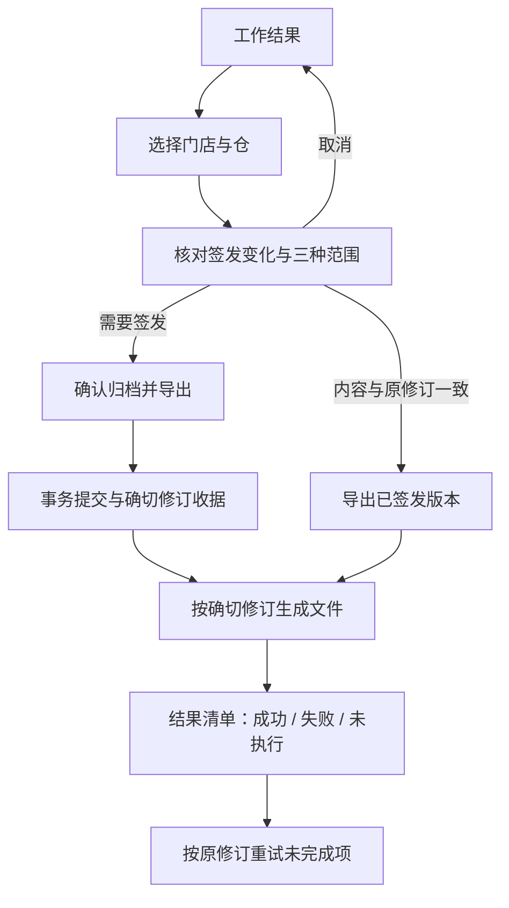

# 补货助手：按钮交互审查与整改方案

日期：2026-10-30。状态：**仅审查与设计，未实施程序修改**。

## 1. 审查基线与方法

- 源码：`feature/batch-archive-export-0.12.0`，`cba4c97887c2640114ae71b6c1d562b95f47eb59`；开始时工作区干净。
- 当前交付：`交付_0.12.0_rc2`；其构建提交为 `5686361900ad0ec420c57c6ff7e45014d8b351dc`。源码 HEAD 与构建提交分开记录，不能当作同一提交。
- 审查主线是**按钮定义 → 动态文字 → 实际回调 → 数据作用范围 → 写入时点 → 取消/失败处理**，不是搜索斜杠后机械拆按钮。
- 对 `src` 非 smoke 脚本做 AST 全量扫描，原始索引见 `qa/button_audit_012/button_inventory.json`、`button_inventory.txt`。其中 179 个按钮相关调用点含公共构造器、标准按钮查找、重复页面、旧入口，不等于 179 个独立可见按钮。
- 按当前 `ApplicationWindow → Workbench(ParameterUi, BatchWindow)` 的实际继承关系核对。`legacy_window.MainWindow` 的旧按钮及已被 `ParameterUi` 覆盖的 `BatchWindow.edit_parameters` 不冒充当前界面问题；`ApplicationWindow` 最后改写的按钮文字优先于构造时文字。
- 已补看隔离资料下的首页、历史页、准备数据页及方案库，证据为 `01-home` 至 `04-presets` 的 PNG/TXT。用户要求改用代码审查后，停止界面操作，后续结论以代码为依据。
- 本轮没有执行删除、恢复、覆盖方案、导入回传、签发或实际导出；不声称这些操作已完成运行验收。未计算误操作率。

## 2. 结论

问题不只是“一个按钮上写两个动作”，而是四类边界混在一起：

1. **动作边界**：移入回收站和恢复属于相反动作；应分开。
2. **对象边界**：有的操作认勾选，有的认高亮行，有的认上次打开的门店，部分操作认整个批次。
3. **保存边界**：查看、编辑、应用本次、保存门店默认、保存公共方案、签发归档属于不同层级；当前有些入口混在同一弹窗。
4. **产物边界**：导出内部明细、导出加盟商确认单、下载原文件、导出加工核对表不是同一种产物。

建议优先修正会动错对象、意外写入或错误理解取消含义的入口，再统一命名和布局。不要把所有斜杠入口都拆成多个同级按钮。

## 3. 问题清单与逐项设计

优先级说明：P1 为应先整改的范围/写入歧义；P2 为入口、命名与产物说明改进。每项“现状”来自所列源码，不把建议当作已实现。

### 3.1 历史、归档与导出

| 编号 | 入口与代码位置 | 已确认现状 | 设计 |
|---|---|---|---|
| A01 · P1 | `移入回收站 / 恢复`；application_window.py:390 `change_archive_visibility` | 同一按钮根据当前行是否删除执行相反动作。已有默认取消的确认框，且作用于该仓全部修订。 | 正常归档只出现“移入回收站”；回收站只出现“恢复归档”。位置、图标和颜色区分，不能用一个开关反转。保留全部修订作用域提示。 |
| A02 · P1 | 同一历史操作区；application_window.py:390/402，archive_batch_ui.py:115 | 三项批量导出读 `archive_checked`；打开和删除读 `currentRow()`。勾选多单并不意味着删除这些单。无当前行时删除直接返回。 | 查看详情放到行内或单据侧栏；批量操作栏只认勾选。移入回收站/恢复如果提供批量能力，明确“N张仓单”，无勾选禁用，不回退使用高亮行。 |
| A03 · P1 | 工作页 `选择门店并导出加盟商确认单`、确认框 `确认并导出`；application_window.py:301 | 内容未归档或已变化时会同时保存完整草稿、签发/修订正常单，再导出；相同内容可复用原修订。 | 入口“制作加盟商确认单”；核对后按状态显示“确认归档并导出”或“导出已签发版本”。历史入口始终“导出此修订确认单”。保留自动归档规则。 |
| A04 · P1 | 同一加盟商流程；application_window.py:326 | 导出可仅勾选某仓，归档仍保存所选门店的完整正常单，不只这个仓；完整草稿也同时保存。确认框已有说明，但容易被文件范围掩盖。 | 核对页分三行明确“草稿保存范围 / 正常单签发范围 / 文件输出范围”，逐店列仓和修订。不能为了界面简单改变事务范围。 |
| A05 · P1 | `仅确认归档（不导出）`；application_window.py:277 | 使用门店设置页的勾选门店，并过滤已完成状态；并不以当前结果表高亮行决定。这个作用范围在结果页不直观。 | 点击后显示明确门店选择/核对面板；主按钮“确认归档 N 家店”，展示跳过项及原因。与加盟商入口共用同一选择语义，但保留原业务范围。 |
| A06 · P2 | `打开选中单据 / 修订`；application_window.py:402 | 打开当前高亮的一个仓单，随后选修订；不是批量打开。 | 行内“查看单据”；侧栏标题固定展示日期、门店、仓、单号、修订。与批量栏分离。 |
| A07 · P2 | `操作记录 / 回溯单据`；history_ui.py:168 | 打开日志页；双击日志回溯对应修订。日志页三个导出按钮导出当前日志行绑定的单据资料，并非导出筛选后的操作日志。 | 入口“查看操作记录”。日志内独立区标“当前记录关联单据”，进入单据后使用三项导出；不把单据导出放在看似“导出日志”的位置。若未来补日志自身导出，明确另叫“导出操作记录”。 |
| A08 · P2 | `下载商品资料原表`；archive_batch_ui.py:75 | 进入后还可选择“多订单资料核对表”，后者是加工表。已有清楚说明，不是以加工表冒充原文件，但入口名称仍只承诺原表。 | 主入口保留“下载商品资料原表”；加工表放相邻次级入口“导出商品资料核对表（加工）”。原文件缺失时明确失败，不自动降级成核对表。 |
| A09 · P2 | 计算依据窗口的导出按钮；history_ui.py:123/131 | 根据当前查看范围，按钮在原文件下载与核对表导出之间变义。 | 两个固定含义入口：当前表单区“导出此核对表单”，附件区“下载当时原文件”。不支持的入口禁用并给原因，不能在同一位置静默换产物。 |
| A10 · P2 | `内部全量明细` / `内部当前筛选`；application_window.py:57、ui_results.py:151 | 两者都是当前门店内部报告；前者忽略当前筛选，后者使用筛选。名称缺少“导出”和“本店”。 | “导出本店全量内部明细”“导出筛选内部明细（N行）”。展示店名、仓筛选、商品筛选；全量入口标明“不采用页面筛选”。保持各报表已有字段和范围。 |
| A11 · P2 | `内部批次明细导出`；batch_app.py:342 | 另开本批门店选择框，与查看某店明细的两个入口不同。 | 放在“内部核对”区，名称“导出本批内部明细”；保留门店选择及未完成状态说明，与加盟商确认单视觉分区。 |

### 3.2 参数、默认设置与草稿

| 编号 | 入口与代码位置 | 已确认现状 | 设计 |
|---|---|---|---|
| B01 · P1 | `查看完整模型参数`；batch_app.py:66 → parameter_ui.py:115 | 实际进入可编辑、可保存/归档版本的公共方案库，不是只读查看该店生效参数。 | 全局入口统一“管理参数方案”；门店行另设“查看生效参数”（只读）和“编辑本店参数”。已有生效核对表保留。 |
| B02 · P1 | `批量设置仓参数`；batch_app.py:204 → parameter_ui.py:120 | 打开的完整表单包括模型超参、权重、分类映射、仓周期等，应用整个表单。 | 改为“批量编辑完整参数（N店）”；仓周期快捷入口若保留，只展示明确的仓周期编辑范围，不能暗中写回其它字段。第一轮可只改名，避免新增另一套计算配置实现。 |
| B03 · P1 | 参数窗口 `复制另存方案` / `保存方案新版本` 与底部 `取消`；parameter_ui.py:89 | 保存方案立即持久化；随后点窗口“取消”不会撤销已保存的方案。窗口又提示“修改先仅保留在此窗口”。 | 将“管理方案”与“编辑门店参数”分成独立窗口。方案管理成功后明确“已保存为…，未应用门店”，底部“关闭”；门店编辑仅在应用按钮提交，“取消”只丢弃未应用编辑。 |
| B04 · P1 | `归档所选版本`；parameter_ui.py:84，work_repository.py:51 | 自定义版本立即写 archived=1，无二次确认；标准版后端拒绝；没有同屏恢复入口。与订单“归档”用词冲突。 | 改“停用此方案版本”，二次确认显示方案名/版本/已绑定门店不受影响；内置标准版提前禁用。首轮不承诺新增恢复能力；若后续增加“已停用方案”页与启用功能，单独验收。 |
| B05 · P1 | `载入此方案`；parameter_ui.py:82 | 替换当前编辑表单，没有未保存编辑替换核对。 | 改“用此方案填充表单”；表单有修改时提示将替换哪些编辑，默认取消；填充成功仍明确“尚未应用门店”。 |
| B06 · P1 | 多店参数编辑；parameter_ui.py:14/120 | 以第一家参数展示，应用整个表单统一所选门店；顶部已有文字说明，预算/主从仓保留。 | 首屏突出“N店参数不完全相同”；应用前提供逐店差异，不能只显示第一家。保持现有整表应用语义，不暗中新增“只改有变化字段”的另一套规则。 |
| B07 · P1 | `全选可计算门店` / `取消全选`；batch_app.py:185 | 遍历所有可用门店；筛选只是隐藏行，不限制全选和清空范围，已选隐藏门店仍参与后续动作。 | 拆成“全选当前筛选（N店）”“全选本批可计算（M店）”；“清空全部勾选”明确范围。常驻“已选N店，其中隐藏M店”，可查看已选清单。 |
| B08 · P2 | 门店参数列动态按钮；parameter_ui.py:131 | 按钮文字主要是方案名称、版本、已保存默认/仅本次状态，实际点击进入编辑。 | 状态改成独立文本/标记，按钮固定“编辑参数”；不要把状态当动作标签。 |
| B09 · P1 | `仅用于本次`、`保存为门店默认并应用`、顶部保存默认；parameter_ui.py:37/139 | 分别影响当前门店配置、后续自动带入默认；保存默认不等于保存每日草稿；方案另存也不等于应用门店。 | 分别使用“应用到本次 N 店”“应用并保存为 N 店默认”。旁列说明三个保存对象：本次草稿、门店默认、方案库，成功提示标出已经保存哪一层。预算是否保存仍按现有选项，不自动扩大。 |
| B10 · P2 | `打开 / 继续今日作业`；workbench.py:166 | 可选历史日期，旧日期/旧模型恢复后可能只读；同一文案不能说明编辑权限。 | 按所选记录显示“继续今日草稿”或“查看历史草稿（只读）”；状态旁解释只读原因。复制另设“用此配置新建今日草稿”，说明只复制配置、不刷新旧输入。 |
| B11 · P2 | `新建今日作业`、`保存作业`旧提示、`转为今日作业`；workbench.py:17/114 | 当前主按钮已改为保存草稿，但部分提示仍叫作业；跨天转换不会刷新输入数据。 | 统一“每日草稿”；“转为今日草稿”必须保留旧数据日期提醒；“保存后继续”写明目的，如“保存后新建”。不改变同日覆盖确认。 |

### 3.3 导入、选品与异步任务

| 编号 | 入口与代码位置 | 已确认现状 | 设计 |
|---|---|---|---|
| C01 · P1 | 分仓资料与必卖清单 `导入 / 更新`；warehouse_ui.py:28/33，ui_session.py:33，batch_app.py:232 | 同一入口选文件，读取成功后即保存并替换持久资料；不是只供本次预览。已有标题说明完整替换，但没有单独最终数据预览确认。 | 空状态“导入河北仓资料”；已有资料“更新河北仓资料”。流程显示原/新版本、商品数和影响，最后“确认更新并保存”；必卖同理。旧历史快照不变。 |
| C02 · P1 | `本月无关注新品`；application_window.py:98 | 生成空关注清单，经确认后保存，改变本月/往期分组；不是单纯标记一句状态。已有确认保护。 | 未设置时“确认本月暂无关注新品”；已有清单时独立“清空本月关注清单”，显示清空数量和重签影响，默认取消。不改变新品选品量。 |
| C03 · P2 | `导入新品明细 / 关注字段`；application_window.py:58 | 进入同一导入、字段映射、预览流程，不是两个独立业务动作。 | 改“导入新品关注清单”；字段映射作为下一步，保留“保存关注清单并用于本次”的明确提交动作。无需拆两个主按钮。 |
| C04 · P1 | `使用当前资料重新检查`；workbench.py:185 | 重新加载已保存仓资料和必卖清单后检查文件，可能替换恢复草稿中的当时资料。 | 改“换用最新资料并重新检查”；先列本次将切换的资料版本和需重算门店。与单纯重试原检查区分。保留历史快照只读。 |
| C05 · P1 | 汇总页 `选择本店新品 / 预览预算`；application_window.py:246 | 优先使用 `current_store`（此前进入明细的门店），无该店才弹选择；汇总页“本店”指向不充分。 | 汇总页“选择门店并安排新品”，每次显式选店或展示当前对象；单店详情页“为【店名】安排新品”。预览与应用两步保留，不能点选即改正式结果。 |
| C06 · P1 | 单据内 `导入回传Excel`；feedback_ui.py:68 → import_returns | 调用全局批量导入函数，没有把当前 `head` 作为输入约束；因此可以导入其他订单，随后只刷新当前窗口。 | 全局历史页保留“批量导入加盟商回传”；单据页提供“导入本仓单回传”，不匹配则拒绝并引导去全局入口。按单号+仓+修订绑定，不按日期/相似名称猜测。此范围收紧应单独测兼容文件。 |
| C07 · P2 | `门店确认 / 导入回传`、`回传来源 / 下载原文件`；history_ui.py:41，feedback_ui.py:49 | 实际都是打开管理/附件窗口，不是点击即导入或下载。 | 入口“查看门店回传”“查看回传附件”；窗口内部保留独立“导入本仓单回传”“下载所选回传原文件”。 |
| C08 · P2 | `导出当前对照`；feedback_ui.py:90 | 导出当前仓单、当前选中回传版本的数量对照，不是全局筛选结果。 | 改“导出本仓单回传对照”，上方固定显示签发修订和回传版本。导出后不回写签发建议。 |
| C09 · P1 | 通用 `取消`；ui_work_io.py:75/97、business_ui.py:30、batch_app.py:280 | 准备期、写事务、保存、已归档后写Excel，各阶段取消能力不同；代码已有提交期禁用/延后停止等保护，但通用文字仍不足。 | 按阶段使用“取消准备”“停止剩余导出”“正在提交，暂不能取消”。提交后的停止提示明确归档保留、已完成文件保留；不承诺全部回滚。详见下表。 |
| C10 · P2 | `重试失败门店`；batch_app.py:279 | 重试本批所有失败门店，并非页面当前选择的门店。 | “重试本批失败门店（N家）”；弹出或展开清单，保留原条件，不悄悄把已停止/已完成门店纳入。 |
| C11 · P2 | `查看 / 重试`、`查看参数 / 所选商品依据`；history_ui.py:63/98 | 前者都是加载当前范围，后者打开同一个多类别核对窗口。 | “查看计算依据”；依据窗口用清楚分区/标签切换，失败时加载动作显示“重试加载”。不必把每个字段类别再做成顶层按钮。 |

以上为 **33 组整改事项**，同一项可能对应多个实例。P1/P2 是整改顺序，不是已经发生数据损失的断言。

## 4. 应保留、统一命名但不必拆分的入口

| 当前入口 | 判断与建议 |
|---|---|
| 开始 / 继续工作 | 只切到工作页；改“进入工作页”，不用拆两个做相同事的按钮。恢复今日草稿仍独立。 |
| 历史归档 / 日志 | 顶部导航统一“历史记录”；页内“归档单据 / 操作日志 / 回收站”清晰分区。不能拿导航切换作为数据动作。 |
| 存储维护 / 旧版兼容副本 | 统一入口“数据维护”，内部明确“生成升级副本”“生成旧版兼容副本”，仍生成新副本，不原地迁移。 |
| 第一次使用 / 操作指南（F1） | 改“使用指南（F1）”。现有快捷键保留，不能再声称当前完全没有快捷键。 |
| 添加 Excel / 移除选中文件 | 改“添加补货文件”“移出本次文件列表（N份）”；说明不会删除磁盘原文件。读取检查仍独立。 |
| 下载最低标准模板 | 就地改为“下载补货模板 / 商品资料模板 / 回传模板”等；模板内容和最低字段不顺带变更。 |
| 查看、查看清单、备份 | 增加对象名，如“查看河北仓资料”“查看必卖清单”“备份必卖清单”。 |
| 读取并校验、读取并预览 | 校验/映射的顺序步骤可保留；通用选择对话框本身只 accept，真实读取在调用方，不能把关闭选择框当作已经校验成功。 |
| 应用选择并重新检查 | 对冲突选择而言是完整且已写明的连续动作，可保留；批量提出选择不是直接提交，撤销能力保留。 |
| 停止剩余任务 | 已有“不再启动新门店，等待运行中门店完成”反馈和禁用重复停止，保留；增加运行/排队数量即可，不假装立即中断计算。 |
| 选中当前筛选可选商品 / 清空当前筛选选择 / 清空全店选择 | 已区分范围；将全店清空放远离常用选品动作的位置，显示数量，可在本次编辑内撤销；不需要每次局部取消勾选都弹确认。 |
| 仅重试失败 / 未执行项（原修订） | 同一种重试操作，改“重试未完成项（N单）”；仍绑定原修订，成功项不重出。 |
| 选择目录并开始导出 | 可以是一个清楚的连续动作；更统一的步骤文案为“下一步：选择导出位置”，选完目录再执行，取消选目录不写文件。 |

**核查纠正：**必卖“备份”及内部导出的文件选择器确实使用 `DontConfirmOverwrite`，但 `priority_list.export_profile`、`xlsx_exports.export_xlsx` 在写入前明确拒绝已有文件。因此不能认定为“无提示覆盖旧文件”的缺陷。建议提示“请选择新文件名”，保持后端拒绝覆盖；不因本轮交互整理放开覆盖。此前过程中只看到文件对话框选项，最终以完整调用链为准。

## 5. 统一界面布局

### 历史页

```text
历史记录                         [归档单据] [操作日志] [回收站]
日期 / 门店 / 仓 / 单号 / 商品查询                         [清空筛选]

已勾选 12 张仓单 · 4店 · 3天                  [查看已选] [清空全部勾选]
[导出完整计算表] [下载商品资料原表] [导出签发建议]
[加工资料核对表]（次级）                           [移入回收站（12）]

勾选 | 日期 | 门店 | 仓 | 单号 | 修订 | 金额 | 原文件状态 | 查看单据
```

- 回收站页将数据动作改成独立的“恢复归档（N）”，不提供删除/恢复混用按钮；保留目前“恢复后才能导出”的限制。
- 单行高亮只负责查看；复选框只负责批量。批量栏没有隐含的“未勾选就使用高亮行”。
- 跨页选择及现有导出顺序保持；历史查询改变后清空勾选的现有保护保留，醒目说明。门店页筛选隐藏但保留勾选时必须展示隐藏数量，不能让两种页面的差异不可见。
- 原文件按原附件下载，可去重并列出其关联单据；不能为满足“一店一仓”把原表加工后仍称原文件。
- 计算表/签发表继续支持分别导出和合并多订单的既定方案，河北与山东保持分开；在预览中显示确切文件数、仓别、修订和输出模式。

### 工作页

```text
当前每日草稿：日期 / 保存状态                   [保存草稿] [草稿记录]
配置管理                                       [管理参数方案]

门店选择：已选N店（隐藏M店） [查看已选]
[批量设置主从仓] [批量设置预算] [批量编辑完整参数]
[保存所选门店默认]             [开始计算 N 家店]

结果：
加盟商用途  [制作加盟商确认单]   [仅确认归档]
内部核对    [导出本批内部明细]
单店详情    店名+编码 [安排本店新品] [导出本店全量] [导出筛选 N 行]
```

方案管理、门店默认、每日草稿分别管理。恢复历史时明确“当时快照”，只有显式刷新资料才改用现行资料；修改本次参数后继续走现有结果失效机制。

## 6. 确认与取消的统一契约

所有持久写入确认页采用固定顺序：**动作 → 对象数量 → 日期/门店/仓/修订 → 变化 → 保留内容 → 确认按钮**。大批量提供完整清单，不能只写“是否确定”。默认取消；Enter 不自动触发删除、停用、覆盖、签发。

| 状态 | 可执行按钮 | 点击后反馈 | 保留的数据 |
|---|---|---|---|
| 查看/编辑但未应用 | 关闭 / 放弃未应用编辑 | 返回原页面 | 不更改业务记录；已单独保存方案不能被描述为撤回 |
| 读取/准备/差异计算 | 取消准备 | 正在取消，等待安全检查点 | 原正式记录保留；可能产生的备份/缓存不得说完全未发生 |
| 门店批次计算 | 停止剩余任务 | 停止启动新门店，X店运行中 | 已完成及运行完成结果保留 |
| 保存或最终提交 | 暂不能取消（禁用） | 正在提交，请等待；关闭请求延后处理 | 不强杀写进程 |
| 归档已成功、文件仍在生成 | 停止剩余导出 | 已归档N单，已导出M份，未完成K份 | 保留归档和完成文件，支持按原修订重试 |
| 全部结束 | 查看结果 / 打开目录 / 关闭 | 明确成功、失败、未执行数量 | 不把部分成功显示成全部完成 |



预览后其它窗口改变了仓单修订或回收站状态，必须拒绝旧预览并要求重新核对，不能把当前最新版偷偷替换进去。一次点击只接受一次请求，等待时禁用重复提交，成功后刷新实际对象。

## 7. 分阶段执行策略

**第一阶段：防误操作与范围明确。** 处理 A01–A05、B03–B07、C01–C06、C09。优先拆删除/恢复、统一勾选范围、显示签发/保存范围、隔离方案即时保存、限定单据内回传对象。这里包含少量明确的交互行为改变，不能当作纯文字替换。批量删除/恢复若实现，需事务性校验所选状态及版本；失败不静默跳过，整批结果明确。

**第二阶段：入口分区和产物命名。** 处理三项高频导出、日志关联资料、原文件/加工表分离，以及参数管理、草稿、门店单据的固定导航。复用已有后台任务和导出实现，不复制业务实现。

**第三阶段：统一状态与验收。** 补齐数量、禁用原因、阶段取消文案和键盘行为，验证所有入口在空数据、只读、过期、运行中、部分失败、回收站状态下的表现。

本方案不改模型、预算、箱规、一箱例外、在途约束、新品数量、仓路由、默认值优先级、历史存储格式、导出字段/顺序/样式。保存/签发事务原子性和确切修订绑定保留。改变参数仍按现有规则使结果失效，历史签发快照不回写。

## 8. 实施后的验收要求（本轮尚未执行）

1. 勾选A/B但高亮C：批量动作只作用A/B；行内查看只打开C。无勾选禁用批量动作，跨页和筛选后范围明确。
2. 正常页不能执行恢复，回收站不能执行移入回收站；确认显示门店+仓+全部修订范围，另一仓不变；取消不提交。
3. 参数编辑取消不改变门店；单独保存方案后显示已保存，关闭不声称回滚；停用标准版预先禁用，自定义版停用先确认。
4. 多店完整参数应用显示各店差异；预算、主从仓及生效优先顺序与当前实现一致；保存默认和保存草稿各自可辨认。
5. 新资料读取失败不替换现有资料；成功后须明确确认保存；同月清空关注清单显示影响，历史数据不改。
6. 本仓单回传入口拒绝其它单号/仓/修订；全局批量入口仍支持多个订单；空白与0、修订关联及签发建议不可覆盖规则不变。
7. 加盟商导出分别验证首次签发、同日修订、相同修订复用、只导出一个仓但保存完整门店单据；确认页准确表达范围。
8. 提交前取消、提交中关闭、提交后停止导出、重试未完成项均复用隔离场景；旧任务结果不串入新任务。
9. 相同输入配置下逐字段比较数量、金额、来源、归属、排除原因及顺序；Excel按工作表、列、值、类型、格式对比。新交互不得改变原报表内容。
10. 有限宽度和键盘Tab/Enter/Escape验证；持久写入不以Enter默认执行；只读窗口关闭不触发保存。
11. 使用独立QA数据库验收源码与实际EXE，旧包、日常资料、原始Excel不修改；构建提交单独记录。

## 9. 证据与查找索引

- 应用入口/历史/签发：`src/application_window.py`。
- 历史批选和三项导出：`src/archive_batch_ui.py`；单据、依据、日志：`src/history_ui.py`。
- 门店选择、批量设置、计算状态：`src/batch_app.py`；每日草稿：`src/workbench.py`。
- 参数编辑和方案持久化：`src/parameter_ui.py`、`src/work_repository.py`。
- 分仓资料、必卖导入：`src/warehouse_ui.py`、`src/ui_session.py`、`src/batch_app.py`。
- 新品关注与选择：`src/new_product_focus_ui.py`、`src/new_product_ui.py`、`src/application_window.py`。
- 回传：`src/feedback_ui.py`；加盟商选择：`src/merchant_selection.py`。
- 原始文件选择/拖拽：`src/import_ui.py`、`src/ui_controls.py`。
- 取消、任务进度：`src/ui_work_io.py`、`src/ui_tasks.py`、`src/business_ui.py`。
- 完整调用点清单与审查前哈希：`qa/button_audit_012/`。审查后的源码不变核对见 `audit_verification.json`。

本轮完成的是代码排查与方案，不是修复验收。只有上述实施及相关回归通过后，才可称这些交互问题已解决。
