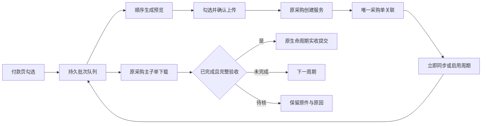

# 翱象批次作业与周期同步（本地开发阶段）

本阶段只扩展应用内的作业协调。真实翱象联调仍按用户要求暂缓；没有后台云服务，关闭应用后不执行周期计划。模型、预算、聚水潭人工链路、签发及付款事实不变。

## 业务操作

### 付款核对 → 批量采购

1. 在付款核对页勾选仓单，点击“勾选单批量生成翱象采购预览”。门店顺序沿用列表顺序。
2. 后台获取一次最新采购模板，再按仓单顺序冻结已确认付款依据、生成文件并登记本地采购意图。此时没有上传。
3. 队列按门店/仓展示款数、金额、状态。点击某行后“查看所选订单采购明细”，或双击该行，查看商品编码、名称、付款基础数量、付款商品金额；可搜索。
4. 勾选成功预览，点击“确认上传勾选的采购预览”。弹框显示单数、金额及门店/仓/本地单号，默认取消；多于12单明确提示其余订单见勾选列表。预览变化后必须重新核对。
5. 上传严格串行，单项失败保留原因。仅创建“待提交”采购单，不执行平台提交、审核。已建单或受理未知不换编号再传。

相同预览和相同勾选再次确认，返回原上传批次。若部分已确认，剩余订单需另行勾选；重叠范围不自动生成新批次。取消队列剩余任务不删除已有预览、不撤销已建采购，也不解除组件订单防重记录。准备好的部分仍可核对后上传。

采购按确认的付款快照执行。派发每项前重新检查有效签发、付款版本、上游依赖、身份、门店映射、供应商和文件哈希；组件在连接后再次检查自身配置与冻结上传文件。平台上传一旦开始，不自动切换为后来修改的付款版本，也不能据取消声称平台单已撤销。采购后业务校准需核对原采购，不自动重建。

### 收货核对 → 批量同步

在收货核对页勾选订单后，进入“勾选单批量同步翱象收货”。也可从首页“查看翱象批次作业”进入同步选择页。

- 打开选择页仅读取本地已核验绑定的采购单，不查询平台。
- “立即同步勾选采购单”只创建本批明确任务，不自动启用周期计划。
- “启用勾选周期同步”单独确认，默认取消。周期可填5至1440分钟，30分钟只是初始填写值，尚未作为平台负载最优值验收。
- 仅应用运行、计划启用、到期、无同单在途任务且浏览器会话空闲时调度。
- 停止某单周期计划后，已排队但尚未开始的该项跳过；正在进行的动作先安全结束。其他订单继续。
- 已核验目标单“已完成”后停止常规监控。最终下载/实收保存未完成的待办保留；不把终态标志清除后重新轮询。
- 缺失实收字段、主子状态矛盾、付款依据变化、已有人工收货等进入待核，不用0填缺、不覆盖人工事实。
- 网络/下载任务等待按原任务恢复并延后尝试；身份、连接或结果未知导致批次暂停，需在队列明确继续原任务。待核项不会无限自动重试。

## 进度、停止和恢复

队列显示“已处理订单数/总订单数”和当前门店、仓、阶段。下载未知时长不显示虚构百分比。成功、待核、普通失败与跳过均计入“已处理”，不把已处理等同全部成功。

“停止本批剩余动作”只作用于当前所选批次。停止后等待正在执行的动作安全结束，保留原任务与采购号；“取消本批未开始的剩余任务”是另一个需要确认的动作。关闭队列窗口不取消已确认的作业；关闭整个应用会停止后续动作并等待组件退出，不强杀上传进程。

重新打开应用时，未结束的人工批次显示为暂停，需继续原任务；周期收货批次恢复原采购/下载身份，不重建采购。已保存实收而组件确认回执丢失时，按同一观察文件重试，原生命周期服务返回已有版本。

首页队列入口是业务状态入口，不增加生命周期环节。生命周期仍为“签发 → 回传 → 付款 → 实收”。

## 连接交接与数据边界



| 层 | 代码 | 职责 |
| --- | --- | --- |
| 应用入口 | `application_window.py`、`lifecycle_home_ui.py` | 队列入口、付款/收货动作、应用关闭协调 |
| 业务界面及调度 | `aoxiang_workflow_ui.py` | 勾选确认、逐单状态、应用运行期间调度、后台线程 |
| 会话交接 | `aoxiang_session.py` | 人工窗口优先；后台安全退出后才交接组件连接 |
| 本地队列 | `aoxiang_workflows.py` | 批次与事件、精确预览确认、周期计划、停止/重启 |
| 编排 | `aoxiang_workflow_runner.py` | 调用既有模板/采购/收货接口，逐单检查并按源顺序执行 |
| 原实现 | `aoxiang_purchase_tasks.py`、`aoxiang_receipts.py`、组件机器入口 | 原付款冻结、原采购防重、原收货校验及生命周期提交 |

人工打开翱象窗口时，门闩先请求后台停止，人工窗口等待；必须等组件进程实际退出才接管。组件仍有最终跨进程互斥。同一资料目录另有一把调度锁，避免两个应用实例同时运行周期/批次队列。异常组件退出或没有调度权时展示原因，不假装成功。

新增 `aoxiang/workflows.sqlite3` 保存自动化批次及计划；`scheduler.lock.sqlite3` 只作调度互斥。原业务SQLite表和schema不变。队列只保存订单头、状态、摘要、精确文件路径/哈希，不复制全量SKU；商品明细按需读取冻结文件。列表默认最近100批加全部未完批，正在查看的旧批仍可保留；周期扫描只读取启用或有最终待办的计划。

完整应用迁移还未实现。不能只复制队列数据库后到另一台机器继续上传，也不能丢弃采购组件账本来绕过已创建记录。缺表/不兼容存储不会静默重建。

## 本地验收与未完成项

可复跑测试：

```powershell
.\.venv\Scripts\python.exe -m unittest discover -s tests -p 'test_aoxiang_workflow*.py' -v
.\.venv\Scripts\python.exe tools/verify_aoxiang_creation.py --stage workflows --qa qa/aoxiang_integration_20261101 --output qa/aoxiang_integration_20261101/ax13-recheck-new
```

输出须使用未存在目录。测试采用隔离SQLite、合成订单、冻结原生模板和模拟客户端，部分验证使用真实Node本地协议；不连接真实平台。结果以本阶段验收记录为准，不沿用旧阶段报告冒充本次结果。

真实平台批量上传/终态收货、人工凭证辅助绑定、完整应用迁移、实际EXE及现场周期性能仍待后续验收。周期计划默认关闭；本轮没有在用户日常资料中开启任何计划。
