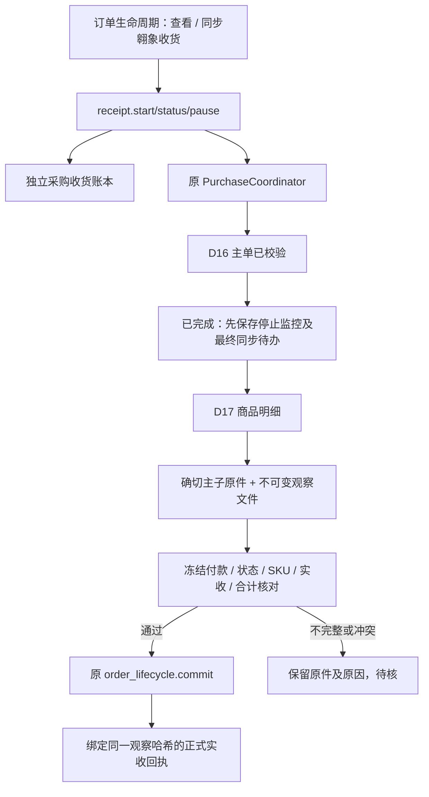

# 翱象收货同步与终态恢复（本地开发阶段）

本段基于 `a0b05b59732e447842f9ed37c33c679136c51f37`。真实联调按用户要求暂缓；以下说明已实现的本地代码，不代表真实翱象、周期监控或新 EXE 已验收。

## 业务操作

在已确认付款的订单生命周期页选择“查看 / 同步翱象收货”。该窗口单独聚焦已关联采购单，打开时只读本地记录，不连接平台。点击“立即同步 / 继续原下载任务”才查询和下载。

- 显示采购单号、平台单据状态、最后观察时间，以及逐商品采购数量、实际入库数量、差额、入库金额和待核原因。可以搜索商品。
- 未完成时保存观察原件，不新增部分收货生命周期。空白显示“未知”，不按0处理。
- 主单或子单已验收的确切目标记录出现“已完成”，立即持久保存停止常规监控标记和最终实收待办；即使下一步子单下载失败，标记也不会丢失。
- 主子单均完成、商品范围和原采购依据一致、实收数量及金额明确、主子合计一致后，调用原正式实收服务保存。少收、多收保留差额，不要求实收等于采购数量。
- 下载中断点“立即同步 / 继续原下载任务”；已验收但本地写入失败点“重试保存已验收实收”。保存后若组件回执丢失，重试识别同一观察文件，不新增实收版本。
- 已有人工收货、其他观察版本、付款或上游依据变化时，自动同步停止。沿用原生命周期核对/校准入口处理，不自动覆盖。

实际完成时间未在已提供模板中核实，因此保持缺失。另存观察时间，不拿采购创建时间、更新时间或电脑当天冒充实际完成/收货日期。

## 调用链与持久关系



| 定位 | 文件 |
| --- | --- |
| 业务窗口、进度、停止、保存重试 | `src/aoxiang_receipt_ui.py` |
| 冻结付款核对、原实收服务适配 | `src/aoxiang_receipts.py` |
| 精确原生字段、真实源行号、观察口径 | `components/aoxiang/src/purchase-receipts.mjs` |
| 停止标记、最终同步状态、恢复事件 | `components/aoxiang/src/purchase-receipt-ledger.mjs` |
| 原下载器组合、新观察及原任务恢复 | `components/aoxiang/src/purchase-receipt-service.mjs` |
| 异步控制、取消、安全退出 | `components/aoxiang/src/machine-purchase-receipt.mjs` |

账本位于应用 `aoxiang/component-state/state.sqlite` 新增的独立表；升级前备份并检查，结构缺失时不能重建空表继续。原采购创建账本和旧业务表不改格式。

观察文件保存在 `component-state/receipt-observations/<runId>.json`，机器接口只返回摘要及确切文件哈希。主子原件仍由原下载器保存；正式实收服务再留存两份原Excel和观察文件。JSON仅供程序核验，业务界面为表格。新增实收行含来源采购任务、平台单号、观察哈希、观察时间及原Excel实际行号，空行不通过“下标+2”猜测。

## 不重发与不丢终态

1. 首次查询固定已关联采购单的原制单日、门店和采购单号；不能用电脑今天猜原单日期。
2. 每次新的观察显式创建新导出快照，不能循环读建单时的旧文件。
3. 一次观察失败后保留确切 run、D16/D17任务号和暂存文件；恢复原任务。受理未知继续阻断，不以新run绕过。
4. “已完成”标记与最终同步待办在同一状态事务保存。进程重开只把在途操作标成可恢复，不清除终态。
5. 已完整写出观察文件但尚未更新账本时崩溃，恢复验证同一文件，仅排除该次重新读取的观察时间用于恢复核对；正式采用第一次文件及其原时间，不覆盖。
6. 原正式实收服务在写锁内检查签发、上下游版本、文件哈希、取消和最终提交边界。进入最后提交后等待安全结束，不强杀。
7. 相同观察的重复保存没有新实收版本；其他观察或人工实收不被自动替换。

## 本段边界

- 没有更改模型、预算、箱规、仓路由、原签发或原导出实现；没有把采购数量当成实收。
- 本地新增入口支持单张已核实绑定采购单的立即同步、恢复及自动正式保存。应用运行期间的跨订单周期调度、批量入口仍属后续工作；当前没有后台定时执行承诺。
- 暂不提供无确切创建依据的任意采购号录入；人工凭原件核验绑定仍待后续补齐。
- 本次实收原件与主子状态采用合成样例验证；真实“已完成”样例、实际平台收货变动与EXE仍需后续验收。
- 已同步订单不自动重新查询。业务后续校准保留原生命周期的版本和附件；不恢复常规监控。

## 可复跑验证

在项目根目录、现有固定Python/Node环境运行。输出目录必须是新目录。

```powershell
.\.venv\Scripts\python.exe -m unittest discover -s tests -p test_aoxiang_receipts.py -v
.\.venv\Scripts\python.exe -m unittest discover -s tests -p test_aoxiang_receipt_ui.py -v
.\components\aoxiang\runtime\node.exe --test components/aoxiang/test/purchase-receipts.test.mjs
.\.venv\Scripts\python.exe tools/verify_aoxiang_creation.py --stage receipts --qa qa/aoxiang_integration_20261101 --output qa/aoxiang_integration_20261101/ax10-recheck-new
```

新增故障验证覆盖终态主单后明细失败、原任务恢复、新观察不复用旧文件、观察落盘后崩溃、空白/0、真实行号、主子状态冲突、重复/缺SKU、数量金额变化、正式提交版本冲突、人工实收保护、取消、回执丢失重试，以及窗口打开不查询平台、停止、过期回执和安全关闭。
