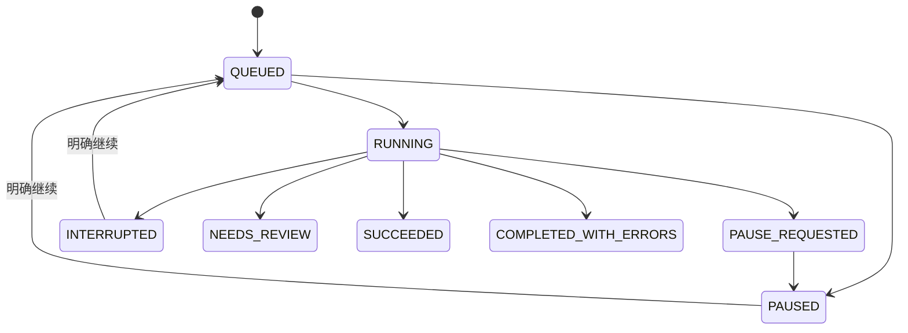

# 翱象机器接口与恢复契约

本文件对应 AX02 基础实现。代码已具备 Python → 固定 Node 子进程 → 原组件执行器的调用链；用户界面和账号/门店配置向导仍在后续任务接入。本文件不能作为真实平台或发行 EXE 的验收记录。

## 入口和职责

```text
补货助手后台任务（后续接线）
  → aoxiang_jobs.Jobs：先保存命令及业务来源
  → aoxiang_client.ProcessClient：请求/响应关联，超时不重做
  → components/aoxiang/src/machine-entry.mjs：NDJSON 入口、会话互斥
  → MachineCommands：命令、逐店 run、有序事件在同一事务保存
  → MachineRuntime：有上限的串行队列、暂停/继续
  → 原 Coordinator / BrowserClient / browser-worker：原生导出与文件验收
  → freezeRunAsset：冻结原文件版本，返回路径、哈希和范围
  → 原检查/匹配/计算（AX05 接线；本阶段未改变这些代码）
```

运行：`components/aoxiang/runtime/node.exe components/aoxiang/src/machine-entry.mjs --state-root <本机绝对路径>`。必须显式指定状态目录，不退回单独助手或主应用的日常用户目录。发行包完整性校验继续使用原 `verifyInstallation`；开发副本带 `.dev-checkout`，不把开发副本当正式发行包。

标准输入和输出为 UTF-8 NDJSON，每帧最多 1 MiB。标准输出只放结构化帧，运行时诊断走标准错误。队列最多 32 个活动命令，每命令最多 256 个不同仓店编码；浏览器动作串行。同一已核对浏览器身份和 Profile 连续处理门店时复用连接，换身份或 Profile 先关闭旧连接。

## 命令与来源

当前仅声明已实现的 `replenishment.export`，不提前声明采购上传、提交或收货接口。

```json
{
  "protocol_version": 1,
  "command_id": "由主程序持久保存的唯一编号",
  "operation": "replenishment.export",
  "account_binding": {"account_id": "文本账号ID", "merchant_code": "文本商家编码"},
  "scope": {"warehouse_codes": ["按用户顺序排列的接收仓店编码"]},
  "basis_versions": {"store_mapping": "configuration返回的store_mapping_version"},
  "policy": {"freshness": "reuse"}
}
```

示意值不能直接运行；`command_id` 实际必须是符合 schema 的 ASCII 编号，界面不要求业务填写。`freshness` 为 `reuse` 或明确选择重新获取时的 `refresh`。编码必须是文本，保留前导零。

新命令必须符合当前账号和门店目录版本。接受后冻结组件有效配置、目录及原始顺序，不因后续修改目录而改变已有命令。相同 `command_id`、相同内容重派返回原 run；同号不同内容拒绝。主程序也固定业务上下文，不能把同命令换绑到另一个批次。

命令、全部逐店 run 及首个事件原子提交。任意插入失败整体回滚。状态表或版本标记缺失时拒绝重新建空表，避免丢失历史后再次提交。

## 请求与响应

请求均带 `protocol_version: 1`、独立 `request_id` 和 `action`。请求编号用于当前通信关联；命令编号用于跨进程、跨启动恢复，二者不可混用。

| action | 附加参数 | 含义 |
| --- | --- | --- |
| configuration | 无 | 只读账号和门店目录摘要、目录版本；不返回 Cookie 或登录态 |
| reserve | command | 原子登记或返回已有命令；登记成功后排队执行 |
| status | command_id | 返回该命令当前完整检查状态与有序逐店结果 |
| events | command_id、after、limit | 按严格递增序号查询事件，每次最多 100 条 |
| list | offset、limit | 命令分页，每次最多 100 条 |
| pause | command_id | 停止该命令后续动作，等待当前动作安全结束 |
| resume | command_id | 显式继续暂停/中断作业，复用原 run |
| ping | 无 | 连接与当前命令状态 |
| shutdown | 无 | 停止排队，安全结束当前动作后关闭组件 |

响应包含原 `request_id`、`ok` 和 `result` 或 `error`。事件保存在组件库中，通过游标查询；当前不靠无限推送队列传进度。状态序号用于拒绝过期回执，界面事件游标须单独维护。Python 端最多 32 个并发查询、标准错误缓冲最多 64 KiB；迟到响应不能填入下一请求或更新另一批次。

## 状态、暂停和恢复



- 普通单店失败（例如空店未验收、文件行数不符）保留错误并继续其他门店，不伪造空文件。
- 登录失效、连接或本地存储问题中断当前命令；继续仍使用原 run/任务，不从头创建另一任务。
- 未知受理、错误范围或其他未决提交进入待核；暂停不能把未知受理变成可以重发。当前没有自动解除待核或自动重传入口。
- 暂停即时返回“已请求暂停”；当前页面动作按已有超时结束，正面受理仍写入状态库。读取/下载在安全检查点停止。不把暂停说成平台撤销。
- 当前文件已经验收完成时允许保存其确切版本，随后停止剩余门店；全部门店均已完成则保持完成状态。
- 关闭同样先请求暂停。Python `close()` 返回 `False` 表示仍等待当前动作结束，调用方须保留连接并显示等待，不能直接强杀后称为已取消。
- 持有原 `coordinator.lock.sqlite` 后才恢复中断标记。重开时把原运行中命令标中断，原排队命令标暂停，不自动开始平台动作。原 `runner.lock.sqlite` 继续保护浏览器。

## 文件版本与顺序

每命令为每门店固定一个 run，逐店串行处理，结果和事件带原序号。失败项保留原位置，不按完成时间或文件名重新排序。

组件原日文件仍使用原复用/刷新规则。主项目采用的是 `state-root/command-files/<command_id>/...xlsx` 中验收哈希对应的独立副本。日文件刷新后，旧命令仍返回原字节。如果中断恰好发生在发布与冻结之间，按记录的原哈希从原暂存文件或原日文件备份恢复，不拿新的日文件顶替。原版本缺失或副本被改时中断并要求核对。

原 Coordinator 的业务操作未重新实现。仅把原有 run 初始化抽为同一顶层函数以便原子登记，并在成功/复用项保存 `assetSnapshot` 审计依据；原选择器、下载验收、同日发布规则保留。

## 本阶段验证和剩余工作

可复跑：

```powershell
.\.venv\Scripts\python.exe tools/verify_aoxiang_protocol.py --baseline qa/aoxiang_integration_20261101/baseline.json --output qa/aoxiang_integration_20261101/ax02-recheck-新的目录名
```

输出目录必须不存在。脚本验证冻结输入、原包及核心哈希，逐文件核对修改前全部 `src/` 文件，运行环境检查、完整组件测试和主项目便携测试。新增故障测试包括事务回滚、状态丢失阻断、队列上限、乱序/迟到回执、真实跨进程关联、第二实例互斥、暂停/关闭/重开、确切文件版本以及目录版本过期。

这些测试使用隔离状态、合成命令和既有本地浏览器测试夹具，没有连接真实翱象账号，没有上传采购单。下一步接账号与门店配置、业务界面、真实取数以及原输入采用；AX02 的界面端体验、真实平台恢复和 EXE 仍随 AX03–AX05/AX13–AX15 联合验收。
# AX03 配置补充

新增 `discover`、`setup.start`、`setup.status`、`setup.cancel`、`setup.commit`。`setup.start` 只接收实际发现的 Edge/用户配置路径、采集目录及有序门店编码/名称；不接收 Cookie、密码或浏览器资料副本。后台返回 setup_id，进度通过 status 查询，READY 后仍需显式 commit。

配置核验与取数互斥。原绑定身份不一致时拒绝保存。提交核验通过项时核对旧配置哈希，保存原配对备份和持久恢复意图；启动发现中断仅允许从原值/目标值继续恢复，外部改动阻断。取消核验不保存新绑定；关闭等待当前只读查询安全结束。供应商映射由 Python 主程序单独保存，不参与补货计算规则。

## AX04/AX05 主界面采用

`aoxiang_acquisition` 生成有序原件清单，校验组件返回的确切命令目录、SHA256、门店/身份/run 绑定。清单独立保存在应用配置目录的 `aoxiang/manifests`，不向计算字典混入新的业务值。`aoxiang_input_ui` 以原函数身份调用 `batch_service.load`，使原 Worker 的源文件留存和取消保护继续生效；采用前比较检查结果的文件哈希及文件顺序。

主程序 `jobs.sqlite3` 只保存自动化记录，不写生命周期表。最近100个记录加全部未完成记录可查询。PREPARED 超时不能新建同店请求；取消未受理请求必须先查原 ID，只有明确 COMMAND_NOT_FOUND 才能变为本地 CANCELLED。已受理、未知受理或查询失败均不能以本地取消解除关联。成功文件可独立采用，但不会抹掉其他门店失败记录。

## AX06 模板控制与付款准备

`template.start` 无业务参数，仅使用当前已核验身份；返回瞬时任务id。`template.status`/`template.cancel` 使用 `template_id`。模板获取始终调用当前原生按钮和受限GET，结果需 `SUPPORTED` 才能交付；READY包含原服务生成的不可变版本、获取记录、身份和确切文件哈希。中断或退出等待当前只读下载安全结束，允许原始下载/获取记录留存，不冒充成功。该控制不创建采购，不提供提交、审核或入库能力。

Python付款准备保留签发/付款版本和业务指纹，上传前必须再次核对有效签发、付款及回传依赖、身份/门店目录版本与供应商配置。采购文件先生成在独立目标，不覆盖旧文件。金额作为来源事实写入，单价不做舍入补造。该基础尚未表示上传、采购号绑定或完整闭环已经验收。

## AX08/AX09 采购创建机器动作

`purchase.reserve(package_file, package_sha256)` 只做本地核验、原件留存和意图登记，不启动浏览器。任务包为本机绝对路径的有界JSON，保留账户/门店版本、本地订单/仓及付款指纹、有序商品、原模板获取记录、待上传文件哈希、固定“否”外部订单和“待提交”状态。组件再次逐行校验 Excel 和原生结构。同编号同包返回原记录；同订单另编号或修改付款版本不能绕过现有记录。

`purchase.start(purchase_id)` 是异步动作：未上传任务进入准备/上传；已有回执仅核对原任务。`purchase.status` 返回序号、业务摘要、当前阶段、是否仍在运行、原任务号和已核验采购单号，不一次返回全量商品。`purchase.list(offset, limit)` 分页，最多100条。`purchase.pause` 停止后续动作，不撤销平台单；`purchase.cancel` 仅允许确定未进入上传的任务。所有参数按动作白名单校验。

采购执行与取数、模板获取、配置核验共用一把会话门闩。关闭等待当前动作结束；收到有效上传回执后，即使随后取消，也先持久保存。状态库先记 `SUBMITTING` 再调用浏览器；未知状态永不重放上传。另一个任务的结果不能更新本任务，已关联采购单号不能转绑其他本地订单。

原生上传只接收生成后冻结的文件和任务，使用本次核验字节，不按 Downloads 最新文件猜测。页面常驻写入阻断保留到该自有页面关闭；仅当前一次上传的精确文件体可通过，普通创建/修改/提交/库存写入都不属于开放动作。

新采购账本不在旧组件配置迁移包范围；存在未取消采购记录时，旧迁移导出返回 `INTEGRATED_PURCHASE_MIGRATION_REQUIRED`，不能丢失创建记录后到另一台机器继续建单。完整应用迁移、真实平台验收与EXE仍需后续验证。

## AX10–AX12 收货观察和正式同步

`receipt.start(purchase_id)` 只接受已核实唯一采购单关联。恢复原在途run；上次观察完成而平台尚未终态时，新的明确同步创建新快照。`receipt.status` / `receipt.list` 返回阶段、终态停止标记、最终同步状态、摘要及观察文件/哈希，不在NDJSON中传全量SKU。`receipt.pause` 与关闭停止后续动作，保留原下载任务，不撤销采购单。

主单或子单出现已核实目标订单的“已完成”，立刻持久保存终态和最终同步待办，后续明细失败不回到常规监控。完整终态保存为READY；主程序独立核对冻结付款和全部实收字段后，经原生命周期服务写入，再调用 `receipt.synced(purchase_id, manifest_sha256, receipt)`。回执须属于同一观察哈希和本地单号。已写实收但回执丢失时，按原文件重试，原服务返回未变化版本。

机器入口仍仅一个浏览器作业活动：取数、配置核验、模板、采购创建、收货下载互斥。观察存储、正式业务存储不做跨库伪事务；恢复通过不可变文件、旧业务服务的版本及依赖校验、相同观察指纹幂等完成。尚未启用周期调度，不承诺关窗/关应用后自动执行。详细字段、操作与限制见《翱象收货同步与终态恢复.md》。

## AX13 主应用批次队列与周期计划

后续新增 `aoxiang/workflows.sqlite3`，没有增加平台业务动作或修改原机器协议。批次准备、勾选确认上传、收货同步分别保存；每项只传既有任务编号和必要参数，按门店列表顺序串行处理。确认绑定精确预览序号，弹框期间自动刷新不能把确认对象换成新预览。

周期计划默认关闭，业务明确启用后才在应用运行时调度。已完成停止常规监控，最终实收待办仍可按原采购/原下载任务恢复；用户停用后未开始项跳过。详细状态和可复跑本地验收见《翱象批次作业与周期同步.md》。这替代上一阶段“尚未启用周期调度”的实现状态说明，不代表已经真实平台或EXE验收。

主应用人工窗口和后台队列通过 `SessionGate` 交接，实际组件退出前不释放后台占用。另有同目录调度SQLite锁防止多实例同时排队；正常关闭和空闲窗口直接销毁均释放。未知上传不会作为普通失败新建一单，继续操作先读取原采购状态。
