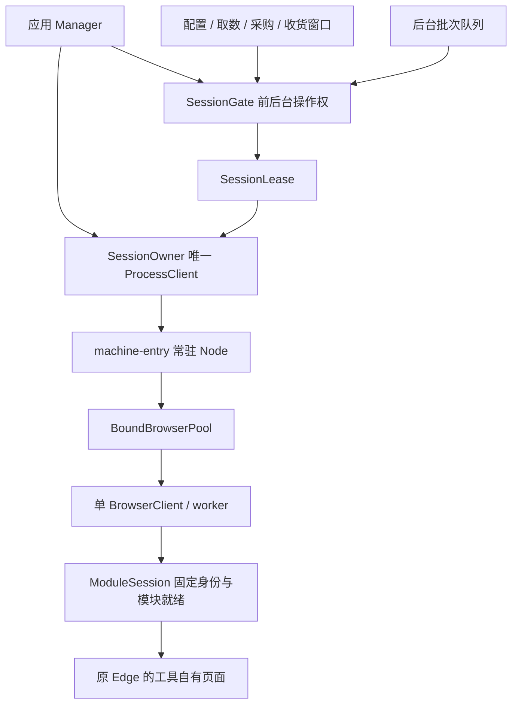

# 翱象跨模块共享连接（0.24.0 ax_rc5 候选）

本轮基于 `a5036cd9e388e14534022c539b0177719948b5f3`，分支 `feat/aoxiang-shared-session`。保持应用 0.24.0、模型 0.3.3-rules、需求归属 0.5.1、存储格式 2；用独立构建编号 ax_rc5 区分候选，旧 ax_rc4 保留。交付结果以 `releases/0.24.0/ax_rc5` 的记录为准，不以本文代替验收。

## 使用变化

- 正常关闭连接配置、补货取数、采购或收货窗口，会停止该窗口后续动作，等已开始动作安全结束，再释放操作权。健康 Node 组件与浏览器连接留给下一个窗口使用。
- 登录和门店核验成功后点击保存，核验使用的浏览器连接交给公共会话。打开采购或收货时不再为正常模块切换主动断开、重新连接。
- 后台队列和前台窗口共享会话。前台打开时通知后台停止新动作；正在进行的上传不能强杀，需等待原受理结果或既有超时处理结束。之后按原任务号恢复。
- “异常后重新连接”是明确的连接重置，会先安全退出旧组件，再建立新连接。退出整个应用也会安全退出公共组件。不会关闭用户原 Edge 窗口。
- 更换 Profile、账号绑定、浏览器路径或连接参数时，旧会话不能混用；必要的重新授权仍存在。应用重启、Edge 重启、网络中断后也不能承诺免授权。

## 边界

共享的是应用内连接和一个工具自有页面，不是同时在同一页面操作多个模块。页面动作串行；补货建议仍按 ax_rc4 流水线先提交各店任务、再轮询各自精确任务号，平台生成可并发。没有采用“最新 N 个任务等于本批”的猜测。

页面切换时固定最初核验身份，卸载旧监听器，打开并验证新页面后才标为就绪。失败后仍未就绪，下次必须重新打开、核验。

仅身份读取超时允许在活着的原 worker 上有限恢复：页面打开中的身份步骤最多重试一次；特定只读查询出现身份响应超时，可重新核验后重试查询一次。写操作、未知受理、任务号不明、账号变化不进入自动重试。核验查询含恢复的总步骤上限为至少 120 秒（按已配置页面超时四倍取大值），界面显示阶段和本步骤超时，取消仍可安全结束只读连接。

身份响应在请求到达时立即读取，避免等待页面跳转完成后再取已失效的响应体。必须是本次观察到的有效身份响应；不拿旧身份缓存冒充本次核验。

未改变模型、最低恢复、一箱例外、主从仓、预算、签发、归档、生命周期数量金额、Excel 输出、已有采购意图及收货完成规则。采购仍保留待提交，聚水潭仍人工导入。

## 结构与查找



| 文件 | 职责 |
|---|---|
| src/aoxiang_session.py | 公共进程所有权、前后台门闩、窗口租用与安全释放 |
| src/aoxiang_ui_common.py | 构造窗口时先取得操作权；公共调用、关闭与重试 |
| src/aoxiang_workflow_ui.py | 后台租用公共组件；应用关闭异步退出 |
| components/aoxiang/src/machine-session.mjs | 停止后续动作、等待当前控制器实际空闲；不退出连接 |
| components/aoxiang/src/machine-setup.mjs | 成功核验保留 worker，保存后交给公共连接池 |
| components/aoxiang/src/bound-browser.mjs | 绑定匹配、回执回调、有限只读恢复 |
| components/aoxiang/src/module-session.mjs | 切换适配器、固定身份、成功后就绪 |
| components/aoxiang/src/aoxiang-ui.mjs | 及时读取本次身份响应 |

`session.release` 只报告控制器真正空闲，不把“收到停止请求”视为已完成。关闭响应未知时，Python 保持门闩并请求组件安全退出，退出前不交给下一窗口。`session.status` 仅提供组件/worker PID 与连接状态供验收，不返回凭据。

## 可复跑验证

在项目根目录使用 `.venv\Scripts\python.exe` 与 `components\aoxiang\runtime\node.exe`。QA 输出须用新的目录。

```powershell
.venv\Scripts\python.exe -m unittest discover -s tests -p 'test_aoxiang*.py' -v
components\aoxiang\runtime\node.exe --test components/aoxiang/test/*.test.mjs
.venv\Scripts\python.exe tools/verify_aoxiang_shared.py --baseline a5036cd9e388e14534022c539b0177719948b5f3 --fixture qa/aoxiang_integration_20261101 --output qa/新的共享连接对照
.venv\Scripts\python.exe tools/verify_aoxiang_exe.py --exe 交付_0.24.0_ax_rc5/补货助手/补货助手.exe --output qa/新的EXE核验 --runs 1
```

最后一项为真实 EXE、本地隔离状态，不连接平台。加 `--business` 检查两店计算、付款采购准备和合成实收，并与同提交源码比较。独立基线结果仍以第三项为依据。

`tools/verify_aoxiang_shared_live.mjs` 是另行显式运行的真实只读探针，要求 `--config-dir`、已核验 `--store`、新 `--output`；复制连接配置到隔离目录，顺序核验配置、补货、采购查询、采购创建适配器的只读查询、返回补货，记录同一 worker。脚本不调用提交导出、上传采购或正式收货保存。它会访问真实 Edge，普通离线验收不会自动执行。

## 试用重点

1. 核验并保存后正常关闭窗口，再打开补货取数、付款采购、收货核对，观察是否仍反复要求连接授权。
2. 有后台任务时打开前台窗口，应看到等待安全交接；不能出现两个模块抢页面。
3. 核验超时应提示、停止继续核验其他门店；取消后可重新核验。采购上传应答未知必须保留原任务，不重新建单。
4. 关闭整个应用后组件应退出；Edge 原有标签页保持。重新启动应用需要新连接属于预期。

本轮不把模拟延迟当平台提速数据。减少了主动重连，不保证平台查询、登录响应或服务器导出生成变快。真实平台各项结果和未通过记录均需单独保留。
