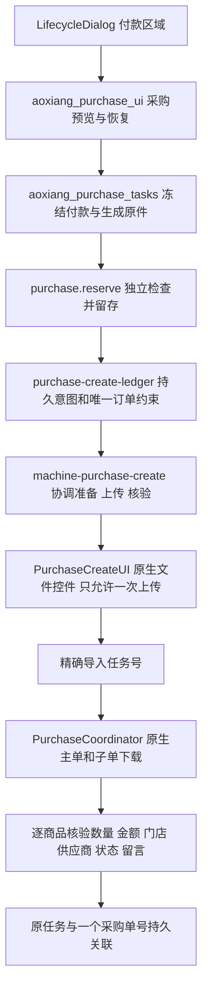

# 翱象采购：付款依据、上传边界与原任务核对

2026-11-02，独立开发分支的本地实现记录。用户要求暂不联调，本轮未连接真实翱象，未创建真实导出或采购。尚未交付新的 EXE。

## 业务入口

订单生命周期的“翱象采购（以已确认付款为依据）”分组，点击“打开翱象采购”。仍是签发、回传、付款、实收四个生命周期阶段；采购创建不是额外生命周期。

1. **生成采购预览（获取最新模板）**：获取并核验当前原生模板；只读当前有效签发对应的已确认付款，逐项展示商品编码、名称、基础数量、付款商品金额；显示门店、仓、供应商和合计。准备阶段登记本地任务，不上传、不创建平台订单。
2. **上传建单（保留待提交）**：默认取消的确认框展示确切门店、仓、供应商、商品数、数量、金额。上传前主程序再次核对付款版本、上游依据、供应商配置和原件哈希。系统不执行翱象的提交、审核、入库，也不创建外部订单。
3. **继续核对原采购任务**：仅对已经取得确切导入任务号的任务查询和核验。成功后显示采购单号和“待提交”；不反复上传同一文件。
4. **停止后续动作**：停止新动作，等待当前已开始的操作安全返回，保留已收到的任务回执。不是撤销平台采购单。
5. **取消尚未上传的任务**：只在确定没有进入上传边界时释放本地预留。进入上传边界后，即使没有回执，也不能用取消解除重复建单保护。

记录按本地补货单号、门店编码、仓隔离。历史记录可以查看，缺少本地预览文件时保留组件任务，不按名称或最新文件猜测原件。界面显示实际阶段和等待秒数；平台未提供百分比时使用不定进度，不虚报完成率。

## 数据保持

- 付款确认后的基础数量直接使用，不再乘除箱规；本轮不改补货模型、预算、仓路由和原签发结果。
- 原模板 D 列写付款基础数量，F 列写付款商品金额，E 单价留空；不自行舍入反算价格。零数量不生成采购行，但零数量非零金额、正数量缺金额等问题阻断并待核。
- 模板示例清除；说明、表头、隐藏工作表及其他 ZIP 成员保留。上传前组件独立读回逐行比对，长编码/前导零按文本保留。
- J 留言增加本次任务标记和本地单号，K 为“否”，L 空。标记仅供候选单检索，**不是平台幂等键**。重复保护来自本地持久任务和唯一订单约束。
- 本地订单/仓已经登记任务后，付款更新不能绕过旧任务另建一个采购。尚未上传可明确取消后重新预览；已上传只核对旧采购，不自动修改或取消平台订单。

## 调用链与查找索引



| 位置 | 职责 |
| --- | --- |
| `src/aoxiang_purchase.py` | 只读冻结付款及依赖版本；上传前再次核验 |
| `src/aoxiang_purchase_excel.py` | 按原模板填入采购内容；单独调用仍保持原默认留言 |
| `src/aoxiang_purchase_tasks.py` | 保存本地采购包、付款依据、生成文件和精确哈希 |
| `src/aoxiang_purchase_ui.py` | 聚焦单据的业务预览、默认取消确认、原任务恢复 |
| `purchase-create-artifacts.mjs` | 包及模板校验；逐行、原生结构、原件哈希核验和留存 |
| `purchase-create-ledger.mjs` | 备份升级；订单/采购号唯一约束；持久事件和重启恢复 |
| `machine-purchase-create.mjs` | 异步协调、取消边界、失败状态；不直接接触 Qt |
| `purchase-create-ui.mjs` | 原生上传、唯一请求/回执绑定、阻断重复和额外业务写入 |
| `purchase-create-service.mjs` | 配置核验、原任务查询、候选采购单和主子文件核对 |
| `purchase-create-contract.mjs` | 精确十进制和逐 SKU 业务事实比较，不用浮点容差 |

组件文件均在 `components/aoxiang/src`。旧 `submitPurchase` 指采购导出，不是创建；新创建入口明确命名 `uploadPurchaseOnce`，避免混用。

## 持久性和中断

组件 `state.sqlite` 增加独立 `purchase_creates`、`purchase_create_events` 和版本标记。升级前保存 SQLite 备份，已有表或唯一索引缺失时拒绝继续，不重建空表。原业务数据库未增加表、未修改历史事实。

`RESERVED → PREPARING → READY → SUBMITTING → ACCEPTED → VERIFYING → BOUND`。

- `SUBMITTING` 在向浏览器进程派发上传**之前**提交到 SQLite，`uploadAttempted` 一旦为真不能清除。即使请求可能尚未真正发出，也保守进入待核，不自动重试。
- 准备中重启变为 `PAUSED`；上传中重启变为 `NEEDS_REVIEW`；已知受理核验中重启回到 `ACCEPTED`。
- 停止时仍保存当前操作返回的有效回执。迟到回执只更新原任务号，不能满足另一个请求；出现第二个不同导入任务号保留冲突并待核。
- 原生上传使用已核验的内存字节，消除“哈希校验后换文件”的路径窗口。文件体必须恰好包含一次冻结原件；只允许一次受控 PUT。额外建单、提交、审核和库存写入被阻断；一次上传结束后仍保留页面级阻断，防止迟到重试。
- 唯一采购单关联需要原导入任务全量成功、唯一新候选、D16/D17 原生文件、逐 SKU 数量/金额及门店/供应商/状态一致。空金额不视为0；多单、部分成功、已推进到其他状态或字段不明均待核。
- 同一来源后续核验沿用已记录的导出任务；不能把“任务查询没有找到”当作没有提交。

旧组件单独迁移包不包含主应用付款包和新创建账本。当已有未取消采购任务时，旧迁移导出明确阻断，避免产生“迁移成功”但丢失防重复记录的包。整套应用的迁移/交付验证属于后续 AX15；本轮不复制浏览器登录态。

## 验证和剩余边界

便携测试使用合成业务、原生模板夹具、隔离 SQLite；真实 Edge 测试仅在本地模拟页面运行，所有请求由测试本地响应或阻断，未访问真实平台。

```powershell
.\.venv\Scripts\python.exe tools/verify_aoxiang_creation.py --qa qa/aoxiang_integration_20261101 --output qa/aoxiang_integration_20261101/ax08-recheck-new
```

输出目录必须不存在。脚本重跑环境、组件、Python 和冻结33场景/5工作簿严格对照，不改旧验收结果；动态白名单沿用原 `parallel_qa.WHITELIST`。

真实多 SKU 导入的任务成功计数、对应供应商实际规则、留言保留和主子文件链路仍需联调。当前选择保守阻断，不能把单商品原型或模拟页面当作通过真实创建。业务批量采购入口、无回执时人工证据核对/绑定、收货监控与正式实收、实际 EXE 和整套迁移仍待后续阶段完成。
