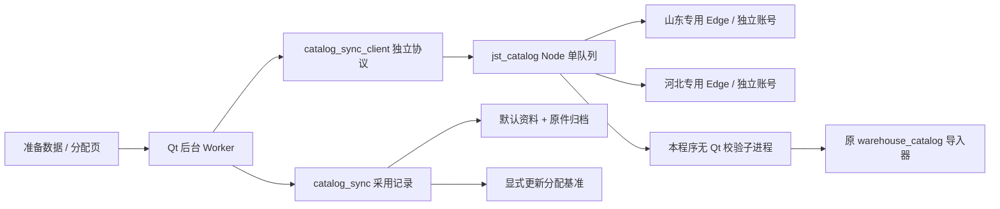

# 聚水潭商品资料同步实施记录

固定源码基线c061932b583dfb31d6284b09eaed93c0ad4cc51d（0.30.0及已确认方案）。独立分支feat/jst-catalog-sync-0.31.0。
用户将真实联调范围缩小为现有临沂账号；第二账号暂不登录、不采集，双账号行为使用明确的合成测试验证。物理仓映射尚未确认，不自动替换日常仓资料。

## 阶段1：独立采集基础

- 新组件复用原商品范围识别和原件下载能力；两份账号参数运行同一流程。
- 独立协议及时响应状态与停止；有界后台任务、原任务恢复和未知受理保护。
- 首次下载要求任务行的唯一文件地址，拒绝按最近文件或条数猜。
- 包内只读校验入口在Qt/日常配置初始化前分流，保留原导入器字段、类型与行号。
- 当前15项Node离线测试、3项Python校验测试通过；另补真实Node子进程协议检查。真实浏览器、采用与EXE仍待后续阶段。

早期测试失败记录保留在qa/catalog_sync_0310/node-stage1.txt：上游测试同时引用了范围外的订单上传模块。调整为验证本组件不提供订单上传接口，未改变六项商品范围预期；重跑15项通过。

QA根qa/catalog_sync_0310，基线源码由Git归档固定，计算对照重新捕获，不借用0.30.0旧验收。原始样本和0.30.0包只读保护；首次冻结复用的旧脚本额外只读哈希扫描了历史包及日常文件，未修改；新冻结脚本已改为仅复制固定QA输入并保护本次旧包，不再扩大扫描范围。

本阶段未接入用户配置、未操作真实平台、未修改模型或翱象源码；不推送、不合并。

## 阶段2：采用、界面与恢复

- `catalog_sync_ui.py` 位于准备数据入口，连接设置、单仓/已启用仓刷新、阶段进度、停止、继续原记录以及仅继续所选仓均有明确按钮。首次登录不保存密码，正常账号失效后补登。
- `catalog_sync.py` 协调独立 Node、查询前库存观察和采用；`warehouse_catalog.Repository` 保留原保存实现，增加每仓写锁和当前版本比较。旧 JSON 格式、SQLite 业务表、仓快照均不迁移。
- 当前默认资料与预期不符时拒绝覆盖；相同原文件不替换导入时间或资料字节，也不让结果过期。成功采用其他内容后本次输入需重新检查，历史签发不变。
- 原 XLSX 按原字节入库；采用意图先记录。写入后崩溃可核对当前文件并恢复回执，不再重写旧版本；分配页复用原 prepare_refresh/commit_refresh，检查查询前后的基准及锁单集合，保留原预占逻辑。
- 停止是合作取消：不再发起下一仓，当前平台请求等待有界返回，不强杀受理中的 Node；原任务号不丢，受理不明不自动重发。关闭界面会等待安全退出后再释放自己的连接，不关闭用户浏览器。
- 取消/拒绝采用可能留下备份、原附件、采用日志和采集记录，不能称整个存储字节未变。

## 调用链与隔离边界

翱象没有连入这条队列。只以只读依赖方式复用固定 Node、EdgeBridge 和环境发现库，不修改翱象源码、SessionGate、协议、配置或定时器。绑定拒绝正常 Edge 根、翱象绑定根及两仓共享同一用户数据根；端点也再次比对。各账户作业依次执行，没有双浏览器并发取数承诺。

## 本轮验证与复跑

QA：`qa/catalog_sync_0310`。命令使用项目 `.venv\Scripts\python.exe`。

- `python -m unittest discover -s tests -v`：阶段2全量592项通过；最终补充测试及最终重跑另见原始日志。
- `components\aoxiang\runtime\node.exe --test components/jst_catalog/test/*.test.mjs`：18项，范围、身份、顺序、登录隔离、停止、原任务恢复、禁止重复提交、唯一任务链接。
- `python tools/verify_catalog_sync_ui.py --output qa/<新目录> [--exe <候选exe>]`：真实 Qt 按钮 + 真实 Node + 当前程序校验子进程，合成已下载任务；停止、重试、成功仓采用、失败仓隔离、重开记录、进程退出。报告 `frozen` 区分源码与 EXE，不能冒充真实平台测试。
- `python tools/parallel_qa.py capture --qa qa/catalog_sync_0310 --source . --output qa/<新捕获目录>`；最终目录名 `after-final`，再执行 `python tools/verify_lifecycle_comparison.py compare --qa qa/catalog_sync_0310`，重新对照固定提交。
- `python tools/catalog_sync_performance.py --qa <新冻结QA>`：9207行真实文件，本地读取/留存/采用 AB、BA、AB 各三次；手动中位1.440秒、自动1.767秒（增加0.327秒，约23%），新增校验/回执有成本。未含浏览器启动、平台等待、下载，不宣称端到端提速。有序商品内容哈希和原件哈希完全相同。
- `python tools/catalog_sync_live.py --qa qa/<单账号专用目录> --binding <已有绑定文件> --export`：仅明确授权下使用。已成功采用的记录拒绝再次新建；未完成优先恢复同一任务。测试仓位明确为合成，不代表物理仓确认。

保留早期失败证据：`ui-source` 的 Qt event 方法命名冲突已改为业务事件回调；`ui-source-r2` 为夹具错误放在 settings 子目录，改正独立数据路径，未改验收断言；`ui-source-final`通过20项。`node-final` 第二项隔离夹具错误把模拟正常根放在专用根之内，修正夹具后 `node-final-rerun`18项全通过，未放宽隔离规则。

## 初轮外部验收状态（历史记录，已由后续验证推进）

2026-11-03 现有临沂账号真实连接在允许远程调试处超时，未查询商品或提交导出（`live-one.txt`、独立 `live-one/service/jobs.json`）。已向用户说明需要允许连接。没有将临沂账号写入正式仓默认配置。第二账号按用户要求不测。

真实任务行必须给出唯一、可核对的原生文件地址；当前页面不提供时会保留任务并明确失败，不按“最近下载”猜。上述是初轮状态；2026-11-03后续已完成用户确认两仓映射、独立账号真实导出下载及采用，详见[双仓完整验证](聚水潭双仓完整验证_20261103.md)。新电脑尚未验收。不自动定时取数，不自动上传聚水潭订单，不迁移浏览器登录态。

## 阶段3：最终本地候选验收

最终构建提交 `cbcad54c3ddc0950ca2b6bb6399e0ace0cc32c98`，独立目录 `交付_0.31.0_rc3/补货助手`。之前0.30.0和本次中间候选均未覆盖。应用0.31.0，模型0.3.4-rules、归属0.5.1、参数格式3、存储格式2不变。

| 核验 | 结果与证据 |
| --- | --- |
| 全量Python回归 | 593项通过，all-python-final.txt |
| 独立Node回归 | 18项通过，node-final-build.txt |
| 固定0.30.0重新捕获的业务与Excel对照 | 38项、0差异，equivalence.json；逐项、有序、类型和Excel样式比较，精确排除字段白名单保留在报告 |
| 实际最终EXE同步界面 | 20项通过，exe-final/report.json；合成原下载任务，真实Node、EXE校验、停止/重试/采用/关闭 |
| 实际最终EXE原订单级/门店级生命周期导出 | 23项通过，exe-lifecycle/comparison-report.json；签发与生命周期业务表未变 |
| 实际最终EXE校验9207行原始商品资料 | 值、类型、顺序完全一致，未导入Qt，未创建用户设置；exe-real-final/report.json |
| 模型/一箱例外/预算/默认配置/默认必卖 | 文件SHA256不变，详见equivalence.json |
| 翱象组件源码 | 与固定基线逐文件SHA256不变；两平台没有共享会话或调度队列 |
| 原文件及旧0.30.0交付包 | 1100个受保护文件哈希未变，封装时再次校验 |

RC2补测发现PyInstaller标准启动钩子提前导入Qt，虽商品值一致但不符合无Qt校验约定，原失败报告保留在exe-real-catalog。RC3新增专用早期只读校验钩子，保留原断言重跑通过，并重新验证正常窗口和生命周期导出，未弱化测试。平台查询按钮失败时的待返回Promise也已防止未处理拒绝结束服务；不改变查询范围和重试规则。

复跑最终真实文件命令：`python tools/verify_catalog_sync_file.py --file qa/catalog_sync_0310/inputs/catalog-real.xlsx --rows 9207 --exe <候选EXE> --output qa/<新目录>`。
构建命令：`python tools/build_from_commit.py --commit cbcad54 --build-id <新编号>`。
封装命令：`python tools/seal_catalog_release.py --qa qa/catalog_sync_0310 --delivery <新交付目录/补货助手> --output releases/0.31.0/<新记录目录>`。

正式状态仍为“本地候选、真实连接授权待完成”，不是完整平台接入验收通过。实际平台动作只尝试了一个临沂账号；第二账号按用户要求未测，正式资料与账号绑定未注入。标签使用候选名，不推送、不合并。
