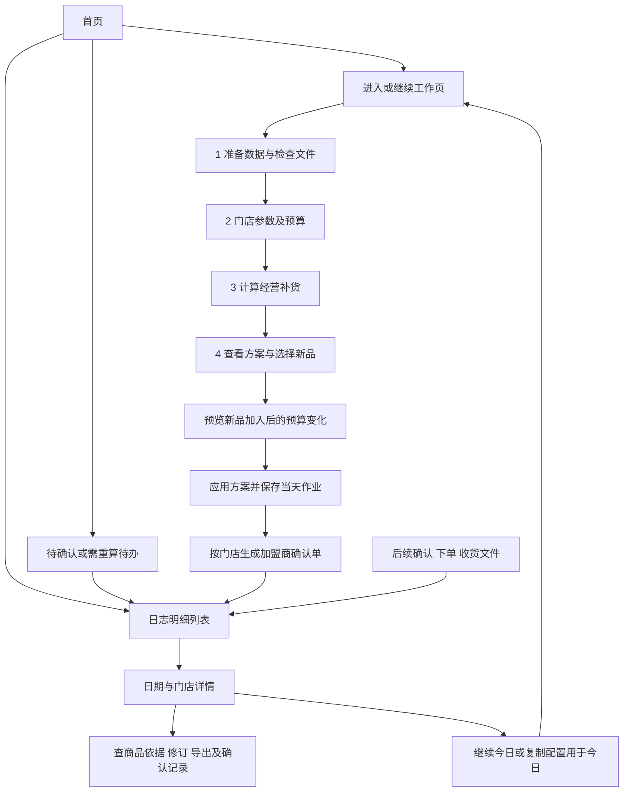

# 首页、作业日志、新品与加盟商确认——设计草案

状态：方案，尚未实现。依据：0.6.2，提交25c11ba0c985d4ea7836119ecbb5ddfe508afb31。建议下一功能版本0.7.0，实际版本在开发时确定。

**最新范围修订：**用户明确将四阶段表格归档和关联放到历史归档，不纳入工作页必经流程。工作页导出必须携带补货单号。以[导出单号与历史归档关联](设计补充_导出单号与历史归档关联.md)为最新依据；本稿涉及后续确认回传、下单及收货的业务闭环按该补充执行，不作为今日作业的阻塞条件。

本轮已完成独立分支perf/parallel-intake-0.6.2及标签v0.6.2推送；远端二者均核验指向25c11ba。没有合并main，没有上传EXE/ZIP或业务输入、用户配置。代码上云不等于加盟商已能在线操作。

## 1. 本次确定的方向

应用分为首页、工作页、历史归档页（扩展原日志明细）。首页负责进入和定位待办；现有资料导入、仓配置、门店参数、计算、结果和导出都收在工作页。历史归档负责后续异构表格关联和追溯，技术报错为辅助。

新品按用户指定条件：月销=0、可用库存=0、在途库存=0、缺货天数=0，四项同时满足。这里的库存沿用当前输入的可用库存口径；按门店判断，不把某店新品当成全局新品。

用户本轮已确认资金规则：**选中的新品也参与门店总预算分配，必卖新品优先于普通动销商品。** 不采用“新品只能用剩余预算”的方案。新品加入可能减少原有商品执行数量，必须有变化预览和版本记录。

其他产品默认建议：新品默认全部不选；勾选后建议首铺1个最小出库单位，可调整为其整数倍；工作页导出每店独立、带号的Excel确认单，回传及其他阶段表在历史归档导入，不建设加盟商账号平台，不自动发送消息或自动下单。这些是本方案建议，不冒充用户已逐项确认。

## 2. 当前代码事实及需要补的能力

| 当前事实 | 本次设计含义 |
|---|---|
| app.py直接创建Workbench；Workbench继承四步工作流 | 增加轻量应用容器和首页，保留工作流及后台任务实例，不重新拼一套计算页面 |
| 作业记录是弹窗，能按日期/门店检索与恢复；jobs表一天一行、覆盖后只存最新payload | 扩展为独立查询和详情页；仍一天一个主记录，但保存旧修订供追溯 |
| 已保存输入、仓快照、必卖清单、参数和结果；export_log仅记录路径和时间 | 复用现有快照，增加不可变修订、导出范围/哈希/确认版本，不能只靠文件路径追溯 |
| 当前结果可按建议补货、必卖、预算缺口、排除、仓、分类及名称/编码过滤 | 增加独立“推荐类型”和“处理状态”维度，避免把新品和必卖、排除混成一个互斥条件 |
| model.py内部Q字段也可能写“新品”，条件与这次四项为零不同 | 新建业务新品标识，不复用或覆盖Q；内部原标签只在计算审计中明确标注 |
| allocation.apply先必卖后普通，同组保留原缺货/预测持有天数/成本/编码/输入位置排序 | 新品作为独立候选数量进入同一个分配器；不伪造日均，不另造一份门店预算 |
| 目前执行导出不包含无执行量的新品候选 | 工作候选、加盟商确认、最终执行必须区分，不能只增加一个筛选项就算完成 |

依据文件：src/workbench.py、work_repository.py、ui_results.py、result_semantics.py、display_fields.py、xlsx_exports.py、allocation.py、model.py、default_config.json。

## 3. 首页与导航

首页沿用现有浅色底、深绿色主按钮和中文表格风格，不新增营销式大图。内容保持简单：

- 顶部显示今天、当前作业状态、上次保存时间；有进行中任务时显示进度和“回到工作页”。
- 两个主要入口：**进入工作页**、**查看日志明细**。今天已保存时第一个入口显示“继续今日作业”；没有记录时显示“开始今日作业”。
- 待办卡片：待确认门店、需重算门店、输入异常门店；卡片直接带筛选进入对应页面。未计算金额显示“待计算”，不显示0元。
- 最近作业列表：日期、门店数、经营补货金额、新品金额、确认进度、最后保存；点开进入日志详情。
- “新建今日作业”作为次级入口；已有当日记录时提示原记录仍保留，保存替换前必须再次确认。

应用容器固定提供“首页 / 工作页 / 日志明细”导航。回首页只切换页面，不销毁工作页、不清空未保存内容、不自动保存。关闭应用、更换正在编辑的作业时沿用保存/放弃/取消确认，取消为默认。后台任务进行时可以浏览首页和只读日志，不能另开第二批工作；关闭应用仍按0.6.2安全取消和回收策略。

历史作业默认只读。复制配置用于今日不复制旧新品勾选和加盟商确认，也不把历史输入伪装成今日数据。恢复今日作业则恢复该版本的新品选择和确认进度；源数据更新后必须重新校验。

## 4. 新品判定、可选资格与数量

### 4.1 判定与资格分开

使用原输入经过现有解析后的J、K、L、N，对应月销、可用库存、在途、缺货天数。缺货天数使用原N，不使用模型修正后的BA。四项必须是有效数值零；空白、None、非数值、负数、布尔值均不当作零。分类结果保存字段证据和判定规则版本。

新品是本轮业务标签，不证明真实上市日期。某件旧品也可能满足四项为零，按用户规则仍标为新品；界面说明“本店四项为零识别”，不擅自增加上市日期条件。

| 情况 | 页面归类 | 是否可纳入 |
|---|---|---|
| 四项有效且均0，资料匹配、状态和价格有效 | 新品候选 | 可以勾选，默认不勾选 |
| 四项均0，但商品禁用/停采 | 新品 / 已排除 | 禁止勾选，不绕过原排除规则 |
| 四项均0，但资料未匹配 | 新品 / 地采待核 | 展示原因，先补齐资料；不凭空生成价格箱规 |
| 四项均0，但周销/日销等出现冲突 | 新品 / 数据异常 | 保留四项判定证据，阻止直接纳入确认，先复核，不改变判定定义 |
| 任一判定字段缺失 | 新品识别待核 | 不默认为新品；列出缺少的字段 |
| 月销0、库存0、在途0，但缺货天数>0 | 非新品；可能缺货恢复 | 继续原模型判定，不塞入新品推荐 |
| 在途>0 | 非新品 | 避免把已在路上的货重复当作首铺 |
| 仅存在仓资料而未出现在门店销售输入 | 不具备本店四项证据 | 不因“未找到”而补出四个0；全量铺货池另议 |

仓归属、基本售价V、箱规及分类仍取当前门店主从仓确定的资料。仓库存只作归属判断，不拆单、不截断、不预占；从仓无货仍保留需求归属。缺箱规沿用补1规则，但在新品行显示“箱规缺失，按1”；缺价/无效价仍待核。新品没有可靠预测日均时持有天数显示“无历史动销依据”，不能显示0天或用虚构日均套21天上限。

### 4.2 可选与首铺建议

工作页“新品候选”显示全部候选及不可选原因。每行：勾选、商品、必卖标记、分类、归属仓、库存单位、箱规、首铺数量、估算金额、资格状态。

首次勾选默认首铺1个最小出库单位：箱规12则12个库存单位，非箱规按现有最小出库单位。改数量按步长增减；手填不符合倍数时提示可用数量，不暗中修改。金额继续按基本售价估算，界面和确认单不用“实际采购成本”误称。

提供“只看必卖新品”“只看可选”“只看已选”“只看未获预算”，支持分类/仓/搜索。“勾选当前筛选中的可选商品”先显示款数和预计金额；“清空选择”明确是当前筛选还是全店。筛选隐藏不等于取消勾选，显示“已选X款，其中Y款不在当前筛选”。取消勾选会移除新品候选量，但保留本轮操作审计。

新品选品清单与数量属于作业状态，不自动保存成所有门店/每天的默认；当前作业保存恢复可复用，换日期/新数据须重新判断。

## 5. 与预算、模型及结果的关系

工作页链条：原输入和仓归属 → 原模型及一箱例外 → 原禁用/停采排除 → 经营候选与勾选新品候选组合 → **同一门店预算分配** → 提案 → 带补货单号导出。后续确认、下单、收货事实在历史归档关联，不作为工作页后置审批步骤。

原模型AS/BV保留，不把人工首铺量写回模型建议。另存“新品首铺候选量/金额”“候选来源”。一个门店+商品只形成一条有效候选；若出现新品条件与经营正建议并存的异常，明确展示并复核，不把两个量直接相加导致重复补货。正常四项零且销量无异常时，新品候选替代该行的零候选，再进入原分配器。

资金规则落实为：先全部必卖候选（含勾选新品），再全部普通候选。同一必卖/普通组内沿用现有分配规则；新品不虚构预测，通常进入无预测组，按现有单次成本、商品编码、原位置决胜。因而必卖动销缺货会先于同组无预测新品，但必卖新品会先于普通动销；这不是“所有新品先补”。多个新品也不新增每款先一箱的公平轮转策略。

例：预算100元，必卖经营候选60元、勾选的必卖新品一个出库单位30元、普通经营候选40元，则先覆盖前两项90元，普通商品按剩余10元及其最小单位分配。结果可能有普通商品减少或暂缓，不能声称加入新品不影响旧商品。这只是规则示例，不是真实测试结果。

新选/取消新品或改数量后，先标该门店“预算待更新”，旧方案不可导出执行。点击“预览重新分配”，展示新增/减少/暂缓商品、经营与新品金额、必卖未满足、最低持有缺口和预算余额；点“应用方案”才替换当前有效分配，取消则恢复原选择。无需重新读取Excel或改原模型结果，可从同一冻结模型结果重建候选后重新分配。其他门店不变化。

预算0时全部执行0；没获得预算的新品仍显示为“已选 / 预算暂缓”，不能从视图消失。没有总预算时采用选定有限候选量，不自动勾全店新品。用户主动调整预算、价格、仓、必卖清单或候选量时，重新分配并使受影响门店的旧确认版本失效。

实现时必须同时覆盖“有预算”和“无预算”：当前order_quantity在无预算时直接回读AS，新品首铺若只写候选字段会丢失。新版应由统一结果口径读取明确的执行数量：有预算取分配量，无预算取通过资格的组合候选量；历史无新字段结果仍按旧入口解释。模型AS/BV不能为此被改写，界面、汇总和两类导出必须使用同一执行口径。

没有选择任何新品时，要求原有商品逐字段、预算排序、数量金额与0.6.2一致。选中新品时只允许预算竞争带来的预期变化，不能改销量预测、原建议、一箱例外或仓路由。执行候选规则需单独记版本，不能只靠未变的模型版本表示整个业务流程未变。

## 6. 工作页筛选与加盟商阅读方式

不要把所有非新品都叫“因动销推荐”。建议采用三个推荐类型，顶部入口前两项最突出：

| 推荐类型 | 解释 | 默认展示 |
|---|---|---|
| 动销补货 | 有有效销量依据，原模型产生经营候选 | 有候选及预算暂缓的商品；一键只看本次可执行 |
| 新品推荐 | 四项为零，人工选择首铺 | 全部候选，可切已选/获预算/待确认 |
| 缺货恢复 / 其他 | 无近期销量但原模型因缺货恢复等提出需求 | 单列原因，不冒充动销或新品 |

数据待核、已排除、地采是处理状态，不应与推荐类型混在同一个下拉菜单。查询采用组合筛选：推荐类型 × 分配状态 × 确认状态 × 必卖 × 仓 × 分类 × 搜索；默认显示简洁选项，其余在“更多筛选”。不同维度取交集，同维度多选取并集，显示已生效条件及一键清除。

结果表前置列：商品/编码、推荐类型、必卖、推荐原因、库存单位、最小出库单位、本次提案数量、估算金额、确认状态；经营视图再前置月销/现存/在途，新品视图前置首铺依据。详情抽屉保留原模型→候选→预算→确认的完整链条。

“必卖”始终是独立标记，新品可以同时是必卖。表格排序和筛选只是查看操作，不改变后端原输入顺序、预算决胜顺序或勾选项。新品默认无勾选；加盟商默认无确认，两者不能混为同一个复选框。

## 7. 工作导出与归档导出分开

| 导出 | 对象和用途 | 范围规则 |
|---|---|---|
| 加盟商确认单（主要按钮） | 每店单独审核，字段精简 | 默认该店当前有效提案全部商品，不受临时筛选隐藏影响；导出前预览款数/金额/范围 |
| 历史阶段对照（归档页） | 核对确认、实际下单和实际收货 | 按明确关联的单号/版本展示，不将“已导出”冒充已下单或已收货 |
| 内部审计明细 / 当前筛选明细 | 排查与分析 | 保留模型、中间字段、缺口、排除、来源和条件；筛选导出醒目标“非完整确认/执行单” |

加盟商单建议工作表：`本次概览`、`动销补货`、`新品推荐`、`缺货恢复`、`填写说明`。某类为0款仍保留表头并写明无该类，避免加盟商误以为文件漏表。主表只放预算后提案量>0且资格通过的商品；未勾选、无预算、禁用、停采、待核不混进可确认行。概览列预算暂缓数量/金额，详细缺口可选另附只读“暂缓说明”，不能将其计为可执行。

确认单列：序号、商品编码、商品名称、推荐类型、必卖、推荐原因、月销、可用、在途、缺货天数、归属仓、库存单位、箱规、提案量、基本售价、估算金额、确认意见、确认数量、原因备注。需要的四项证据在新品表直接可见，不要求加盟商找内部字母字段。列宽、冻结表头、自动筛选、金额格式、文本编码统一；分类通过文字和sheet区分，颜色仅辅助。

可编辑列使用同一浅蓝底；确认意见为“待确认 / 同意 / 调整 / 不采纳”。推荐字段只读提示，冻结签发时的价格、箱规、数量和版本；Excel保护只是防误改，系统回读必须独立校验。

默认每店一个文件，内部多店汇总另导出。加盟商文件不含其他门店、内部原始路径、全部模型参数或技术日志，不靠隐藏sheet隔离其他店数据。文件名如`鹿泉店_20261029_补货确认_V003.xlsx`；单据ID绑定日期、门店、不可变作业修订、提案版本、模板版本及行ID，展示简短单号。

导出前显式选择“全店提案”或“指定商品子集”；正式流程第一期建议只允许全店提案。不得把当前搜索或勾选可见行默认为整店确认范围。内部筛选导出继续可用，但不能作为正式加盟商回执导入。

保存正式确认单前，要求当前提案已保存；同日更新仍出现覆盖确认，取消则不签发新单。导出采用临时文件、完成后改名并登记哈希，失败不登记成功；单据归档记录生成中/成功/失败，重启可核对生成中状态。重复导出同一单据内容保留原单号；提案改变才创建新版并使旧版过期。

## 8. 确认回传属于历史归档

工作页导出后，加盟商可在原表填写确认数，保留补货单号、版本及明细ID。回传在历史归档导入，原建议不覆盖：签发12、确认6，是同一商品的两个阶段值。

后续实际下单和实际收货表也在历史归档关联。资料不全可先保存，缺项显示未知；实际发生的加量、超收、取消或退货作为事实保留并提示差异，不因超过提案而丢弃，也不自动触发今日预算重算。不能只凭名称、时间或数量相似自动确认关系。

原设想中“全部加盟商确认后才能导出最终执行单”的工作流门槛不在本次范围。不同格式、分单、多次收货、版本修订、历史无号文件的处理，以[最新设计补充](设计补充_导出单号与历史归档关联.md)为准。

## 9. 日志明细页：查询、导出、回溯

一级列表默认最近30天，支持自定义日期、门店名称/编码、商品编码/条码/名称、推荐类型、计算状态、确认状态、异常类型。先查轻量索引，再按需打开快照，不遍历解压全部历史结果。列表分页；“导出查询结果”默认全部匹配记录并预览日期、范围、行数，不误当只导出当前页。

每日作业与业务单据分开：一天只有一份当前工作区记录，但可签发多笔门店补货。历史归档按补货单号组织，可从日期/门店汇总下钻。详情包含：

| 详情区域 | 可回答的问题 |
|---|---|
| 作业概览 | 哪天、哪些店、谁操作、哪个版本、多少钱，经营/新品各多少，尚有多少未确认 |
| 商品明细 | 某商品为何被推荐、为何没补、是否新品/必卖、加盟商如何处理 |
| 依据与来源 | 原始字段、文件/工作表/源行、去重冲突选择、仓快照、参数和必卖版本 |
| 数量金额链条 | 模型建议 → 经营/新品候选 → 预算后提案 → 加盟商确认 → 执行导出 |
| 操作时间线 | 导入、检查/失败/取消、计算、选新品、预算更新、保存覆盖、导出、回执、失效 |
| 修订与导出 | 本日各修订差异、签发确认单、原回执和执行单、文件哈希、重导出处 |

商品跨日期查询展示该店该商品每次的分类、候选量、分配量、确认量和金额变化；归属仓是属性，可随版本变化，不能因此变成另一个商品。通过深链直接定位“某天/某店/某修订/某商品”，不让用户重复翻页。

“每天一份作业”继续保持：jobs表保存当天当前版本；每次确认覆盖前，将旧快照和新版本关系保留在修订表。旧修订只读、不额外显示为第二份当日作业。同日覆盖取消不改原作业或确认数据；已有版本改变仍用expected_revision防另一窗口覆盖。以前已经被覆盖而没留快照的旧版本无法恢复，日志明确“历史修订不可用”，不能补造。

业务事件记录对象、结果、操作者、时间、前后版本和关键差异，不逐个单元格/键盘输入刷日志。检查取消和失败也记录，但不生成伪成功快照；未保存编辑可记录概括事件，只有已提交修订承诺完整重算回溯。app.log堆栈放在“技术详情/诊断导出”，不发给加盟商。

历史只读指原业务快照不可改；查看历史后的导出可以追加一条独立事件和文件记录，不能往旧payload里补字段后重新保存。日志下载原单据时核对归档哈希，按快照重新生成文件时标记“重导出”并链接原修订，不冒充原始文件字节。

单机首期操作人可用本机标识+填写姓名，标注“人工登记，非账号认证”；不能声称已完成加盟商身份认证或多人在线审批。快照与文件哈希用于完整性核对，不能宣称具备司法级防篡改审计。

## 10. 轻量实现与兼容建议

复用当前PySide6和SQLite，不引入Web平台或重型工作流框架。建议模块边界：

- app_shell/home_page：导航和首页；持有一个现有Workbench实例。
- audit_page/audit_repository：日志查询、修订索引及操作事件；复用快照编解码。
- recommendation_plan：新品判定、选品状态、候选组合与提案版本；调用原模型和现有预算分配器，避免复制算法。
- document_identity/confirmation_export：工作页单据身份和对外精简导出；archive_intake/archive_linker负责历史多格式导入与关联，现有内部导出保留。
- display_fields/result_semantics：集中新增业务字段口径及不同受众视图，不能让界面和Excel各自判定新品。

轻量新增存储：job_revisions（不可变快照）、audit_events、job_store_index/job_item_index（查询用投影）、confirmation_documents、confirmation_rows、export_artifacts。索引可从有效快照重建，不能成为第二套业务事实。日志查询不改动当前工作结果。

新品状态至少包含：is_new/new_detection_status、四项证据、selected、requested_qty、eligible/reason、candidate_source、candidate_qty、allocated_qty、proposal_revision、confirmation_status、confirmed_qty。这些字段与AS/BV分开，不用同一“数量”字段在不同阶段反复覆盖。

保存最新作业、追加修订、更新查询投影及保存事件在同一SQLite事务中；失败整体回滚。归档Excel和数据库之间使用生成中状态及文件哈希进行失败恢复，不能声称跨文件系统事务天然原子。业务快照/方案/外部确认分别计算指纹，数据或有效配置变化才失效；过滤排序不参与业务指纹。

新增表和新快照格式前备份数据库，支持读取schema1旧作业并保留原字段；旧记录的新品选择和加盟商确认标为“旧版未记录”，不补0或自动同意。恢复旧数据用于重算需显式生成新版本，不能原地改历史。迁移失败保持备份和旧库可用；原0.6.2交付目录不覆盖。

模型预测规则版本可保持0.3.0-rules，但应用版本、新品候选规则版本、确认模板版本和新增快照格式须分别记录。预算算法若直接复用可不改allocation.py；最终须证明未选新品时完全等价，选中时符合新候选竞争规则，不能宣称整条执行链“业务没变化”。

## 11. 开发顺序与验收

1. 首页和日志导航，保持工作页实例、取消/关闭/未保存确认；先无业务结果变化。
2. 日志修订存储、索引、查询、追溯和导出，验证旧数据迁移及事务回滚；一天仍一个主记录。
3. 新品识别、勾选和预算提案预览，验证未选等价、必卖新品高于普通动销、同组原排序和盒规规则。
4. 工作页带号导出可独立验收交付；四阶段资料导入、归档关联、差异查询另行实施，不阻塞工作页。

必须验收的场景：

- 四项严格零，缺失N、空字符串、文本数字、负数、在途正数、周销冲突和仅仓资料存在；不同店同SKU分类独立。
- 新品未选时与0.6.2全部业务字段/顺序一致；勾选必卖新品后普通动销按预期被挤占，预算不超、数量不超过候选、满足最小单位；缺价/排除不执行。
- 改A店新品或参数不串B店；过滤、搜索、排序不改变选择和预算；隐藏选择可见统计与导出范围一致。
- 新品新增金额与经营减少金额可核对；提案量、确认量、执行量分离，不覆盖原AS/BV。
- 一天一次主记录、覆盖取消/确认、并发修订冲突、写入失败回滚、旧版导入、旧修订只读及原文件移走后的回溯。
- 历史文件排序、少行、重复行、改价、改码、跨店、版本不明、重复导入、单位不明、真实0与未知；不能静默串单或重复累计。
- 确认减少不自动补其他货；新版本不消灭旧版关联的真实下单或收货事实；已导出不自动标已发送/已下单。
- 实际EXE验证首页/工作/日志切换、后台读取、保存恢复、查询导出、确认回执；保留0.6.2并行读取和原业务回归。

本轮只写方案与同步已验收版本；没有实施以上页面、数据迁移、新品候选或加盟商确认功能，也没有发送任何加盟商文件。
