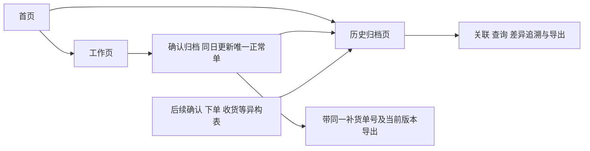

# 设计补充：导出单号与历史归档关联

> 已整合至[产品与交互统一方案 V1](产品方案_首页工作页与历史归档_V1.md)。本文件保留为讨论过程；后续开发以统一方案及用户最新指令为准。

状态：方案，未实现。依据用户最新修正，本文取代前稿中把回执、实际下单、收货串为工作页必经步骤的设想。

最新确定：模型正常补货链路按“业务日期＋门店＋正常补货类型”唯一。工作页确认归档后，签发建议量自动归档；同日重新计算并再次确认归档，覆盖该正常单的当前版本，不生成第二张正常单。其他类型补货可以多笔，但不能借此把模型重算当成新正常单。

## 一、职责边界

| 区域 | 做什么 | 不做什么 |
|---|---|---|
| 工作页 | 导入、参数、模型计算、新品选品及预算分配；确认归档时生成或更新当日正常单并自动归档签发建议；带号导出 | 不管理实际下单和收货，不等待四阶段资料齐全，不因历史归档缺资料阻塞今日工作 |
| 历史归档页（日志明细的业务扩展） | 自动接收本应用确认归档的签发建议；导入后续确认、下单、收货文件及历史旧材料；关联单据与商品行；查询差异、来源及归档事件 | 不要求本应用建议表人工二次导入，不根据回传差异擅自重算工作结果，不自动下单 |

首页保留进入工作页、历史归档页两个主要入口。原参数、仓资料、必卖维护仍在工作页。历史归档可以事后、跨日、批量整理，缺一张表也可以先归档，显示资料完整度，不构成工作流程审批门槛。

## 二、工作页先把单号带出去

### 1. 区分两种编号

- **补货单号**：本应用生成，标识一次门店补货建议业务；界面面向用户可以称订单号，但数据字段明确为补货单号。
- **采购订单号**：实际下单后由采购/业务系统产生。事先未知，不用补货单号伪造该系统的真实订单号。

一个补货单号可对应多个采购订单号，例如分仓、分供应商下单；一个采购单若合并了多次补货，则在历史归档中按明细显式建立对应关系，不能只在文件上随意绑定一个号。

### 2. 编号与版本规则

正常单建议展示格式：`BH-20261029-门店代码-ZC`，内部另存唯一ID和修订号。正常单的业务唯一键是业务日期、稳定门店编码、正常补货类型；不能把计算时间、模型版本、仓或导出次数加入唯一键，绕开“一天一张”。内部UUID不能替代这个业务唯一约束。多机数据合并时同一业务键冲突需核对修订，不能因为UUID不同就保留两张当前正常单。

| 操作 | 编号处理 |
|---|---|
| 首次确认归档某店当日正常方案 | 创建正常单号及V001，保存完整输入、有效配置和结果快照，签发建议自动进入历史归档 |
| 内容不变，再次确认归档或导出 | 同一单号、同一版本；导出只追加事件，不重复归档或累计数量 |
| 同日重新计算、修改新品选择或预算，再次确认归档 | 提示覆盖差异；确认后更新原正常单当前版本，例如V001→V002；旧修订留存只供追溯 |
| 只重算、未确认归档 | 只是工作草稿，历史当前正常单仍是上次已确认版本 |
| 次日正常补货 | 以新业务日期生成新的正常单；归档/导入时间不能改写业务日期 |
| 多店一起确认归档或导出 | 每店每天各一张正常单；A店更新不覆盖B店，未选择门店保持原状态 |
| 复制历史参数用于今天 | 按今天该店正常单唯一键创建或更新，不能以“复制”为理由另建第二张正常单 |
| 其他来源或类型补货 | 在历史归档按真实业务类型另存，可有多笔；本期不因此新增工作页紧急单/手工单功能 |

模型正常链路不提供“同日新建另一张正常单”的选择，也不再询问重算是否为独立补货。同日确认归档固定更新当日正常单；覆盖前展示原/新版本的门店、数量、金额及差异，默认取消。取消不改历史单据。这里的“确认归档”是内部确认当前建议，不是加盟商确认数量。

文件名、概览页以及商品明细行均带补货单号和版本；每条商品记录另带稳定明细ID。行号、排列位置不作身份。动销、新品和缺货恢复分表仍共享同一门店补货单号，按明细ID关联；排序、删行、复制sheet不能改变原始快照。

归档主键不依赖文件名。每天一份工作区记录可以包含多店；每店当日正常单始终只有一个当前版本。正常单与其他补货类型分开查询，旧修订不作为新增正常单展示或累计金额。工作区草稿保存不等于确认归档；确认归档应一次事务更新已确认作业修订、正常单当前指针、建议快照及归档索引，失败全部回滚，不能出现已确认但未归档。正式对外导出使用已确认版本；数据已变但未确认时应提示先确认归档，不静默导出草稿。

### 3. 原模型量与发送量不要混淆

用户的四阶段主线为：模型计算数 → 加盟商确认数 → 实际下单数 → 加盟商实际收货数。当前应用还存在新品首铺和预算分配，所以归档同时保留原模型AS、预算前候选和实际签发建议量。

对外确认依据是**签发建议量**，不能拿未经预算或新品处理的AS代替。界面四阶段对照首列显示“建议数量（签发）”，可展开原模型计算依据；新品由选品产生的数量明确标“新品首铺”，不冒充模型预测。

## 三、历史归档负责把后续表接回来

本应用签发建议由确认归档自动写入，不需要再选一次模型Excel上传。后续文件及应用外历史旧建议无论何时收到，都先保留原文件、文件哈希、来源工作表/行号和导入时间，再解析为阶段记录。业务日期与归档日期分开；次日导入不将业务归属移到次日。

标准归档操作：选择文件 → 指定/识别资料类型与模板 → 映射字段预览 → 找到明确单据关系或进入待关联 → 确认关联并保存。

不同格式通过可保存的字段映射模板统一解释，不要求人先手工改成同一种表。模板含门店、商品码、单位、数量、单据号、原单号、版本、日期、状态和行ID映射；缺少什么就标记什么。模型输出自带编号，加盟商若沿用原表填写确认数量，原编号直接保留。

### 关联分三种证据等级

1. **编号关联**：补货单号+版本+明细ID明确且门店/商品身份一致；或实际订单号已在归档映射表中明确关联。允许自动关联，并展示依据。
2. **人工确认关联**：外部系统没带补货单号，由人指定原补货单和版本；再按精确门店/商品码核对行。记录谁确认、确认时间、来源证据及具体数量分摊。
3. **待关联**：只有相似商品、相近时间、文件名或群消息时间。可以推荐候选，不能自动定案。只知道补货单但不知道具体签发版本，也应待核版本。

数量相同不是身份，数量不同也不是不能关联。加盟商改了建议量，正确处理是保留“签发12、确认6”，而不是寻找另一个刚好为6的建议单。

导入的异构确认表若改名、丢编号、删行，仍可以作为原始材料归档，但不能伪造自动精确关联。删除/缺少的行显示“确认信息缺失”，不能默认为拒绝0。重复、改码或无法识别单位的行留待核；有人明确认定不采纳时才记录确认0。

### 一笔可以有多张表

- 一笔补货可分成河北/山东仓采购单，并分几次收货；分别保留各子单/收货单与原明细关系。
- 同一SKU在多单出现时，不能仅凭SKU合并；必须结合门店、业务单号/外部订单号及版本。
- 一张外部订单合并多笔补货时，按商品行建立数量分摊；关联数量之和不得超过外部有效数量，同一数量不能计入两笔。无法拆清时保留“未分摊”，不自行按FIFO或时间比例猜。
- 确认数大于建议数、实际下单超确认、收货超下单均可作为真实事实归档并标差异，不因不符合计划而丢弃。归档事实不等于应用批准了该交易。
- 替代商品不直接覆盖原SKU；有明确证据再建立替代关系，不能仅按名称相似合并。

## 四、对照页与统计口径

主列表按补货单号组织，可按日期、门店、商品、推荐类型、缺失资料、未关联、数量差异筛选。详情展示各阶段数量、差异、证据与原表入口。

| 商品 | 签发建议 | 加盟商确认 | 实际下单 | 加盟商收货 | 差异/完整度 |
|---|---:|---:|---:|---:|---|
| 示例商品 | 12 | 6 | 6 | 5 | 确认减6；收货比下单少1 |

上表仅为解释示例。缺收货表时显示“未归档/未知”，不是0件；确认了确实没收到，才可记录事实0。资料完整度、关联可信度和业务差异是三个独立维度，资料齐不代表数量一致。

数量比较统一到已确认的库存单位，原单位、原数量和换算来源同时保存；箱/个不能直接相减。没有可靠换算时待核，不默认为1。模型箱规缺失补1的计算规则，不能自动当作外部采购或收货文件的单位换算证据。

明确快照和增量：重复导出的订单累计表不能逐文件相加；订单修订按该外部单据的有效版本解释，收货增量按唯一收货单/事件累计。除文件SHA去重外，还需业务单号/行号/版本去重，避免同一表另存后哈希改变而重复计数。外部编号也须带来源系统/供应商等作用域，不假定各平台号码全局唯一。

取消下单、撤销收货、退货单独保存动作和关联原单，不直接删除旧事实。界面区分原下单量、撤单量、有效下单量，以及累计收货、退货和净收货。比较差额只在双方口径与完整度明确时计算；部分数据标“截至目前/部分归档”，不把尚未归档判成业务差错。

价格口径单独处理：模型V是基本售价估算，实际采购和收货金额需原表支持；不能把价格差当作数量问题，也不能凭估算补造真实成本。

特别区分“加盟商实际收货”与仓库发货、物流签收或系统入库状态。只有相应证据才填写该阶段；证据不足留空并注明来源类型。

## 五、历史变更和版本追溯

原始文件、阶段事实、关联关系分别保存。修正错误关联时保留前后关系和操作记录；只影响历史查询结果，不自动写入工作页。

某一旧版建议已被确认或下单后，后来导出的新版不能让旧实际订单凭空失效。历史事实仍挂在当时明确关联的版本上；新方案另存版本，是否替代未执行部分须有明确业务依据。不能用“最新导入时间”或“最新文件名”替换原订单所依赖的版本。

因此，同日覆盖的是正常单的当前签发建议版本，不是抹掉加盟商确认、下单或收货事实。V002成为当前版本后，已关联V001的后续表保留原关系并显示“基于旧建议版本，需核对”；不能自动搬到V002参与同版本差额计算，也不能自动清零。默认列表仍只有该日该店一张正常单，详情可切换修订及查看各自关联材料。

历史导出提供两类：查询结果汇总，以及某笔补货的四阶段对照和原始附件索引。再次导出时保留业务号/版本和查询范围，原表归档不依赖用户下载目录一直存在。业务关联记录和原附件需一起备份，只有数据库或只有Excel都不能完整恢复。

旧文件没有单号时，允许建立“历史补货档案号”并记录它是整理时补建、哪些关联由人工确认；不倒写原Excel，不声称找回了不存在的历史订单号。无法确认关系的材料留在待关联区，不用相似度填满闭环。

## 六、实施次序

近期工作页功能先做到：确认归档时创建或覆盖当日唯一正常单、自动归档签发建议，保留版本和行ID；所有正式输出带号，保存快照和导出记录。历史页先能读取这份自动归档，不等待后续异构文件关联功能完成；新品与预算规则继续按前稿已确认的方向。

历史归档另设功能阶段：资料类型与模板映射 → 原始文件入库 → 编号关联/人工待核 → 四阶段数量对照与导出 → 批量历史整理。无需等归档全部完成才交付工作页。

历史关联开发前需要一组能够人工确定对应关系的四阶段样本，确认采购/收货系统有哪些可用单号、商品编码、单位和修订规则，再冻结模板契约。这里不预设外部系统一定支持回写补货单号，也不预设四张表一一对应。

验收重点：同店同日正常单唯一、重算未确认不覆盖、确认后自动归档且同号更新、重复确认不重复累计、取消或事务失败保留旧版本、多店隔离、其他类型不占正常单唯一键、跨日不丢原关联、不同修订的后续事实不串版、分单和多次收货不重复累计、无单位依据不换算、缺表不当0、历史更正不改今日结果。

本次仅修订设计文档；没有修改软件、导入历史表、建立实际业务关联、迁移数据库或推送新的代码版本。
