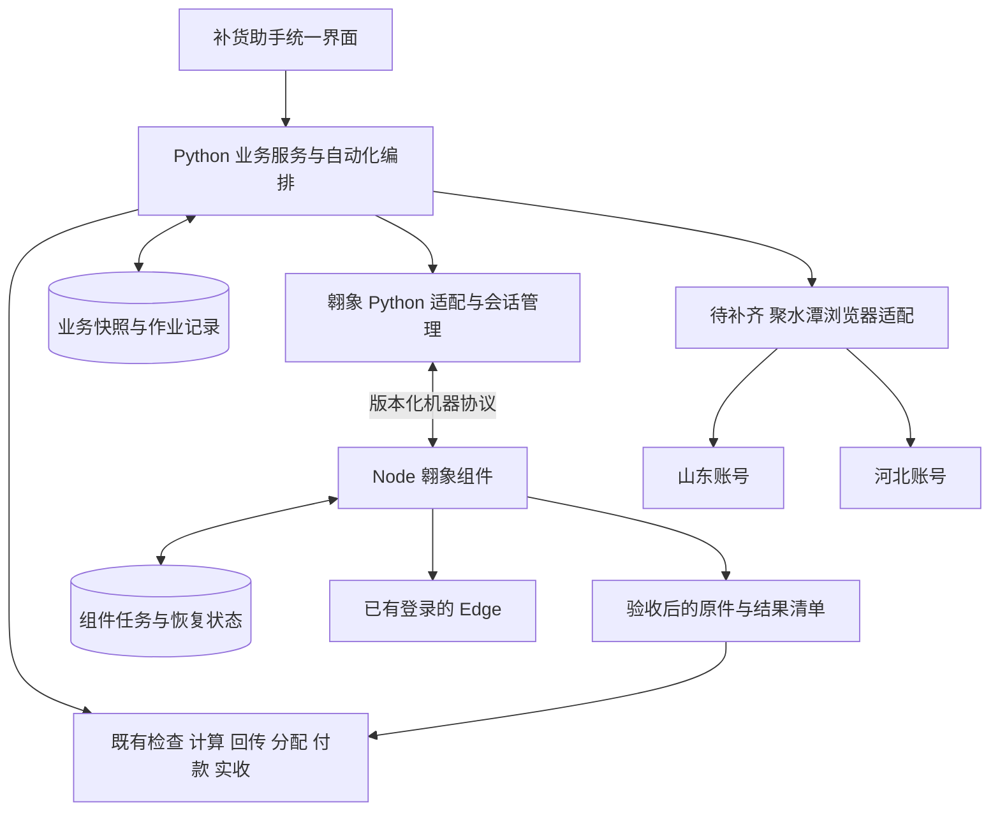

# 补货助手项目意图与实施进度

## 必采最低持有与日配排除（2026-11-11，0.50.5）

按用户确认，补货侧必采品沿用最低可售参考量（默认1个库存单位）作为最低持有基数，零销量也适用；扣除可用及在途后按最小出库单位取整。预算先满足各必采最低量再分配追加需求，不足时保留最低持有缺口。商品资料精确“日配”标签默认排除，禁采、停采、禁用及原准入限制优先；新品选择与人工改量不能静默绕过。预测核心、默认参数、归属、缺货率统计未改；历史签发保留原执行量，旧草稿需重算。源码、EXE及等价性证据以[本版交付报告](../releases/0.50.5/rc3/交付报告.md)为准，[业务规则与操作](0.50.5必采最低持有与日配排除.md)及新人手册已同步。

## 缺货率分析桥接白名单修复（2026-11-10，0.50.1 rc2）

修复 rc1 缺陷：新增的"读取当前 Edge 登录"调用不在分析模块操作白名单，缺货率采集在登录核验前被"分析不允许该翱象操作"拦截。`stockout_task.Bridge.AX_ACTIONS` 增加 `setup.check_login`、`setup.status`、`setup.cancel`；新增 `tests/test_stockout_login_bridge.py` 4 项覆盖登录/轮询/取消/失败及白名单不放宽，并补测此前漏掉的登录与分析之间桥接。固定源码 `b91c9d0`：Python 全量 1366 项、组件 216 项、冻结 EXE 启动 39 项、删除生命周期 9 项、缺货率完整链路 63 项（含桥接关键断言）通过；证据见 [rc2 交付报告](../releases/0.50.1/rc2/交付报告.md)。全部隔离验证，未调用真实平台；真实 Edge 下的缺货率采集仍待现场验证。另记录：rc1 protection.json 中 model.py 哈希不可从 Git 对象复现，rc1/rc2 构建归档实际一致，疑点已在 rc2 protection.json 如实登记。

## 付款识别与采购状态实施（2026-11-08，0.49.0 rc1）

已落实付款最小四列及表头别名、已核验企业＋内部号原关系、门店对应、生命周期及日期排序、跨日唯一与生成明细复核、同事务付款及对应保存；新增名称对应维护。作废停常规轮询且不写实收0；本批同步限定范围、只读历史和多入口原身份重验。单号精查隔离范围，受控降级不重提已受理任务。首次按需建轻量索引，已有索引只读变化快照及必要候选。[业务说明](0.49.0付款识别与采购状态.md) · [最终验收证据](../releases/0.49.0/rc1/交付报告.md)。真实平台支持性待现场验证；未清理真实数据、未推送或合并。

## 采购单价两位小数（2026-11-08，0.48.7 rc1）

固定源码`ccdd38a`：翱象采购文件明确填写两位四舍五入单价，原付款不变，逐行及汇总展示采购金额和舍入差额；旧上传任务继续精确核对，旧未上传预览需重新生成。[规则](0.48.7采购单价两位小数.md) · [交付与验证限制](../releases/0.48.7/rc1/交付报告.md)。138项专项、193项Node、实际EXE9项及包内组件8项通过；完整执行1264项中的1项子进程导入环境错误已通过模块7项补验闭合。未调用真实平台，未推送、未合并。

## 付款单识别与采购状态原方案（2026-11-08，历史阶段）

新增[付款单分层识别与采购状态同步修正方案](plans/付款单分层识别与采购状态同步修正方案_20261108.md)。业务已确认先用已有对应关系、生命周期、时间、门店及汇总缩小候选，再核对实际生成明细；支持无签发号、无仓字段及跨平台店名差异，保留跨日、已付款更正、多候选和真实差异的处理入口。同步纳入平台作废终态、已知采购单号精查，以及历史关联不再进入有效同步候选或调度的要求。

该方案编写时为0.48.6 rc1，当时仅编写方案和入口；0.48.7仅实现采购单价舍入。0.49.0实施识别与状态联动，当前状态和验证边界以上方本轮说明及报告为准。

## 缺货率多维切面与导出（2026-11-07，0.47.7）

按用户确认结构支持每套组合一张表、每行一组完整维度与指标；最多12维、32套组合，按编码/名称搜索并跨页多选筛选。地采仓显示统一；全量流式导出带Excel筛选与冻结表头，原统计口径和补货业务隔离保持。0.47.6负库存按0及默认停采/禁用剔除继续保留。[使用说明](0.47.7缺货率多维切面与导出.md) · [发行验证](../releases/0.47.7/rc1/交付报告.md)。

## 缺货率供货设置与可读性修复（2026-11-07，0.47.3历史交付）

分析采用入口改为只读参数页保存的门店主从仓，修复旧供货缓存遗漏门店导致无仓资料的问题。新增逐店已采用供货设置查看；切面、筛选、明细和分析导出同时显示名称与编码，汇总身份仍按编码。保留原单/双仓判断、统计口径和快照隔离，不自动重写既有任务或日报。[用法](0.47.3分析供货设置与名称显示.md) · [本轮验收](../releases/0.47.3/rc1/交付报告.md)。真实资料仅用于只读定位；测试和EXE验收全部隔离，不调用真实平台，不修改真实业务数据。

## 启动连接增量（2026-11-07，0.47.2本地候选）

正常启动自动连接翱象与聚水潭两仓并核验登录，复用原身份和专用浏览器绑定；手动入口作为异常检查与修复。未登录时保留登录页并有限自动复核，账号不符不覆盖绑定。已断开的翱象连接不复用旧成功记录，连接状态栏零延时回调改为受窗口生命周期管理。主动业务优先安全让行，关闭时协作退出；不自动导出、更新业务资料或加载缺货率历史。[用法及范围](0.47.2启动自动连接与登录核验.md) · [本轮验收](../releases/0.47.2/rc2/交付报告.md)。首次从未建立的翱象商家/门店绑定仍需明确业务配置，不猜归属。仅隔离验证、独立打包，不操作真实平台，不推送或合并。

## 缺货率批量导出增量（2026-11-07，0.47.1本地候选）

新采集把所选门店放入一个原生批次，复用补货业务的“先提交各店、平台同时生成、统一收取”流程。本地原件仍逐份解析；升级前逐店任务保留原编号恢复。另修复原生V2三列“毛利”误触发重复表头拦截、空分配队列检查误触发分析取消。资料隔离、低负载生命周期和原任务防重不变。[使用说明](0.47.1缺货率翱象并行导出.md) · [本轮验收](../releases/0.47.1/rc1/交付报告.md)。本轮仅隔离验证、独立交付，不访问真实平台，不推送或合并。

## 门店缺货率增量（2026-11-07，0.47.0本地候选）

新增独立资料、独立日快照和按需入口，按有月销商品的门店可用库存统计缺货率；支持淘汰/考核视角及门店、供货来源、必采、仓、类目、仓内上游供货商等切面。手动采集、原任务恢复、可选择启用的每日计划和独立Excel均在该板块内，原补货模型与默认资料不由分析更新。[操作及隔离边界](0.47.0门店缺货率分析.md) · [发行验收](../releases/0.47.0/rc2/交付报告.md)。

本轮仅隔离验证和独立打包，不访问真实平台，不启用业务计划，不推送或合并。合成容量和未进入板块的对照范围以报告为准，不能替代低配置业务机和真实平台连续运行。旧五段漏斗新增供货商切面的方案仍单独待实施。

## 删除恢复增量（2026-11-07，0.46.4）

修复重复预览误作平台身份、原采购已作废却没有完整核验结束路径的问题。重复本地准备可以结束，作废原单仍须核对原受理任务和逐商品原生文件；核验后返回原删除确认流程。没有修改真实订单或平台单据，没有新增强制删除。用法及验证边界见[0.46.4说明](0.46.4作废采购核对与删除恢复.md)，实际交付见[本版报告](../releases/0.46.4/rc1/交付报告.md)。

## 方案增量（2026-11-07，尚未实施）

用户已确认“大仓供应商”为商品对应的上游供货商。新增[五段漏斗上游供应商与商品类目切面方案](plans/五段漏斗上游供应商与商品类目切面方案_20261107.md)，覆盖冻结资料取值、组合筛选、切面汇总与下钻、独立Excel、AI同口径、历史待核、性能及验收；完整范围估算3～5人天。

本次核对基线为0.46.3、`d12bf52`，仅编写方案和入口文档，没有实施新增功能、修改业务数据或重新打包。当前运行版本以[README](../README.md)及对应发行记录为准；下方版本段保留为历史快照。

## 当前增量（2026-11-06，0.44.0本地候选）

预计可售天数已接入五段看板、Excel和AI。纯分析模块固定使用制单时预测，区分现货/含在途/签发后覆盖与五段新增量；共同可比范围、跨仓去重、多轮单列、缺失原因可查看。既有37列后追加5列，原数量/金额/比例及计算实现保持。业务用法见[0.44.0说明](0.44.0预计可售天数.md)，最终rc2固定构建d89d3c8，20项实际EXE/MCP通过；主体988项回归及38份原业务对照零差异，布局修正后另跑36项定向检查。完整证据见[交付报告](../releases/0.44.0/rc2/交付报告.md)。

本轮独立分支，不推送、不合并，保留0.43.1。实际stdio接口与界面验收不冒充Codex/WorkBuddy自然语言正确率，也不宣称平台实时库存或全店实际周转。

## 历史增量（2026-11-06，方案与目录整理，应用当时为0.43.1）

新增[预计可售天数与五段漏斗分析完整方案](plans/预计可售天数与五段漏斗分析方案_20261106.md)：区分现货、含在途、五段新增量和签发后覆盖，固定历史预测依据，明确必采分组、门店加权、双仓去重、多轮趋势、Excel及AI一致性。状态为待开发；未修改计算或分析代码，不代表已具备新增指标。

按用户要求，仅保留最新0.43.1 rc1交付和构建目录，旧二进制及构建中间产物清理；源码、Git、历史验收、QA及业务资料保留。旧包附带说明、模板及构建日志另保留，精确范围与哈希核对见[目录整理记录](项目目录整理记录_20261106.md)。旧报告中的“旧包保留”为当时事实，不代表本次清理后的磁盘状态。

## 历史增量（2026-11-05，主线0.43.1）

本次按用户“更新文档、推送并合并”同步0.41.0～0.43.1连续成果，原远端主线6203512。运行包为0.43.1 rc1，固定构建源码16c0701，验收标签v0.43.1-rc1指向a7178bb；主线另有本次文档提交。完整引用关系及同步范围见[主线说明](../releases/0.43.1/rc1/主线同步说明.md)。

| 业务目的 | 已完成入口 | 当前边界 |
| --- | --- | --- |
| 设置及复用门店参数 | 参数预案、逐店补货预案绑定、批量开关/预算/供货仓、导入下拉引导 | 保存以后默认与采用本次分开；系统默认兜底不展示、不删 |
| 清理脏配置 | 删除整条已保存门店配置，避免旧JSON重新恢复被删配置 | 不删除本次/历史作业，不连带删除独立准入记录 |
| 查看资质与拒收现状 | 参数设置的二类医疗资质/门店拒收清单；状态、筛选、详情、维护、导入定位、筛选导出 | 未登记为待核验；登记状态和有效状态分开；规则不改 |
| 批量解除大量拒收 | 店-SKU勾选、全选当前筛选、完整核对、批量原子保存 | 筛选变化清空勾选；只解除所选项；并发变化整批拒绝，历史不回写，当前结果需重算 |

0.43.1已有971项回归、38份严格对照零差异和实际EXE 39项检查；70店7000条为合成隔离数据，三轮性能原始值见[验收报告](../releases/0.43.1/rc1/交付报告.md)。本次文档同步仅核对证据、源码、标签、哈希及链接，没有重跑测试、重新打包、更新平台或解除用户真实清单。用户实际大历史库备份速度、人员长期使用体验不由此宣称验收。

以下各段为历史快照，旧版本“当前”、候选目录和“未推送”不代表最新状态。模型0.3.4-rules、仓归属0.5.1、参数/作业/存储3/1/2保持。

## 历史增量（2026-11-05，0.39.0 rc2 本地候选）

经营分析已独立成页：五段漏斗、必采/非必采分组、全量导出、多轮证据复盘及AI同口径查询。安全库存诊断在冻结依据上只试调分类概率，完整重算预算，明确确认后采用本次结果；永久默认及历史不变。已完成854项回归、严格冻结输入对照和实际EXE原生/stdio两套验证。见[本轮交付与限制](../releases/0.39.0/rc2/交付报告.md)、[业务操作](0.39.0业务使用指南.md)。当前候选为 `交付_0.39.0_rc2`，保留旧包，本轮未推送或合并。

本轮没有重跑真实平台、外部AI客户端自然语言或新机验收；历史资料不足不能用当前资料补齐。以下按日期保留历史状态，旧“当前”判断及入口不作为0.39.0的最新结论。

## 历史增量（2026-11-04，0.36.0 本地候选）

以主线 `35b33de022be33958ec57851f722130feb328d7a` 固定基线，独立分支完成首页待办、日常维护区折叠、异常核对筛选与固定列、生命周期空态和范围继承。见[操作及结构](0.36.0业务待办与核对.md)、[交付证据](../releases/0.36.0/rc1/交付报告.md)。旧 0.35.1 包保留，本轮没有推送或合并。

已重跑 754 项回归，另做组合筛选、跨页选择、备份恢复与同环境性能对照；业务逐值对照及实际 EXE 结果以本轮报告为准。真实翱象已完成采购单主子单下载与隔离入账验证使用明确指定样本；没有修改平台订单或日常资料。该单缺少本应用历史付款关联，隔离重建上游参考不冒充正式历史关联。

采购空白模板夹具已按原哈希定向纳管，从固定 Git 归档副本补入锁定运行时后，163 项组件测试全部通过。下方“夹具待解决”为历史状态，本轮已关闭该项；不代表脱离锁定运行时的全新电脑构建已经验收。

用户要求 AI 连接问题与自然语言客户端验收暂缓，保留原功能及未完成记录，不继续配置 WorkBuddy。第二台机器、真实创建到收货连续闭环和真实规模全链路性能仍需相应环境，不以本地合成测试关闭。下方 0.35.1 与 0.28.0 段落保留为历史记录。

## 当前进度（2026-11-04，0.35.1）

本次核对源码 `361773237b02bebea2c285f9cd460e0ae9d79f4a`，本地与云端 `main` 一致，已包含 0.34.0、0.35.0 和 0.35.1。应用 0.35.1、模型 0.3.4-rules、仓归属 0.5.1。以下更新以当前代码和既有发行证据为依据；本次仅整理文档，没有重新运行回归、实际 EXE 或真实平台测试。

推荐运行包为 **0.35.1 rc1**，构建源码 `940cfb672ab7ae4bfc84813725132c28428d02ea`；标签 `v0.35.1-rc1` 指向证据提交 `1d3e479`。主线还包含后续文档格式整理，故三者提交号不同。版本报告中的“未推送、未合并”是当时状态，不改写历史；当前状态以上述核验为准。

| 领域 | 当前实现及已有证据 | 剩余边界 |
| --- | --- | --- |
| 聚水潭双仓资料同步 / R04 R05 | 已有分仓同步；[双仓验证记录](聚水潭双仓完整验证_20261103.md)记录真实导出、下载及隔离采用 | 不是待开发空白；登录、账号与物理仓核验仍需保留，新机及登录异常覆盖未据此全部关闭 |
| 业务准入与恢复 | 0.32.0 增加资质、拒收与计划；[0.32.2 修复](0.32.2任务快照与聚水潭依据修复.md)记录恢复快照、当前准入依据及普通导出校验 | 不再用下方 0.28.0 历史问题描述现状；后续变更继续检查任务隔离与准入 |
| 聚水潭批次分配 | [0.33.0 使用说明](0.33.0批次库存与处理范围.md)及[实际 EXE 报告](../releases/0.33.0/rc1/交付报告.md)：明确订单、顺序、分仓冻结库存；继续、重试、撤销及筛选导出 | 批内共享库存，新批不扣其他批预留；业务选择资料，不强制刷新或自动判断新旧；本地生成不等于平台下单 |
| 翱象采集维护 | [0.33.1 rc2 报告](../releases/0.33.1/rc2/交付报告.md)：结束采集和删除记录，解除旧任务阻塞并保护已采用资料 | 本机结束不冒充平台撤销；已采用文件、草稿和签发不随采集记录清理 |
| 参数分组与复用 | [0.34.0 参数说明](0.34.0参数分组与预案.md)及[rc2 验收](../releases/0.34.0/rc2/交付报告.md)：分仓周期、门店分类参数、独立通用参数、全局映射、预案；单店/批量/Excel 设置 | 保存默认和应用本次分开，未选字段不覆盖；历史快照不变。日常计算步骤的布局精简仍需单列验收 |
| AI 协助 | [0.35.0 本机接口](0.35.0AI协助使用与结构.md)提供 12 个 MCP 工具；[0.35.1 常用业务](0.35.1AI常用业务与提示词.md)提供九个表单式提示词 | 只查询、试算或明确采用本次结果；不把签发、删除、平台采购等开放为自动动作。客户端需独立配置并保持工作台打开 |
| AI 验证 | [0.35.1 rc1 报告](../releases/0.35.1/rc1/交付报告.md)：741 项回归、25 项最终定向检查、33 场景与 5 份 Excel 零差异；实际 EXE 九案例与 Codex MCP 客户端调用 | 属于既有验证，不是本次重跑。自然语言模型执行次数为 0；没有 Codex/WorkBuddy 对九条提示词的多轮成功率结论 |
| 业务使用体验 | [体验清单](plans/业务使用体验优化与验收清单_20261104.md)已核对当前代码，区分旧观察、已有实现、专项证据和待验收 | 不再将参数分组整体标为未开发；首页待办重组、结果异常优先和固定列仍需后续处理，不把旧截图当新版验收 |
| 真实跨系统闭环 | 保留回传需求、本地生成、实际配货依据、付款确认、翱象采购及实收的事实边界 | 聚水潭自动网页下单/实际配货回拉、翱象最终连续实收、联合换机及全链路性能尚缺完整证据，不宣称已整体替代影刀 |

## 当前使用入口与后续安排

- 业务人员使用完整 `交付_0.35.1_rc1/补货助手` 目录；源码、运行包、用户资料分别管理。
- 参数维护进入“参数设置”；备货/到货按仓，分类参数按门店两仓共用，分类映射全局一份。通用参数可不维护，使用默认通用方案。
- AI 首次从“AI 协助”配置本机连接，日常从“AI 常用业务”复制场景指令；满意后明确采用，正式保存和签发仍由人员在原页面完成。
- 后续体验工作按清单补验已实现子项，再安排首页待办、付款空态与连续处理、异常引导及表格布局。暂未进行的自然语言客户端成功率验证单列，不冒充功能已失败或已稳定。
- 自动网页下单、实际配货回拉、真实连续实收等属于后续主链目标，不因更新文档而自动进入开发或真实执行。

本轮仅统一四份文档：当前 README、项目进度、体验清单和此前已生成的历史 README 存档。历史存档原文件及下方历史段原文保留；计算、默认配置、用户资料、发行包和现有标签不变。

## 历史进度快照（2026-11-02）

以下保留原项目意图、架构和历史进度以便追溯。业务目标中未被后续明确修订的部分继续有效；实现状态、待办及云端状态仅代表当时，发生冲突时以上方增量和链接的新版本证据为准。

更新日期：2026-11-02。进度基线：`22f5115bf5edebe0032e824ae20673c8cc9180ee`，应用 0.28.0，模型 0.3.3-rules。本文发布前已通过远端引用确认，GitHub `main` 和 `feat/business-readability-0.28.0` 均指向该提交。

本文作为项目目标、架构方向和当前进度的统一入口。历史设计稿保留原文便于追溯；当前实现状态以本页及对应代码、发行证据为准。发行报告里的“未推送、未合并”是出包时记录，不替代当前远端状态。本文不是执行真实采购、付款、删除或新增后台任务的授权。

## 一 项目要完成什么

逐步替代影刀旧业务流程，将浏览器取数、补货模型计算、门店确认、聚水潭下单、付款依据、翱象采购与实收记录整合到补货助手。解决旧流程全串行、运行时间长、维护困难和参数写死在 Excel 中的问题。

最终用户在一个应用内完成作业；业务计算和浏览器执行保持明确边界。保留手动入口以处理异常和接收外部文件，自动和手动共用相同校验、计算与生命周期规则。

正式生命周期保持：**签发单 → 门店回传单 → 门店付款单 → 门店实际收货单**。取数任务、JST 导入单和翱象采购任务作为执行记录关联，不冒充付款或实收事实。

## 二 不变的业务要求

1. 补货建议来自翱象，商品与库存资料来自聚水潭。两类原件分别保留、记录来源与采集时间。
2. 山东仓、河北仓各有一个聚水潭账号；资料、库存、价格、订单和执行身份按仓隔离。
3. 聚水潭下单以门店确认回传为需求依据，经现有本地库存分配后使用有效生成版本，不直接使用模型初算量，不由自动化层再分配一次。
4. 实际财务配货单代表聚水潭为订单实际分配的商品数量和金额；自动闭环以该事实作为默认付款来源，业务核对确认后再推进采购。
5. 当前应用另有人工确认后采用生成单作为付款来源的路径，予以保留并区分来源；不能把本地生成单自动解释成远端已经接收、实际配货或支付。
6. 翱象采购依据已确认付款版本。按当前专项范围创建采购草稿并保留“待提交”，不自动执行平台后续提交、付款或收货。
7. 完结后的实收取平台实际入库数据，缺失与零区分；记录数量和金额差异，平台完成时间与观察时间分开。
8. 未知提交先查询核对，不通过重启、换入口、换机或重新生成请求来重复下单。
9. 保留签发核对、门店回传确认和付款确认；自动化主要替代重复取数、搬表、填表和跟踪操作。
10. 已撤销的“8.5 天目标”和“无销量统一走首铺”不列入本项目后续开发或验收缺口。计算口径变更另行明确，不夹带在架构整理中。

## 三 架构方向与实际接入

推荐方向已部分落地：组件代码纳入 `components/aoxiang/`，保留独立 Node 包、机器入口和测试；Python 管业务事实，Node 管浏览器动作、平台任务、文件验收和技术恢复。主项目有共享会话、取数适配、采购任务、批次编排和实收适配代码。无需将组件拆散重写为 Python，也不要求当前先部署服务器或微服务。

主项目只能采用明确账号、门店、任务和文件哈希对应的结果，不能扫描下载目录猜最新文件。重复回执和恢复登记必须幂等。业务数据库与组件技术状态各有写入责任，不跨层直接修改付款、库存或实收表。

独立发行 ZIP 仍是 0.2.1，仓库内组件已在该基础上扩展；不能根据独立 ZIP 或 package.json 的上游版本号推断仓库集成能力。后续发布应同时记录上游版本、集成提交、协议及能力版本。

## 四 五段主链的当前进度

“代码已有”表示源码实现存在；“测试记录”表示有对应证据，需区分离线、实际 EXE 和真实平台；“完成”只在整段按约定验收通过后使用。不按五段简单计算百分比。

| 主链 | 当前实现 | 验收与剩余工作 |
| --- | --- | --- |
| 指定门店建议 → 检查 → 计算 | 已有翱象采集、机器协议、文件验收、Python 输入采用和共享会话；已实现先提交后轮询的采集流水线，按原店序采用 | 历史记录有真实建议下载与采用对照；最终共享会话跨模块连续现场验收仍需完成 |
| 聚水潭两仓资料与库存自动同步 | 已有分仓资料管理、手动导入与历史恢复 | 两账号自动登录、全量原生导出及库存口径闭环尚未打通 |
| 回传 → 聚水潭下单 → 配货回拉 | 已有回传触发、本地库存分配、有效生成 gid、四列执行文件、汇总及重复导出 | 网页填地址、上传下单、精确绑定外部订单、回拉真实配货单尚未打通；本地生成不能替代远端接收 |
| 确认付款 → 翱象采购创建 | 已有付款依据冻结、原生模板生成、上传意图、结果核验、采购号关联、原任务恢复与批处理 | 历史真实测试建单保留待提交；最终候选连续联调、异常恢复现场覆盖仍不足，不能认定正式全链路通过 |
| 翱象完结 → 实收与差异 | 已有采购观察、应用内周期调度、终态处理、明细校验、实收适配和原件留存 | 真实“已完成”单据的最终实收闭环需验收；不承诺关闭应用或关机后仍监听，独立运行宿主未纳入完成项 |

当前判断：主应用和翱象链路已有较完整的本地实现，主要功能缺口集中在聚水潭网页自动化；主要交付缺口是最终版本真实连续验收、换机和恢复可靠性。尚未达到完整替代影刀的交付条件。

## 五 最近版本推进

| 版本 | 已增加的能力 | 边界 |
| --- | --- | --- |
| 0.23.0 | JST 结果页、按日期汇总、全部或勾选导出、重复导出、查询缓存 | 本地执行文件，不等于聚水潭下单 |
| 0.24.0 系列候选 | 翱象接入、采购草稿与收货适配、批次调度、采集流水线、共享连接 | 保留真实联调失败和未完成项，不算全部现场通过 |
| 0.25.0 | 门店参数批量导入；签发表隐藏单号列但保留回传关联 | 模型版本保持 |
| 0.26.0 与 0.26.1 | 完整参数、分类覆盖；重新检查时正确继承门店默认 | 参数 schema 升为 2，历史快照和当前明确修改需分别处理 |
| 0.27.0 | 默认与仓资料历史、撤销恢复、任务重跑、带范围预览的数据维护 | 删除和恢复按其各自明确范围执行，不能作为自动化默认动作 |
| 0.27.1 | 瞬时队列锁恢复、后台维护协调与重新检查入口 | 不代表所有平台连接错误已经消除 |
| 0.28.0 | 决策与参数可读性、来源核对、筛选提示、业务日志和文件结果展示 | 以展示与理解成本改善为主，未证明全业务性能提升 |

0.28.0 发布证据见 [交付报告](../releases/0.28.0/rc1/交付报告.md)：报告记载 552 项 Python 回归通过、33 组业务及 5 份计算 Excel 对照零差异、12 组归档导出对照零差异，并有实际 EXE 验收。此次文档发布读取并引用这些记录，没有重新运行全部验收，不能将其表述为本轮新测。

此前独立检查在固定开发快照中补齐本机夹具后运行 514 项测试通过。该快照属于较早开发状态，不替代 0.28.0 的验证，也不能用于证明后续新增代码已通过。

## 六 需求编号与状态映射

详细定义保留在 [完整需求与接入设计稿](plans/补货助手需求清单与翱象组件接入设计_20261101.md)。下表更新其状态，避免重复开发。

| 需求 | 最新状态 |
| --- | --- |
| R01 R02 R03 指定门店取数、批量、手动导入 | 已有集成代码；最终真实连续验收待补 |
| R04 R05 两仓自动资料获取 | 待开发及验证 |
| R06 手动分仓资料 | 已有，新增历史维护 |
| R07 R08 回传分配及执行文件 | 本地已有，复用现有生成版本和四列导出 |
| R09 R10 R11 R12 地址、JST 账号、自动下单及配货回拉 | 外部自动化链路待打通 |
| R13 付款确认 | 本地已有；自动真实配货来源待接 |
| R14 R15 R16 翱象模板、采购输入及创建 | 集成已有，局部真实证据；最终完整验收待补 |
| R17 已有采购单导出 | 已有 |
| R18 R19 R20 监听、实收、时间记录 | 本地已有相关代码；真实完成单及运行宿主边界待验收 |
| R21 R22 R23 人工接管、审计、暂停恢复 | 已有多项实现；保留未知提交阻断，继续做故障覆盖 |
| R24 换机迁移 | 上游核心与隔离测试已有；主项目联合迁移及双机真实验收未完成 |
| R25 打包版本兼容 | 已有固定构建与包证据；新机重建和测试依赖完整性待闭环 |
| R26 性能与有限重叠 | 有局部采集流水线及测量；缺全链路真实规模对照，不承诺统一提速倍数 |

## 七 已发现问题与处理状态

### 任务重跑依据

此前在 0.27.0 未提交快照复现：先计算 A，再恢复当天草稿 B，失败重跑仍使用 A 的输入与参数，且重跑列表为空。最新代码已在 restore_job 清理部分缓存，并在重跑时补充 run_codes，因此不能继续把原问题原样标为“完全未修”。但 `_calculation_profile` 的恢复边界仍需独立核验；本轮没有重跑跨作业完整场景，状态记为“已有修正，待完整复验”，不关闭问题。

### 干净检出的测试夹具

采购模板 `components/aoxiang/test/fixtures/purchase-import-template.xlsx` 在本次核对时仍未被 Git 跟踪，受全局 `*.xlsx` 忽略规则影响。此前固定源码补齐运行时后有 22 项测试因缺该模板失败，补齐本机模板后通过。状态为“待解决”。建议定向纳管经过检查的无业务数据模板并固定哈希，或提供可重建夹具；不放开全部业务 Excel 入仓。

### 真实跨模块连接与实收

共享会话验收曾记录身份响应超时和连接授权等待，最终连续场景没有完整通过。0.28.0 交付报告明确本轮没有真实采集、采购、收货联调，因此不能用 UI 或离线验收关闭这一项。

## 八 下一阶段开发和验收顺序

1. 完成重跑依据复验和测试夹具可重建，保证旧业务、恢复及干净检出验证可靠。
2. 固定当前候选和测试对象，完成“核验保存 → 建议采集采用 → 采购查询与创建关联 → 收货观察”的连续现场验收；未知受理只查原任务，不重新建单。
3. 实现山东、河北聚水潭资料全量获取，明确库存口径和更新时点；使用原分仓资料校验入口。
4. 实现聚水潭地址管理、有效生成版本下单、实际配货回拉和外部订单关联；保持付款确认。
5. 用真实完成采购单验证实收、差异、幂等记账和完成时间；明确应用关闭后的运行方式。
6. 做联合迁移、第二台 Windows 验收和全链路性能对照，再判断是否满足替代旧流程的交付条件。

性能测量区分连接、查询、平台生成、下载、验收、检查、计算与归档；保持相同输入、预算、参数和顺序。两系统账号隔离、重复提交保护、结果正确性优先于增加并发。

## 九 文档入口与维护规则

- [完整需求与翱象组件接入设计稿](plans/补货助手需求清单与翱象组件接入设计_20261101.md)：26 项需求、架构、协议、字段与 20 项验收场景；保留 2026-11-01 基线。
- [跨系统闭环初稿](plans/跨系统自动化闭环待办开发方案_20261031.md)：原始业务目标及待办，作为历史依据。
- [接入任务拆解与执行计划](plans/补货助手自动化接入任务拆解与执行计划_20261101.md)：依赖、模块职责与实施顺序。
- [翱象字段与业务口径记录](plans/翱象字段与业务口径确认_20261101.md)：门店、供应商、单位及待提交范围的项目记录；不是新的外部操作授权。
- [翱象专项验收索引](翱象专项验收索引.md)：现场与本地证据索引。
- [0.28.0 操作与结构](0.28.0业务可读性.md)及 [发行证据](../releases/0.28.0/rc1/交付报告.md)。

每次更新记录日期、固定提交、实际验证和未完成范围。只有可追溯证据满足验收才标“完成”；代码存在、测试模拟、真实平台局部通过分别记录。后续不需重写历史报告，只更新本页并链接新证据。业务数据、账号凭据、浏览器登录态和真实下载文件不作为本次文档发布内容。
