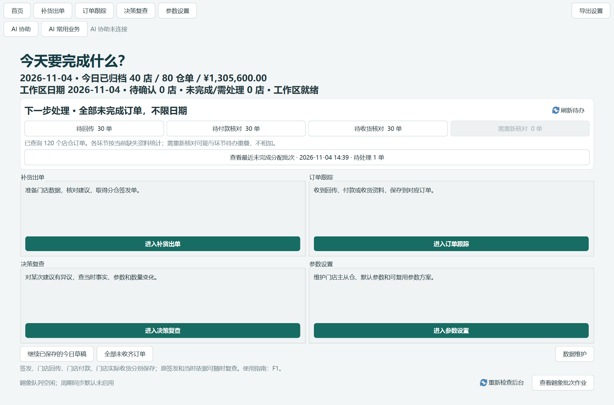
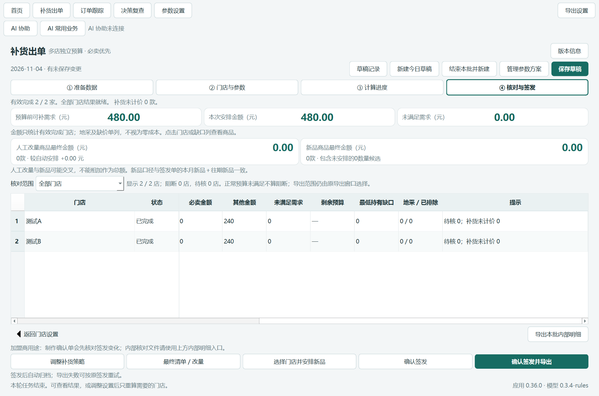

# 0.36.0 rc1 业务待办与核对

日期：2026-11-04。结论：本轮业务界面整理、独立对照及本机实际 EXE 验证通过，可以试用。AI 连接问题和自然语言客户端验收按用户要求暂缓，未宣称修复 WorkBuddy 的 `NOT_CONNECTED`。

## 交付与版本

- 分支：`feat/business-flow-acceptance-0.36.0`。本地提交，不推送、不合并。
- 固定基线：`35b33de022be33958ec57851f722130feb328d7a`（0.35.1）。
- 构建源码：`6d178bc751061010f7387d96c47bbffa10568a58`，从 Git archive 独立构建，未叠加工作区文件。
- 应用 0.36.0；模型 0.3.4-rules，仓归属 0.5.1，参数/作业/存储格式 3/1/2 不变。
- EXE：`交付_0.36.0_rc1/补货助手/补货助手.exe`。
- ZIP：`交付_0.36.0_rc1/补货助手_0.36.0_rc1_业务待办与核对.zip`，共 1,221 个文件，CRC 和逐文件哈希通过。
- EXE SHA-256：`6e97b246a6464aad6fcd94c19f02ac78b35c6acd203abd1b73dde48417a1f0be`。
- ZIP SHA-256：`d3d44b396cea9333e772f5e19b51894a59b3beb2d9e0c54f0da66b4dc69360ec`。

源码提交与发行证据提交分开；本地标签 `v0.36.0-rc1` 定位发行证据。旧 0.35.1 rc1 保留，未替换日常运行目录。详见 [包记录](package.json)、[全文件清单](files.json)。

证据提交另将封包工具生成 JSON 的换行统一为 LF，防止 Windows 换行被 Git 标为尾部空白；不修改应用源码、包内文件或已验证业务值，运行包仍绑定上述构建提交。

## 实际完成

1. 首页增加全日期待回传、待付款核对、待收货核对、需重新核对及最近未完成分配批次。查询有进度，可取消重查；仅投影现有单据状态。
2. 准备页折叠首次连接与历史兼容维护；步骤②折叠完整参数维护，保留日常门店、主从仓、预算及逐店实际参数入口。
3. 核对页增加阻断/待核/完成筛选，固定门店与状态列；正常预算缺口不误标阻断，展示筛选不修改结果或导出范围。
4. 生命周期空列表说明范围及原因；下一环节继承所选或固定订单，清空日期筛选不会解除限定订单。
5. 补齐独立组合验证、旧/新严格业务对照、包含商品原件 BLOB 的备份恢复、性能记录，以及实际 Windows EXE 验证。
6. 定向纳管既有空白采购模板测试夹具，固定原哈希，没有修改原测试预期；从本次 Git 归档副本运行翱象组件测试全部通过。
7. 按用户提供的真实已完成采购单补验原件解析、差异、隔离实收入账、幂等与终止监控。

实现索引见 [操作与结构说明](../../../docs/0.36.0业务待办与核对.md)。核心变化为 `business_flow.py` 的只读投影与 `business_flow_ui.py` 的控件组合，调用原 `HistoryReader`、`daily_batch`、`StageDialog` 和导出服务。

## 业务等价与回归

| 检查 | 结果 / 证据 |
| --- | --- |
| 全部 Python 回归 | **754 / 754**，206.986 秒；[原始日志](full-tests.txt) |
| 新界面与范围专项 | **13 / 13**；其中 144 种日期×仓×锁×搜索×环节组合；[专项日志](scope-tests.txt) |
| 翱象组件干净源码副本 | **163 / 163**，无跳过；[日志](clean-component-tests.txt)，原空白模板固定哈希未改 |
| 修改前后业务 | **33 场景、5 份 Excel，差异 0**；[完整对照](equivalence.json) |
| 备份与格式往返 | 60 份签发、1 份工作快照，全部 SQL 业务行及解码值一致；原件字节也比较；[报告](storage-roundtrip.json) |
| 取消 / 损坏 / 覆盖 | 冷索引取消可重查；格式转换取消不发布输出；损坏块拒绝发布；已有目标拒绝覆盖 |
| 数据保护 | 冻结输入、旧交付及用户数据库等 **3,618 文件**无变化；3 份明确更新的说明文档单列；[基线](baseline.json) |

对照包含真实 14,244 行输入、多文件顺序、重复与冲突、双仓、参数、自定义方案、计算中间值、候选/执行数量金额、预算、例外、排除及审计字段。全部按原记录及字典顺序比较，保留类型、空值、0、空字符串差异；没有按商品重新排序、放宽浮点容差或删业务字段。

仅排除原有精确动态项：`loaded.loaded_at`、`result.created`、`result.task.pid/started/finished`、`result.version.version/source_commit/build_id/built_at`。Excel 仅按 `structure_oracle.excel_snapshot` 的既有位置归一化时间/构建单元格，其他工作表、行列、单元格值、类型、格式和样式严格比较。没有新增宽泛白名单。

`model.py / allocation.py / one_box_exception.py / default_config.json / default_must_sell.json / normal_orders.py / normal_exports.py / order_lifecycle.py` 修改前后 SHA-256 相同，详见对照报告；业务算法与导出实现未改。

## 实际 EXE

同一候选程序在 Windows 图形环境运行，未用源码启动代替：

- [常规窗口报告](exe-rc1.json)：1360×900 逻辑尺寸、150% 缩放；60 店、120 店仓订单、12,000 条合成签发行。
- [较窄窗口报告](exe-narrow-rc1.json)：1080×720 逻辑尺寸、150% 缩放；实际窗口达到该尺寸，页面截图已检查。
- [参数专项报告](exe-parameters-rc1.json)：批量设置取消/确认、单店恢复通用默认、完整 Excel 导入、全局映射、预案保存重读采用、恢复旧作业、新作业带默认、双店实际 Windows spawn 计算。

业务检查覆盖首页状态对照、取消后重查、维护折叠、双店计算、固定列、阻断筛选、跨页勾选恰好导出两份签发、筛选变化清除勾选、固定订单范围保持、无记录说明、正常关闭与子进程退出。下一环节按钮的范围传参用测试替身断言；实际环节页则独立打开并查询，未把替身检查说成整个下游人工流程已操作完成。

常规 EXE 四次异步查询耗时 0.588 / 0.175 / 0.241 / 0.201 秒；查询阶段 25ms UI 心跳最大间隔 52ms。整个 QA 脚本最大间隔 1.991 秒包括同步夹具、对照及截图，不能混称日常操作无卡顿。参数验收全脚本最大 1.797 秒同理。





## 性能

同机 Windows 11、CPython 3.12.14、锁定依赖；60 店/120 仓单/12,000 条合成签发行，相同数据库。旧新 **AB / BA / AB** 串行，各 3 次。未同时运行新旧，也未同时构建或跑回归。Windows 文件缓存未清空，“冷”仅指独立的新应用索引。

单位秒；括号为最小～最大。所有原始值在 [performance.json](performance.json)。

| 操作 | 基线中位数（范围） | 新版中位数（范围） |
| --- | ---: | ---: |
| 归档查询，冷索引 | 1.482（1.395～1.511） | 1.353（1.352～1.413） |
| 归档查询，热索引 | 0.177（0.176～0.206） | 0.171（0.166～0.178） |
| 订单跟踪，冷索引 | 1.496（1.444～1.933） | 1.530（1.433～1.655） |
| 订单跟踪，热索引 | 0.142（0.131～0.230） | 0.154（0.139～0.208） |
| 首页所用服务组合，冷索引 | 1.951（1.612～2.025） | 1.793（1.726～2.025） |
| 首页所用服务组合，热索引 | 0.186（0.124～0.199） | 0.153（0.133～0.205） |
| 上述全部查询含进程启动总耗时 | 6.223（5.669～7.120） | 5.994（5.757～6.315） |
| 服务进程峰值内存 MiB | 40.09（39.68～41.16） | 39.79（39.72～40.31） |

没有发现数量级退化；有快有慢，波动区间重叠，不宣称优化后统一提速。旧首页没有这项待办：基线“首页”一行是原服务的等价组合，并不是旧首页启动时间。新版自动查询会增加后台工作及一个读取进程。内存是 Windows `GetProcessMemoryInfo.PeakWorkingSetSize` 的服务进程历史峰值，不是完整 GUI 进程树，也不是固定间隔采样，不能据此推断整个软件 RAM 降低。

## 真实翱象完成单

核验 `PO202610311151281572`（郓城店、山东供应商）。复用已登录正常 Edge，一次授权连接完成精确查询、两类原生导出及下载；没有提交采购、修改状态或登记平台收货。

| 项目 | 真实原件结果 |
| --- | ---: |
| 主单 / 子单状态 | 均为“已完成” |
| 采购 SKU / 原始子单行 | 259 / 259 |
| 采购基础数量 / 金额 | 1836 / 6318.13 元 |
| 实收基础数量 / 金额 | 1829 / 6238.89 元 |
| 少收商品 | 6 款，合计少 7 个基础单位、79.24 元 |

两个原任务号、原件哈希和验证结论见 [completed-receipt.json](completed-receipt.json)。原件保留在本机 `qa/v0360/aoxiang-completed-live`，不入 Git 和发行包。

用这些真实原件在隔离库验证正式实收适配：全部商品顺序、基础数量、金额与原件一致；重复同步仍为同一版；原签发、回传、付款不变；主子原件及观察快照完整存档；完成后禁用常规监控，重启调度也不再入队。平台未提供准确完成时间，保持空值，仅保存观察时间。

**边界**：该历史 PO 没有本应用原付款关联，QA 上游签发/回传/付款依据是明确由原件重建的测试参考。不是正式历史关联成功，也不是一次真实建单到收货的连续验证。28 张候选只抽取 1 张，未声称全测。

## 复跑

仓库根目录执行；以下目录须为新的，验收数据不得指向日常资料库。Python 路径为本机已锁定环境；其他机器应按 `requirements-win-amd64.lock` 准备同依赖。

```powershell
$py = '.\qa\v0350\locked-venv\Scripts\python.exe'
$env:PYTHONIOENCODING = 'utf-8'
$env:QT_QPA_PLATFORM = 'offscreen'
& $py -m unittest discover -s tests -v
& $py tools/verify_business_flow_release.py freeze --qa qa/replay0360
& $py tools/verify_business_flow_release.py before --qa qa/replay0360
& $py tools/verify_business_flow_release.py after --qa qa/replay0360
& $py tools/verify_business_flow_release.py compare --qa qa/replay0360
& $py tools/benchmark_business_flow.py --out qa/replay0360-performance
& $py tools/business_flow_fixture.py --out qa/replay0360-exe --stores 60 --products 200
& $py tools/verify_storage_maintenance.py --source qa/replay0360-exe/settings/workbench.sqlite3 --output qa/replay0360-storage
$env:REPLENISHMENT_DATA_DIR = (Resolve-Path qa/replay0360-exe/settings).Path
$env:QT_QPA_PLATFORM = 'windows'
& '.\交付_0.36.0_rc1\补货助手\补货助手.exe' --business-flow-acceptance (Resolve-Path qa/replay0360-exe).Path
# 另一独立夹具目录下用 --parameter-workspace-smoke 运行参数专项。
& $py tools/verify_completed_receipt_replay.py --live qa/v0360/aoxiang-completed-live --out qa/replay0360-receipt
```

性能脚本基线固定为 `qa/v0360/baseline`；另机复跑前先执行该目录的 freeze，或保持相同冻结副本。真实 PO 查询脚本 `tools/verify_aoxiang_completed.mjs` 为显式选择运行，查询后须核对其 `query.json` 中店码与日期，再写 `command.json` 发起原生导出；不可因重试而盲目新建导出。离线重放只使用已保存原件，不再访问平台。

构建命令：`tools/build_from_commit.py --commit 6d178bc751061010f7387d96c47bbffa10568a58 --build-id <新的编号>`。封包门槛在 `tools/seal_business_flow.py`，默认针对本轮固定 QA 与 rc1 路径，拒绝失败报告及覆盖旧输出。

## 试用重点与剩余边界

业务人员可检查：从首页进入对应待办；展开/收起维护区；步骤②看实际参数；步骤④筛选失败/待核并横向滚动；跨页勾选两单只导出两单；环节页清空筛选仍保持原限定订单。

AI 连接及自然语言客户端验收暂缓，已有两份试验脚本和失败记录保留但未计为通过。新版本第二台机器、读屏/对比度、业务人员主观体验及完整真实连续闭环未完成；没有当前可用环境就不以本机合成结果替代。首次索引成本仍存在，进度可见、可取消；本轮未修改存储格式，也未增加自动网页下单功能。

验收过程中两次 UI 夹具错误（未创建导出目录、过早读取查询状态）及旧存储验证脚本不识别原件 BLOB 已修正，原失败记录保留在本机 QA。实收重放的首次夹具十进制文本序列化错误按现有采购包规则修正，未改业务适配或测试预期。
