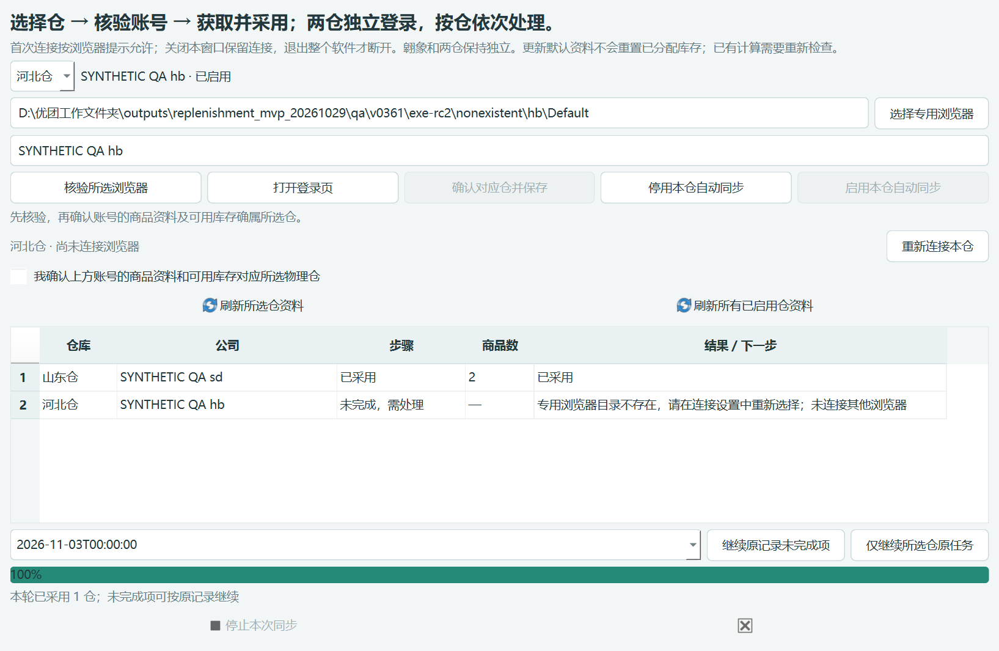

# 0.36.1 rc2 浏览器连接保留

2026-11-04。已完成本地开发、严格业务对照、实际 EXE 和隔离真实 Edge 验证。可试用 rc2；旧 0.36.0 保留。未推送、未合并。此次减少软件主动断连引起的重复许可，不承诺浏览器永久免授权。

## 版本与交付

- 分支：`fix/browser-session-retention-0.36.1`。
- 固定基线：`2487601d9a3d5830704f4dbab8e6dc56961a1fd4`，0.36.0 main。
- 连接实现提交：`d11747acb95207b0ee1108a0e51622595aa93aac`。
- 最终构建源码：`f3a85360452099a42909f2e8748c605a39668172`；从干净 Git archive 构建，无工作区叠加。第二次提交仅修正旧验收脚本及候选记录，应用业务实现未再次变更。
- 本地证据标签：`v0.36.1-rc2`，指向发行证据提交；与构建源码提交分开。
- 应用 0.36.1；模型 0.3.4-rules、仓归属 0.5.1、参数/作业/存储格式 3/1/2 不变。
- 启动文件：`交付_0.36.1_rc2/补货助手/补货助手.exe`。需保留整个文件夹，不能只复制 EXE。
- ZIP：`交付_0.36.1_rc2/补货助手_0.36.1_rc2_浏览器连接保留.zip`，1,224 文件，CRC 与逐文件 SHA-256 核对通过。
- EXE SHA-256：`fed26ccfb61008edcf749eda20974f612bd7bde5e3fa7bc8d873d66799adad7d`。
- ZIP SHA-256：`796d0a4aaaea6557a75fdf18ab3de9965bf33edd8939b503ea048b6b0d82f3c3`。

完整清单：[package.json](package.json)、[files.json](files.json)。构建过程在本机 `build_0.36.1_rc2/build.log`。

## 改了什么

1. 聚水潭 Node 组件改由主窗口持有；默认商品资料和分配库存窗口只借用独占操作权。关闭业务窗口继续保留组件及两仓健康连接。
2. 两仓分别检查浏览器连接和作业标签是否仍可用。增加本仓状态及“重新连接本仓”；重连只核验当前仓，不自动重发导出或重新采用资料。
3. 关闭正在同步的窗口或整个软件时先请求停止，等待安全交接；组件未空闲或响应未知时不放出第二个执行者，不强杀正在提交的进程。
4. 正常退出主软件释放组件和本程序拥有的标签；不关闭用户浏览器或用户原有标签。
5. 翱象保留现有跨模块共享连接；两仓仍使用各自专用浏览器，与翱象正常浏览器隔离。

代码查找、使用步骤与关系图见 [浏览器连接保留](../../../docs/0.36.1浏览器连接保留.md)。没有更改模型、预算、箱规、库存、价格、任务恢复判定、采购上传或收货同步业务规则。新增 `connections` 只是组件运行态响应，不写入业务快照，不扩大业务指纹忽略字段。

## 验证结果

| 范围 | 结果 | 证据 |
| --- | --- | --- |
| Python 全回归 | 764 / 764，193.563 秒 | [原始日志](python-tests.txt) |
| 聚水潭组件 | 39 / 39，无跳过 | [原始日志](jst-tests.txt) |
| 翱象组件 | 163 / 163，无跳过 | [原始日志](aoxiang-tests.txt) |
| 新旧业务结果 | 33 场景 + 5 份 Excel，差异 0 | [逐场景对照](equivalence.json) |
| 原资料保护 | 3,597 个冻结输入、旧交付及用户数据库文件无变化；README 修改单列 | [基线与核心哈希](baseline.json) |
| 聚水潭实际 EXE | 通过，正常退出，真实组件进程已结束 | [EXE 报告](exe-ui.json) |
| 翱象实际 EXE | 通过；四个窗口共用 PID 36168；0 遗留子进程 | [窗口报告](exe-aoxiang.json)、[共享记录](exe-aoxiang-shared.json)、[进程采样](exe-aoxiang-process.json) |
| 源码与随包真实 Edge | 两份隔离配置，连接复用与单仓恢复通过 | [源码](browser-source.json)、[随包组件](browser-bundle.json) |

Python 全回归在连接实现完成后运行。随后只修正可选 EXE 验收脚本的提示框拦截位置，并重新执行该脚本、最终业务对照和 rc2 EXE 验收；没有将旧 EXE 报告用于 rc2。

业务对照严格保留值、Python 类型、字段/商品/门店顺序、空值与 0。Excel 对比工作表、行列、单元格值和类型、格式及样式。精确动态白名单沿用：`loaded.loaded_at`、`result.created`、`result.task.pid/started/finished`、`result.version.version/source_commit/build_id/built_at`；Excel 仅按既有 `structure_oracle.excel_snapshot` 指定单元格归一化时间与构建值。没有扩大容差、重排记录或忽略整块元数据。

`model.py / allocation.py / one_box_exception.py / default_config.json / default_must_sell.json / normal_orders.py / normal_exports.py / order_lifecycle.py` 修改前后哈希相同，详见基线报告。

## 实际程序与浏览器检查范围

聚水潭 EXE 使用合成已下载任务，经过真实 Node、EXE 校验子进程和隔离数据库采用。检查立即停止、继续原任务、失败仓不采用、不影响另一仓、关闭重开窗口仍用原 PID、分配库存入口复用、已成功仓不重复处理、不同用途不串任务、主软件运行中关闭先停止再退出，以及 Qt 心跳持续运行。没有调用真实平台导出。

翱象 EXE 检查超时后的单次提示和停止轮询、异常重连恢复，以及核验窗口 → 获取建议 → 收货选择 → 再开获取建议，共用同一 Node 进程。超时为明确模拟；组件启动、窗口、进程与退出为真实操作。50ms 采样的子进程记录显示退出后无遗留；UI 心跳最大间隔约 115ms，不能外推真实网站操作耗时。

真实 Edge 使用独立临时配置与本机页面，版本 `Edg/156.0.4314.58`。两仓首次各连接一次，此后各连续复用三轮，仍只有两次初始 CDP bind。主动重连山东仓增加一次绑定；关闭山东作业标签后的恢复再增加一次，河北始终保留。结束后两仓原有页面都还在，本程序标签已清理。随包与源码分别执行，结果一致。



## 修正过的验证问题

- 首轮源码 UI 暴露新 SessionLease 缺少下载根目录属性，导致采用失败。已补齐同一绝对目录契约及回归，源码、rc1 与最终 rc2 实际采用通过。[原失败](development-interface-failure.json)
- 无头 Edge 不支持现有“同实例打开绑定标签”的完整流程，首次隔离浏览器验证未通过。改用最小化真实 Edge，生产绑定校验未放宽，两轮通过。[原限制](development-headless-limitation.json)
- 旧翱象验收脚本拦截 `QMessageBox.warning`，而当前界面使用 `readable_ui.failure`，导致其故意模拟的超时未被测试接收。仅将测试拦截移到当前函数，并严格只接收该模拟超时，其他错误仍失败。rc1 因此不交付；重新构建 rc2 验证通过。[rc1 原失败](development-old-fixture-failure.json)

## 复跑与试用

完整命令见 [说明](../../../docs/0.36.1浏览器连接保留.md)。核心入口为 `tools/verify_connection_retention.py`、`tools/verify_catalog_sync_ui.py`、`tools/verify_browser_connection_retention.mjs`。翱象 EXE 可用：

```powershell
& .\qa\v0350\locked-venv\Scripts\python.exe tools/verify_aoxiang_exe.py --exe '交付_0.36.1_rc2/补货助手/补货助手.exe' --output qa/replay0361-ax --runs 1
```

输出必须是新的隔离目录。构建：`tools/build_from_commit.py --commit f3a85360452099a42909f2e8748c605a39668172 --build-id <新编号>`。本轮封包脚本 `tools/seal_connection_retention.py` 只针对固定 rc2 及本次 QA，拒绝覆盖已有包。

试用时先退出旧应用，再启动新目录内 EXE。按首次提示允许连接后，保持主软件和浏览器开启，关闭商品资料窗口再重开；正常操作不点“重新连接本仓”。主软件退出、浏览器重启、作业标签关闭或连接中断后仍可能要求再次授权。

没有测试生产账号许可弹窗跨任务实际次数、跨日/休眠稳定性或第二台机器。本次真实浏览器验证证明连接确实复用，不证明 Edge 永久授权；未访问生产平台、未新增导出/采购/收货任务。AI 客户端连接问题仍按用户要求暂缓。
