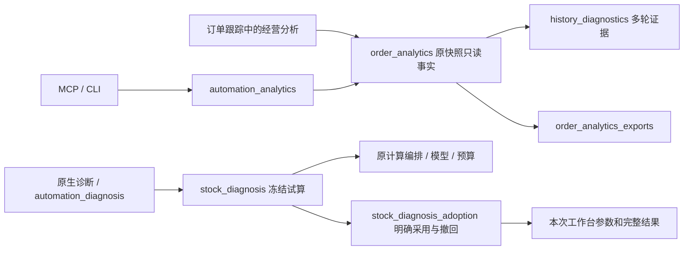

# 0.39.0 rc2：经营分析与安全库存诊断

日期：2026-11-05。状态：本地候选交付，未推送、未合并。原模型规则、原生命周期及旧导出保持；新增分析与明确确认后采用本次试算。

## 交付物与版本对应

| 项目 | 值 |
| --- | --- |
| 基线 | `efb85bf2c532daa5e1ffed9ca6e0ec323009b359`，应用0.38.1 |
| 开发分支 | `feat/business-analytics-0.39.0` |
| 构建源码 | `702d01364035935c6b2abd5283d204b8e271ec57` |
| 构建方式 | 固定Git归档；无工作区覆盖；锁定浏览器组件收集 |
| 应用 / 模型 / 仓归属 | `0.39.0 / 0.3.4-rules / 0.5.1` |
| 参数 / 作业 / 存储格式 | `3 / 1 / 2`，未迁移 |
| 本机程序 | `D:\优团工作文件夹\outputs\replenishment_mvp_20261029\交付_0.39.0_rc2\补货助手\补货助手.exe` |
| ZIP | `交付_0.39.0_rc2/补货助手_0.39.0_rc2.zip` |
| EXE SHA256 | `f6494b35c3485123b83e4309e8ec50625478e66714803937429d6031e5e988e8` |
| AI接口 EXE SHA256 | `8882291cdee48a370b4b906fc0ea1b3b953708d662e4a095cee8316e0119b61b` |
| ZIP SHA256 | `2db1a8426393565e746cbb1e4a89b315cd243845365f96ebdddd09a3ee23ee8e` |
| 交付清单 | 1231个文件；逐文件哈希及ZIP解包内容一致 |
| 本地证据标签 | `v0.39.0-rc2`，指向包含本报告的证据提交；与构建提交分别记录 |

0.39.0 rc1为中间构建，试用选rc2。旧0.38.1及此前交付目录未覆盖。完整解压运行，不单独复制EXE。使用步骤见[业务使用指南](../../../docs/0.39.0业务使用指南.md)。

## 本次实际完成

| 阶段 | 内容 | 状态 |
| --- | --- | --- |
| 口径冻结 | 原签发快照、虚拟分类原件、必采依据、五段有效性和统一签发价 | 完成 |
| 原生分析 | 独立入口、必采/非必采并列、店/仓/订单/商品下钻、待核、分页、筛选、常用视图、全量导出 | 完成 |
| AI/CLI | 共享查询和导出服务，分页、操作键幂等、绑定快照、旧结果拒绝 | 完成 |
| 多轮复盘 | 最近8轮默认、1～30轮可选、跨仓SKU证据链、执行减量与参数疑点分开、重复缺货及偏高库存观察 | 完成首期表格证据能力 |
| 受限调参 | 固定当前依据、分类概率小档、最多2候选、整店预算重算、完整比较、明确采用、失败回滚、受限撤回与审计 | 完成首期概率诊断 |

分阶段源码提交：`897b3d2`分析基础、`9245df3`AI与多轮、`315b8cb`概率诊断及审计、`702d013`包内接口验收与使用指南。方案纳管提交为`0e38b87`。

### 业务口径

- 五段为模型自动建议（含启用例外、总预算前）→最终签发→有效门店确认→有效付款数量→有效实收。仅生成/导出聚水潭文件不算实际下单。
- 模型有量、签发0的记录保留；下游新增商品不伪造模型量。未导入/上游失效/关键待核不当0。已确认完整单据的缺行沿用既有0语义。
- 必采来自当时必卖清单；无清单依据为属性待核。历史商品原件按已保存哈希读取，使用实际`虚拟分类`字段核对标杆淘汰及已验证括号分类，不能笼统匹配“淘汰”或用`商品标签`冒充。
- 门店禁采/拒收/准入拦截、对应仓禁用及明确淘汰，整条商品五段统一排除；待核单列，不纳入已核统计。当前资料不回填历史。
- 各段统一签发价；实际付款行金额及原单金额另列并保留币种。相邻变化只比相同有效且有价集合，增加、减少、净差分开；零分母不产生百分比。
- 历史轮次按不同签发业务日，跨仓保留来源；同日多仓同SKU有歧义时停止数量归因。月销不能相减生成期间销量；实收不证明准时到货。
- 候选只改变分类`probability`；预测权重、保护期、库存上限、预算、必卖、箱规、仓路由和准入固定。采用只改当前作业，不自动保存或签发。采用后保存/签发/再编辑会阻止旧撤回覆盖新工作。

## 验证证据

| 检查 | 本次结果 | 证据与限度 |
| --- | --- | --- |
| 全部Python回归 | **854项通过，283.278秒** | [完整日志](全部回归.log.txt)；包括原生命周期、预算、路由、取消等原套件。不是854笔真实订单 |
| 旧四段导出适用回归 | 14项通过，包含值/类型/格式/顺序 | 最终全套包含；旧服务文件未改 |
| 冻结新旧计算对照 | **差异0**，字典字段顺序/类型/值及列表顺序递归严格比较 | [性能与严格对照](性能与严格对照.json)；2店各2商品合成、10元预算、2进程，不能代替真实全量SKU验收 |
| 核心业务文件 | **6份SHA与基线完全一致** | [交付核验](交付核验.json)：model、allocation、一箱例外、默认配置、旧生命周期比较、签发导出 |
| 原生/AI新报表 | 值/类型/工作表、行列顺序、样式相同 | `test_automation_analytics`本轮用例；只允许统计口径页生成时间不同 |
| 历史与准入 | 禁采/禁用/淘汰排除、未知标签、缺原件/清单、0/缺行/未导入、历史不回填、多轮跨仓/单位歧义 | 新增纯逻辑与Qt测试；测试不写日常库 |
| 诊断与采用 | 参数实际生效、固定预测字段、完整候选、风险门槛、过期拒绝、回滚/撤回、原默认不变、草稿及签发审计保存 | `test_stock_diagnosis`8项通过 |
| 实际EXE原生流程 | **通过，frozen_exe=true** | [EXE原生验收](EXE原生验收.json)，6000条合成；原生查询、三级下钻、8表导出、停止/重试、双进程试算、采用审计/撤回/关闭 |
| 实际EXE接口 | **19组检查通过，22个工具** | [EXE接口验收](EXE接口验收.json)；包内AI桥接进程真实stdio，含查询/试算、两个客户端、取消/重试、锁异常恢复、旧结果拒绝和只读保护 |

精确新旧对照白名单仅：结果顶层`created`、`task.pid`、`task.started`、`task.finished`、`version.version`。模型/仓归属版本仍比较；没有删业务字段、金额或改变浮点容差。

新字段只有采用后的`stock_diagnosis_audit`及分析服务自己的结果。诊断审计中的Decimal以精确文本编码，原数量/金额类型保持。未采用时不修改正式结果；历史快照不回写。

EXE测试是实际打包程序中的自动Qt交互及独立stdio进程，截图见[经营分析](经营分析.png)、[商品漏斗](商品漏斗.png)、[安全库存诊断](安全库存诊断.png)。不是业务人员手工验收，也不是外部Codex/WorkBuddy自然语言成功率测试。主窗口25ms心跳920次，最大相邻间隔0.219秒。

完整套件结束期间有5条浏览器状态QLabel销毁后回调告警，另有用例主动制造的数据库锁、数据过期及合成失败日志。全部断言通过，但不将日志称为无告警；本轮两个EXE测试进程未出现该Qt告警。这项清理告警未在本轮修复。

## 性能

同机同环境，所有测量逐个运行；基线与新查询交替，至少3次，完整原值随JSON交付。12店×500商品为**合成**规模，不冒充真实业务。旧四段与新五段工作量不同，不能称为同功能提速。

| 操作 | 中位秒 | 最小～最大秒 | 采样峰值MB |
| --- | ---: | ---: | ---: |
| 旧四段查询 | 0.338 | 0.335～0.349 | 120.3 |
| 新五段查询（后台服务） | 0.566 | 0.563～0.586 | 126.1 |
| 新8表完整导出 | 5.612 | 5.576～5.615 | 131.2 |
| 新进程查询，包含模块导入 | 1.357 | 1.316～1.360 | 187.4 |
| 原生查询直到界面可用 | 3.365 | 3.037～4.224 | 114.3 |
| 筛选单店直到界面可用 | 2.868 | 2.432～3.139 | 111.3 |
| 同一报告历史投影 | 0.043 | 0.040～0.044 | 114.6 |
| 门店→仓→订单下钻并返回 | 0.016 | 0.016～0.019 | 114.6 |
| 2店各2SKU，基线+2候选完整试算 | 6.187 | 5.971～6.717 | 204.6 |
| 采用完整候选 | 0.030 | 0.025～0.032 | 117.9 |
| 撤回采用 | 0.022 | 0.021～0.023 | 117.9 |

前三行：每30ms采样主进程Windows工作集，包含解释器；这几个服务无子进程。其余：每30ms取主进程及实时后代工作集总和，最多采到3进程，包含试算spawn与冷查询解释器。共享页可能重复计入、瞬时峰值/短命进程可能漏采。两组不同独立进程，不可把它们内存值相减当作优化收益。未清空OS文件缓存，新进程不等于冷盘。试算规模主要测编排及spawn开销，未证明大门店吞吐。实际EXE只报告本次流程通过和心跳，不把源码三次性能值冒充EXE计时。

## 复跑

在项目根目录、已有锁定Python环境执行；各输出目录必须不存在：

```powershell
.\.venv\Scripts\python.exe -B -m unittest discover -s tests -v
.\.venv\Scripts\python.exe -B tools/verify_analytics_0390.py --output qa/0390_model_and_performance_NEW
.\.venv\Scripts\python.exe -B tools/benchmark_analytics_interactions_0390.py --output qa/0390_interactions_NEW
.\.venv\Scripts\python.exe -B tools/verify_analytics_exe_0390.py --exe '交付_0.39.0_rc2/补货助手/补货助手.exe' --output qa/0390_native_EXE_NEW
.\.venv\Scripts\python.exe -B tools/run_automation_ui.py --exe '交付_0.39.0_rc2/补货助手/补货助手.exe' --out qa/0390_stdio_EXE_NEW
```

构建：`tools/build_from_commit.py --commit 702d01364035935c6b2abd5283d204b8e271ec57 --build-id <新编号>`。封存：`tools/seal_analytics_0390.py`，明确传入`--qa --delivery --release --zip`；工具核对EXE构建、回归、对照、保护文件和ZIP逐文件内容，任何输出已存在即拒绝。新编号需要匹配相应EXE证据，不能套用本次旧报告。

本地完整QA目录：`qa/analytics_0390_20261105`。其中包含合成数据库、冻结输入、源码基线归档、首次失败和修正后日志；Git只保存可公开的验证脚本、报告及合成截图，不加入业务原件、用户库或凭据。

## 结构与后续边界



- 未签发作业仍在原核对页及本次诊断查看，没有纳入历史订单漏斗；不为分析制造假签发。
- 多轮是离散证据表，无新增趋势图、连续库存回测或自动认定缺货原因。
- 已有人工改量/新品安排的门店暂拦截概率试算采用链路，不清除后声称节省。只支持整候选，不能拼凑不同候选SKU。
- 查询持有当前范围事实，原件按SHA有界缓存；大量历史建议按日期分段。未验证真实全历史库、新机、冷盘或长时间使用规模。
- 缺历史虚拟分类/原件/必采依据，展示待核；未宣称真实历史均可得到完整漏斗。当前分析不修改历史。
- 轻量过期检查按业务日期保守核对，其他门店同日期更新也可能提示重查；不会静默替换正在看的快照。
- 本轮未连接真实平台、未解决暂缓的外部AI连接或自然语言验收；不改变平台写权限，不自动签发/采购/改默认。
- 1231文件和ZIP哈希证明包完整性；单机打包成功不等于新机器或逐字节可复现构建。

业务试用建议：选一笔生命周期资料齐全的历史单，核对五段及必采分组，导出后对照原单；再选一个没有人工/新品安排的当前门店运行诊断，先看资金与缺口，再明确采用/撤回。正式签发仍走原流程。
