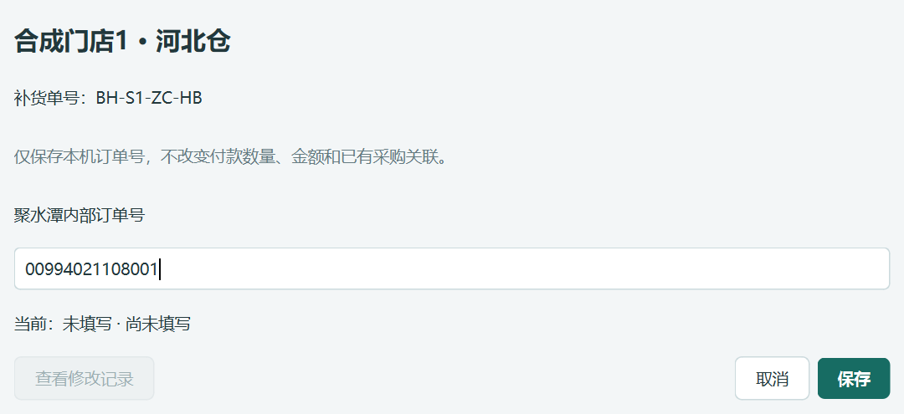
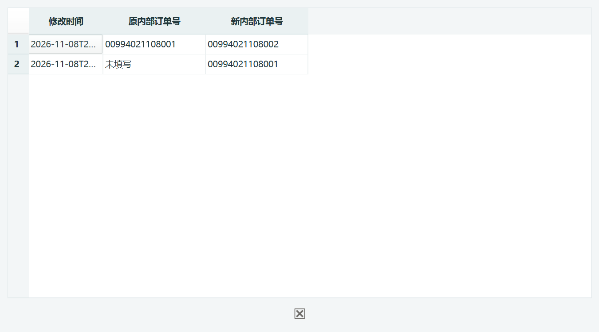

# 0.49.2 rc1 交付报告

订单详情新增“维护聚水潭内部订单号”。直接填写或修改后保存；原付款文件有号时带出，修改历史可查看。无文件导入、企业选择或自动认单步骤。

## 使用与范围

订单跟踪 → 查看订单详情 → 单据与依据 → 维护聚水潭内部订单号 → 填写 → 保存。已确认付款的订单可用，已有采购或收货也能维护。

只写当前仓单的本机号码登记与修改事件；沿用已有生命周期存储表。付款版本、原件、数量、金额、库存分配及已有采购收货依据均不改写。付款识别代码、模型、预算、默认参数、主从仓归属及平台组件均未改变。手工维护的号码不自动改写历史付款文件，也不改变付款自动认单规则。

## 验证

- 全量回归 1317 个独立测试通过，用时 463.524 秒。
- 单号专项 12 项通过：填空、更正、同店两仓隔离、收货后补号、并发修改、删除/失效身份、取消、写入中途失败回滚及重复保存。
- 源码与实际EXE各 17 项界面验收通过；启动不加载维护模块，打开订单入口后按需读取。实际点击入口、填写、保存、重开、更正、取消、空值提示、重复保存与修改记录均验证。
- 隔离样本逐表验证签发、付款、收货、原文件及库存分配完全相同；未调用真实平台，未写本机日常业务库。
- 15 个受保护核心文件与 42 个旧交付EXE/ZIP哈希不变。平台组件无变动，本轮未重跑Node测试；未做性能测量或低配电脑实测。既有QLabel销毁后回调问题不在本次修改范围。

## 交付与追溯

- 应用0.49.2；模型0.3.4-rules；存储格式2。
- 分支：feature/payment-reference-maintenance-0.49.2。
- 不可变构建源码提交：7d0ab0131fd35e32c7614ec631d63f5f059852ea。
- EXE：交付_0.49.2_rc1/补货助手/补货助手.exe。
- ZIP：交付_0.49.2_rc1/补货助手_0.49.2_rc1_内部订单号维护.zip。
- EXE SHA256：3ce63e7d9057b147c4ce68a44753e133a0ed3db0c67be89126cd561f65adb274。
- ZIP SHA256：f9e377b10fd99269caf08ae313481111e21c03eacc1e34eaa05cec931d082a17。
- ZIP含 1248 个文件，解压内容逐文件校验通过；带图文使用说明。旧版本保留，未推送、未合并。

早期独立自动认单原型的18项测试日志保留在qa/payment_reference_0492/references1.log。该原型已按用户要求撤下，本交付以精简入口的12项专项和17项界面验收为准，不将早期结果计入验收。

