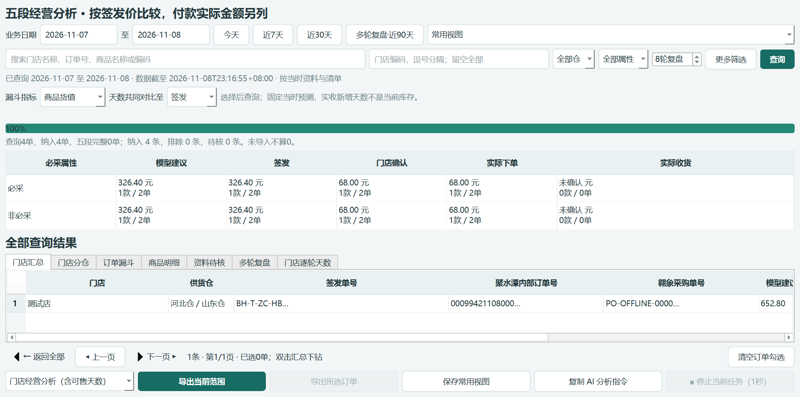
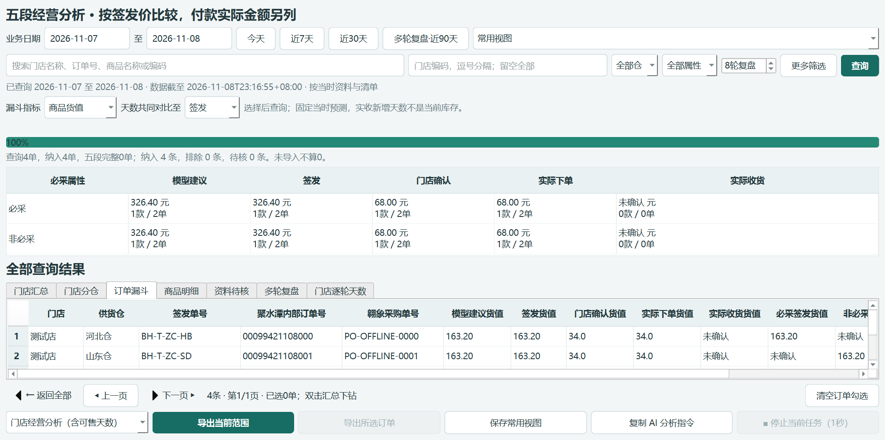

# 0.49.3 rc1 交付报告

门店经营分析在同一查询快照、界面和Excel中保留签发单号、聚水潭内部订单号、翱象采购单号。门店/分仓/订单视图都可查看；导出原42列后追加三列，并附“单号关联明细”。聚水潭本机维护值优先，未维护时取当前付款原表；翱象取本地已保存采购关联，按原订单身份、修订、仓及签发快照核对。没有在线查询或修改平台。

## 使用及业务边界

五段经营分析 → 查询 → 门店经营分析（含可售天数） → 导出当前范围。仅导出部分单时在订单漏斗中勾选，再点导出所选订单。

同店跨日、跨仓多单按签发单逐行对应；一张签发单多张采购单在明细中分别留行。未提供内部号、未取得采购号不补0或猜号；已作废保留原号和本机已留存状态。原付款版本变化的已关联采购号仍留存，并标记待复核。补号、关联或已留存状态变化后，旧快照标为需刷新，导出前后复核，避免混入新旧单号。

原五段数量、货值、比率、必采分组、排除规则及可售天数未改。导出前42列保持原位置、数值、类型和格式；新表45列，增加单号关联明细。分析只读本机资料，不迁移存储、不改变付款、采购、收货或模型规则。

## 验证与限制

- 全量回归1335个独立测试通过，用时484.318秒。
- 经营分析专项44项通过，包括16项新单号测试和2项新界面测试；原有指标、格式及AI/界面导出一致性检查保留。
- 源码和实际EXE各19项界面验收通过：两日同店两仓4张仓单，实际点击查询、全范围与勾选导出，检查45列和单号明细；核对文本类型、前导零、作废状态、旧快照失效、刷新及可售天数视图。
- 隔离查询和导出前后，业务库与翱象组件库哈希不变。读库仅提取关联元数据，未启动平台客户端或读取原生商品大表。
- 15个受保护核心文件、44个旧交付EXE/ZIP哈希不变；平台组件未改，本轮未重跑Node测试。
- 仅隔离合成案例，未接真实平台或改动日常库；未测低配电脑和大历史库资源占用，不宣称性能提升。既有QLabel销毁后回调问题不在本次修改范围。
- 该版同步新增功能图文教程；主新人手册仍保留其原版本及历史截图标注，不冒充全面换版。

## 交付与追溯

- 应用0.49.3；模型0.3.4-rules；参数/作业/存储版本3/1/2。分析快照标识funnel-2。
- 分支feat/analytics-order-identifiers-0.49.3。
- 不可变构建源码提交fa3bd028ad5aac3fd3ab8d80f5d4b5480eae3f4e。
- EXE：交付_0.49.3_rc1/补货助手/补货助手.exe。
- ZIP：交付_0.49.3_rc1/补货助手_0.49.3_rc1_经营分析单号关联.zip，126102166字节，1249个文件逐文件校验通过。
- EXE SHA256：899b5381170a1f6e943e186dad46f1ef750ed27204f7544027f5ca1fa13561e0。
- ZIP SHA256：6548492af92c37f3d8823f764feb887e0dd778a73407efb0d71ebf4a4d987dbb。
- 旧版保留，未推送、未合并。开发阶段测试夹具锁冲突日志保留在retained-development，不计为最终验收。

